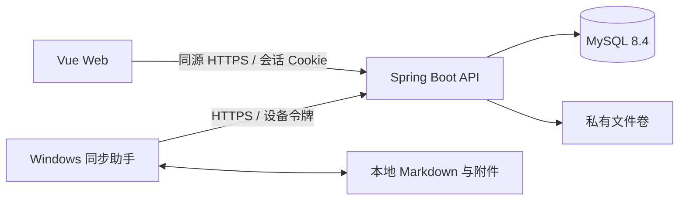

# 私有空间技术架构

版本：v1.0

确认日期：2026-10-27

状态：已确认，用于项目初始化与后续分阶段开发

## 1. 已确认范围

- 单用户、无公开注册，首版管理一个普通笔记库。
- 普通 Markdown 与附件在服务端和 Windows 本地目录均可读，不做端到端加密。
- 密码条目、安全笔记和自定义字段只进入浏览器端加密的保险库；服务端只保存密文和必要元数据。
- Windows 11 通过常驻同步助手实现关闭网页后的双向自动同步；macOS、Linux 和手机目录同步不属于首版。
- 保险库首版为在线 Web 使用并支持加密导入导出，不提供桌面离线保险库。
- 视觉采用浅色工具型界面与墨绿强调色，具体以 PRD 第 5 节为准。

## 2. 架构类型

采用单仓库、前后端分离、模块化单体和单机 Docker Compose 部署。



不引入微服务、Redis、消息队列、Kubernetes 或对象存储集群。后续只有在已有需求无法满足且经过确认时才增加基础设施。

## 3. 技术选型

| 层 | 选型 | 说明 |
| --- | --- | --- |
| Web | Vue 3、TypeScript、Vite | 使用官方 Vite 工程方式；编辑器在 M1 采用 CodeMirror 6 |
| 状态与路由 | Pinia、Vue Router | 按业务模块拆分，保险库解密状态不得泄漏到普通笔记模块 |
| Markdown | 成熟解析器与 DOM 净化库 | 禁用原始 HTML 执行并限制危险协议，具体依赖在 M1 锁定 |
| 服务端 | Java 17、Spring Boot 4.1.x、Maven | 模块化单体；根包名 `com.privatespace` |
| 数据访问 | MyBatis Spring Boot 4.1.x、Flyway | 显式 SQL 和可追踪迁移；不引入 MyBatis-Plus 的额外抽象 |
| 数据库 | MySQL 8.4 LTS | 保存账户、元数据、当前可检索文本、版本关系、密文和同步状态 |
| 文件内容 | 服务器私有文件卷 | 保存不可变文件版本与附件，数据库保存摘要及对象引用 |
| 同步助手 | Python 3.13 原型 | 使用 SQLite 持久化队列和基线；Windows 打包、凭据保护及托盘能力先验证 |
| 部署 | Docker Compose、HTTPS 反向代理 | 只暴露 HTTPS，数据库不直接暴露公网 |

依赖补丁版本通过锁文件或构建文件固定。升级依赖时执行对应测试，不依赖浮动的 `latest` 版本完成生产部署。

## 4. 源码职责

```text
frontend/
  src/
    app/                    应用装配、路由、全局主题
    modules/                note、vault、sync、settings 等业务模块
    shared/                 无业务归属的可复用组件和基础能力
backend/
  src/main/java/com/privatespace/
    modules/                auth、note、file、vault、sync、backup
    common/                 通用异常、常量与基础工具
    config/                 框架与基础设施配置
sync-client/
  privatespace_sync/        Windows 助手实现
database/migrations/        Flyway 迁移的唯一来源
deploy/                     本地 Compose 与后续生产部署配置
```

初始化阶段只创建运行、构建和验证必需的文件，不提前创建空业务分层或占位接口。

## 5. 数据与一致性

### 5.1 普通笔记和附件

- `Note/File` 保存稳定 ID、逻辑相对路径、类型、当前版本和删除状态。
- Markdown 当前文本可在 MySQL 中检索；每次已确认保存产生不可变版本。
- 历史版本和附件先写入私有文件卷并校验摘要，再在数据库事务中发布版本及变更记录。
- 同步内容以相对路径导出，不向 Markdown 强制写入系统专属 ID。

### 5.2 保险库

- 浏览器负责加密、解密和解锁后搜索；API 不接受字段明文。
- 服务端保存整体加密快照、格式版本、KDF 参数、受保护的数据密钥和条件更新版本号。
- 具体 KDF、AEAD、nonce、关联数据和格式迁移必须经过 M0 加密验证和专项设计审查后确定。

### 5.3 条件更新

- 普通内容写入携带对象基线版本、内容摘要和幂等操作 ID。
- 服务端仅在基线版本匹配时发布新版本；不匹配返回冲突，不自动覆盖重试。
- 变更日志使用服务端单调递增游标；删除使用墓碑，不以客户端时钟决定胜负。
- 保险库使用快照版本条件更新，旧版本提交被拒绝并保留本地加密草稿。

## 6. 身份和接口边界

- Web 使用受保护的同源会话 Cookie，启用 CSRF 防护、严格来源校验和接口对象级授权。
- 同步助手使用独立、限权、可撤销设备令牌，只能访问普通笔记同步接口。
- 登录口令、保险库主密码和设备令牌分别管理；登录不等于保险库解锁。
- 接口统一返回错误代码、操作 ID 和可执行提示，不在错误、URL 或日志中记录密钥、密码、令牌及私有正文。

## 7. 备份与恢复

- 数据库、文件卷、保险库密文和备份清单组成一个恢复单元。
- 首版允许短暂暂停写入、等待在途发布结束后制作一致性备份。
- 同机备份不视为灾备；必须由用户选择异机或离线目的地后才能显示整机故障保护已配置。
- 恢复演练需在全新目录或实例核对笔记数量、附件摘要、保险库解锁、历史和设备撤销状态。

## 8. 开发闸口

### M0 三项验证

1. 加密验证：仅用虚构条目验证创建、解锁、篡改拒绝、并发拒绝、改主密码和独立口令导出恢复。
2. 文件兼容验证：中文路径、Frontmatter、相对图片、换行和特殊字符在 Web、Windows 与 Obsidian 间往返。
3. 同步验证：两端并发、离线队列、临时文件替换、删除冲突、崩溃恢复、磁盘满与令牌撤销。

### M1 计划范围

- 单用户初始化与基础登录；正式公网启用前仍须在 M3 完成 TOTP 和安全加固。
- Markdown 笔记、目录、附件、搜索、自动保存状态、历史、回收站、导入和导出。
- 对应接口契约、数据库迁移、前后端测试及文件兼容验证。
- 不在 M1 宣称同步助手或密码保险库已经完成。

## 9. 尚待实施时核实

- Ubuntu 版本、CPU 架构、剩余磁盘、现有服务和可用端口。
- `www.sy.ggh.cool` 的 DNS、证书与反向代理现状。
- 异机或离线备份目的地及可用容量。
- Windows 同步助手原型的凭据保护、通知与打包验证见第 15 节；正式托盘、升级方式、安装签名和资源占用目标仍待 M2 验收。
- 密码协议、安全审查、平台兼容性与性能目标均不得在验证前宣称通过。

## 10. M0 运行与接口约定

### 10.1 当前已接入的运行接口

| 请求 | 成功/失败 | 含义 |
| --- | --- | --- |
| `GET /api/system/health/readiness` | 200 / 503，`{"status":"UP"}` 或不可用状态 | 本次 MySQL 查询、私有文件卷真实读写及可用空间检查 |
| `GET /api/system/health/liveness` | 200 / 503 | 只报告应用进程是否存活，不代替就绪检查 |

健康检查不输出内部路径、连接地址或异常。默认本机监听；前端通过同源 `/api` 代理访问。Flyway 使用 Boot 4 的 `spring-boot-starter-flyway` 自动配置，启动迁移失败时后端不能进入就绪状态。V1 为基线，V2 为账户与笔记业务表；公开接口还包含初始化状态、CSRF、登录及一次性初始化，笔记与附件必须登录。

开发 Compose 项目名固定为 `private-space`，私有卷独立。MySQL 使用 8.4 镜像的固定摘要；升级时显式调整摘要并重跑集成验证。测试项目名为 `private-space-integration`，使用独立数据库 `private_space_it`、随机端口、随机密码和临时存储。

### 10.2 业务接口的统一约定

- 业务 API 前缀 `/api/v1`，JSON 字段采用 lowerCamelCase；成功响应使用对应资源 DTO，不返回持久化 Entity。
- 对象 ID、操作 ID 使用 UUID 字符串；数据库递增版本号和游标在 JSON 中以十进制字符串表示，避免 JavaScript 整数精度丢失。
- 时间使用 UTC ISO 8601 字符串；展示转换为北京时间。时间不参与冲突决胜。
- 写入请求携带 `Idempotency-Key`；更新和删除携带 `baseVersion`。同一身份、方法、目标和操作 ID 的重试返回相同确认结果；相同操作 ID 对应不同请求载荷时拒绝。
- 文件响应包含 `id`、`path`、`type`、`version`、`size`、`sha256`、`deleted`。发布版本、更新当前内容和写入变更日志属于同一数据库事务；对象文件必须先完成写入校验。
- 错误使用 `application/problem+json`，字段为 `type`、`title`、`status`、`code`、`operationId`；不透出堆栈、正文、密码、密文载荷或凭据。
- 分页使用 `cursor` 和有上限的 `limit`；变更游标过期明确返回重新对账信号，不自动推断删除。

| HTTP 状态 | 业务错误代码 |
| --- | --- |
| 400 | `INVALID_REQUEST`、`INVALID_PATH`、`UNSUPPORTED_FORMAT` |
| 401 / 403 | `UNAUTHENTICATED` / `FORBIDDEN` |
| 404 | `NOT_FOUND` |
| 409 | `VERSION_CONFLICT`、`PATH_CONFLICT`、`IDEMPOTENCY_CONFLICT` |
| 410 | `CURSOR_EXPIRED` |
| 413 | `FILE_TOO_LARGE` |
| 429 | `RATE_LIMITED` |
| 503 / 507 | `SERVICE_UNAVAILABLE` / `INSUFFICIENT_STORAGE` |

### 10.3 M1 数据职责

账户保存唯一用户、登录哈希和初始化状态；会话保存令牌摘要、有效期与撤销状态。文件保存稳定 ID、相对路径、类型、当前版本及删除状态；版本保存不可变对象引用、字节数、摘要和来源。当前普通笔记文本单独关联文件与版本供子串查询；保险库不进入该索引。变更日志保存单调游标、文件 ID、版本与墓碑；幂等记录保存操作 ID、请求摘要和确认结果。目录/路径按 Windows 兼容规则校验，大小写冲突不得静默覆盖。

V2 迁移已实现账户、会话、登录失败限制、文件对象、笔记、历史、变更日志和幂等记录；V3 添加设备配对和限权设备身份。真实业务验收状态见下方记录。加密候选范围见第 12 节，M0 Windows 机制、异常同步原型与已完成的 Obsidian 实际编辑往返见第 15 节。

## 11. M0 第一项验收记录（2026-10-28，历史记录）

范围：本地运行基础链路。测试均使用独立测试数据；没有 Mock 服务或内存数据库替代 MySQL。

| 验证方式 | 实际结果与边界 |
| --- | --- |
| Maven 单元测试 | 3 项通过，其中 2 项验证真实临时文件目录读写/不可用和探测文件清理，另 1 项为原有启动注解检查 |
| Maven 集成测试 | 2 项通过；独立 MySQL 8.4、Flyway V1、真实随机端口 HTTP 就绪接口、事务提交/回滚、UTF-8 与 CRLF 字节往返 |
| 前端构建/单元测试 | TypeScript 类型检查及生产构建通过；1 项服务端渲染测试验证收到真实响应前不显示就绪，不证明联调 |
| 浏览器运行链路 | Chrome 实际访问 Vite → 后端 → MySQL/文件卷；1440、1280、375、812px 均通过就绪状态、键盘重试及无横向溢出检查 |
| 实际故障注入 | 停止本项目 MySQL，以上四种尺寸均收到真实 503/DOWN 并显示不可用；恢复数据库后四种尺寸重新通过 200/UP 检查 |
| 容器重建与数据卷 | 修改健康检查后重建开发 MySQL 容器，原 Flyway V1/success 记录仍存在，前端代理返回 200/UP |
| 人工视觉检查 | 已查看 1440px 和 375px 截图，沿用浅色墨绿主题；浏览器检查期间发现并修复重试按钮等待后丢失键盘焦点的问题 |

可复现命令见 README；JUnit 报告在 `backend/target/`，浏览器截图与 JSON 记录在 `frontend/test-results/`，均不提交生成物。后端服务默认只在本机提供健康接口；目前没有账户、笔记、保险库或同步业务接口。本项不代表全部 M0 或任何 M1 功能验收通过。

未验证：真实业务内容经 API 保存及进程重启恢复、Obsidian 往返、保险库密码协议、安全审查、Windows 助手打包与同步异常场景、Ubuntu/HTTPS/备份部署和性能指标。

## 12. M0 加密候选方案与验证边界

本节是可逆验证原型的专项设计，不代表生产密码格式已定稿或安全审查通过。原型位于 `frontend/verification/vault/`，不被产品入口引用；HTTP 控制器和事务存储仅在 `backend/src/test/` 中，包名置于产品扫描范围之外，不打入生产 JAR。测试表只在 `private_space_it` 中创建，没有添加产品数据库迁移。

### 12.1 候选构成

- 使用固定的 `libsodium-wrappers-sumo 0.8.4`，仅作为验证开发依赖；核心算法直接调用该库的高层接口。
- 随机 256 位数据密钥加密载荷；主密码经 Argon2id v1.3 派生独立的 256 位密钥，用于认证加密保护数据密钥。
- 验证参数为 64 MiB、opslimit=3、随机 128 位盐；在 Web Worker 中执行。反序列化时严格限制算法、参数及字段，拒绝任意 CPU/内存消耗；此参数选择仍须在目标手机/浏览器上进一步校准。
- 载荷与数据密钥包装均使用 XChaCha20-Poly1305，每次加密生成新的随机 192 位 nonce；拒绝篡改或认证失败的密文。
- 浏览器主线程/Worker 的口令字符串和解密内容只能短暂保存在内存；可持有的字节缓冲尽力清零，任务完成或失败后终止 Worker。JavaScript 字符串与运行时内部副本不能保证物理擦除。

### 12.2 验证格式

顶层只接受 `format`、`version`、`purpose`、`vaultId`、`keyId`、`kdf`、`wrappedKey`、`payload`，拒绝额外字段。`format=private-space-candidate`、`version=1`，与未来生产格式明确隔离；`purpose` 区分 `vault` 和 `backup`。ID 为 UUID v4 字符串；二进制为规范 URL-safe 无 padding Base64。当前原型明文上限 1 MiB，仅作为验证资源上限，不改变产品容量要求。

`kdf` 保存显式算法、运算次数、内存字节数与盐；`wrappedKey` 保存数据密钥包装的 nonce 与认证密文；`payload` 保存快照 ID、nonce 与认证密文。

包装关联数据使用固定顺序的 JSON 数组，绑定命名空间、格式版本、用途、算法、保险库 ID、数据密钥 ID 与 KDF 参数。载荷关联数据绑定命名空间、版本、用途、算法、保险库 ID、数据密钥 ID 与快照 ID。数据库并发版本不等同于密码快照 ID；CAS 版本控制不能替代认证，也不能保证检测恶意服务端回滚到完整旧快照。

### 12.3 主密码、历史与恢复

- 改主密码先认证原包装及原载荷，生成新盐和新包装，保留数据密钥；候选快照只有经数据库版本检查成功后才能作为当前版本。
- 当前主密码解出的数据密钥可读取同保险库、同 keyId 的历史或加密草稿，不依赖旧主密码。解密历史之前验证用途与绑定 ID。
- 历史/旧草稿或旧备份中原有的包装不会因此失效；已持有旧副本与旧口令的人仍可能读取它们。单纯改主密码不是数据密钥轮换，也不是泄漏后的完整处置。
- 独立备份口令生成全新的盐、包装密钥和数据密钥，不复用在线数据密钥；恢复时解密备份，再为新的保险库 ID 生成新数据密钥。
- `recover.ts` 是本地候选格式恢复验证工具，仅使用本地文件、依赖和标准输入的口令；默认校验输出仅含摘要/字节数。明确指定 `--output` 时才创建明文恢复文件，已有文件禁止覆盖。它尚不是面向用户发布的离线恢复安装包。

### 12.4 验证 HTTP 入口的边界

测试端点使用每轮生成的随机认证令牌，监听本机随机端口；读写均鉴权。真实 HTTP 请求将浏览器生成的加密 JSON 写入独立 MySQL 表；当前快照和不可变历史在同一事务发布，两个旧基线并发提交应恰有一个成功，另一个返回 409。令牌和主密码均不写入报告。

这一 HTTP 层用于验证密码候选方案的真实往返与事务行为，不是产品保险库 API，不包含登录、TOTP、完整幂等契约、生产格式校验、历史清理或产品权限体系。不能据此宣称这些功能已经交付。后端重启验证当前通过关闭并重建完整 Spring 应用上下文、HTTP 服务和连接池实现，尚未覆盖 JVM 进程崩溃和服务器断电。

### 12.5 查证依据

- [libsodium 密码派生与参数指南](https://doc.libsodium.org/password_hashing/default_phf)：显式保存算法/盐/参数，依据可用内存选取参数并测量耗时。
- [libsodium XChaCha20-Poly1305](https://doc.libsodium.org/secret-key_cryptography/aead/chacha20-poly1305/xchacha20-poly1305_construction)：高层认证加密、关联数据及每消息 nonce 的使用约束。
- [libsodium.js 官方仓库](https://github.com/jedisct1/libsodium.js)：浏览器/Node 模块、初始化与包含密码派生接口的 sumo 构建。

公开库文档只支持接口和构造的使用依据，不等同于本项目继承库或其他密码管理器的审计结论。候选组合仍需独立安全审查，之后才能进入正式密码模块和真实秘密迁入流程。

### 12.6 实际验证记录（2026-10-28）

- `npm run type-check:verification`、前端正常类型检查/生产构建及原有单元测试通过。
- `scripts/test-integration.ps1 -IncludeCrypto`：3 项后端单元测试、3 项真实集成测试通过。其中加密集成测试驱动真实 Chrome、Web Worker、认证 HTTP、MySQL 和本地文件恢复，没有 Mock 网络响应或内存数据库替代。
- 500 条虚构条目完成加密保存、读取和解密；API 写入请求与数据库当前/历史记录的扫描未发现测试名称、账号域名、秘密标记和主/备份口令标记。扫描只覆盖本次测试标记，不等于完整数据流审计。
- 错误口令、载荷/nonce/包装/元数据篡改、未知格式、过大 KDF 参数、跨保险库引用均被拒绝；认证失败的输入也无法通过更新操作被悄悄覆盖。
- 同一基线的两个真实并发写入恰有一个成功、一个 409；主密码变更后的旧版本提交被拒绝；故意制造历史表主键冲突后，快照更新事务回滚，原版本保持不变。
- IndexedDB 保存的加密草稿在页面刷新后可用当前主密码恢复；localStorage/sessionStorage 没有写入口令、密钥或条目。当前主密码可读取同 keyId 的历史；旧副本原包装的可解密性限制见 12.3。
- 下载的独立口令备份在新浏览器会话和重建的后端应用中恢复成新保险库；独立 Node 进程用本地文件验证了解密内容摘要一致、错误备份口令拒绝，不调用任何 API。
- 当前 Windows/Chrome 单次创建样本（500 条虚构条目）约 361ms，主线程 20ms 计时器触发 18 次；该数值包含 Worker 启动和加密，不是单独 KDF 基准、P95 性能结论或手机兼容结论。
- 已检查生产 JAR 不含 `verification/privatespace` 类，正常前端 `dist` 不含候选格式、虚构条目或 libsodium 代码。

原始结果位于 `frontend/test-results/vault-<随机ID>/write.json`、`restore.json` 及 `backend/target/failsafe-reports/`，生成物被 Git 忽略；测试容器和网络已移除，开发数据库未被修改。本次没有完成独立安全审查、生产登录/TOTP/CSRF/CSP 接入、主密码强度政策、密钥轮换、完整锁定 UI、手机浏览器校准或 JVM 崩溃恢复，因此仍不得迁入真实秘密；产品保险库功能仍属于后续 M3。

## 13. M1 工作台实施进度（2026-10-28）

本节是开发进度，不代表整个 M0 或 M1 验收通过。PRD 的需求范围没有改变。

- 已接入产品入口：单用户初始化、登录、退出；笔记文件树、CodeMirror 源码与净化预览、中文搜索、收藏、最近访问、大纲、自动保存、普通本机草稿、冲突对比、历史与回收站、单个 Markdown 导入和附件上传/私有下载。
- 前端新增依赖采用已确认的成熟编辑器/Markdown 解析与净化方向：CodeMirror 6、markdown-it、DOMPurify、highlight.js；Lucide 为统一图标，diff 用于普通文本对比。版本由 package-lock 固定，没有接入云服务。
- 初始化凭证由本机启动脚本随机生成并保存在被忽略的 deploy/setup-token.local；账户口令使用 BCrypt，随机会话令牌只保存摘要。Cookie 为 HttpOnly、SameSite=Strict，公网需启用 Secure 和 HTTPS；CSRF 与来源校验均实际执行。
- V2 数据库迁移新增账户、会话、文件、历史和幂等表；私有对象先临时写入并 fsync/原子发布，数据库事务再发布版本、历史和变更。失败可能留下不可访问的孤立对象，自动清理尚未实现，不会为清理而删除历史引用对象。
- NotesIT 驱动真实 Chrome、产品 HTTP、MySQL 和临时真实文件目录；不使用模拟接口。开发中已修复 MySQL 保留字和 CSRF 令牌失效问题。最新 scripts/test-integration.ps1 通过：3 项后端单元测试、3 项集成测试（RuntimeIT 两项，NotesIT 一项）。NotesIT 覆盖初始化/登录、未登录拒绝、CSRF 拒绝、非法路径、新建保存、幂等、旧版本冲突、断网草稿重试、历史恢复、收藏、UTF-8/BOM/CRLF 导入和原字节下载、回收站恢复、附件、危险 Markdown 净化、四种视口宽度无横向溢出、重建后端上下文后重新登录读取及退出失效；上下文重建不是 JVM 崩溃测试。前端类型检查与 1 项单元测试通过，生产构建曾通过，最新细节修改后的构建需重新执行。
- 补充验证：最新 CRLF 编辑规范化修正后，真实笔记集成流程再次通过；已人工查看桌面/手机截图，编辑器换行正常。最新 npm run build 复验也已通过；仍有主包体积超过 Vite 建议阈值的告警，尚未完成加载性能优化与性能验收。
- 保存交互修复：修正“无修改保存”同步结束时残留已完成 Promise、阻塞后续写入的问题；按钮与 Ctrl+S 统一提供显式反馈，只有真实写入确认后显示成功，无修改时单独说明。CodeMirror 已处理的快捷键不再被全局重复触发。NotesIT 已加入无修改保存后再编辑、按钮连续保存、Ctrl+S 成功反馈和断网失败反馈的真实回归，并通过 Chrome/HTTP/MySQL/文件链路验证；故障覆盖使用浏览器真实断网，没有模拟响应。README 同步操作说明，PRD 未改变。
- 分栏和图标提示：按用户新增要求，源码/预览间增加 Pointer Capture 拖动分隔线，宽度比例限制在 20%–80%，支持方向键、Home/End、滑轨点击和双击各半；小于 1024px 时继续显示单栏。图标操作按钮的浏览器原生 title 提示与辅助名称对应。PRD 5.3/5.4 与 README 已同步。真实 NotesIT 回归验证拖动后实际面板尺寸变化、拖动释放、键盘边界、滑轨调整、双击复位、图标名称属性及四种视口；与笔记保存业务一同通过真实 Chrome/HTTP/MySQL 验证，构建通过，无新增依赖。
- 本节当时尚缺目录批量导入预检和完整 ZIP 导出，现已实现并验证，见第 16 节。历史分页、历史文本对比及 30 天保留清理仍未完成，不能据此宣称完整 M1 已完成。重命名/移动及链接修复的实现见第 14 节。
- 当时尚缺 Obsidian 实际编辑往返；现已由用户实际编辑确认并完成真实接口回传、字节核对，M0 验收关闭记录见第 15 节。

当前接口：GET /api/v1/auth/status、GET /api/v1/auth/csrf、POST /api/v1/auth/initialize、POST /api/v1/auth/login、POST /api/v1/auth/logout；GET/POST /api/v1/notes，GET/PUT/DELETE /api/v1/notes/{id}，GET /api/v1/notes/{id}/history、GET /api/v1/notes/{id}/history/{version}、POST /api/v1/notes/{id}/restore、PUT /api/v1/notes/{id}/favorite；POST /api/v1/files 与 GET /api/v1/files/content。创建/保存请求为 path、type、content、baseVersion；历史恢复传 version 与 baseVersion。收藏为幂等布尔赋值，不发布正文版本；其他正文写入使用 Idempotency-Key，更新/删除检查 baseVersion。列表每页最多 200 条并返回 nextCursor，历史目前最多最近 200 条。

## 14. 文件重命名、移动与链接修复（2026-10-28）

用户明确补充右键菜单和拖拽两种入口，PRD N-01 与 README 已同步。文件树支持笔记、附件和文件夹的右键“重命名 / 移动到…”、Shift+F10 键盘菜单、拖入文件夹、拖回根目录；普通搜索、收藏和最近列表也支持右键操作。目录移动包含仍有效的子目录与文件，稳定 ID 不变；回收站条目保持原路径，并列出恢复前需要原目录的提示。

### 14.1 产品接口与事务

- `POST /api/v1/notes/{id}/move-preview`：登录与 CSRF 保护；请求 `{targetPath, baseVersion}`。只读业务预览，不写入版本；返回 `{fingerprint, fromPath, toPath, changes, warnings}`。changes 项为 `{id, fromPath, toPath, baseVersion, links}`，links 为 `{line, from, to}`，行号从 1 开始。
- `POST /api/v1/notes/{id}/move`：请求在预览字段之外携带 fingerprint，另带 `Idempotency-Key`。统一执行重命名和移动；服务器重新计算预览，拒绝过期版本或过期 fingerprint。`PREVIEW_STALE` 为 HTTP 409，要求重新预览。fingerprint 包含整个路径/版本/删除目录快照，其他笔记或新文件变化也会使其过期；不采用时间先后决定覆盖。
- 两个接口均使用 notebook_lock 获取一致目录快照；提交在一个 MySQL 事务内更新路径、受影响正文、历史、变更日志和幂等确认。附件不改写二进制内容；修复正文先写不可变对象，再发布版本。数据库中途失败时整体回滚，可能遗留不可访问的孤立文件对象，沿用现有清理边界。
- 拒绝非法 Windows 路径、路径超限、目标父目录不存在、大小写重名、回收站重名及文件夹移入自身子树；不会覆盖目标对象。大小写改名保留文件 ID。路径和正文变化均形成新版本；原历史正文与历史路径保留。
- 发起操作前保存当前普通草稿；预览涉及其他本机草稿时阻止确认，要求先打开保存。未知网络失败保留同一操作 ID 供重试；409 不会伪装为成功。移动后刷新目录、搜索结果和当前正文。

### 14.2 Markdown 兼容边界

后端新增固定版本 `org.commonmark:commonmark:0.31.0`，仅用于解析普通 Markdown 的 AST 和源位置，遵循已确认的成熟解析器方向；不替换前端解析/净化库，不引入新服务。使用 [CommonMark 官方源位置 API](https://github.com/commonmark/commonmark-java#source-positions) 定位链接和图片目的地，只替换相应源区间，不将整篇文档重新渲染成 Markdown。

自动处理可准确定位的单行标准行内链接、图片链接及单行引用定义，包括目标改名后的入站链接和源文件移目录后的出站相对路径；保留 URL 查询、片段与标题。路径按 URL 编码保存，预览按可读名称展示。Frontmatter、BOM、CRLF/LF、代码段和代码块保持原样，外部协议地址与锚点保持原样。双链、HTML、无法准确定位的多行/转义/实体写法和无效/缺失目标列出提示并保持原文。预览扫描当前普通笔记，因此也可能提示其他已有的未解析链接。历史不被追溯修复；恢复旧正文后应核查其相对路径。

### 14.3 验证结果与限制

- 5 项后端单元测试通过，其中 2 项解析器测试覆盖 Frontmatter 中 emoji 的 UTF-16 源位置、BOM/CRLF、普通/图片/引用定义、标题、代码保留及出站路径变化；单元测试不替代业务验收。
- 真实集成命令 `scripts/test-integration.ps1` 通过：3 项集成测试，包括真实 Chrome → 产品 HTTP → MySQL/私有文件的 NotesIT。新增场景覆盖搜索结果右键重命名、Shift+F10 菜单、目录选择、拖入目录和拖回根目录、文件夹及子文件 ID、入站和出站链接修复、移动后图片实际解码、旧历史保留、重名与非法路径拒绝、目录快照过期拒绝、相同操作重试幂等，以及重建后端上下文后的路径持久化。
- 故障注入使用真实测试数据库的历史主键冲突，强制多文件事务中途失败；检查原路径、正文和版本全部回滚，清除测试故障后以同一操作重试成功。没有 Mock、内存替代库或伪造网络响应。只在专用 `private_space_it` 与临时目录执行；未对开发库注入故障。
- 前端类型检查和生产构建通过；已查看右键菜单和变更预览截图。依然有既有的主包大小告警，未完成大规模性能验收。M0 的 Obsidian 与 Windows 同步验收已完成，详见第 15 节；其他 M1 剩余项维持第 13 节状态。

## 15. M0 Windows 同步原型与文件兼容验收（2026-10-28）

### 15.1 当前结论与阶段边界

M0 的加密候选验证维持第 12 节结论。Windows 同步原型已经接通真实产品服务、MySQL、SQLite 和本地文件，验证关键风险。2026-10-28 用户在 Obsidian 中实际打开并编辑验收文件，确认显示正常；随后修改文件通过真实接口回传，与 Web 私有下载及第二份 Windows 文件核对字节一致。用户确认 M0 验收关闭。本结论限于 M0 验证范围，不代表完整 M1、M2、M3 产品交付或全面安全审计。

实现位于 `sync-client/privatespace_sync/`；故障与场景编排位于 `sync-client/verification/`，不包含在正常原型入口中。后端使用 `modules/sync/` 调用 NoteService 的真实版本发布事务，不直接跨模块操作 NoteMapper；新增 V3 迁移只创建 sync_pairing/sync_device，不删除既有数据。未替换已确认技术栈。

### 15.2 身份、接口与持久化

| 接口 | 身份与请求 | 实际行为 |
| --- | --- | --- |
| POST /api/v1/sync-devices/pairing-code | Web Cookie + CSRF + Origin；`{name}` | 创建五分钟一次性随机码；只存摘要，响应 `{code,expiresInSeconds}` |
| POST /api/v1/sync/pair | `{code}` | 原子消费有效配对码，签发只允许普通文件同步的设备身份；返回 `{id,name,token}` 一次 |
| GET /api/v1/sync-devices | Web 身份 | 返回设备 DTO，不含令牌/摘要，时间为 UTC ISO 字符串 |
| DELETE /api/v1/sync-devices/{id} | Web Cookie + CSRF + Origin | 持久化撤销；后续设备请求返回 401 DEVICE_UNAUTHORIZED |
| GET /api/v1/sync/snapshot | Bearer 设备令牌 | 在 notebook_lock 下读取一致的普通文件/目录/墓碑元数据及字符串 cursor |
| GET /api/v1/sync/files/{id}?version=… | Bearer 设备令牌 | 条件读取不可变版本字节；无有效版本则拒绝，通用附件下载/CSP sandbox |
| POST /api/v1/sync/files | Bearer + Idempotency-Key | 请求 `{id,path,baseVersion,deleted,sha256,contentBase64}`；新增 id=null/baseVersion="0"，删除需有效基线 |

设备令牌不能使用 Web 笔记、附件或设备管理接口；Web Cookie 不能作为设备通道身份。设备 API 的独立安全链不读取 Cookie，仅对该 Bearer 通道关闭 CSRF；Web 通道继续校验 CSRF 与来源。原型 HTTP 只允许回环地址，其他地址必须 HTTPS，证书验证不被关闭，跨地址重定向不被跟随。

SyncWrite 先校验路径、版本、格式、字节限额及 SHA-256；在一个事务内创建必要父目录并发布不可变对象、当前正文、历史、变更和幂等确认。失败不发布半文件；删除只产生墓碑。原型服务端令牌、配对码都只保存摘要。Windows 令牌使用 [Microsoft DPAPI 用户范围保护](https://learn.microsoft.com/en-us/windows/win32/api/dpapi/nf-dpapi-cryptprotectdata)，无明文降级方案；SQLite 队列包含普通笔记的明文/编码内容，是普通本机数据，不是保险库。

### 15.3 Windows 原型行为

- 使用 [ReadDirectoryChangesW](https://learn.microsoft.com/en-us/windows/win32/api/winbase/nf-winbase-readdirectorychangesw) 唤醒对账，另有定期扫描；读取前后核对文件状态并等待稳定，忽略编辑器临时文件。正常写回可能再唤醒一次检查，但摘要一致不重复发布正文版本。
- SQLite 保存基线、不可变待发送载荷、操作 UUID、冲突和删除观察状态，使用 WAL/FULL 同步。网络失败时先持久化本地编辑；重启后重试相同操作，不把新服务器版本当作无条件覆盖基线。
- 本地文件写入真实临时文件并 fsync，核对当前本地摘要后原子替换；本地再次编辑则拒绝覆盖。根目录身份标记丢失、根/祖先目录出现联接或符号链接、扫描无权访问时暂停，不根据目录失联发送删除。缺失的子目录也会被保守暂停，不能仅凭缺失推断删除。
- 两端并发改动保留远端当前版本及本地冲突副本；如果队列载荷与后续本机编辑不同，均保留。二进制附件按原始字节处理，不强制解码。删除/修改冲突保留修改内容与冲突记录，不自动复活已删除对象。
- 删除使用共同基线和稳定观察；超过 20 个或 10% 时输出具体变化列表及 fingerprint，只有当前列表对应的确认才执行。远端删除前把本地原文件与摘要/路径记录写入状态目录 recycle。不同步 .git/.obsidian、助手状态、缓存、符号链接或目录联接。
- `status`/`once` 只报告本地已知队列、冲突、错误和本轮处理结果，不宣称某台电脑实时在线或全端同步完成；无正式 Web 同步中心。

### 15.4 实际验收记录

完整命令与固定测试镜像见 README。使用 `scripts/test-integration.ps1 -IncludeCrypto -IncludeSync -UsePackagedSync -FullDiskImage …` 执行：

- 后端 5 项单元测试、4 项集成测试通过（RuntimeIT 两项、NotesIT 一项含笔记和 Windows 同步场景、VaultCryptoIT 一项）。Python 本机 4 项单元测试通过，涉及实际文件替换保护、Windows 路径边界与真实 DPAPI 往返/篡改拒绝；单元测试不代替集成结论。
- 两个独立目录、两份 SQLite 和两台设备身份通过真实 HTTP 并发提交同一基线，Markdown 与二进制附件的双方字节均被保留；错误上传摘要被拒绝且没有创建对象。
- 测试中继只转发真实后端响应，不构造成功响应。实际停止其监听以制造 TCP 连接失败，关闭/重启助手再恢复连接后队列可继续提交。另在后端真实提交后阻断确认，并终止真实 EXE 进程；重新启动 EXE 后恢复队列，未发布重复版本。
- 真实文件临时替换保存被 Windows 通知捕获，最终内容在两端一致；真实目录失联、空目录替换、Windows 目录联接不会造成误删除或越界上传。删除/修改冲突保留修改内容；21 文件批量删除先暂停，旧确认因影响列表变化而被拒绝，确认当前列表后完成并留下本地回收副本。
- 通过真实 Docker 内核填满只属于本次测试的 24 MiB tmpfs，收到 ENOSPC。真实文件写入 API 返回 507 INSUFFICIENT_STORAGE，原版本号和字节仍可读取。未填充 Windows 物理卷，也没有在开发库注入故障；客户端物理卷耗尽尚未单独实测。
- 后端应用上下文关闭并重建后，原队列/基线对应文件可读取；设备撤销后旧令牌被拒绝。此处后端上下文重建不等于后端 JVM 断电测试；助手进程终止为实际进程终止测试。
- PyInstaller 固定构建依赖生成 Windows onedir EXE，实际 `--version`、状态读取、DPAPI 解密及断网/崩溃恢复使用打包产物执行。本机目录总量 21,707,076 字节，入口 2,067,235 字节；未完成安装签名、干净 Windows 安装环境及 CPU/内存性能目标验收。
- 中文/特殊路径、BOM、Frontmatter 中 emoji、自定义字段、CRLF、标准相对图片、表格、任务和代码的验收语料已在 Web 私有下载与两份 Windows 文件中核对原始字节一致。早期语料正文 SHA-256 为 `2de75c33fae44d37571985f1caffe67567dbf09c69091c89bd66cbbca0bdded1`；早期 `compatibility.json` 中 obsidianUiVerified=false 仅说明该自动化检查本身不覆盖 Obsidian 人工操作。
- 最终验收在完整命令追加 `-ObsidianVault 'D:\ai_project\Workbench\data\m0-obsidian-vault'`，后端 5 项单元测试和 4 项集成测试再次通过。用户实际添加“Obsidian 手动验证”段落并确认图片显示正常；`obsidian-manual.json` 记录 Frontmatter、自定义字段及相对图片仍在，修改文件经真实上传、第二份 Windows 目录下载与 Web 私有下载核对字节完全一致，SHA-256 为 `0b7a6decfc4d90fe433499e7cece837377600265de2167338470c65e9c1a67d4`。Obsidian 此次保存后的文件是无 BOM 的 UTF-8、LF 换行；同步链路原样保留该输入，不声称 Obsidian 保存仍保留原 BOM/CRLF。

报告在被忽略的 `frontend/test-results/sync-<随机ID>/`，包括 write.json、restore.json、disk-full.json、compatibility.json 和最终人工编辑回传的 obsidian-manual.json；测试不记录原始令牌。测试 MySQL、网络和专用磁盘满容器已清理；本地报告、冲突与回收副本保留用于核对。所有测试只使用独立数据库/普通虚构文件，无 Mock 服务、内存数据库或写死成功结果。

人工素材修正：原来的 1×1 PNG 只适合自动字节校验，不适合人工判断。已新增由确定性 SVG 渲染的 640×320 可视测试 PNG，并在独立 Obsidian 语料中替换其相对图片引用；修改前副本保存在 data/m0-obsidian-before-image-fix.md。验收脚本也使用此可视语料。上述早期正文摘要属于调整图片引用前的记录，最终人工编辑及回传结果以上一条记录为准。素材修正本身未作为 Obsidian 人工验收依据，人工确认和真实回传已另行完成。

### 15.5 M2 待交付边界

当前是有限的全量快照原型（最多 5000 对象），不是增量分页协议。首次配对只接受新空目录，不接管非空库；远端重命名保守要求重新对账，暂不自动迁移本机路径。冲突记录和副本会保留，但没有正式解决界面。正式托盘/小窗、设备管理页面、首次合并预览、增量游标过期策略、冲突解决、目录删除处理、回收站恢复操作、单实例/自动启动、升级、安装签名与负载目标属于 M2 完整产品工作，不能用上述原型验证替代它们。M0 已按上述限定范围完成验收，后续仍需独立完成这些 M2 工作。

## 16. M1 目录导入与 ZIP 导出（2026-10-29）

本次完成 PRD N-07/N-10 对应的普通目录导入和笔记附件 ZIP 导出，不变更 PRD，不引入新依赖或数据表。历史分页、历史文本对比、保留清理与 M1 整体验收仍待完成。

### 16.1 接口与原子发布

- `GET /api/v1/note-imports/limits`：返回 maxFiles、maxBytes、maxNoteBytes、maxAttachmentBytes，均为数值。默认每批 2000 文件、1 GiB；笔记 1 MiB、附件 50 MiB。批次限制由配置控制；Multipart 总请求默认 1030 MiB、最大 4100 个 part，扩大批次需协调这些参数与临时磁盘。
- `POST /api/v1/note-imports/preview`：Multipart 的 `target` 为已有目标目录路径，空字符串表示根目录；`paths` 为 JSON 字符串数组，顺序对应重复 `files` part。文件原始名称不作为服务端路径依据。返回 fingerprint、canImport、totalBytes、fileCount、entries；每个 entry 为 path、type、size、status（CREATE / REUSE / BLOCKED）和 message。检查路径、UTF-8、原始摘要、限制、已有文件/回收站、批次内部重名和文件/目录冲突；Unicode 重名按 MySQL 实际 `utf8mb4_0900_as_ci` 比较，而非仅依赖前端小写转换。预检不创建笔记、目录或文件对象。
- `POST /api/v1/note-imports`：相同 Multipart 加上 fingerprint 和 UUID `Idempotency-Key`。服务器重新读取真实内容，核对预检与完整目录版本，然后在 notebook_lock 对应事务内新建目录、原始对象、笔记/附件、历史和变更；一个错误使整批元数据回滚。同一操作和相同输入重复提交返回第一次结果，不重复发布历史。响应为 filesCreated、foldersCreated、totalBytes。内容或目录变化返回 409，要求重新预检；超限 413，无效清单 400。确认结果未知时保留同一操作重试。
- `GET /api/v1/note-exports`：在短事务内取得统一的已提交普通文件目录快照，随后从不可变对象复制到 UTF-8 ZIP 临时文件，生成完成后才发送带鉴权的 attachment 下载，最终清理临时 ZIP。仅包含未删除普通目录、笔记和附件；不包含历史、回收站、本机草稿、账户或保险库。对象校验失败时拒绝导出，不发布部分文件。后续实现对象回收时必须保护进行中的导出快照，不能直接删除仍在读取的对象。
- 全部接口沿用真实 Web 会话权限；写入仍校验 CSRF 与 Origin，设备 Bearer 令牌不因此获得 Web 导入导出权限。已有单文件导入保持可用。Markdown 后缀按大小写不敏感识别，导入的 `.MD` 可继续重命名、移动和使用库内链接。

### 16.2 页面与边界

文件树底部新增“批量导入目录”和“导出笔记 ZIP”。导入对话框有目标目录、目录/多文件选择、本地大小检查、服务器预检、逐路径影响、确认、处理中和成功/错误反馈；支持键盘焦点约束、Escape、手机宽度和减少动态效果。目录选择保留所选根目录名称及内部路径，多文件选择使用文件名称；浏览器不提供空目录。目录选择时以 `.` 开头的目录默认在前端排除并显示数量，不上传其内容；非法路径与直接 API 提交的系统排除路径仍被服务端拒绝。重名阻止整批，不提供隐式覆盖。

导出只包含服务器版本，先尝试保存当前笔记并提示本机其他草稿不在 ZIP 中。ZIP 解压后可再次选择目录导入；直接上传 ZIP 不自动解包。预检与确认分别上传文件，没有持久化上传会话或大文件断点续传；2000 文件 / 1 GiB 是配置边界，尚未做满载资源或性能验收。事务失败可能留下未引用的不可变物理对象，与既有对象发布机制一致；自动清理尚未实现，不能将其作为历史保留清理已完成的依据。

### 16.3 验证记录

- 单元检查：后端 5 项既有单元测试、前端 1 项单元测试通过；前端类型检查与生产构建通过。Vite 主包大小告警仍存在，未宣称性能达标。
- 真实端到端：`scripts/test-integration.ps1` 使用独立 MySQL、真实 Chrome、产品 HTTP 和文件卷验证目录选择、预检不发布、取消、提交与重启后摘要；覆盖中文逗号文件名、`.MD` 识别与移动、BOM/CRLF、Frontmatter、双链文本、二进制附件、相对图片显示、64 文件提交、重名/目录冲突、非法路径、无效 UTF-8、超限、回收站占用、预检过期及幂等重试。ZIP 由真实按钮下载，标准 ZIP 读取器解压并核对，再通过目录入口重新导入，笔记和图片字节一致。未登录读取新接口被拒绝。
- 故障注入：仅在独立测试库临时增加 CHECK 约束，强制第二个文件的 INSERT 失败，核对前序文件与目录全部回滚，随后移除测试约束；不存在产品中的测试开关或模拟成功接口。普通文件对象被实际改坏时导出真实校验失败，恢复原字节后可完整导出。浏览器真实断网不显示导入成功，恢复网络后按同一操作确认。
- 人工检查：查看 1440px、375px 和横屏预检截图，核对弹窗、滚动与确认按钮可见。该检查不等于在真实手机设备或屏幕阅读器上完成验收；本轮没有重新操作 Obsidian，M0 人工结果沿用第 15 节。
- 生成日志、ZIP、语料和截图位于被忽略的 `frontend/test-results/notes-<随机ID>/`，不提交用户内容或运行凭据。扩展 Windows 同步回归可执行 `scripts/test-integration.ps1 -IncludeSync -UsePackagedSync`；本轮没有重复执行加密专项、物理磁盘满或正式性能测试。

## 17. 导入导出与导航交互修正（2026-10-29）

本节按用户确认同步 PRD，不修改通用开发规范。

- 导入弹窗遮罩不再触发关闭。单文件导入、结果未知时的关闭确认均使用应用内 ConfirmDialog；导出用范围选择弹窗代替浏览器确认框。支持取消、焦点约束和 Escape，未确认不执行。
- 文件选择后按路径的目录段排除任意以 `.` 开头的目录（含所选根目录），显示排除文件数量；不将其内容加入 Multipart。普通 `.xxx` 文件不因后缀而排除，浏览器空目录限制不变。
- 1178 个虚构文件、约 29 MiB 的真实请求复现了 Failed to fetch。依赖本地配置元数据证实 Tomcat 默认 max-parameter-count=1000，与本项目页面宣称的 2000 文件不一致。现设为 10000，并将 max-swallow-size 与有界请求大小对齐，防止中途拒绝请求时因默认 2 MiB 吞咽限制直接复位连接；max-part-count 仍为 4100。预检连接失败显示中文说明，不能视为导入成功。只扫描用户提供目录的元数据用于排查，没有将其内容上传测试库。
- 新增 `POST /api/v1/note-exports`，JSON `{all:boolean, ids:string[]}`，保留 GET 全量导出兼容接口。POST 沿用 Web 登录、CSRF、Origin 校验。按稳定 ID 选择普通文档/附件或目录及其递归子项；无效或删除对象返回 409，空选择返回 400。单篇文档自动包含 CommonMark 解析到的标准相对链接/图片对应的库内附件，保持原根目录路径并去重；不自动递归导出其他笔记，不承诺解析双链、原始 HTML 或外网资源附件。
- 导出弹窗初始显示可展开的目录树，默认不勾选；提供“全选”“清空选择”按钮、路径搜索、同级每页 30 项及区域滚动，跨页保留选择。目录选择包含子项；取消勾选子项时移除递归祖先选择，保留其余已选项，避免父目录使取消操作失效。未选择时禁止提交；失败保留选择。没有对其他列表追加尚未确认的统一分页改造。
- 收藏/最近访问再次点击时清空筛选和当前目录，返回根目录。大纲通过 Markdown 源码行号定位净化后的预览标题，避免 Frontmatter 渲染额外标题导致错位；仅高亮所点击标题，点击预览正文取消，编辑模式下先显示预览。

验证使用真实浏览器、HTTP、独立 MySQL 和文件卷，包含 1178 文件预检、隐藏目录排除、遮罩点击、应用内确认、单篇/目录/全部导出及 ZIP 范围核对、重复选择去重、导航取消和标题高亮。所有批量语料均为虚构文件；不以本次测试宣称用户整个目录已经成功导入，也不代表 2000 文件满载或性能验收。

上传进度实现补充：前端 uploadRequest 使用同源 XMLHttpRequest.upload 的真实 progress/load 事件，沿用 Cookie、实时 CSRF 刷新、403 拒绝后单次重试及原幂等标识。上传总字节是完整请求而非虚构的逐文件成功数；目录预检上传与确认上传分别展示阶段。单笔记导入和附件也接入相同进度条。上传完成后显示等待服务器处理，只有成功响应才确认预检/导入结果；失败不插入附件链接或显示保存成功。未提供长度时显示不确定进度。真实浏览器限速只改变网络吞吐，不拦截或模拟业务响应；验证中检查 0–100% 之间的真实进度值，继续核对服务端文件字节。

右键删除与确认框统一补充（2026-10-29）：FileContextMenu 增加带图标与文字的删除项，沿用方向键、Shift+F10 和 Escape。菜单与编辑区删除按钮共用 removeNote，读取实际目标及当前版本，通过既有 DELETE 接口移入回收站；不增加永久删除接口；先前仅支持空目录，现已按下述用户确认扩展为整树回收和恢复。确认前保护当前保存和其他笔记本机草稿，取消不发删除请求；删除其他文件不清空当前编辑器，版本冲突/失败保留 UI 与草稿。非空目录的先前拦截现由整树删除预检与批次恢复机制取代。ConfirmDialog 统一承载删除、历史恢复、冲突选择、离线草稿切换、需确认的退出及导入确认；产品源码不再调用浏览器 confirm/alert/prompt。beforeunload 防丢失提醒保留浏览器原生机制，平台不允许自定义该系统对话框。

真实回归覆盖右键取消、键盘菜单删除、删除后原始内容仍在及恢复、空目录删除、非空目录拒绝、编辑区删除、历史恢复与冲突选择；浏览器 dialog 事件被记录，出现原生确认即判失败。使用独立 MySQL、真实 HTTP 和文件存储，未使用模拟删除结果。相关代码与需求/使用文档同步，历史保留清理仍未因此交付。

导入入口与预检目录树补充（2026-10-29，按用户确认）：保留浏览器/系统目录选择入口，增加应用内拖入区，不尝试伪装网页可以任意浏览本机磁盘。拖入事件同步获取浏览器授予的 FileSystemEntry，目录读取器逐批读至空批（避免漏掉 100 个以后的文件），按根目录名称和相对层级收集真实 File 对象；隐藏目录在遍历前跳过，显示目录数，不读取其内容。系统选择继续按 FileList 排除隐藏路径并显示排除文件数。扫描期间禁用提交和关闭，失败不替换原有选择，不上传部分结果；仍沿用批次数量/大小限制，目录节点扫描上限 10000，空目录暂不导入。点击预检才调用真实接口，内容字节与幂等流程不变。

ImportPreviewTree 根据服务端实际 entries 展示目录层级，所有目录默认收起，不因有错误自动展开；收起时展示文件数和内部问题数，展开才显示子目录与文件。每个层级最多展示 30 条再分页，预检区域仍受弹窗高度限制并可滚动；新预检会重置折叠状态。无合法父节点的错误路径仍在根层展示，不能因目录折叠隐藏“预检失败”的整体结论。

验证使用真实 Chrome 目录选择及 Chrome 原生拖放协议提供的临时磁盘目录，不伪造 FileSystemEntry。沿真实 HTTP/MySQL/文件卷完成预检与保存，并核对隐藏目录排除、默认收起、父目录展开后子目录仍收起，以及原始文件字节。该验证不等同于在用户资源管理器里人工完成拖放，也未自动导入用户提供的私人目录。

本轮真实目录拖入语料共 132 文件，其中同一子目录 128 文件，验证多批 readEntries 未漏读；预检默认折叠、展开父级后子级仍折叠，以及同级分页均已通过。前端构建、单元检查及真实 MySQL/HTTP/Chrome 集成通过，尚未进行真实手机拖放验收。

目录整树回收、目标目录选择与高亮调整（2026-10-29，用户明确确认）：

- 新增 V4 迁移 note_delete_member，按根目录删除版本记录本批每个稳定 ID、原路径、删除前历史版本与删除后版本，并通过外键保护对应历史。一次删除只纳入当时仍活跃的目录/文件，先前已删除的对象不进入本批，避免恢复时额外复活。
- `GET /api/v1/notes/{id}/delete-preview?baseVersion=…` 返回 fingerprint 和 targets（id/path/type/version）。目录 targets 包含自身和所有活跃后代，单文件只包含自身。新 Web 入口展示影响数量、保护受影响的本机草稿，并给 `DELETE /api/v1/notes/{id}?baseVersion=…&fingerprint=…` 传回指纹；范围或版本变化返回 409，要求重新确认。fingerprint 参数对既有 API 调用保留可选兼容，旧调用不具备范围预检保证。沿用登录、CSRF、Origin、幂等标识和 notebook_lock 事务。
- 删除在同一事务保存批次成员、增加每个对象的删除版本、历史和变更日志，任何失败整批回滚。不可变物理对象不删除。后端不再因目录非空拒绝操作，前端也不再提示先删除子项；删除受影响的当前笔记前保存，其他受影响本机草稿必须先处理，成功后清理对应草稿并退出被删除的编辑内容。
- 回收站目录默认选择删除前的版本；`POST /api/v1/notes/{id}/restore` 在该目录仍删除时读取其当前删除批次，要求选择批次对应的删除前版本。恢复先检查所有成员仍处于预期删除版本与路径、外部父目录可用及原路径无冲突，逐一校验原始对象并创建新版本；中途失败整批回滚。稳定 ID、原始字节、目录层级和路径保持不变。已存在、被单独改动或缺失历史的内容不被覆盖；旧版删除的空目录无批次记录时沿用单对象恢复。未来历史/回收站清理必须先处理到期批次与外键，不能删除仍受恢复快照引用的历史。
- 标题高亮采用主题 token #fff0b3 背景、#252a28 文字、#946000 边线，按 sRGB 计算文字/背景对比度约 12.75:1；只高亮标题，点击预览正文取消，不将此局部计算当作全站无障碍审计。
- 导入目标改为 DirectoryPicker/DirectoryTree：应用内弹窗搜索和选择根目录或已有文件夹，输入始终过滤 type=folder 且未删除的数据；文件不参与渲染或选择。保留当前目标显示、文件夹图标、选中态、区域滚动、取消、Escape、焦点约束，选择确认后才更新导入目标。

验证：真实 Chrome 目录删除确认及回收站整树恢复、真实 MySQL/对象存储的 Markdown（含 BOM/CRLF）和二进制原字节核对；重复操作幂等、预检后新增文件拒绝旧范围；在独立库临时加 CHECK 约束分别强制删除和恢复中途失败，核对所有对象和批次一起回滚，移除约束后同一操作可完成。新增 V4 的迁移与重启验证同步更新，未用模拟数据库或模拟成功响应。目录选择器核对只显示文件夹，高亮核对实际渲染颜色；M1 的历史分页/对比及保留清理仍未交付。

## 18. 回收站多选恢复（2026-10-29）

按用户确认，文件右键直接恢复原位置；文件夹右键打开应用内恢复向导。整个文件夹仅恢复当前删除批次的剩余项目到原位置。部分文件先在默认收起的目录树多选，再选择原目录或指定目录；指定目录平铺文件名，不保留原子目录。已恢复的文件不随之后的整目录恢复移回原位置；未选文件仍留在回收站。复用 V4 删除快照，不新增数据表或依赖。

### 18.1 接口契约

- `GET /api/v1/recycle/{id}` 返回 id、path、baseVersion、items（id/path/type）。文件夹优先读取最新仍有待恢复成员的删除批次；返回快照目录节点及仍处于原删除版本的文件，不把已恢复文件列入可选范围。旧版单对象删除回退到删除前最后一个有效历史版本。
- `POST /api/v1/recycle/{id}/preview` 接收 `{baseVersion,mode,ids,destination,target}`。mode 为 `all` 或 `files`，destination 为 `original` 或 `directory`；整目录只接受 original，files 只接受本次可选的文件 ID。target 为空表示根目录，否则须为已存在的活跃文件夹。返回 fingerprint、changes（id/fromPath/toPath/type/links）、folders（path/action，CREATE/RESTORE/REUSE）和 warnings，不写入对象或元数据。
- `POST /api/v1/recycle/{id}/restore` 接收上述参数及 fingerprint、UUID `Idempotency-Key`。返回 filesRestored、foldersRestored、ids。沿用 Web 登录、CSRF、Origin、notebook_lock 与事务；重复的同一请求返回首次持久化结果。目录、版本或预览变化返回 409；非法范围返回 400。同名占用（含回收站）及平铺后的同名文件阻止整批，Unicode/大小写比较沿用实际 MySQL 排序规则。
- `GET /api/v1/notes?deleted=true&includeGroups=true` 在删除对象外，额外返回仍有快照成员待恢复的活跃根目录，用作回收站容器；其 deleted 字段仍为 false，页面显示“尚有待恢复子项”。includeGroups=true 同时按 note_delete_member 的实际批次成员和当前删除版本隐藏子目录/文件，仅保留根目录条目，部分恢复后的根目录也继续归组；不按路径粗略隐藏此前单独删除的对象。查询在分页前完成归组，恢复候选接口仍提供内部明细。includeGroups 默认 false，旧的纯删除列表行为不变。列表继续采用现有游标分页。多次删除存在剩余快照时，向导每次处理最新的待恢复批次，完成后较早批次仍可继续恢复。
- 原 `POST /api/v1/notes/{id}/restore` 保留历史恢复及完整、未改动删除批次的兼容行为；经历部分恢复后的目录使用新回收站接口，不将旧接口解释为可恢复任意部分批次。

### 18.2 发布与交互边界

恢复原位置时使用删除前不可变对象的原始字节，仅补齐所选文件必要的祖先目录；恢复目录元数据不会复活未选中的同级文件。指定目录时文件直接 repath 到目标目录，复用标准 Markdown 相对链接重写器，仅更新能可靠解析的相对链接并在预览中报告；附件必须显式选择，未选择或无法解析的引用显示警告。原始 HTML、双链等不承诺自动修复。预览指纹包含整个目录的版本快照，期间任何目录变化保守要求重新预览。

确认时重新校验快照，在同一事务发布父目录、文件新版本、历史、变更及幂等结果；任何中途失败均回滚可见元数据。改变正文才创建新的不可变对象，事务失败后的未引用对象清理仍是既有待办，不宣称已完成保留清理。目录原路径被其他对象占用时拒绝恢复，不静默替换。

前端复用可多选目录树和只含活跃目录的 DirectoryPicker；选择树每层 30 项分页，预览每页 20 个文件，弹窗内部滚动。提交前展示恢复路径、目录及相对链接修改数量。结果未知时保留同一请求和操作标识，允许重试确认；关闭前使用应用内提示。文件直接恢复遇到错误或未知结果时要求核对回收站，不报告成功。

### 18.3 验证

- 单元检查与构建：后端 5 项既有单元测试、前端 1 项单元测试、前端类型检查和生产构建。该范围不能替代恢复业务的完整验收；Vite 主包大小告警仍待优化。
- 真实集成及端到端：独立 MySQL、真实 HTTP/Chrome 和临时真实文件目录覆盖右键文件直接恢复、文件夹模式、取消、树形多选、指定目录平铺、原目录恢复、恢复必要父目录、未选内容保留、活跃回收站容器及后续整目录恢复不移回已恢复文件。核对 BOM/CRLF/Frontmatter、二进制字节、相对图片链接重写、同名拒绝、预览过期和幂等结果。
- 故障注入：只在独立测试库为选中文件增加临时 CHECK 约束，强制批次后部 UPDATE 失败，核对前序文件路径/版本和父目录均回滚；移除约束后按同一操作成功并验证重复确认。未使用 Mock 接口、内存数据库或模拟成功结果。
- 浏览器截图覆盖桌面、窄屏及横屏；这不等于真实手机设备或屏幕阅读器验收。日志与截图位于被忽略的 `frontend/test-results/notes-<随机ID>/`。本轮不重复 M0 Obsidian 人工往返、加密专项、同步 EXE 专项或性能验收；M1 历史分页/对比和保留清理仍待交付。

## 19. 当前交付进度与本批提交记录（2026-10-29）

M0 已于 2026-10-28 由用户确认验收关闭。本批提交在该基线上补齐 M1 目录批量导入、选择范围的 ZIP 导出、上传与应用内确认交互、整目录回收、部分恢复及回收站归组展示；需求和操作说明同步到 PRD v1.2 与 README。没有修改技术栈和通用开发规范。数据库从 V3 升到 V4，仅增加删除快照及历史引用保护，启动时由 Flyway 执行；升级前应备份数据库与对象目录，不应通过删除旧数据卷升级。

### 19.1 最新验证结果

- 前端：`npm run build`（含类型检查）和 `npm test` 通过，1 项单元测试。构建仍有主包超过 Vite 建议大小的告警，未宣称加载性能验收通过。
- 后端与真实链路：`scripts/test-integration.ps1` 最新完整复验通过，5 项后端单元测试、3 项集成测试（RuntimeIT 两项、NotesIT 一项）。NotesIT 内执行真实 Chrome 页面、鉴权 HTTP、MySQL 和文件存储，覆盖第 16–18 节业务；不是 3 个简单场景。验证 V4 迁移、服务上下文重建后的持久化读取及幂等结果，不将上下文重建描述为 JVM 崩溃测试。
- 归组展示补充：整目录删除后 UI 和 `includeGroups=true` 列表只有根文件夹条目，同批子目录和文件隐藏；默认 API 仍可读取真实删除对象。恢复弹窗仍可展开、多选、恢复到指定目录，再按原位置恢复剩余文件；部分恢复后的根容器继续归组，此前独立删除的文件仍可直接恢复。
- 故障注入：独立数据库临时 CHECK 约束使导入、删除、恢复中途失败，实际核对整批元数据回滚；真实断网和损坏对象检查按第 16–18 节执行。无 Mock 成功响应或内存数据库替代。
- 本机人工检查：已查看桌面、窄屏和横屏截图。未在真实手机、屏幕阅读器或用户私人目录执行本批验收；没有重新执行 M0 Obsidian、加密和同步 EXE 专项。
- 归组首轮回归在既有拖拽移动提交处发生一次 `Failed to fetch`，当轮判失败；未观察到后端业务异常。新增浏览器请求失败诊断后，完整独立回归复验通过。该次连接失败根因尚未确认，不表述为已定位并修复的产品问题。

本地证据：`frontend/test-results/recycle-select-final-build.log`、`recycle-select-final-unit.log`、`recycle-grouping-integration-recheck.log` 及 `notes-<随机ID>/`；后端报告在 `backend/target/failsafe-reports/`。均为被忽略的本地生成物，不提交凭据、数据库、用户内容或截图语料。开发服务已更新，本地前端 HTTP 200、后端 readiness=UP；这只代表当次就绪检查，不代替业务回归。

### 19.2 后续顺序

原列出的 M1 历史、保留清理和整体验收已在第 21 节完成开发与真实自动化验收，等待用户手动确认关闭 M1。之后依次进入 M2 正式助手与同步产品、M3 正式保险库和安全加固、M4 生产部署及备份恢复验收；现有 M0 原型和 Compose 开发环境不表示这些阶段已经交付。

## 20. 新建交互与目录选择（2026-10-29）

按用户确认优化新建流程，不改变后端路径规则、API 或数据库结构，不新增依赖。CreateItemDialog 将名称与位置分开，复用 DirectoryPicker 选择真实已有目录；最终仍以 `POST /api/v1/notes` 的 path/type/content 和 UUID Idempotency-Key 提交。名称本机检查用于即时反馈，服务器继续执行权威路径、重名与持久化校验，不以本机列表判断代替接口结果。

FileContextMenu 支持文件树空白/根目录的新建菜单和文件夹的“在此新建”，菜单显示目标位置并按实际高度限制在视口内；原有重命名、移动、删除、恢复逻辑保留。仅文件树区域增加空白右键，回收站不提供新建，Markdown 正文不拦截原有右键。支持 Shift+F10、方向键和 Escape。目录展开箭头与名称按钮分离，名称更新统一的 treeSelection 和创建目标 folder，箭头维护展开状态；创建成功后的 revealPath 只在变化时展开祖先，不因每次保存/刷新强制重开手动收起的目录。

选中态修正：文件树的视觉高亮和 aria-pressed 统一只取 treeSelection 中的一个稳定 ID，根目录使用空 ID；不再分别按当前正文与创建位置同时着色。点击已打开文件也会重新选中该 ID，点击文件夹保留当前正文及独立创建位置，保存正文不改变树选择。创建/移动后选中新对象，删除选中对象时清空选择。真实 Chrome/HTTP/MySQL/文件回归覆盖文件→文件夹→原文件→根目录切换、保存后仍只有一个高亮及原有业务流程；最新 5 项后端单元测试、3 项集成测试和前端类型检查/构建通过。证据为被忽略的 tree-selection-integration.log 和 tree-selection-build.log，既有主包大小告警仍存在。

新建前沿用当前草稿保护，弹窗支持名称焦点/默认选择、Enter（排除输入法合成）、Escape 和焦点约束。提交中禁用重复操作；传输或服务端未知失败保留同一请求和幂等标识，冻结名称与位置以重试确认，关闭时应用内提示并保留 beforeunload 保护。只有真实成功响应才更新目录和显示成功；重名和非法名称保留输入。创建成功后切回普通文件树、展开所需父级并聚焦新项目。主包体积优化不因本次交互修改而关闭；当时尚未完成的 M1 历史/清理见第 21 节。

验证脚本 `check-note-creation.mjs` 接入 NotesIT：覆盖空白右键、根目录右键、文件夹右键、键盘入口、默认名称选择、取消、非法名称、真实重名、变更创建位置、笔记后缀、自动展开定位与回收站边界，并在后端上下文重建后读取实际创建对象。

实际验证：前端类型检查/生产构建和 1 项单元测试通过，构建仍有既有包体积告警。`scripts/test-integration.ps1` 完整复验通过，5 项后端单元测试、3 项真实集成测试（含 Chrome/HTTP/MySQL/文件存储及原有故障注入），没有模拟新建或绕过服务端。首轮发现列表底部菜单可能因自动滚动的延迟事件提前关闭，已按锚点实际位移判断并使用 preventScroll 聚焦，原有移动/删除和新建流程共同复验通过。已人工查看桌面、窄屏及横屏截图，弹窗内部滚动且操作按钮可见；不代替真实手机或屏幕阅读器验收。新建结果未知时的专门响应丢失演练、中文输入法实际候选词操作未单独实测；不以键盘 Enter 测试替代这些检查。日志在被忽略的 `frontend/test-results/create-interaction-*.log` 及 `notes-<随机ID>/`，不提交测试数据库、运行凭据或用户内容。

## 21. M1 历史、保留清理与整体验收（2026-10-30）

本节完成 PRD N-09 中此前尚未交付的历史分页、文本对比和默认 30 天可配置保留，不改变恢复创建新版本、整目录删除快照或回收站选择恢复规则。M1 已确认开发范围由此完成，并通过真实自动化整体验收；仍等待用户手动确认后关闭阶段。未把 M0 同步原型、M2 正式同步、M3 保险库或 M4 部署范围并入本结论。

### 21.1 历史接口与页面

- `GET /api/v1/notes/{id}/history?cursor=&limit=30` 改为返回 `{items,nextCursor}`。items 按版本倒序，元素为 version、deleted、createdAt；cursor 是上一页最后一个版本号，下页查询严格小于该版本，新增版本不会造成翻页重复或跳项。limit 允许 1–100，非法游标或页大小返回明确 400。原先固定最多 200 条的数组响应不再作为接口契约，所有产品前端及验收脚本已同步分页对象。
- 历史弹窗每页固定请求 30 条，列表区域独立纵向滚动，提供上一页、当前页和下一页；窄屏改为顶部横向版本列表与固定分页操作，不让整个页面产生横向溢出。版本按钮保留唯一 key、选中状态和禁用反馈。
- 打开当前笔记历史前会先保存草稿并重新读取服务器当前版本，避免另一设备已追加版本时拿本机旧副本比较。选择历史版本后使用行级差异显示“历史版本内容”和“当前版本新增”，同时使用文字图例、`del`/`ins` 语义和高对比背景，不只靠颜色表达。目录继续显示删除快照说明；恢复仍经应用内确认并创建新版本。

### 21.2 保留与对象安全

- 新增 V5 `file_object_lease`。每次导出在持有 notebook_lock 的短事务内取得活跃目录快照，并为快照涉及的不可变对象创建有时限的持久化租约；ZIP 完成或失败后释放，进程异常时默认 2 小时自动过期。清理查询同时检查 `note_file`、`note_revision` 和未过期租约，不能删除当前文件、历史版本或进行中导出仍读取的对象。
- 后台默认启动 1 分钟后执行，之后每 6 小时执行；每次最多处理 2000 个到期回收站对象、2000 个历史版本和 2000 个数据库对象，剩余内容在后续周期继续处理。默认历史、回收站和物理/数据库孤儿均保留 30 天。配置为 `PRIVATE_SPACE_RETENTION_ENABLED`、`PRIVATE_SPACE_HISTORY_RETENTION_DAYS`、`PRIVATE_SPACE_RECYCLE_RETENTION_DAYS`、`PRIVATE_SPACE_ORPHAN_RETENTION_DAYS`、`PRIVATE_SPACE_RETENTION_CLEANUP_INTERVAL`、`PRIVATE_SPACE_RETENTION_CLEANUP_INITIAL_DELAY`；天数最小为 1。导出租约时长内部默认 `PT2H`，可用 `PRIVATE_SPACE_EXPORT_LEASE` 调整。
- 元数据清理先持有 notebook_lock，在一个真实 MySQL 事务中移除已到期回收站对象、其历史及失效删除批次，再删除无保护的旧历史。当前版本永不按历史周期删除；`note_delete_member.before_version` 和批次根删除版本仍被引用时受保护。部分恢复后仍有待恢复成员的批次不会当成已完成快照清除；到期成员清理完后才释放批次引用。
- 元数据提交后只删除数据库确认不再被当前文件、历史或有效导出租约引用的 `file_object` 和物理文件。另扫描超过孤儿周期、名称和两级路径均符合 UUID 对象格式且数据库不存在的物理文件，用于清理由事务回滚留下的未发布对象；拒绝符号链接和不符合对象格式的文件。单个物理删除失败只记录并留待后续扫描，不伪报整批成功，也不触碰仍发布的对象。
- `note_change` 变更日志和墓碑不在本轮 30 天清理内，继续满足 PRD 对同步日志至少 90 天的边界。没有增加用户可点击的立即永久删除入口；缩短保留期或升级 V5 前必须备份数据库和对象目录。

### 21.3 真实验证与边界

- 前端 `npm run build`（含 Vue/TypeScript 检查）和 `npm test -- --run` 通过，1 项单元测试；构建仍有既有主包大小告警。UI/UX 检查据分页长列表、文本重排、对比度和非纯颜色表达规则调整了内部滚动、响应式布局和差异图例。
- `scripts/test-integration.ps1` 最终完整通过：5 项后端单元测试、3 项集成测试（RuntimeIT 两项、NotesIT 一项）。使用独立 MySQL 8.4、真实 Flyway V1–V5、真实 Spring HTTP、Chrome、临时对象目录和服务上下文重建；没有 Mock 接口、内存数据库、写死成功响应或仅前端状态替代。
- 历史真实链路连续保存 31 个额外版本，接口核对首页恰好 30 条与 nextCursor，Chrome 实际切换到第二页，检查历史与当前文本同时出现删除/新增语义后再恢复为新版本。既有导入、导出、移动、目录删除、部分恢复、断网草稿和重启持久化流程一并回归。
- 清理真实链路把测试库时间回拨 40 天：日志确认一次运行删除 3 个到期回收站文件、1 个无保护旧版本、1 个数据库对象和 1 个数据库外物理孤儿；释放租约后第二次删除另 1 个数据库对象。测试同时证明活跃当前版本不受影响、删除快照引用的旧版本和对象仍存在且可整目录恢复、到期单文件和整目录行被清除、原路径可再次创建、有效租约阻止删除、租约释放后物理文件消失。
- 第一轮完整回归因首页空字符串游标被前端误判而失败；修正后第二轮在旧导入验收脚本按数组读取新分页响应处失败；两轮均未记为通过。同步更新验收脚本后第三轮从空库重新执行并完整通过。测试中为验证事务回滚而注入的 SQL CHECK 失败属于明确故障注入，并非产品成功路径。
- 尚未完成的非阻塞边界：2000 文件 / 1 GiB 满载性能、超过单批清理上限的大规模积压耗时、真实手机和屏幕阅读器人工验收、长期运行调度与进程崩溃期间导出租约自然过期。它们不得由本次功能正确性回归替代；M1 用户手动验收确认仍待进行。

## 22. 保存 Message、弹窗关闭与文件夹双击（2026-10-30）

按用户手动验收反馈统一三项交互，不改变后端接口、数据库或保存成功判定。保存按钮与 Ctrl+S 继续调用同一真实保存流程；原编辑区内反馈改为页面顶部固定的应用内 Message，分别使用保存中、成功、信息和错误图标及文字。保存中持续显示，成功与无修改 4 秒后自动关闭，失败/冲突保留 8 秒，也可显式关闭；错误使用 alert/assertive，其余使用 status/polite。自动保存仍只更新底部状态，不频繁弹 Message。UI/UX 检查据成功反馈、表单提交状态、可见焦点和动态 `aria-expanded` 规则完成，无新增依赖。

移除重命名/移动以及历史/冲突弹窗的遮罩点击关闭；其余新建、目录选择、导入、导出和恢复弹窗原本已经不会因点击遮罩关闭。承载输入或选择状态的弹窗现在统一只通过提交成功、显式取消/关闭按钮或 Escape 退出，忙碌及结果未知时继续沿用原有保护。关闭/刷新浏览器页签的 beforeunload 系统提示不属于页面弹窗，仍保留。

FileTree 的文件夹名称按钮新增双击切换本组件 `expanded` 状态；双击产生的单击仍会先选中该文件夹并更新创建位置，符合单击规则。再次双击执行收起；独立箭头及键盘入口保留，名称行与箭头均以实际集合状态输出 `aria-expanded`。附件和笔记双击不改变原有打开行为。

验证：前端类型检查、生产构建和 1 项单元测试通过，仍有既有 Vite 主包体积告警。`scripts/test-integration.ps1` 最终完整通过 5 项后端单元测试和 3 项真实集成测试，使用 Chrome、产品 HTTP、独立 MySQL 8.4 和真实文件目录；新增断言核对 Ctrl+S Message 位于页面顶部、重命名输入后点击遮罩仍保留弹窗和输入、文件夹连续双击收起/展开及 `aria-expanded`。首轮回归因双击父目录会按规则改变创建位置，而旧测试仍假定子目录选中而失败；测试显式重新选择子目录后从空库完整复验通过，未将首轮计为成功，也未用 Mock 或模拟保存结果。

## 23. 重命名预览影响范围修正（2026-10-30）

用户以无任何引用的 `CCCCCCCCCC.md` 验收时发现，重命名预览会混入大量无关文档。原因是链接重写器为发现入站引用而扫描全库后，仍允许无关标准链接按规范路径和大小写被顺带改写，并把全库无关双链、HTML 和失效链接警告汇入本次预览。

修正后仍扫描有效 Markdown 以发现真实入站引用，但只有当前文档自身路径变化，或解析出的链接目标 ID 位于本次移动路径集合时，才允许生成正文改写。无关文档中的路径大小写、编码或历史格式差异保持原文。失效标准链接仅在其所在文档自身移动、相对路径基准变化时提示；双链和 HTML 仅在所在文档移动，或能识别为可能指向本次移动目标时提示。文件夹移动仍包含子树路径和因此受影响的入站、出站标准相对链接，不缩小已确认业务能力。

验证新增两层覆盖：单元测试构造无关链接大小写差异、无关双链与 HTML，要求正文、链接变更和警告均为空，同时保留真正指向重命名目标的双链/HTML 警告；真实 NotesIT 在独立 MySQL 中创建 `CCCCCCCCCC.md` 和无关语料，要求改名为 `DDDDDDDDDD.md` 的预览严格只有源文件一项且无警告。首次完整联调因 Chrome 对本机测试端口返回 `ERR_INTERNET_DISCONNECTED` / `ERR_NO_BUFFER_SPACE`，未运行到新增断言，不记为通过。随后从空的隔离库完整复跑成功：7 项后端单元测试、NotesIT 1 项和 RuntimeIT 2 项全部通过，使用真实 Chrome、Spring HTTP、MySQL 8.4、Flyway V1–V5 与临时文件目录，没有使用 Mock、内存数据库或写死响应。

## 24. 图片预览重载与保存等待优化（2026-11-02）

用户反馈修改图片链接时加载慢、保存等待长及页面卡顿。只读检查时线上容器 CPU 低、根分区剩余约 46 GiB，服务器本机 HTTPS readiness 返回 200，耗时约 0.17 秒；这些检查不代表用户实际图片传输耗时已经测量。代码发现原预览直接依赖每次输入并整段替换 `v-html`，会销毁已加载图片；文件树在模板内每次重新过滤数组，也会在输入时触发不必要的子树更新。私有附件响应保持禁止缓存，因此节点反复创建会增加真实网络请求。

新增 MarkdownPreview：使用既有 MarkdownIt 和 DOMPurify 净化结果构造 Vue 节点，在停止输入 250 毫秒后更新，带图片的节点按源地址及同级出现次数稳定标识，使正文编辑及前方插入段落时复用图片 DOM；图片采用异步解码，纯编辑模式暂停预览计算。文件树的有效条目改为 computed 缓存，输入时不再传入新数组。保持原始 HTML 禁用、URL 校验、图片格式限制和 DOMPurify 净化，不引入依赖、不改写文档或附件字节、不改变后端鉴权和缓存安全边界。

正文保存通过 AbortSignal 设置单次请求 30 秒等待上限，包括本次 CSRF 获取和原有受限重试。超时或中止后保留 pending 原请求、版本与幂等标识，用户重试时先确认原操作，不按结果未知新建一次写入。其余导入、导出、移动等长任务不应用这个正文保存超时。

验证分为组件单元测试、真实集成流程和响应延迟故障注入。组件测试只检查节点复用、链接更新、隐藏状态和净化行为，不替代浏览器或后端验收；其 Happy DOM 环境与 DOMPurify 的首标签行为存在差异，标题标签结构单独在真实 Chrome 中检查。新增真实浏览器脚本上传六张可视 PNG，验证首次加载、连续编辑不增加图片请求、路径修改后的正文真实保存。延迟故障注入先把 PUT 发给真实后端并完成 MySQL/文件写入，再暂不交付真实响应，验证 30 秒超时、草稿保留以及重试版本不重复。没有使用 Mock、模拟成功响应或内存数据库。

最终验证：前端类型检查、生产构建和 3 项组件/单元测试通过，仍有既有 Vite 主包体积告警；`scripts/test-integration.ps1` 从空库完整复跑通过 7 项后端单元测试和 3 项真实集成测试，覆盖 Chrome、Spring HTTP、独立 MySQL V1–V5、真实文件、原有业务流程与服务上下文重建。最终六张图片各首次请求一次，连续正文编辑新增图片请求 0 次；修改路径并保存这次本机端到端耗时 124 毫秒，只是单次观察，不是 P95 或公网性能承诺。真实 PUT 响应延迟超过 30 秒后提示结果未确认，草稿和原幂等操作保留，重试后的版本与首次提交版本一致。

前三轮完整回归未通过：首轮图片专项通过后，原脚本切回 CRLF 笔记未等待加载即编辑而失败；第二轮在原附件保存未结束时开始专项上传，出现 CSRF 403；第三轮新增图片语料改变了旧移动测试“第一个附件”的输入，其预期未包含空格路径编码。已增加真实保存完成等待，并将新增图片专项安排在旧流程之后，以保留原流程输入和断言；第四轮整套回归通过。测试产生的 SQL 拒绝和响应延迟均为明确故障注入，不是业务成功路径，也未计作模拟验收。

只读生产元数据检查发现匹配所述日期文件名的 9 张附件总计 3,866,304 字节，单张最大 481,408 字节，未读取图片或正文。首次加载原图的用户公网带宽、用户实际图片集合的预览体验、长篇大容量笔记和持续长时间编辑性能尚未验收。详细记录位于被忽略的 `frontend/test-results/notes-4e85bb07-8ff1-4163-ac30-3573302da9bf/preview-images.json`；不提交测试内容或凭据。此记录描述工作区修复，尚未更新生产部署。

## 25. 工作台首页、编辑器选区与预览新标签（2026-11-02）

按用户当时确认的范围新增独立 HomeView，登录默认进入工作台，沿用现有浅色墨绿和全局导航。骨架阶段只显示已鉴权用户名、内容待补充说明和进入笔记入口，没有统计、模拟业务数据或占位功能按钮；后续首页内容已按第 26 节扩展。现有 WorkspaceView 保留笔记状态，首页切换先执行 leaveNote，纯首页暂停 Markdown 预览；没有引入新框架或依赖。

CodeMirror basicSetup 使用下层 selectionLayer 绘制选区，而 highlightActiveLine 会给光标所在行添加活动行装饰。原主题将活动行背景覆盖为不透明颜色，使同一行的选区被遮住，而其他行和匹配词仍可见。活动行改为低透明度墨绿，选区使用独立的浅绿色 token；不改变选词、拖选或编辑事务。

原链接渲染器对外链设置过 target，但 DOMPurify 默认移除了该属性；库内 Markdown 链接还会由 previewClick 阻止默认行为并打开当前编辑区。现在所有生成的链接统一设置 target=_blank、rel=noopener noreferrer，净化白名单只增加 target，保留既有危险协议和原始 HTML 限制。库内笔记 href 为 ?note=编码后的逻辑路径，新页面先通过 App 鉴权，再从真实目录列表定位目标并调用原笔记读取接口。目标不存在或已删除时明确提示；未增加绕过鉴权的静态笔记入口。附件链接继续走原私有下载接口。

前端类型检查、生产构建和 4 项组件/单元测试通过，仍有既有 Vite 主包体积告警；单元测试覆盖净化后的新标签属性和危险协议拒绝，只证明对应组件行为。`scripts/test-integration.ps1` 最终从空库完整通过 7 项后端单元测试和 3 项真实集成测试，使用 Chrome、Spring HTTP、独立 MySQL、真实文件及服务上下文重建，没有 Mock 成功响应或替代持久化链路。

本轮端到端检查使用真实接口创建来源与目标笔记，通过原生鼠标操作验证双击选词、单行拖选和多行拖选；内链在独立标签读取对应真实笔记，外链打开真实健康接口，均核对 opener 为空、原页面地址和正文不变。首页在 1440、375 和 812 像素视口无横向溢出，返回笔记后核对正文与后端一致；另人工检查桌面及窄屏首页、单行和多行选区截图。真实手机和用户线上浏览器尚未人工验收。

首轮本次回归因验收脚本从已选中文字内部起拖，触发浏览器原生文字拖动而失败，未记为通过；调整为每次拖选前先折叠上次选区后，第二轮整套回归通过。详细记录位于被忽略的 `frontend/test-results/notes-a37ccc26-b91c-40d2-a76d-4ea4e1012ac5/workspace-interactions.json`，不提交测试内容或凭据。本轮尚未提交 Git 或更新线上部署。

## 26. 首页日期、假期与笔记入口（2026-11-02）

用户确认将首页骨架扩展为日期与假期、最近编辑、常用收藏和快捷操作。HomeView 接收 WorkspaceView 通过真实分页目录接口汇总的对象，只展示未删除普通笔记；最近编辑按 updatedAt 倒序取 5 篇，收藏按路径排序取最多 6 篇，分别提供空状态、加载和失败提示。返回首页会重新读取目录；打开文档、新建笔记/目录、导入目录和全部收藏复用原保存保护、编辑器、弹窗及 HTTP/MySQL/文件持久化流程。快捷新建默认根目录，仍可在弹窗改位置；没有新增笔记存储模型或模拟数据。

新增 home 业务模块及需 WEB 账户鉴权的 `GET /api/v1/home/calendar?month=YYYY-MM`，省略 month 时使用北京时间当前月份；限定 1900–2100 年，非法月份返回 400 INVALID_MONTH。响应为 `{month,today,timeZone,available,source,days,nextHoliday,notice}`：today 是后端 Asia/Shanghai 日期；days 为所选月全部日期、日号、周一为 1 的星期、weekday/weekend/holiday/makeup 分类及可选假期名称；source 包含官方通知标题、URL、核对日期；nextHoliday 包含名称、起止日和距离放假天数，假期内为 0，无已确认后续假期时为 null。倒计时从今天计算，不随所浏览月份改变。

年度参考数据永久随源码版本维护在 `backend/src/main/resources/holidays/cn-YYYY.json`，由真实后端服务启动时读取；本轮仅核对并收录 2026 年国务院办公厅通知，来源为 [武汉市政府转载的官方通知](https://www.wuhan.gov.cn/zwgk/tzgg/202511/t20251105_2672471.shtml)，含 33 个放假日和 6 个调休上班日。该数据是有来源的正式业务参考资料，不是测试替身或模拟成功响应。无相应资源的年份 available=false、source=null，仅显示真实公历和普通星期/周末，并明确提示尚未收录、待官方公布并核对后补充；不根据往年日期猜测，不把缺失资料直接等同于官方未公布。后续年份须维护者核对通知并发布更新，不进行运行时网络抓取，也未增加数据库表、外部服务或依赖。

页面沿用现有浅色墨绿及图标库；放假用“休”、补班用“班”，同时提供文字图例和日期说明，不只依赖颜色。桌面两栏，窄屏单列优先日期；页面内部滚动可到达底部内容。前端每分钟及窗口重新聚焦时检查北京时间日期，跨日重新请求真实后端。

验证结果：前端类型检查、生产构建、4 项组件/单元测试通过，仍有既有 Vite 主包体积告警；后端 11 项单元测试通过，其中新增 4 项使用真实年度资源和服务规则核对放假/补班、假期内及未来倒计时、缺失年份、闰日和非法月份。`scripts/test-integration.ps1` 最终从空库完整通过 3 项真实集成测试，含真实 Chrome、Spring HTTP、MySQL、对象目录、原有笔记回归和服务上下文重建。年度参考文件直接由真实产品服务读取，笔记和新建操作核对真实持久化结果；没有 Mock 接口或替代存储。

首页端到端核对完整目录分页、最近 5 篇/收藏 6 篇及实际打开文档、回收站和目录排除、新建笔记/文件夹的后端记录、原导入弹窗入口、未登录日历接口 401、非法月份 400、2026 年元旦及补班日期、实际月历十月放假/补班标记、跨年未收录状态和回到本月。1440、375、812 像素视口均无页面或首页横向溢出，并实测内部滚动到收藏列表。人工检查桌面、375 像素首页和十月月历截图；真实手机、屏幕阅读器、跨日持续运行和真实假期当日的倒计时 UI 尚未人工验收，指定日期的服务单元测试不替代这些检查。

本轮前两次整体验证失败：首轮 Chrome 在准备测试笔记时返回 ERR_NO_BUFFER_SPACE，根因未定位，后续两轮未复现；第二轮验收脚本只读取目录第一页 200 条，而产品读取了全部分页，收藏预期漏项。补齐脚本的真实分页读取后第三轮完整通过。最终记录位于被忽略的 `frontend/test-results/notes-077e4185-3bf0-4f23-a09b-07e098f1dc0c/home-dashboard.json`。本地开发后端已重启加载日历接口，前端 HTTP 200、经前端代理访问后端就绪为 UP；未提交 Git、未更新公网部署。

## 27. 首页布局精简与取消热榜（2026-11-02）

按用户最新反馈调整第 26 节的首次首页版本：移除最大 1180px 的居中容器及大幅自适应留白，内容使用可用宽度并保留桌面 24px 边距；顶部仅保留标题和北京时间日期。桌面左侧日历宽 380–400px，保持适中尺寸，窄屏单列。最近编辑与常用收藏合并为紧凑标签面板，均最多 3 篇，单行记录最小高度 44px；支持鼠标及方向键/Home/End 切换，保留真实文档打开、进入笔记/全部收藏及加载/空/失败状态。移除首页新建笔记、新建目录、导入目录入口及专用事件和处理函数，笔记页面原功能保留。

用户在来源验证后明确取消平台热榜。本轮没有接入任何热榜 API、聚合服务、Cookie 或访问令牌，没有安装相关依赖、添加热榜存储表或修改生产网络，也不保留假数据或“待开放”热榜占位。取消前的只读来源探测不代表产品已集成；受拒绝的额外联网验证未继续执行。日历接口及官方年度资源保持第 26 节实现。

本轮前端类型检查、生产构建及 4 项组件/单元测试通过，仍有既有 Vite 主包体积告警；完整集成脚本首轮通过 11 项后端单元测试及 3 项真实集成测试。Chrome 使用真实 Spring HTTP、独立 MySQL、真实对象文件及服务重建核对原笔记业务和首页文档打开；没有 Mock 接口或替代存储。新增首页断言核对标签鼠标/方向键/Home 切换、每类最多 3 篇、全部收藏入口、首页无新建/导入按钮、桌面日历宽 380–420px、文档面板不超过 260px，以及 1440/375/812 像素下铺满可用内容宽度、无横向溢出并可内部滚动到收藏条目；监听期间无任何首页外部新闻/热榜请求。原笔记页新建、文件夹、导入和其他业务流程一并回归。

已人工检查 1440 与 375 像素首页截图，桌面日历实测约 400px、文档面板约 220px 高。真实手机、屏幕阅读器和跨日长期运行仍未人工验收。记录位于被忽略的 `frontend/test-results/notes-42042eee-7f29-4ed6-92b6-283b6be1fac9/home-dashboard.json`。本地 Vite 已热更新到最新组件和样式，未提交 Git 或更新公网部署。

## 28. M2 首批实施边界（2026-11-02）

用户要求先提交当前 M1，再推进 M2，并自行执行 M1 人工确认。M1 基线及人工清单已作为 `f64fb88` 推送到远程 main，提交时未自动关闭人工验收，也未更新生产部署。随后用户于 2026-11-02 明确确认“M1我已经确认过了，没什么问题”，现 M1 验收关闭；只记录用户整体确认，不补写未另提供的逐项操作、浏览器版本或性能边界证据。

首批目标是可操作的设备配对与文件同步入口：Vue 同步中心调用既有真实设备接口创建五分钟一次性配对码、列出设备及最后联系时间、明确确认后持久化撤销设备；Windows 助手提供服务器地址、选择新空目录、输入配对码、开始/暂停、手动同步、打开目录和查看错误。配对码仅短期保留在当前页面/输入框，不持久化，不进入日志。设备令牌继续用 Windows 用户范围 DPAPI，队列与基线继续使用原 SQLite，文件发布继续使用真实服务端条件写入与不可变对象。Web 会话与设备令牌边界保持不变。

现有设备 lastSeenAt 是最后一次已鉴权请求时间，首批据此只显示“最近联系”，不把它或配对成功当作实时在线、文件已同步或同步完成；完整状态上报协议另行交付。首批继续明确限制新空目录和最多 5000 对象全量快照，不把 M0 算法包装成完整增量产品。非空合并预览、增量分页、游标过期、重命名自动迁移、正式冲突解决和安装/自动启动后续分批实现。

用户已明确确认桌面界面采用既有 Python 3.13 与标准库 Tkinter 8.6，提供小型窗口，不引入新的 GUI 依赖；未采用会增加依赖和体积的 PySide6。由 UI 主线程独占控件，单一后台线程独占 Engine、SQLite 和文件监听，命令/状态通过队列传递，避免跨线程共享数据库连接或同时运行多个同步周期；暂停在当前安全文件操作结束后生效，不声称中途写入已取消。CLI 与桌面同步引擎共同使用状态目录旁的 Windows 字节范围文件锁，阻止两个进程同时写入同一状态。Tk 窗口的待处理列表和删除预览每页 20 项并有滚动条，删除确认沿用当前真实 fingerprint，不自动确认新变化。

已落地的网页 SyncCenterView 提供设备名称、五分钟一次性码及清除倒计时、复制反馈、真实设备列表和撤销确认；列表每页 10 台并在表格内滚动，失败与空状态分别提示，离开页面清除码且不写入浏览器持久化存储。时间按北京时间显示，授权状态与最近联系保持原接口语义。未新增服务端接口、数据库表或外部依赖，设备安全边界仍由现有模块实现。

桌面实现位于 `desktop.py` 和 `desktop_worker.py`，入口为 `python -m privatespace_sync gui [--state ...]`，窗口版由 `scripts/build-sync-desktop.ps1` 复用已有固定版本 PyInstaller 构建。默认状态目录 `%LOCALAPPDATA%/PrivateSpace/Sync`，启动时读取真实配置，配对后不自动开始，重启默认暂停。配对码经控件送入短期命令队列后清空输入；设备令牌只经既有 DPAPI 保存。暂停标记在安全文件操作边界检查，退出等待线程关闭，文件锁由同一引擎释放。旧 M0 已打包版本不读取新锁，不得与新版共用状态目录并行运行；本批不声称完成升级兼容或安装交付。

真实回归暴露了原删除判断缺陷：批次从超过阈值缩小到阈值以下时，原逻辑会无视已触发的预览，甚至传入旧 fingerprint 仍按小批次直接执行。现在用原 SQLite setting 表的 `delete_review` 持久化待确认状态；批次非空且已有待确认记录或传入确认时，必须匹配当前 fingerprint，不能因数量缩小跳过。全部执行完成或已无拟删除项后清除记录，执行中失败保留待确认。真实用例创建 22 项，触发预览后重启引擎并恢复 2 项，20 项仍须确认，旧 22 项确认被拒绝且服务端文件未删；确认当前 20 项后清除状态，再验证另一端收到 22 项删除时保留本地副本至确认。

验证分层：前端类型检查、生产构建、4 项组件/单元测试通过，既有 Vite 主包告警保留；Python 5 项单元测试使用真实 Windows 文件、DPAPI 和跨进程锁。最终 `scripts/test-integration.ps1 -IncludeSync` 从独立空 MySQL 8.4 完整通过 11 项后端单元测试和 3 项集成测试。Chrome 创建真实配对码后离开产品页面，独立 Tk 控件调用真实配对、下载、ReadDirectoryChangesW 后台上传、暂停后不发布/手动发布、正常退出重启及撤销后拒绝发布；SQLite 基线/待提交队列与 DPAPI 文件真实存在。网页另核对撤销取消无副作用、确认后持久化、最近联系、12 台设备的 10/2 分页，以及 1440/375/812 像素截图无整页横向溢出。原 M0 双端并发、二进制冲突、断网/真实进程终止后的幂等恢复、目录失联/联接排除、删除冲突和回收副本均一并回归。没有 Mock 接口、内存数据库或写死成功响应。

前两轮本批整体验证未通过：首轮断言误把 Windows CRLF 输入按 LF 比较，改为真实字节核对；第二轮暴露上述实际批量删除缺陷。修复后第三轮完整通过，第四轮增加 12 台设备分页验证后再次完整通过。最终记录为被忽略的 `frontend/test-results/notes-f1b864cb-22ab-434b-83fd-44bf82ba6d23/sync-center.json`、同目录 `desktop/desktop.json` 及 `frontend/test-results/sync-f1b864cb-22ab-434b-83fd-44bf82ba6d23/write.json`、`restore.json`。故障中继只转发真实服务端响应，断网和提交后终止为明确故障注入，不计作模拟成功链路。

人工检查已覆盖网页桌面/窄屏截图，以及窗口版 EXE 未配对页的基本启动和布局；Tk 真实控件联调以源码入口进行，不将它描述成打包 EXE 的完整往返验收。打包 EXE 全套交互、干净 Windows 安装、原生删除预览按钮人工操作、真实手机和屏幕阅读器尚未验收。本轮未重新执行磁盘满容器测试；原 M0 记录仅保留其原范围。源码与构建产物仍是首批开发版本，完整 M2、生产部署与备份恢复均未据此关闭。操作说明见 `docs/M2-SYNC.md`。

## 29. 按设备选择目录及自动附件（2026-11-02）

用户确认每设备支持全库或多目录递归同步，保留完整库内路径，自动纳入标准 Markdown 引用的库内附件；并确认目录外共享附件内容双向同步，本地缺失只重新下载，不反向删除共享文件，取消选择仅停止同步并保留两端文件。

V6 向 sync_pairing/sync_device 增加 scope_json，向 sync_device 增加 scope_version，原记录 null 映射为全库、版本 1，不删除既有数据。配对码生成接受可选 scope `{all,folders}`，已配对设备返回 scope 和字符串 scopeVersion；`PUT /api/v1/sync-devices/{id}/scope` 为 Web 身份+CSRF+Origin，接收 `{scope,baseVersion}`，锁定设备并条件更新；空/超限/非法或不存在目录拒绝，选父目录会去掉冗余子目录。修改范围不对笔记、附件或本地文件执行删除。

设备快照返回原 cursor/items 及 scope、scopeVersion、attachmentPaths。NoteService 在 notebook_lock 下过滤目录路径段边界和所选活跃笔记的 CommonMark 引用，支持标准图片/链接/引用定义，拒绝外链、越界、代码块和其他 Markdown 笔记，不递归跟随附件。既有附件按实际库内路径处理大小写，系统/临时目录排除规则对所选根目录和自动附件同样有效。引用目标允许尚未上传的普通附件路径，使本地新附件可在笔记发布后纳入。范围仅限制当前设备，不改 Web 文件接口；SyncDeviceService 在同一事务先锁设备、校验 `X-Sync-Scope-Version`，再由 NoteService 执行业务，Controller 仅转换 HTTP 请求/响应。范围外路径和目录外附件删除返回 403 OUTSIDE_SYNC_SCOPE；旧版本返回 409 SYNC_SCOPE_CHANGED。仅从未改范围的原全库版本 1 可兼容无范围头的旧设备请求，受限设备或改过范围的设备不得静默退化为旧全库行为。

Python 通过 scope_policy 设置保存最近服务端范围、版本和引用附件，SQLite 事务提交；每轮先取真实快照，再按目录/附件范围扫描，本地目录遍历剪枝不读取范围外内容。首次离线而无已确认范围时不扫描；断网且已有范围时仅按已确认范围捕获队列，不发布。范围变化清除删除基线、missing、删除预览和旧删除队列，保留非删除上传与实际文件；范围外上传队列不执行，按 heldQueued 显示。重新纳入无旧删除基线，缺失文件下载，已有不同内容进入原冲突保留规则。快照从引用中移除附件不推断删除副本，目录外引用附件本地缺失直接下载。所选本地笔记新增引用后，Tk worker 根据 rescanRequired 最多补做两轮，仍未收敛显示待处理；CLI 明确返回该标记。

网页配对及设备范围编辑使用目录专用复选框、搜索、每页 20 项及内部滚动，不允许选文件；修改弹窗遮罩不关闭，明确取消/关闭才退出，错误保留输入，并提供焦点循环。Tk 显示最近核对范围及范围外暂存队列数。原5000对象全量快照上限仍按全库计算，选目录不替代后续增量分页；范围按路径维护，所选目录移动需重新选择，不伪报自动迁移。

本轮前端类型检查、生产构建、4 项组件/单元测试及 Python 8 项单元测试通过，Python 涉及真实 Windows 文件、DPAPI 和跨进程锁；沙箱初次阻止临时文件访问，正常 Windows 权限重跑后通过。后端 13 项单元测试包含两项实际 CommonMark 解析测试，不以这些单元测试替代联调结论。

`scripts/test-integration.ps1 -IncludeSync` 完整通过 13 项后端单元测试及 3 项真实集成测试。新增用例经网页创建两目录设备、真实 Tk 配对和手动同步、HTTP/MySQL/对象文件、SQLite/DPAPI 验证：所选目录与子路径保留；相似前缀目录和链接到的其他笔记不下载；目录外共享附件下载、修改回传与本地缺失重下载；新本地笔记引用新目录外图片后自动补扫上传；旧范围请求拒绝；取消选择保留文件与待提交上传、重启后暂存仍在；重新选择发布保留上传并重新下载缺失文件、不推断旧删除；移除引用保留共享副本；旧网页修改版本拒绝。原 M0 并发、二进制冲突、断网、提交后真实进程终止、目录失联、联接排除、批量删除预览和回收副本一并回归。完整记录位于被忽略的 `frontend/test-results/notes-a1e25a73-7fc5-46f0-8f7c-811cf4405207/selected-sync/scope.json`、同批 `sync-.../write.json` 及 `restore.json`。

早期本轮回归未通过：范围快照改为先检查授权后，旧撤销用例误要求尚未扫描的新文件已入队，现核对本地字节保留且未发布；新增引用用例先修正等待本轮同步结束，再修正全文搜索结果包含引用笔记时的断言，按精确附件路径核对服务器摘要。实际文件和 SQLite 证据确认附件确已上传，不把失败的旧断言计作通过。最终截图另发现公共弹窗标签样式覆盖复选框布局，已提高专用样式优先级并补充实际浏览器 display 检查，保持墨绿点缀。

样式调整后再次执行 `scripts/test-integration.ps1`，13 项后端单元测试及 3 项真实集成测试通过，包含完整笔记浏览器业务、源码 Tk 配对/监听及上述 6 组选择范围场景；该次未重复启用额外 M0 故障套件，后者以上述 IncludeSync 完整运行记录为准。网页实际修改设备范围持久化、遮罩点击不关闭，以及 1440/375 像素下无整页横向溢出与复选框行布局通过。已查看两尺寸真实截图确认文字、选项与操作按钮可见；不是实际手机操作。最终记录为 `frontend/test-results/notes-b0f7a4c0-39c9-4a06-9598-254daef2585a/selected-sync/scope.json` 及同目录 `scope-dialog-1440.png`、`scope-dialog-375.png`。

本地开发数据库在 V6 前已备份到被忽略的 `data/backups/before-sync-scope-20261102-ba013536caa54c05b6a232bff0ae96fb.sql`；本地服务重启实际完成 V5→V6，前端 HTTP 200、代理后端 readiness UP。窗口版 EXE 已重建，本轮真实往返使用源码 Tk 控件，不声称打包 EXE 全套交互、干净 Windows、真实手机或屏幕阅读器已验收。未重做磁盘满及全量容量性能验收，Vite 主包告警保留。未部署生产，完整 M2 未关闭；V6 上线前按部署文档备份数据库和对象文件，并同步升级助手。

## 30. 助手配置管理与重新配对（2026-11-02）

用户指出配对后不能重新选择服务器与目录，并要求继续完善 M2。本批在既有 Tk 窗口增加“更换服务器 / 目录”：新建独立配置后重新填写地址、独立新空目录和目标服务器一次性配对码；配置列表可切回原配对。保持现有新空目录限制，不冒充已实现非空迁移、合并预检或原地更改服务端身份。

`profiles.py` 管理本地非秘密元数据，不引入依赖、服务或数据库迁移。原 `--state` 对应 default 配置，不搬移既有文件；旁置 `<state>.profiles/registry.json` 保存名称、UUID 与当前选择，新配置状态位于独立 UUID 子目录。注册表写入使用同目录临时文件、flush/fsync 和原子替换；设备令牌仍只由原 DPAPI 文件保存，各配置保持自己的 SQLite 队列/基线/冲突与回收目录。禁止符号链接/目录联接路径；新配对根目录不得与任何已知同步目录、原状态目录或配置存储目录重叠。管理器独占旁置 Windows 字节锁，各引擎继续持有原状态锁，目标被 CLI 占用时拒绝切换。

UI 主线程仅发送 ProfileCommand，单一后台工作线程在安全边界停止原监听，准备目标引擎和注册表，成功后关闭旧引擎。目标读取、DPAPI 或状态锁失败时保留原选择并报告错误；旧状态、令牌和用户文件不删除。新配置不复用旧令牌、队列或基线，不自动撤销旧服务器设备。切换或重启默认暂停；非当前配置不运行同步，原目录后续变化在切回并执行对账时捕获。GUI 当前选择不改变 CLI `once/watch/status --state` 对实际状态路径的原语义。

配置弹窗有名称校验、明确的新建/切换/关闭入口，外部点击不关闭；列表每页 20 项并有滚动条，选中后展示实际目录，当前配置有文字标记。原配对字段继续只在未配对时可编辑，通过配置管理解锁独立配对，不直接修改运行中引擎参数。窗口显示实际状态目录和配置名称，切换成功明确提示需要手动开始。旧状态不能被新配置当作删除基线。操作与备份说明已同步 `docs/M2-SYNC.md`、README 与 PRD 7.7。

验证分层：Python 12 项单元测试通过，包括新增注册表持久化/重启恢复、失败输入不改变状态、目录重叠保护和管理锁测试；这些单元测试不替代联调。本轮未改前端构建代码，前端构建/4 项组件测试沿用第 29 节通过记录，未重复运行。最终 `scripts/test-integration.ps1 -IncludeSync` 完整通过 13 项后端单元测试及 3 项真实集成测试，涵盖 Chrome、源码 Tk 控件、Spring HTTP、独立 MySQL、真实对象文件、SQLite/DPAPI 和原 M0 故障套件。

新增配置联调覆盖：真实断网后队列持久化；新建配置解锁输入且旧队列保留；重叠目录与错误配对码拒绝；新配置独立配对/下载且不发布旧待上传项；退出重启后恢复当前配置并暂停；原状态被另一使用者锁定时拒绝切换，当前配置保留并停止监听；切回恢复原服务器和 DPAPI 凭据，重连后真实上传旧队列；21 项已保存配置按 20/1 分页。故障中继只转发真实后端响应，关闭中继导致真实连接拒绝，不返回模拟成功。两个 HTTP 地址指向同一真实 Spring/MySQL 实例，本轮没有测试两套独立部署或公网 HTTPS 服务器切换，不扩大实测结论。

首轮真实集成未通过：新验证脚本对中文搜索词未编码而触发 Python HTTP ASCII 编码异常；已使用 URL 编码重跑。同时清理测试主动销毁 Tk 窗口前的待执行轮询回调，避免后续新窗口执行残留回调。第二轮完整通过，原并发、断网/真实进程终止、删除确认、文件兼容和重启恢复均通过。证据位于被忽略的 `frontend/test-results/notes-38a27dd3-fbe4-472f-b2e5-37ab14bda65b/selected-sync/profiles/profiles.json`，同批范围 `scope.json`、Tk `desktop.json` 与 `frontend/test-results/sync-38a27dd3-fbe4-472f-b2e5-37ab14bda65b/write.json`、`restore.json`。

最终窗口版 EXE 已重建成功；额外用屏幕外真实 Tk 未配对窗口测得 720×560 时内容底部 540px，基本控件未超出窗口。未进行本轮原生完整视觉人工审查、打包 EXE 全套往返、干净 Windows、两套独立服务器或磁盘满复测；不将源码控件验证描述为这些验收。未新增依赖或修改生产环境，未提交本轮 Git，完整 M2 未关闭。下一批仍需非空目录首次合并预检、增量分页/过期游标、重命名对账、正式冲突处理及安装/自动启动等。

## 31. 下载服务端目录结构（2026-11-02）

用户实际同步后在本地根目录新增文件未上传。只读检查发现该设备选择 `哈哈哈哈/BBBB`，文件却位于本地根目录；同时确认助手过滤了快照中的 folder，仅在下载文件时顺带创建父目录，导致服务端选中的空目录根本没有出现在本地。前者符合既有范围过滤，后者使操作位置不清晰，属于此次补齐的目录下载缺口。没有将用户文件或设备凭据用作开发测试语料，也没有移动其文件或变更其范围。

用户最终明确：选择本地空文件夹后，把多个所选服务端目录结构一并下载，保持两端目录层级清晰。沿用 `ex/哈哈哈哈/BBBB` 的库内完整路径，不采用讨论中的单目录内容平铺映射。PRD 7.2 已据此更新原“不承诺空目录”的边界，明确服务端目录及空子目录下载；本地纯空目录上传、目录删除传播和目录重命名迁移尚未据此交付。

Engine.snapshot 继续返回文件对象用于既有文件对账，额外保留当前快照内活跃、在选定目录范围内且未被排除的目录路径；SyncScope.directory 包含所选根目录本身和子目录，不因引用附件扩大其他目录。每轮在线对账先创建这些目录及必要祖先目录，最后一次快照后再补齐本轮变化。离线捕获不基于过期目录元数据创建目录，目录创建期间按安全边界响应暂停。Filesystem.ensure_directory 逐级校验逻辑路径、根标记、符号链接/联接，保留已有同名文件并报告 DIRECTORY_PATH_CONFLICT，不覆盖或删除。

为避免修复引入误删，目录准备先从活跃文件基线构造需保护的祖先目录集合；若这类目录整体缺失，报告 PARENT_DIRECTORY_UNAVAILABLE，不自动重建成空目录，不让缺失子文件进入删除推断。按问题路径阻止受影响子树，其余目录仍可处理。已删除的服务端目录不创建，取消范围保留已下载目录和文件。目录不写入文件基线，不改变原文件删除阈值、条件写入、共享附件防删除或队列行为。助手范围文字明确提示在对应同名目录内新建文件。

验证分层：新增两项真实文件单元测试通过，Python 总计 14 项通过；`scripts/test-integration.ps1 -IncludeSync` 首轮完整通过 13 项后端单元测试及 3 项真实集成测试。新增用例实际创建多个服务端空目录，通过源码 Tk 手动同步下载目录结构，使用 Windows 原生监听将在空子目录内新建的文件上传到真实服务端；另外在独立新空根目录选择两个深层空目录，验证完整祖先路径、空后代目录和未选内容排除。制造本地同名文件后核对原字节保留且另一个目录仍创建，移除冲突后重试成功；再将有文件基线的本地目录重命名到测试根之外，核对原目录未被重建且服务器文件没有删除，恢复后正常对账。范围、共享附件、配置切换与原 M0 并发、断网/进程终止、删除预览及重启恢复同时通过。全部业务链路使用真实 HTTP、Spring/MySQL、对象文件、Windows 文件、SQLite 和 DPAPI，没有替代成功响应。

证据为被忽略的 `frontend/test-results/notes-69e0d9c8-d76f-4bb8-be5f-f8ee7505f31a/selected-sync/scope.json`（9 组检查）、同目录 `profiles/profiles.json`，以及 `frontend/test-results/sync-69e0d9c8-d76f-4bb8-be5f-f8ee7505f31a/write.json`、`restore.json`。故障注入保持第 28–30 节范围，未重新做磁盘满或满容量性能测试。未改前端构建代码，本批未重跑前端构建/组件测试；原记录仍为第 29 节。

最终窗口版使用既有固定 PyInstaller 环境独立构建至 `sync-client/dist/directory-sync/privatespace-sync/privatespace-sync.exe`，保留原默认构建目录和用户配置；正常退出旧助手后启动新版，沿用原配置手动同步即可补齐目录。产物已构建成功，真实往返仍以源码 Tk 控件验证，本轮未执行打包 EXE 的全套人工交互或原生视觉检查。代码不增加依赖、不修改接口或数据库结构，未部署生产、未提交 Git，完整 M2 仍未关闭。操作文档、PRD 和 README 已同步。

## 32. 当前版本推送与生产升级（2026-11-02）

用户明确要求推送并将当前版本更新到生产。业务提交 `e3bf4d42733cd799582aef7ff94414de4153cd2f` 已推送至原 `codex/m2-sync-entry` 分支及发布标签 `preview-20261102-e3bf4d4`，未合并其他分支或改写历史。生产从该干净 Git 归档构建前后端镜像；本机及生产前端类型检查/构建通过，后端生产镜像打包跳过测试，实际业务测试依据仍为第 31 节的独立真实验证。

北京时间 18:26 完成新镜像切换及 V5→V6。升级前停止 Web/后端写入，同一窗口完成数据库逻辑导出和文件对象归档，原源码/配置/secret 与旧镜像版本同时保留；备份在服务器受限目录，未把数据/secret 提交 Git。恢复 Web 前对比文件元数据整体 SHA-256、对象文件 SHA-256 和文件/账户/设备记录数，前后保持一致。生产匿名只读检查确认 HTTPS 200、HTTP 308、笔记鉴权 401、readiness UP、原账户仍 initialized=true、安全 Cookie 标记及新同步中心静态资源；开发电脑经公网也核对预期主包资源。

生产未创建测试笔记或使用用户口令/设备令牌做开发测试，这些冒烟检查不代替登录后实际业务和 Windows EXE 人工验收；回滚分支未触发，备份恢复/异机灾难恢复未演练。完整 M2 仍未关闭。镜像版本、备份位置、校验边界和配套 Windows ZIP 的 SHA-256 记录于 `docs/DEPLOYMENT.md` 第 10 节，本次部署说明随后单独提交，不改变已发布业务提交与标签。

## 33. 用户目录安装及单实例启动（2026-11-03）

用户确认先解决寻找解压目录和命令行启动不友好的问题。本批沿用已确认 Python/Tkinter，不引入安装框架或新包：构建脚本增加受限 Variant 目录参数，输出独立 `dist/easy-start`，将同一完整 onedir 主程序复制为“安装同步助手.exe”作为显式安装入口。主程序仍正常打开同步窗口；中文安装入口或 `--install` 打开安装窗口，不把安装与自动同步混为一件事。

`installer.py` 将主 EXE 与全部 `_internal` 文件复制到 `%LOCALAPPDATA%/Programs/PrivateSpaceSync/releases/<随机版本目录>`，逐文件核对 SHA-256 后，通过 Windows 自带 PowerShell 的 WScript.Shell 创建当前用户桌面及开始菜单快捷方式。PowerShell 使用 SystemRoot 下的明确路径、EncodedCommand 和 Base64 JSON 数据参数，不依赖 PATH、不把用户路径拼进可执行脚本。桌面/开始菜单位置使用当前用户特殊文件夹 API，兼容重定向位置。程序、复制进度和快捷方式均是真实系统操作，没有模拟安装状态。

安装元数据及产品标记限定受管理目录，不接管其他已有内容；目录和文件逐级拒绝符号链接/联接，遍历时先验证再进入子目录。新版本使用独立目录，不删除旧程序或重写原配置、凭据、SQLite 队列和同步根目录；安装锁防止并行更新。同名快捷方式若指向其他程序则拒绝覆盖。复制/快捷方式失败时保留旧有效元数据并恢复已改快捷方式；失败新文件留在未引用的版本目录，避免递归清理误删用户文件。复制完成后原子更新 install.json。长安装状态/错误内部滚动，进度按已复制并校验文件数显示；安装期间阻止窗口直接关闭，完成后可明确打开助手或结束，不开启开机启动。

`single_instance.py` 使用当前会话的 Windows 命名 mutex 和 auto-reset event，按规范化状态根目录摘要区分实例。重复启动通过 event 唤起已有 Tk 窗口，第二进程退出；不传输口令/令牌、不新增本地 HTTP 端口，也不替代原引擎/配置管理状态锁。正常退出释放对象，独立 `--state` 测试实例可以分别运行；历史旧版没有该唤起协议，升级前应正常退出一次。实现参照微软 [CreateMutexW](https://learn.microsoft.com/en-us/windows/win32/api/synchapi/nf-synchapi-createmutexw) 与[前台窗口权限说明](https://learn.microsoft.com/en-us/windows/win32/api/winuser/nf-winuser-setforegroundwindow)，并通过实际多进程/窗口验证。

验证分层：最终 Python 20 项测试通过，新增 4 项安装测试使用非可执行单元夹具验证真实文件、元数据、Windows .lnk 及复制中断故障注入，不据此证明程序可运行；新增 2 项使用真实跨进程 kernel 对象及实际 Tk 窗口验证重复启动通知、窗口恢复、不同状态隔离和释放。另执行 `verification/check_installation.py --bundle dist/easy-start/privatespace-sync`：实际 Tk 安装窗口复制并核对完整构建产物 995 个文件，读取真实快捷方式验证目标，实际通过桌面快捷方式启动安装后的 EXE；重复启动退出而原窗口 PID 保持。旧程序运行时安装新版本，旧文件仍在，指向新版本的再次启动唤起旧窗口，正常退出后开始菜单快捷方式能启动新版。中文命名的实际安装入口窗口也正常打开/关闭。600×400 最小窗口下操作区未超出边界。记录位于被忽略的 `frontend/test-results/installation-4586d203-3cc5-4b6f-bf60-ed1b19ce097c/installation.json`。

上述 EXE 检查使用独立状态目录，未使用真实用户凭据；只验证安装/启动/更新/重复启动，不把它描述为 EXE 完整同步往返验收。本批未改同步业务、Web/API 或数据库，也未重跑此前第 31 节的完整同步/后端/前端回归。没有修改生产服务。正式 MSI/签名、卸载项、托盘、自动更新和用户可选开机启动仍未交付。

验证后已实际安装到开发电脑当前用户程序目录，并创建“私有空间同步助手”桌面及开始菜单两个入口，逐个读取快捷方式确认目标；未自动启动使用真实用户配置的助手。安装结果只保存在被忽略的 `data/easy-start-installed.local.json`。新 ZIP 为 `data/workbench-sync-windows-easy-start-20261103.zip`，约 14.9 MiB，SHA-256 `cde0bab70fc1b9e61c68fc6ddb8e1b8548937031a76ed69ef7d0868e00061148`。PRD、操作说明及 README 已同步；本批未提交 Git，完整 M2 未关闭。

## 34. 慢图片取消与改扩展名的删除提示（2026-11-03）

用户明确图片卡顿发生于生产 `https://sy.ggh.cool`，TXT→MD 是在 Windows 资源管理器直接改扩展名。只读生产观察时 CPU/内存没有明显压力，readiness 约 0.17 秒；当前环境关闭了浏览器连接，未能取得用户实际页面的网络瀑布，不能断言公网慢加载只有一个原因。独立 Chrome/本机 HTTP 传输实验确认：移除尚未加载完的原生 img 节点后连接仍可能存在，显式移除 src 后图片连接关闭；实验只验证浏览器行为，不作为后端业务验收。

新增 PreviewImage，沿用真实鉴权图片接口、原生懒加载/异步解码和低优先级请求；切换前（包括等待旧笔记保存时）、隐藏预览及卸载组件会清除未完成图片的 src，已成功加载图片在隐藏预览时保留。接近视口的图片以 20 秒为加载期限，失败/超时显示应用内重试；重试不跟随包裹图片的外部链接。保持原有格式限制、MarkdownIt/DOMPurify 净化、私有接口 no-store 和原图字节，不引入代理外站图片、永久缓存、缩略图或新依赖。

笔记选择使用独立 AbortController、20 秒 GET 超时及递增选择序号；新选择取消旧 GET，迟到响应不得覆盖新选择。读取期间仍保留当前编辑内容，响应回来后再次检查编辑期间产生的草稿，沿用真实保存/确认规则。过期选择不再弹出新的失败切换确认；不取消已经提交的写请求，不把未确认保存当作成功。

同步引擎的本地身份仍以路径和基线跟踪，扩展名变化按新增与旧路径删除处理，符合 PRD 7.5 允许的保守降级。超过删除阈值或已有待审批次时，新路径可先上传，旧路径保留至当前 fingerprint 确认；`remote` 是删除方向而非网络错误。本批只把助手状态改成“删除操作待确认”，逐项显示“待确认删除服务器文件”或本地回收方向，并解释改名的当前边界；未放宽阈值、自动确认或迁移原 ID。正式改名对账仍属于未完成的 M2 范围。PRD、README 和 M2 操作说明同步说明这些行为。

验证分层：前端类型检查/生产构建、6 项前端组件/单元测试、20 项 Python 路径/真实文件/DPAPI/安装/锁测试通过；Python 首次在沙箱临时目录因权限失败，改在正常 Windows 用户的临时测试目录执行后通过。完整 `scripts/test-integration.ps1 -IncludeSync` 最终通过 13 项后端单元测试和 3 项集成测试（NotesIT、RuntimeIT），使用真实 Chrome/Tk、Spring HTTP、独立 MySQL V1–V6、对象文件、Windows 目录及 SQLite/DPAPI。前端仍有既有 Vite 主包体积告警。

故障注入仅延迟真实接口响应：保存先真实提交再延迟确认；新增中间件先从真实鉴权接口取回图片/笔记，延迟交付其原始响应。核对等待保存时旧图片连接实际关闭、20 秒图片超时及重试、笔记 GET 超时保留原文、取消迟到读取、慢图片期间刷新可用。六张原图初次各请求一次，正文编辑额外请求仍为 0；单次本机保存约 120 毫秒，不作为公网性能承诺。Tk 场景实际创建 22 个 TXT 并改成 MD，以确保触发现有批量阈值；确认前两类文件均存在，暂停/重试仍保留删除保护，确认后只有旧 TXT 在回收站，新 MD 的 UTF-8/CRLF 原始字节保持一致。原有选择性同步、共享附件、断网、提交后进程终止及后端重建同时回归。详细结果在被忽略的 `frontend/test-results/notes-799eb01b-6cff-471d-8454-bee07617c02b/preview-images.json`、`desktop/desktop.json` 和同批 `sync-...`。

前三轮完整回归均未计为成功：第一轮运行中修改前端源码、页面回到首页，后续点击超时，判断与开发服务器热重载有关；第二轮新测试误用 inputValue 读取 CodeMirror 正文；第三轮新测试用 read_text 归一化本地 CRLF，导致与服务端保留的原文比较失败。改为读取编辑区文字及比较原始字节后，从空隔离库完整复跑通过。没有替换业务成功响应、使用内存数据库或改动生产数据。

最终窗口构建位于 `sync-client/dist/image-rename-fix/privatespace-sync`，ZIP 为 `data/workbench-sync-windows-image-rename-fix-20261103.zip`，SHA-256 `adee26b9c3cea05df669b30c3e010bc58338cdb0ae30ee7ac70261b045af126c`。已通过原安装逻辑实际复制和校验至当前用户程序目录并核对桌面/开始菜单快捷方式，旧版本保留，未启动真实用户同步配置；已运行的旧助手需正常退出后重开。此次未对最终 EXE 再做完整同步往返或原生人工视觉验收，不能用源码 Tk 回归替代。Web 修复未部署至生产、未推送 Git，实际用户公网链路仍待上线后复测。

## 35. 保留文件身份的双向改名同步（2026-11-03）

用户明确要求：同一个文件改名时同步修改服务端原文件名，而非新增另一份。本节取代第 34 节“一律按新增/删除”的当前实现边界；PRD 7.5 新增可可靠识别时必须保留 ID 的规则，无法可靠识别时的保守降级条款保留。文件夹整体改名、所选目录范围自动迁移与正式冲突解决仍未交付，不据此关闭完整 M2。

新增 `POST /api/v1/sync/file-renames`，请求为 `{id,sourcePath,targetPath,baseVersion,sha256,contentBase64}`；仅改名时 contentBase64 可为空，正文同时变化时携带真实内容。同步设备快照新增 `fileRenameSupported=true`，旧客户端可忽略，新客户端遇到未声明能力的服务器时暂停可识别改名并提示 `RENAME_SERVER_UPGRADE_REQUIRED`，不静默生成新文件。沿用 Bearer 设备鉴权和范围版本头；设备服务在设备锁下检查源与目标均属于显式范围，自动纳入的目录外共享附件不能借此改名或越界。

NoteService 在现有 notebook_lock 事务内校验源 ID、旧路径、版本、目标占用（含回收站）和大小写冲突。路径、必要父目录、类型、正文元数据、历史及变更日志一起提交；收藏、原 ID 和旧历史保持。按目标扩展名推导 note/attachment，转为 Markdown 须通过 UTF-8 和 1 MiB 限制，附件仍限 50 MiB。未改正文时复用原对象，内容变化才写新对象；不自动修复其他笔记链接。幂等按设备和请求摘要记录，重放原操作返回同一结果，不增加版本；旧版本、异参幂等与冲突请求不覆盖目标。无新增服务端表或 Flyway 版本。

Windows 侧以卷/设备号、文件 ID 和创建时间组合跟踪身份，仅接受单链接文件及稳定扫描结果；不以相同 SHA-256 猜测“同一个文件”。SQLite 增加 local_identity、rename_queue 和 local_rename 三张本地表，既有上传队列结构不变。新旧名称、内容、操作 ID、已尝试状态与本机移动意图先落盘，之后才提交网络或本地改名。服务端完成但响应丢失时可原操作重放；另一设备按原 ID 迁移本地路径，原文件内容有变化或新位置被占用则暂停保留双方。大小写改名及文件移入新父目录也保留 ID，文件夹整体迁移未据此实现。

首个上传或编辑还在排队时改名，会先完成该文件原有持久化操作，再补扫同一身份的新路径，不把新路径作为独立文件抢先上传。原名称被另一个新文件复用时，原身份随改名文件移动，新文件单独取得 ID；若服务端并发变更则暂停，不把旧名下的新文件覆盖成旧正文。既有配置需要先在原路径同步以建立身份；旧版已经生成的两份对象不擅自合并。跨卷复制、复制后删除、多重硬链接或替换保存后丢失可靠身份不承诺保留同一 ID。

批量改名继续遵守超过 20 项或超过已有文件数 10% 的预览阈值，发送端和接收端分别保护实际要执行的变更。窗口入口改为“查看变更预览”，列表区分服务器改名、本地改名、服务器删除和本地回收；改名前后路径清楚展示。未提交的改名预览在本地目标或内容变化后更新 fingerprint，旧确认不得放行；已发出的请求保留原幂等参数。暂停/错误状态不被旧预览消息覆盖，不新增浏览器确认框或系统授权。

验证分层：21 项 Python 测试通过，其中新增真实 Windows 文件身份测试验证改名/大小写改名保留身份，复制及原子替换产生不同身份。`scripts/test-integration.ps1 -IncludeSync` 完整通过 13 项后端单元测试、3 项集成测试，使用真实 Chrome/Tk、MySQL V1–V6、Spring HTTP、对象文件、Windows 目录、SQLite 和 DPAPI；完整报告批次为 `notes-852a3fb7-8dd1-4ddc-be4d-946a2cba1a04`、同批 `renames-...` 和 `sync-...`。Tk 实际操作 22 个 TXT→MD 改名预览，确认前只有原对象，确认后 ID 不变、历史恰增一版，无重复和墓碑，CRLF 字节一致。原有图片、目录范围、共享附件、冲突、断网、进程终止和后端重建也通过回归；本批没有改前端源码，前端构建和 6 项测试沿用第 34 节记录。

专项另验证双客户端的改名并编辑、大小写变化、新父目录移动、离线重启、真实提交响应丢失后的幂等重试、首次上传前改名、待上传编辑后旧名复用、范围越界/伪造来源/占用路径/旧版本拒绝、相同字节复制不误判、两端批量确认与旧 fingerprint 拒绝、服务端并发编辑保留双方。补充类型与事务断言后，以 `IT_ONLY_FILE_RENAMES=1` 再跑隔离专项通过；该分支只验证改名专项和 RuntimeIT，不替代此前完整流程。最终专项批次 `renames-a1cd23cd-b42a-498f-8210-65dd3f08db12/renames.json` 包含 9 组检查，NotesIT 另注入真实重复历史键，确认路径、类型、版本及新父目录全部回滚，解除故障后原 ID 可正常改名。网络故障只丢弃真实后端响应，没有模拟业务成功或内存数据库。

尚未做最终 EXE 的完整同步往返、原生人工视觉验收、跨卷/其他文件系统的可靠身份验收，也未在本机文件移动与 SQLite 提交之间注入进程终止；相应恢复逻辑不能被描述为这些场景已经实测。本批未连接生产执行新接口、未修改真实用户同步目录或合并旧重复对象，未更新生产或推送 Git。服务端与新助手必须配套发布；当前已安装的第 34 节助手保持原版本，避免单独替换导致用户在旧生产后端上无法使用新改名接口。

窗口版已构建至 `sync-client/dist/file-rename-sync/privatespace-sync`，完整 ZIP 为 `data/workbench-sync-windows-file-rename-20261103.zip`（15,649,241 字节），SHA-256 `309fc8084c072ca8d290d4c0be20b13dfa9c572abb102e5b237651517f7295fa`。仅生成产物，未启动用户真实配置。完整集成用例通过后停止扩展回归；补充类型/回滚专项也通过，未把最后的定向检查描述为再次完整验收。
