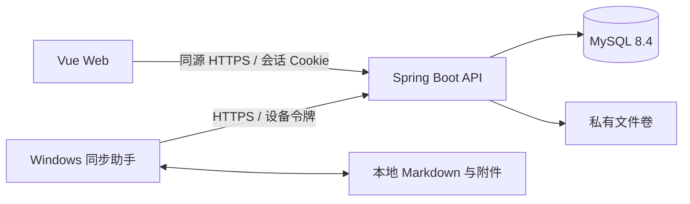

# 私有空间技术架构

版本：v1.0

确认日期：2026-10-27

状态：已确认，用于项目初始化与后续分阶段开发

## 1. 已确认范围

- 单用户、无公开注册，首版管理一个普通笔记库。
- 普通 Markdown 与附件在服务端和 Windows 本地目录均可读，不做端到端加密。
- 密码条目、安全笔记和自定义字段只进入浏览器端加密的保险库；服务端只保存密文和必要元数据。
- Windows 11 通过常驻同步助手实现关闭网页后的双向自动同步；macOS、Linux 和手机目录同步不属于首版。
- 保险库首版为在线 Web 使用并支持加密导入导出，不提供桌面离线保险库。
- 视觉采用浅色工具型界面与墨绿强调色，具体以 PRD 第 5 节为准。

## 2. 架构类型

采用单仓库、前后端分离、模块化单体和单机 Docker Compose 部署。



不引入微服务、Redis、消息队列、Kubernetes 或对象存储集群。后续只有在已有需求无法满足且经过确认时才增加基础设施。

## 3. 技术选型

| 层 | 选型 | 说明 |
| --- | --- | --- |
| Web | Vue 3、TypeScript、Vite | 使用官方 Vite 工程方式；编辑器在 M1 采用 CodeMirror 6 |
| 状态与路由 | Pinia、Vue Router | 按业务模块拆分，保险库解密状态不得泄漏到普通笔记模块 |
| Markdown | 成熟解析器与 DOM 净化库 | 禁用原始 HTML 执行并限制危险协议，具体依赖在 M1 锁定 |
| 服务端 | Java 17、Spring Boot 4.1.x、Maven | 模块化单体；根包名 `com.privatespace` |
| 数据访问 | MyBatis Spring Boot 4.1.x、Flyway | 显式 SQL 和可追踪迁移；不引入 MyBatis-Plus 的额外抽象 |
| 数据库 | MySQL 8.4 LTS | 保存账户、元数据、当前可检索文本、版本关系、密文和同步状态 |
| 文件内容 | 服务器私有文件卷 | 保存不可变文件版本与附件，数据库保存摘要及对象引用 |
| 同步助手 | Python 3.13 原型 | 使用 SQLite 持久化队列和基线；Windows 打包、凭据保护及托盘能力先验证 |
| 部署 | Docker Compose、HTTPS 反向代理 | 只暴露 HTTPS，数据库不直接暴露公网 |

依赖补丁版本通过锁文件或构建文件固定。升级依赖时执行对应测试，不依赖浮动的 `latest` 版本完成生产部署。

## 4. 源码职责

```text
frontend/
  src/
    app/                    应用装配、路由、全局主题
    modules/                note、vault、sync、settings 等业务模块
    shared/                 无业务归属的可复用组件和基础能力
backend/
  src/main/java/com/privatespace/
    modules/                auth、note、file、vault、sync、backup
    common/                 通用异常、常量与基础工具
    config/                 框架与基础设施配置
sync-client/
  privatespace_sync/        Windows 助手实现
database/migrations/        Flyway 迁移的唯一来源
deploy/                     本地 Compose 与后续生产部署配置
```

初始化阶段只创建运行、构建和验证必需的文件，不提前创建空业务分层或占位接口。

## 5. 数据与一致性

### 5.1 普通笔记和附件

- `Note/File` 保存稳定 ID、逻辑相对路径、类型、当前版本和删除状态。
- Markdown 当前文本可在 MySQL 中检索；每次已确认保存产生不可变版本。
- 历史版本和附件先写入私有文件卷并校验摘要，再在数据库事务中发布版本及变更记录。
- 同步内容以相对路径导出，不向 Markdown 强制写入系统专属 ID。

### 5.2 保险库

- 浏览器负责加密、解密和解锁后搜索；API 不接受字段明文。
- 服务端保存整体加密快照、格式版本、KDF 参数、受保护的数据密钥和条件更新版本号。
- 具体 KDF、AEAD、nonce、关联数据和格式迁移必须经过 M0 加密验证和专项设计审查后确定。

### 5.3 条件更新

- 普通内容写入携带对象基线版本、内容摘要和幂等操作 ID。
- 服务端仅在基线版本匹配时发布新版本；不匹配返回冲突，不自动覆盖重试。
- 变更日志使用服务端单调递增游标；删除使用墓碑，不以客户端时钟决定胜负。
- 保险库使用快照版本条件更新，旧版本提交被拒绝并保留本地加密草稿。

## 6. 身份和接口边界

- Web 使用受保护的同源会话 Cookie，启用 CSRF 防护、严格来源校验和接口对象级授权。
- 同步助手使用独立、限权、可撤销设备令牌，只能访问普通笔记同步接口。
- 登录口令、保险库主密码和设备令牌分别管理；登录不等于保险库解锁。
- 接口统一返回错误代码、操作 ID 和可执行提示，不在错误、URL 或日志中记录密钥、密码、令牌及私有正文。

## 7. 备份与恢复

- 数据库、文件卷、保险库密文和备份清单组成一个恢复单元。
- 首版允许短暂暂停写入、等待在途发布结束后制作一致性备份。
- 同机备份不视为灾备；必须由用户选择异机或离线目的地后才能显示整机故障保护已配置。
- 恢复演练需在全新目录或实例核对笔记数量、附件摘要、保险库解锁、历史和设备撤销状态。

## 8. 开发闸口

### M0 三项验证

1. 加密验证：仅用虚构条目验证创建、解锁、篡改拒绝、并发拒绝、改主密码和独立口令导出恢复。
2. 文件兼容验证：中文路径、Frontmatter、相对图片、换行和特殊字符在 Web、Windows 与 Obsidian 间往返。
3. 同步验证：两端并发、离线队列、临时文件替换、删除冲突、崩溃恢复、磁盘满与令牌撤销。

### M1 计划范围

- 单用户初始化与基础登录；正式公网启用前仍须在 M3 完成 TOTP 和安全加固。
- Markdown 笔记、目录、附件、搜索、自动保存状态、历史、回收站、导入和导出。
- 对应接口契约、数据库迁移、前后端测试及文件兼容验证。
- 不在 M1 宣称同步助手或密码保险库已经完成。

## 9. 尚待实施时核实

- Ubuntu 版本、CPU 架构、剩余磁盘、现有服务和可用端口。
- `www.sy.ggh.cool` 的 DNS、证书与反向代理现状。
- 异机或离线备份目的地及可用容量。
- Windows 同步助手的托盘、凭据保护、打包体积、升级方式和资源占用实测结果。
- 密码协议、安全审查、平台兼容性与性能目标均不得在验证前宣称通过。
