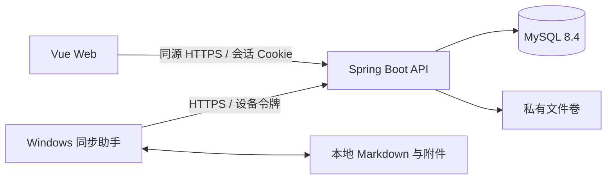

# 私有空间技术架构

版本：v1.0

确认日期：2026-10-27

状态：已确认，用于项目初始化与后续分阶段开发

## 1. 已确认范围

- 单用户、无公开注册，首版管理一个普通笔记库。
- 普通 Markdown 与附件在服务端和 Windows 本地目录均可读，不做端到端加密。
- 密码条目、安全笔记和自定义字段只进入浏览器端加密的保险库；服务端只保存密文和必要元数据。
- Windows 11 通过常驻同步助手实现关闭网页后的双向自动同步；macOS、Linux 和手机目录同步不属于首版。
- 保险库首版为在线 Web 使用并支持加密导入导出，不提供桌面离线保险库。
- 视觉采用浅色工具型界面与墨绿强调色，具体以 PRD 第 5 节为准。

## 2. 架构类型

采用单仓库、前后端分离、模块化单体和单机 Docker Compose 部署。



不引入微服务、Redis、消息队列、Kubernetes 或对象存储集群。后续只有在已有需求无法满足且经过确认时才增加基础设施。

## 3. 技术选型

| 层 | 选型 | 说明 |
| --- | --- | --- |
| Web | Vue 3、TypeScript、Vite、Ant Design Vue 4.2.6 | 2026-11-05 用户确认迁移编辑器、预览以外的 Web 控件；CodeMirror 6 与 Markdown 渲染链路保留 |
| 状态与路由 | Pinia、Vue Router | 按业务模块拆分，保险库解密状态不得泄漏到普通笔记模块 |
| Markdown | 成熟解析器与 DOM 净化库 | 禁用原始 HTML 执行并限制危险协议，具体依赖在 M1 锁定 |
| 服务端 | Java 17、Spring Boot 4.1.x、Maven | 模块化单体；根包名 `com.privatespace` |
| 数据访问 | MyBatis Spring Boot 4.1.x、Flyway | 显式 SQL 和可追踪迁移；不引入 MyBatis-Plus 的额外抽象 |
| 数据库 | MySQL 8.4 LTS | 保存账户、元数据、当前可检索文本、版本关系、密文和同步状态 |
| 文件内容 | 服务器私有文件卷 | 保存不可变文件版本与附件，数据库保存摘要及对象引用 |
| 同步助手 | Python 3.13 原型 | 使用 SQLite 持久化队列和基线；Windows 打包、凭据保护及托盘能力先验证 |
| 部署 | Docker Compose、HTTPS 反向代理 | 只暴露 HTTPS，数据库不直接暴露公网 |

依赖补丁版本通过锁文件或构建文件固定。升级依赖时执行对应测试，不依赖浮动的 `latest` 版本完成生产部署。

## 4. 源码职责

```text
frontend/
  src/
    app/                    应用装配、路由、全局主题
    modules/                note、vault、sync、settings 等业务模块
    shared/                 无业务归属的可复用组件和基础能力
backend/
  src/main/java/com/privatespace/
    modules/                auth、note、file、vault、sync、backup
    common/                 通用异常、常量与基础工具
    config/                 框架与基础设施配置
sync-client/
  privatespace_sync/        Windows 助手实现
database/migrations/        Flyway 迁移的唯一来源
deploy/                     本地 Compose 与后续生产部署配置
```

初始化阶段只创建运行、构建和验证必需的文件，不提前创建空业务分层或占位接口。

## 5. 数据与一致性

### 5.1 普通笔记和附件

- `Note/File` 保存稳定 ID、逻辑相对路径、类型、当前版本和删除状态。
- Markdown 当前文本可在 MySQL 中检索；每次已确认保存产生不可变版本。
- 历史版本和附件先写入私有文件卷并校验摘要，再在数据库事务中发布版本及变更记录。
- 同步内容以相对路径导出，不向 Markdown 强制写入系统专属 ID。

### 5.2 保险库

- 浏览器负责加密、解密和解锁后搜索；API 不接受字段明文。
- 服务端保存整体加密快照、格式版本、KDF 参数、受保护的数据密钥和条件更新版本号。
- 具体 KDF、AEAD、nonce、关联数据和格式迁移必须经过 M0 加密验证和专项设计审查后确定。

### 5.3 条件更新

- 普通内容写入携带对象基线版本、内容摘要和幂等操作 ID。
- 服务端仅在基线版本匹配时发布新版本；不匹配返回冲突，不自动覆盖重试。
- 变更日志使用服务端单调递增游标；删除使用墓碑，不以客户端时钟决定胜负。
- 保险库使用快照版本条件更新，旧版本提交被拒绝并保留本地加密草稿。

## 6. 身份和接口边界

- Web 使用受保护的同源会话 Cookie，启用 CSRF 防护、严格来源校验和接口对象级授权。
- 同步助手使用独立、限权、可撤销设备令牌，只能访问普通笔记同步接口。
- 登录口令、保险库主密码和设备令牌分别管理；登录不等于保险库解锁。
- 接口统一返回错误代码、操作 ID 和可执行提示，不在错误、URL 或日志中记录密钥、密码、令牌及私有正文。

## 7. 备份与恢复

- 数据库、文件卷、保险库密文和备份清单组成一个恢复单元。
- 首版允许短暂暂停写入、等待在途发布结束后制作一致性备份。
- 同机备份不视为灾备；必须由用户选择异机或离线目的地后才能显示整机故障保护已配置。
- 恢复演练需在全新目录或实例核对笔记数量、附件摘要、保险库解锁、历史和设备撤销状态。

## 8. 开发闸口

### M0 三项验证

1. 加密验证：仅用虚构条目验证创建、解锁、篡改拒绝、并发拒绝、改主密码和独立口令导出恢复。
2. 文件兼容验证：中文路径、Frontmatter、相对图片、换行和特殊字符在 Web、Windows 与 Obsidian 间往返。
3. 同步验证：两端并发、离线队列、临时文件替换、删除冲突、崩溃恢复、磁盘满与令牌撤销。

### M1 计划范围

- 单用户初始化与基础登录；正式公网启用前仍须在 M3 完成 TOTP 和安全加固。
- Markdown 笔记、目录、附件、搜索、自动保存状态、历史、回收站、导入和导出。
- 对应接口契约、数据库迁移、前后端测试及文件兼容验证。
- 不在 M1 宣称同步助手或密码保险库已经完成。

## 9. 尚待实施时核实

- Ubuntu 版本、CPU 架构、剩余磁盘、现有服务和可用端口。
- `www.sy.ggh.cool` 的 DNS、证书与反向代理现状。
- 异机或离线备份目的地及可用容量。
- Windows 同步助手原型的凭据保护、通知与打包验证见第 15 节；正式托盘、升级方式、安装签名和资源占用目标仍待 M2 验收。
- 密码协议、安全审查、平台兼容性与性能目标均不得在验证前宣称通过。

## 10. M0 运行与接口约定

### 10.1 当前已接入的运行接口

| 请求 | 成功/失败 | 含义 |
| --- | --- | --- |
| `GET /api/system/health/readiness` | 200 / 503，`{"status":"UP"}` 或不可用状态 | 本次 MySQL 查询、私有文件卷真实读写及可用空间检查 |
| `GET /api/system/health/liveness` | 200 / 503 | 只报告应用进程是否存活，不代替就绪检查 |

健康检查不输出内部路径、连接地址或异常。默认本机监听；前端通过同源 `/api` 代理访问。Flyway 使用 Boot 4 的 `spring-boot-starter-flyway` 自动配置，启动迁移失败时后端不能进入就绪状态。V1 为基线，V2 为账户与笔记业务表；公开接口还包含初始化状态、CSRF、登录及一次性初始化，笔记与附件必须登录。

开发 Compose 项目名固定为 `private-space`，私有卷独立。MySQL 使用 8.4 镜像的固定摘要；升级时显式调整摘要并重跑集成验证。测试项目名为 `private-space-integration`，使用独立数据库 `private_space_it`、随机端口、随机密码和临时存储。

### 10.2 业务接口的统一约定

- 业务 API 前缀 `/api/v1`，JSON 字段采用 lowerCamelCase；成功响应使用对应资源 DTO，不返回持久化 Entity。
- 对象 ID、操作 ID 使用 UUID 字符串；数据库递增版本号和游标在 JSON 中以十进制字符串表示，避免 JavaScript 整数精度丢失。
- 时间使用 UTC ISO 8601 字符串；展示转换为北京时间。时间不参与冲突决胜。
- 写入请求携带 `Idempotency-Key`；更新和删除携带 `baseVersion`。同一身份、方法、目标和操作 ID 的重试返回相同确认结果；相同操作 ID 对应不同请求载荷时拒绝。
- 文件响应包含 `id`、`path`、`type`、`version`、`size`、`sha256`、`deleted`。发布版本、更新当前内容和写入变更日志属于同一数据库事务；对象文件必须先完成写入校验。
- 错误使用 `application/problem+json`，字段为 `type`、`title`、`status`、`code`、`operationId`；不透出堆栈、正文、密码、密文载荷或凭据。
- 分页使用 `cursor` 和有上限的 `limit`；变更游标过期明确返回重新对账信号，不自动推断删除。

| HTTP 状态 | 业务错误代码 |
| --- | --- |
| 400 | `INVALID_REQUEST`、`INVALID_PATH`、`UNSUPPORTED_FORMAT` |
| 401 / 403 | `UNAUTHENTICATED` / `FORBIDDEN` |
| 404 | `NOT_FOUND` |
| 409 | `VERSION_CONFLICT`、`PATH_CONFLICT`、`IDEMPOTENCY_CONFLICT` |
| 410 | `CURSOR_EXPIRED` |
| 413 | `FILE_TOO_LARGE` |
| 429 | `RATE_LIMITED` |
| 503 / 507 | `SERVICE_UNAVAILABLE` / `INSUFFICIENT_STORAGE` |

### 10.3 M1 数据职责

账户保存唯一用户、登录哈希和初始化状态；会话保存令牌摘要、有效期与撤销状态。文件保存稳定 ID、相对路径、类型、当前版本及删除状态；版本保存不可变对象引用、字节数、摘要和来源。当前普通笔记文本单独关联文件与版本供子串查询；保险库不进入该索引。变更日志保存单调游标、文件 ID、版本与墓碑；幂等记录保存操作 ID、请求摘要和确认结果。目录/路径按 Windows 兼容规则校验，大小写冲突不得静默覆盖。

V2 迁移已实现账户、会话、登录失败限制、文件对象、笔记、历史、变更日志和幂等记录；V3 添加设备配对和限权设备身份。真实业务验收状态见下方记录。加密候选范围见第 12 节，M0 Windows 机制、异常同步原型与已完成的 Obsidian 实际编辑往返见第 15 节。

## 11. M0 第一项验收记录（2026-10-28，历史记录）

范围：本地运行基础链路。测试均使用独立测试数据；没有 Mock 服务或内存数据库替代 MySQL。

| 验证方式 | 实际结果与边界 |
| --- | --- |
| Maven 单元测试 | 3 项通过，其中 2 项验证真实临时文件目录读写/不可用和探测文件清理，另 1 项为原有启动注解检查 |
| Maven 集成测试 | 2 项通过；独立 MySQL 8.4、Flyway V1、真实随机端口 HTTP 就绪接口、事务提交/回滚、UTF-8 与 CRLF 字节往返 |
| 前端构建/单元测试 | TypeScript 类型检查及生产构建通过；1 项服务端渲染测试验证收到真实响应前不显示就绪，不证明联调 |
| 浏览器运行链路 | Chrome 实际访问 Vite → 后端 → MySQL/文件卷；1440、1280、375、812px 均通过就绪状态、键盘重试及无横向溢出检查 |
| 实际故障注入 | 停止本项目 MySQL，以上四种尺寸均收到真实 503/DOWN 并显示不可用；恢复数据库后四种尺寸重新通过 200/UP 检查 |
| 容器重建与数据卷 | 修改健康检查后重建开发 MySQL 容器，原 Flyway V1/success 记录仍存在，前端代理返回 200/UP |
| 人工视觉检查 | 已查看 1440px 和 375px 截图，沿用浅色墨绿主题；浏览器检查期间发现并修复重试按钮等待后丢失键盘焦点的问题 |

可复现命令见 README；JUnit 报告在 `backend/target/`，浏览器截图与 JSON 记录在 `frontend/test-results/`，均不提交生成物。后端服务默认只在本机提供健康接口；目前没有账户、笔记、保险库或同步业务接口。本项不代表全部 M0 或任何 M1 功能验收通过。

未验证：真实业务内容经 API 保存及进程重启恢复、Obsidian 往返、保险库密码协议、安全审查、Windows 助手打包与同步异常场景、Ubuntu/HTTPS/备份部署和性能指标。

## 12. M0 加密候选方案与验证边界

本节是可逆验证原型的专项设计，不代表生产密码格式已定稿或安全审查通过。原型位于 `frontend/verification/vault/`，不被产品入口引用；HTTP 控制器和事务存储仅在 `backend/src/test/` 中，包名置于产品扫描范围之外，不打入生产 JAR。测试表只在 `private_space_it` 中创建，没有添加产品数据库迁移。

### 12.1 候选构成

- 使用固定的 `libsodium-wrappers-sumo 0.8.4`，仅作为验证开发依赖；核心算法直接调用该库的高层接口。
- 随机 256 位数据密钥加密载荷；主密码经 Argon2id v1.3 派生独立的 256 位密钥，用于认证加密保护数据密钥。
- 验证参数为 64 MiB、opslimit=3、随机 128 位盐；在 Web Worker 中执行。反序列化时严格限制算法、参数及字段，拒绝任意 CPU/内存消耗；此参数选择仍须在目标手机/浏览器上进一步校准。
- 载荷与数据密钥包装均使用 XChaCha20-Poly1305，每次加密生成新的随机 192 位 nonce；拒绝篡改或认证失败的密文。
- 浏览器主线程/Worker 的口令字符串和解密内容只能短暂保存在内存；可持有的字节缓冲尽力清零，任务完成或失败后终止 Worker。JavaScript 字符串与运行时内部副本不能保证物理擦除。

### 12.2 验证格式

顶层只接受 `format`、`version`、`purpose`、`vaultId`、`keyId`、`kdf`、`wrappedKey`、`payload`，拒绝额外字段。`format=private-space-candidate`、`version=1`，与未来生产格式明确隔离；`purpose` 区分 `vault` 和 `backup`。ID 为 UUID v4 字符串；二进制为规范 URL-safe 无 padding Base64。当前原型明文上限 1 MiB，仅作为验证资源上限，不改变产品容量要求。

`kdf` 保存显式算法、运算次数、内存字节数与盐；`wrappedKey` 保存数据密钥包装的 nonce 与认证密文；`payload` 保存快照 ID、nonce 与认证密文。

包装关联数据使用固定顺序的 JSON 数组，绑定命名空间、格式版本、用途、算法、保险库 ID、数据密钥 ID 与 KDF 参数。载荷关联数据绑定命名空间、版本、用途、算法、保险库 ID、数据密钥 ID 与快照 ID。数据库并发版本不等同于密码快照 ID；CAS 版本控制不能替代认证，也不能保证检测恶意服务端回滚到完整旧快照。

### 12.3 主密码、历史与恢复

- 改主密码先认证原包装及原载荷，生成新盐和新包装，保留数据密钥；候选快照只有经数据库版本检查成功后才能作为当前版本。
- 当前主密码解出的数据密钥可读取同保险库、同 keyId 的历史或加密草稿，不依赖旧主密码。解密历史之前验证用途与绑定 ID。
- 历史/旧草稿或旧备份中原有的包装不会因此失效；已持有旧副本与旧口令的人仍可能读取它们。单纯改主密码不是数据密钥轮换，也不是泄漏后的完整处置。
- 独立备份口令生成全新的盐、包装密钥和数据密钥，不复用在线数据密钥；恢复时解密备份，再为新的保险库 ID 生成新数据密钥。
- `recover.ts` 是本地候选格式恢复验证工具，仅使用本地文件、依赖和标准输入的口令；默认校验输出仅含摘要/字节数。明确指定 `--output` 时才创建明文恢复文件，已有文件禁止覆盖。它尚不是面向用户发布的离线恢复安装包。

### 12.4 验证 HTTP 入口的边界

测试端点使用每轮生成的随机认证令牌，监听本机随机端口；读写均鉴权。真实 HTTP 请求将浏览器生成的加密 JSON 写入独立 MySQL 表；当前快照和不可变历史在同一事务发布，两个旧基线并发提交应恰有一个成功，另一个返回 409。令牌和主密码均不写入报告。

这一 HTTP 层用于验证密码候选方案的真实往返与事务行为，不是产品保险库 API，不包含登录、TOTP、完整幂等契约、生产格式校验、历史清理或产品权限体系。不能据此宣称这些功能已经交付。后端重启验证当前通过关闭并重建完整 Spring 应用上下文、HTTP 服务和连接池实现，尚未覆盖 JVM 进程崩溃和服务器断电。

### 12.5 查证依据

- [libsodium 密码派生与参数指南](https://doc.libsodium.org/password_hashing/default_phf)：显式保存算法/盐/参数，依据可用内存选取参数并测量耗时。
- [libsodium XChaCha20-Poly1305](https://doc.libsodium.org/secret-key_cryptography/aead/chacha20-poly1305/xchacha20-poly1305_construction)：高层认证加密、关联数据及每消息 nonce 的使用约束。
- [libsodium.js 官方仓库](https://github.com/jedisct1/libsodium.js)：浏览器/Node 模块、初始化与包含密码派生接口的 sumo 构建。

公开库文档只支持接口和构造的使用依据，不等同于本项目继承库或其他密码管理器的审计结论。候选组合仍需独立安全审查，之后才能进入正式密码模块和真实秘密迁入流程。

### 12.6 实际验证记录（2026-10-28）

- `npm run type-check:verification`、前端正常类型检查/生产构建及原有单元测试通过。
- `scripts/test-integration.ps1 -IncludeCrypto`：3 项后端单元测试、3 项真实集成测试通过。其中加密集成测试驱动真实 Chrome、Web Worker、认证 HTTP、MySQL 和本地文件恢复，没有 Mock 网络响应或内存数据库替代。
- 500 条虚构条目完成加密保存、读取和解密；API 写入请求与数据库当前/历史记录的扫描未发现测试名称、账号域名、秘密标记和主/备份口令标记。扫描只覆盖本次测试标记，不等于完整数据流审计。
- 错误口令、载荷/nonce/包装/元数据篡改、未知格式、过大 KDF 参数、跨保险库引用均被拒绝；认证失败的输入也无法通过更新操作被悄悄覆盖。
- 同一基线的两个真实并发写入恰有一个成功、一个 409；主密码变更后的旧版本提交被拒绝；故意制造历史表主键冲突后，快照更新事务回滚，原版本保持不变。
- IndexedDB 保存的加密草稿在页面刷新后可用当前主密码恢复；localStorage/sessionStorage 没有写入口令、密钥或条目。当前主密码可读取同 keyId 的历史；旧副本原包装的可解密性限制见 12.3。
- 下载的独立口令备份在新浏览器会话和重建的后端应用中恢复成新保险库；独立 Node 进程用本地文件验证了解密内容摘要一致、错误备份口令拒绝，不调用任何 API。
- 当前 Windows/Chrome 单次创建样本（500 条虚构条目）约 361ms，主线程 20ms 计时器触发 18 次；该数值包含 Worker 启动和加密，不是单独 KDF 基准、P95 性能结论或手机兼容结论。
- 已检查生产 JAR 不含 `verification/privatespace` 类，正常前端 `dist` 不含候选格式、虚构条目或 libsodium 代码。

原始结果位于 `frontend/test-results/vault-<随机ID>/write.json`、`restore.json` 及 `backend/target/failsafe-reports/`，生成物被 Git 忽略；测试容器和网络已移除，开发数据库未被修改。本次没有完成独立安全审查、生产登录/TOTP/CSRF/CSP 接入、主密码强度政策、密钥轮换、完整锁定 UI、手机浏览器校准或 JVM 崩溃恢复，因此仍不得迁入真实秘密；产品保险库功能仍属于后续 M3。

## 13. M1 工作台实施进度（2026-10-28）

本节是开发进度，不代表整个 M0 或 M1 验收通过。PRD 的需求范围没有改变。

- 已接入产品入口：单用户初始化、登录、退出；笔记文件树、CodeMirror 源码与净化预览、中文搜索、收藏、最近访问、大纲、自动保存、普通本机草稿、冲突对比、历史与回收站、单个 Markdown 导入和附件上传/私有下载。
- 前端新增依赖采用已确认的成熟编辑器/Markdown 解析与净化方向：CodeMirror 6、markdown-it、DOMPurify、highlight.js；Lucide 为统一图标，diff 用于普通文本对比。版本由 package-lock 固定，没有接入云服务。
- 初始化凭证由本机启动脚本随机生成并保存在被忽略的 deploy/setup-token.local；账户口令使用 BCrypt，随机会话令牌只保存摘要。Cookie 为 HttpOnly、SameSite=Strict，公网需启用 Secure 和 HTTPS；CSRF 与来源校验均实际执行。
- V2 数据库迁移新增账户、会话、文件、历史和幂等表；私有对象先临时写入并 fsync/原子发布，数据库事务再发布版本、历史和变更。失败可能留下不可访问的孤立对象，自动清理尚未实现，不会为清理而删除历史引用对象。
- NotesIT 驱动真实 Chrome、产品 HTTP、MySQL 和临时真实文件目录；不使用模拟接口。开发中已修复 MySQL 保留字和 CSRF 令牌失效问题。最新 scripts/test-integration.ps1 通过：3 项后端单元测试、3 项集成测试（RuntimeIT 两项，NotesIT 一项）。NotesIT 覆盖初始化/登录、未登录拒绝、CSRF 拒绝、非法路径、新建保存、幂等、旧版本冲突、断网草稿重试、历史恢复、收藏、UTF-8/BOM/CRLF 导入和原字节下载、回收站恢复、附件、危险 Markdown 净化、四种视口宽度无横向溢出、重建后端上下文后重新登录读取及退出失效；上下文重建不是 JVM 崩溃测试。前端类型检查与 1 项单元测试通过，生产构建曾通过，最新细节修改后的构建需重新执行。
- 补充验证：最新 CRLF 编辑规范化修正后，真实笔记集成流程再次通过；已人工查看桌面/手机截图，编辑器换行正常。最新 npm run build 复验也已通过；仍有主包体积超过 Vite 建议阈值的告警，尚未完成加载性能优化与性能验收。
- 保存交互修复：修正“无修改保存”同步结束时残留已完成 Promise、阻塞后续写入的问题；按钮与 Ctrl+S 统一提供显式反馈，只有真实写入确认后显示成功，无修改时单独说明。CodeMirror 已处理的快捷键不再被全局重复触发。NotesIT 已加入无修改保存后再编辑、按钮连续保存、Ctrl+S 成功反馈和断网失败反馈的真实回归，并通过 Chrome/HTTP/MySQL/文件链路验证；故障覆盖使用浏览器真实断网，没有模拟响应。README 同步操作说明，PRD 未改变。
- 分栏和图标提示：按用户新增要求，源码/预览间增加 Pointer Capture 拖动分隔线，宽度比例限制在 20%–80%，支持方向键、Home/End、滑轨点击和双击各半；小于 1024px 时继续显示单栏。图标操作按钮的浏览器原生 title 提示与辅助名称对应。PRD 5.3/5.4 与 README 已同步。真实 NotesIT 回归验证拖动后实际面板尺寸变化、拖动释放、键盘边界、滑轨调整、双击复位、图标名称属性及四种视口；与笔记保存业务一同通过真实 Chrome/HTTP/MySQL 验证，构建通过，无新增依赖。
- 本节当时尚缺目录批量导入预检和完整 ZIP 导出，现已实现并验证，见第 16 节。历史分页、历史文本对比及 30 天保留清理仍未完成，不能据此宣称完整 M1 已完成。重命名/移动及链接修复的实现见第 14 节。
- 当时尚缺 Obsidian 实际编辑往返；现已由用户实际编辑确认并完成真实接口回传、字节核对，M0 验收关闭记录见第 15 节。

当前接口：GET /api/v1/auth/status、GET /api/v1/auth/csrf、POST /api/v1/auth/initialize、POST /api/v1/auth/login、POST /api/v1/auth/logout；GET/POST /api/v1/notes，GET/PUT/DELETE /api/v1/notes/{id}，GET /api/v1/notes/{id}/history、GET /api/v1/notes/{id}/history/{version}、POST /api/v1/notes/{id}/restore、PUT /api/v1/notes/{id}/favorite；POST /api/v1/files 与 GET /api/v1/files/content。创建/保存请求为 path、type、content、baseVersion；历史恢复传 version 与 baseVersion。收藏为幂等布尔赋值，不发布正文版本；其他正文写入使用 Idempotency-Key，更新/删除检查 baseVersion。列表每页最多 200 条并返回 nextCursor，历史目前最多最近 200 条。

## 14. 文件重命名、移动与链接修复（2026-10-28）

用户明确补充右键菜单和拖拽两种入口，PRD N-01 与 README 已同步。文件树支持笔记、附件和文件夹的右键“重命名 / 移动到…”、Shift+F10 键盘菜单、拖入文件夹、拖回根目录；普通搜索、收藏和最近列表也支持右键操作。目录移动包含仍有效的子目录与文件，稳定 ID 不变；回收站条目保持原路径，并列出恢复前需要原目录的提示。

### 14.1 产品接口与事务

- `POST /api/v1/notes/{id}/move-preview`：登录与 CSRF 保护；请求 `{targetPath, baseVersion}`。只读业务预览，不写入版本；返回 `{fingerprint, fromPath, toPath, changes, warnings}`。changes 项为 `{id, fromPath, toPath, baseVersion, links}`，links 为 `{line, from, to}`，行号从 1 开始。
- `POST /api/v1/notes/{id}/move`：请求在预览字段之外携带 fingerprint，另带 `Idempotency-Key`。统一执行重命名和移动；服务器重新计算预览，拒绝过期版本或过期 fingerprint。`PREVIEW_STALE` 为 HTTP 409，要求重新预览。fingerprint 包含整个路径/版本/删除目录快照，其他笔记或新文件变化也会使其过期；不采用时间先后决定覆盖。
- 两个接口均使用 notebook_lock 获取一致目录快照；提交在一个 MySQL 事务内更新路径、受影响正文、历史、变更日志和幂等确认。附件不改写二进制内容；修复正文先写不可变对象，再发布版本。数据库中途失败时整体回滚，可能遗留不可访问的孤立文件对象，沿用现有清理边界。
- 拒绝非法 Windows 路径、路径超限、目标父目录不存在、大小写重名、回收站重名及文件夹移入自身子树；不会覆盖目标对象。大小写改名保留文件 ID。路径和正文变化均形成新版本；原历史正文与历史路径保留。
- 发起操作前保存当前普通草稿；预览涉及其他本机草稿时阻止确认，要求先打开保存。未知网络失败保留同一操作 ID 供重试；409 不会伪装为成功。移动后刷新目录、搜索结果和当前正文。

### 14.2 Markdown 兼容边界

后端新增固定版本 `org.commonmark:commonmark:0.31.0`，仅用于解析普通 Markdown 的 AST 和源位置，遵循已确认的成熟解析器方向；不替换前端解析/净化库，不引入新服务。使用 [CommonMark 官方源位置 API](https://github.com/commonmark/commonmark-java#source-positions) 定位链接和图片目的地，只替换相应源区间，不将整篇文档重新渲染成 Markdown。

自动处理可准确定位的单行标准行内链接、图片链接及单行引用定义，包括目标改名后的入站链接和源文件移目录后的出站相对路径；保留 URL 查询、片段与标题。路径按 URL 编码保存，预览按可读名称展示。Frontmatter、BOM、CRLF/LF、代码段和代码块保持原样，外部协议地址与锚点保持原样。双链、HTML、无法准确定位的多行/转义/实体写法和无效/缺失目标列出提示并保持原文。预览扫描当前普通笔记，因此也可能提示其他已有的未解析链接。历史不被追溯修复；恢复旧正文后应核查其相对路径。

### 14.3 验证结果与限制

- 5 项后端单元测试通过，其中 2 项解析器测试覆盖 Frontmatter 中 emoji 的 UTF-16 源位置、BOM/CRLF、普通/图片/引用定义、标题、代码保留及出站路径变化；单元测试不替代业务验收。
- 真实集成命令 `scripts/test-integration.ps1` 通过：3 项集成测试，包括真实 Chrome → 产品 HTTP → MySQL/私有文件的 NotesIT。新增场景覆盖搜索结果右键重命名、Shift+F10 菜单、目录选择、拖入目录和拖回根目录、文件夹及子文件 ID、入站和出站链接修复、移动后图片实际解码、旧历史保留、重名与非法路径拒绝、目录快照过期拒绝、相同操作重试幂等，以及重建后端上下文后的路径持久化。
- 故障注入使用真实测试数据库的历史主键冲突，强制多文件事务中途失败；检查原路径、正文和版本全部回滚，清除测试故障后以同一操作重试成功。没有 Mock、内存替代库或伪造网络响应。只在专用 `private_space_it` 与临时目录执行；未对开发库注入故障。
- 前端类型检查和生产构建通过；已查看右键菜单和变更预览截图。依然有既有的主包大小告警，未完成大规模性能验收。M0 的 Obsidian 与 Windows 同步验收已完成，详见第 15 节；其他 M1 剩余项维持第 13 节状态。

## 15. M0 Windows 同步原型与文件兼容验收（2026-10-28）

### 15.1 当前结论与阶段边界

M0 的加密候选验证维持第 12 节结论。Windows 同步原型已经接通真实产品服务、MySQL、SQLite 和本地文件，验证关键风险。2026-10-28 用户在 Obsidian 中实际打开并编辑验收文件，确认显示正常；随后修改文件通过真实接口回传，与 Web 私有下载及第二份 Windows 文件核对字节一致。用户确认 M0 验收关闭。本结论限于 M0 验证范围，不代表完整 M1、M2、M3 产品交付或全面安全审计。

实现位于 `sync-client/privatespace_sync/`；故障与场景编排位于 `sync-client/verification/`，不包含在正常原型入口中。后端使用 `modules/sync/` 调用 NoteService 的真实版本发布事务，不直接跨模块操作 NoteMapper；新增 V3 迁移只创建 sync_pairing/sync_device，不删除既有数据。未替换已确认技术栈。

### 15.2 身份、接口与持久化

| 接口 | 身份与请求 | 实际行为 |
| --- | --- | --- |
| POST /api/v1/sync-devices/pairing-code | Web Cookie + CSRF + Origin；`{name}` | 创建五分钟一次性随机码；只存摘要，响应 `{code,expiresInSeconds}` |
| POST /api/v1/sync/pair | `{code}` | 原子消费有效配对码，签发只允许普通文件同步的设备身份；返回 `{id,name,token}` 一次 |
| GET /api/v1/sync-devices | Web 身份 | 返回设备 DTO，不含令牌/摘要，时间为 UTC ISO 字符串 |
| DELETE /api/v1/sync-devices/{id} | Web Cookie + CSRF + Origin | 持久化撤销；后续设备请求返回 401 DEVICE_UNAUTHORIZED |
| GET /api/v1/sync/snapshot | Bearer 设备令牌 | 在 notebook_lock 下读取一致的普通文件/目录/墓碑元数据及字符串 cursor |
| GET /api/v1/sync/files/{id}?version=… | Bearer 设备令牌 | 条件读取不可变版本字节；无有效版本则拒绝，通用附件下载/CSP sandbox |
| POST /api/v1/sync/files | Bearer + Idempotency-Key | 请求 `{id,path,baseVersion,deleted,sha256,contentBase64}`；新增 id=null/baseVersion="0"，删除需有效基线 |

设备令牌不能使用 Web 笔记、附件或设备管理接口；Web Cookie 不能作为设备通道身份。设备 API 的独立安全链不读取 Cookie，仅对该 Bearer 通道关闭 CSRF；Web 通道继续校验 CSRF 与来源。原型 HTTP 只允许回环地址，其他地址必须 HTTPS，证书验证不被关闭，跨地址重定向不被跟随。

SyncWrite 先校验路径、版本、格式、字节限额及 SHA-256；在一个事务内创建必要父目录并发布不可变对象、当前正文、历史、变更和幂等确认。失败不发布半文件；删除只产生墓碑。原型服务端令牌、配对码都只保存摘要。Windows 令牌使用 [Microsoft DPAPI 用户范围保护](https://learn.microsoft.com/en-us/windows/win32/api/dpapi/nf-dpapi-cryptprotectdata)，无明文降级方案；SQLite 队列包含普通笔记的明文/编码内容，是普通本机数据，不是保险库。

### 15.3 Windows 原型行为

- 使用 [ReadDirectoryChangesW](https://learn.microsoft.com/en-us/windows/win32/api/winbase/nf-winbase-readdirectorychangesw) 唤醒对账，另有定期扫描；读取前后核对文件状态并等待稳定，忽略编辑器临时文件。正常写回可能再唤醒一次检查，但摘要一致不重复发布正文版本。
- SQLite 保存基线、不可变待发送载荷、操作 UUID、冲突和删除观察状态，使用 WAL/FULL 同步。网络失败时先持久化本地编辑；重启后重试相同操作，不把新服务器版本当作无条件覆盖基线。
- 本地文件写入真实临时文件并 fsync，核对当前本地摘要后原子替换；本地再次编辑则拒绝覆盖。根目录身份标记丢失、根/祖先目录出现联接或符号链接、扫描无权访问时暂停，不根据目录失联发送删除。缺失的子目录也会被保守暂停，不能仅凭缺失推断删除。
- 两端并发改动保留远端当前版本及本地冲突副本；如果队列载荷与后续本机编辑不同，均保留。二进制附件按原始字节处理，不强制解码。删除/修改冲突保留修改内容与冲突记录，不自动复活已删除对象。
- 删除使用共同基线和稳定观察；超过 20 个或 10% 时输出具体变化列表及 fingerprint，只有当前列表对应的确认才执行。远端删除前把本地原文件与摘要/路径记录写入状态目录 recycle。不同步 .git/.obsidian、助手状态、缓存、符号链接或目录联接。
- `status`/`once` 只报告本地已知队列、冲突、错误和本轮处理结果，不宣称某台电脑实时在线或全端同步完成；无正式 Web 同步中心。

### 15.4 实际验收记录

完整命令与固定测试镜像见 README。使用 `scripts/test-integration.ps1 -IncludeCrypto -IncludeSync -UsePackagedSync -FullDiskImage …` 执行：

- 后端 5 项单元测试、4 项集成测试通过（RuntimeIT 两项、NotesIT 一项含笔记和 Windows 同步场景、VaultCryptoIT 一项）。Python 本机 4 项单元测试通过，涉及实际文件替换保护、Windows 路径边界与真实 DPAPI 往返/篡改拒绝；单元测试不代替集成结论。
- 两个独立目录、两份 SQLite 和两台设备身份通过真实 HTTP 并发提交同一基线，Markdown 与二进制附件的双方字节均被保留；错误上传摘要被拒绝且没有创建对象。
- 测试中继只转发真实后端响应，不构造成功响应。实际停止其监听以制造 TCP 连接失败，关闭/重启助手再恢复连接后队列可继续提交。另在后端真实提交后阻断确认，并终止真实 EXE 进程；重新启动 EXE 后恢复队列，未发布重复版本。
- 真实文件临时替换保存被 Windows 通知捕获，最终内容在两端一致；真实目录失联、空目录替换、Windows 目录联接不会造成误删除或越界上传。删除/修改冲突保留修改内容；21 文件批量删除先暂停，旧确认因影响列表变化而被拒绝，确认当前列表后完成并留下本地回收副本。
- 通过真实 Docker 内核填满只属于本次测试的 24 MiB tmpfs，收到 ENOSPC。真实文件写入 API 返回 507 INSUFFICIENT_STORAGE，原版本号和字节仍可读取。未填充 Windows 物理卷，也没有在开发库注入故障；客户端物理卷耗尽尚未单独实测。
- 后端应用上下文关闭并重建后，原队列/基线对应文件可读取；设备撤销后旧令牌被拒绝。此处后端上下文重建不等于后端 JVM 断电测试；助手进程终止为实际进程终止测试。
- PyInstaller 固定构建依赖生成 Windows onedir EXE，实际 `--version`、状态读取、DPAPI 解密及断网/崩溃恢复使用打包产物执行。本机目录总量 21,707,076 字节，入口 2,067,235 字节；未完成安装签名、干净 Windows 安装环境及 CPU/内存性能目标验收。
- 中文/特殊路径、BOM、Frontmatter 中 emoji、自定义字段、CRLF、标准相对图片、表格、任务和代码的验收语料已在 Web 私有下载与两份 Windows 文件中核对原始字节一致。早期语料正文 SHA-256 为 `2de75c33fae44d37571985f1caffe67567dbf09c69091c89bd66cbbca0bdded1`；早期 `compatibility.json` 中 obsidianUiVerified=false 仅说明该自动化检查本身不覆盖 Obsidian 人工操作。
- 最终验收在完整命令追加 `-ObsidianVault 'D:\ai_project\Workbench\data\m0-obsidian-vault'`，后端 5 项单元测试和 4 项集成测试再次通过。用户实际添加“Obsidian 手动验证”段落并确认图片显示正常；`obsidian-manual.json` 记录 Frontmatter、自定义字段及相对图片仍在，修改文件经真实上传、第二份 Windows 目录下载与 Web 私有下载核对字节完全一致，SHA-256 为 `0b7a6decfc4d90fe433499e7cece837377600265de2167338470c65e9c1a67d4`。Obsidian 此次保存后的文件是无 BOM 的 UTF-8、LF 换行；同步链路原样保留该输入，不声称 Obsidian 保存仍保留原 BOM/CRLF。

报告在被忽略的 `frontend/test-results/sync-<随机ID>/`，包括 write.json、restore.json、disk-full.json、compatibility.json 和最终人工编辑回传的 obsidian-manual.json；测试不记录原始令牌。测试 MySQL、网络和专用磁盘满容器已清理；本地报告、冲突与回收副本保留用于核对。所有测试只使用独立数据库/普通虚构文件，无 Mock 服务、内存数据库或写死成功结果。

人工素材修正：原来的 1×1 PNG 只适合自动字节校验，不适合人工判断。已新增由确定性 SVG 渲染的 640×320 可视测试 PNG，并在独立 Obsidian 语料中替换其相对图片引用；修改前副本保存在 data/m0-obsidian-before-image-fix.md。验收脚本也使用此可视语料。上述早期正文摘要属于调整图片引用前的记录，最终人工编辑及回传结果以上一条记录为准。素材修正本身未作为 Obsidian 人工验收依据，人工确认和真实回传已另行完成。

### 15.5 M2 待交付边界

当前是有限的全量快照原型（最多 5000 对象），不是增量分页协议。首次配对只接受新空目录，不接管非空库；远端重命名保守要求重新对账，暂不自动迁移本机路径。冲突记录和副本会保留，但没有正式解决界面。正式托盘/小窗、设备管理页面、首次合并预览、增量游标过期策略、冲突解决、目录删除处理、回收站恢复操作、单实例/自动启动、升级、安装签名与负载目标属于 M2 完整产品工作，不能用上述原型验证替代它们。M0 已按上述限定范围完成验收，后续仍需独立完成这些 M2 工作。

## 16. M1 目录导入与 ZIP 导出（2026-10-29）

本次完成 PRD N-07/N-10 对应的普通目录导入和笔记附件 ZIP 导出，不变更 PRD，不引入新依赖或数据表。历史分页、历史文本对比、保留清理与 M1 整体验收仍待完成。

### 16.1 接口与原子发布

- `GET /api/v1/note-imports/limits`：返回 maxFiles、maxBytes、maxNoteBytes、maxAttachmentBytes，均为数值。默认每批 2000 文件、1 GiB；笔记 1 MiB、附件 50 MiB。批次限制由配置控制；Multipart 总请求默认 1030 MiB、最大 4100 个 part，扩大批次需协调这些参数与临时磁盘。
- `POST /api/v1/note-imports/preview`：Multipart 的 `target` 为已有目标目录路径，空字符串表示根目录；`paths` 为 JSON 字符串数组，顺序对应重复 `files` part。文件原始名称不作为服务端路径依据。返回 fingerprint、canImport、totalBytes、fileCount、entries；每个 entry 为 path、type、size、status（CREATE / REUSE / BLOCKED）和 message。检查路径、UTF-8、原始摘要、限制、已有文件/回收站、批次内部重名和文件/目录冲突；Unicode 重名按 MySQL 实际 `utf8mb4_0900_as_ci` 比较，而非仅依赖前端小写转换。预检不创建笔记、目录或文件对象。
- `POST /api/v1/note-imports`：相同 Multipart 加上 fingerprint 和 UUID `Idempotency-Key`。服务器重新读取真实内容，核对预检与完整目录版本，然后在 notebook_lock 对应事务内新建目录、原始对象、笔记/附件、历史和变更；一个错误使整批元数据回滚。同一操作和相同输入重复提交返回第一次结果，不重复发布历史。响应为 filesCreated、foldersCreated、totalBytes。内容或目录变化返回 409，要求重新预检；超限 413，无效清单 400。确认结果未知时保留同一操作重试。
- `GET /api/v1/note-exports`：在短事务内取得统一的已提交普通文件目录快照，随后从不可变对象复制到 UTF-8 ZIP 临时文件，生成完成后才发送带鉴权的 attachment 下载，最终清理临时 ZIP。仅包含未删除普通目录、笔记和附件；不包含历史、回收站、本机草稿、账户或保险库。对象校验失败时拒绝导出，不发布部分文件。后续实现对象回收时必须保护进行中的导出快照，不能直接删除仍在读取的对象。
- 全部接口沿用真实 Web 会话权限；写入仍校验 CSRF 与 Origin，设备 Bearer 令牌不因此获得 Web 导入导出权限。已有单文件导入保持可用。Markdown 后缀按大小写不敏感识别，导入的 `.MD` 可继续重命名、移动和使用库内链接。

### 16.2 页面与边界

文件树底部新增“批量导入目录”和“导出笔记 ZIP”。导入对话框有目标目录、目录/多文件选择、本地大小检查、服务器预检、逐路径影响、确认、处理中和成功/错误反馈；支持键盘焦点约束、Escape、手机宽度和减少动态效果。目录选择保留所选根目录名称及内部路径，多文件选择使用文件名称；浏览器不提供空目录。目录选择时以 `.` 开头的目录默认在前端排除并显示数量，不上传其内容；非法路径与直接 API 提交的系统排除路径仍被服务端拒绝。重名阻止整批，不提供隐式覆盖。

导出只包含服务器版本，先尝试保存当前笔记并提示本机其他草稿不在 ZIP 中。ZIP 解压后可再次选择目录导入；直接上传 ZIP 不自动解包。预检与确认分别上传文件，没有持久化上传会话或大文件断点续传；2000 文件 / 1 GiB 是配置边界，尚未做满载资源或性能验收。事务失败可能留下未引用的不可变物理对象，与既有对象发布机制一致；自动清理尚未实现，不能将其作为历史保留清理已完成的依据。

### 16.3 验证记录

- 单元检查：后端 5 项既有单元测试、前端 1 项单元测试通过；前端类型检查与生产构建通过。Vite 主包大小告警仍存在，未宣称性能达标。
- 真实端到端：`scripts/test-integration.ps1` 使用独立 MySQL、真实 Chrome、产品 HTTP 和文件卷验证目录选择、预检不发布、取消、提交与重启后摘要；覆盖中文逗号文件名、`.MD` 识别与移动、BOM/CRLF、Frontmatter、双链文本、二进制附件、相对图片显示、64 文件提交、重名/目录冲突、非法路径、无效 UTF-8、超限、回收站占用、预检过期及幂等重试。ZIP 由真实按钮下载，标准 ZIP 读取器解压并核对，再通过目录入口重新导入，笔记和图片字节一致。未登录读取新接口被拒绝。
- 故障注入：仅在独立测试库临时增加 CHECK 约束，强制第二个文件的 INSERT 失败，核对前序文件与目录全部回滚，随后移除测试约束；不存在产品中的测试开关或模拟成功接口。普通文件对象被实际改坏时导出真实校验失败，恢复原字节后可完整导出。浏览器真实断网不显示导入成功，恢复网络后按同一操作确认。
- 人工检查：查看 1440px、375px 和横屏预检截图，核对弹窗、滚动与确认按钮可见。该检查不等于在真实手机设备或屏幕阅读器上完成验收；本轮没有重新操作 Obsidian，M0 人工结果沿用第 15 节。
- 生成日志、ZIP、语料和截图位于被忽略的 `frontend/test-results/notes-<随机ID>/`，不提交用户内容或运行凭据。扩展 Windows 同步回归可执行 `scripts/test-integration.ps1 -IncludeSync -UsePackagedSync`；本轮没有重复执行加密专项、物理磁盘满或正式性能测试。

## 17. 导入导出与导航交互修正（2026-10-29）

本节按用户确认同步 PRD，不修改通用开发规范。

- 导入弹窗遮罩不再触发关闭。单文件导入、结果未知时的关闭确认均使用应用内 ConfirmDialog；导出用范围选择弹窗代替浏览器确认框。支持取消、焦点约束和 Escape，未确认不执行。
- 文件选择后按路径的目录段排除任意以 `.` 开头的目录（含所选根目录），显示排除文件数量；不将其内容加入 Multipart。普通 `.xxx` 文件不因后缀而排除，浏览器空目录限制不变。
- 1178 个虚构文件、约 29 MiB 的真实请求复现了 Failed to fetch。依赖本地配置元数据证实 Tomcat 默认 max-parameter-count=1000，与本项目页面宣称的 2000 文件不一致。现设为 10000，并将 max-swallow-size 与有界请求大小对齐，防止中途拒绝请求时因默认 2 MiB 吞咽限制直接复位连接；max-part-count 仍为 4100。预检连接失败显示中文说明，不能视为导入成功。只扫描用户提供目录的元数据用于排查，没有将其内容上传测试库。
- 新增 `POST /api/v1/note-exports`，JSON `{all:boolean, ids:string[]}`，保留 GET 全量导出兼容接口。POST 沿用 Web 登录、CSRF、Origin 校验。按稳定 ID 选择普通文档/附件或目录及其递归子项；无效或删除对象返回 409，空选择返回 400。单篇文档自动包含 CommonMark 解析到的标准相对链接/图片对应的库内附件，保持原根目录路径并去重；不自动递归导出其他笔记，不承诺解析双链、原始 HTML 或外网资源附件。
- 导出弹窗初始显示可展开的目录树，默认不勾选；提供“全选”“清空选择”按钮、路径搜索、同级每页 30 项及区域滚动，跨页保留选择。目录选择包含子项；取消勾选子项时移除递归祖先选择，保留其余已选项，避免父目录使取消操作失效。未选择时禁止提交；失败保留选择。没有对其他列表追加尚未确认的统一分页改造。
- 收藏/最近访问再次点击时清空筛选和当前目录，返回根目录。大纲通过 Markdown 源码行号定位净化后的预览标题，避免 Frontmatter 渲染额外标题导致错位；仅高亮所点击标题，点击预览正文取消，编辑模式下先显示预览。

验证使用真实浏览器、HTTP、独立 MySQL 和文件卷，包含 1178 文件预检、隐藏目录排除、遮罩点击、应用内确认、单篇/目录/全部导出及 ZIP 范围核对、重复选择去重、导航取消和标题高亮。所有批量语料均为虚构文件；不以本次测试宣称用户整个目录已经成功导入，也不代表 2000 文件满载或性能验收。

上传进度实现补充：前端 uploadRequest 使用同源 XMLHttpRequest.upload 的真实 progress/load 事件，沿用 Cookie、实时 CSRF 刷新、403 拒绝后单次重试及原幂等标识。上传总字节是完整请求而非虚构的逐文件成功数；目录预检上传与确认上传分别展示阶段。单笔记导入和附件也接入相同进度条。上传完成后显示等待服务器处理，只有成功响应才确认预检/导入结果；失败不插入附件链接或显示保存成功。未提供长度时显示不确定进度。真实浏览器限速只改变网络吞吐，不拦截或模拟业务响应；验证中检查 0–100% 之间的真实进度值，继续核对服务端文件字节。

右键删除与确认框统一补充（2026-10-29）：FileContextMenu 增加带图标与文字的删除项，沿用方向键、Shift+F10 和 Escape。菜单与编辑区删除按钮共用 removeNote，读取实际目标及当前版本，通过既有 DELETE 接口移入回收站；不增加永久删除接口；先前仅支持空目录，现已按下述用户确认扩展为整树回收和恢复。确认前保护当前保存和其他笔记本机草稿，取消不发删除请求；删除其他文件不清空当前编辑器，版本冲突/失败保留 UI 与草稿。非空目录的先前拦截现由整树删除预检与批次恢复机制取代。ConfirmDialog 统一承载删除、历史恢复、冲突选择、离线草稿切换、需确认的退出及导入确认；产品源码不再调用浏览器 confirm/alert/prompt。beforeunload 防丢失提醒保留浏览器原生机制，平台不允许自定义该系统对话框。

真实回归覆盖右键取消、键盘菜单删除、删除后原始内容仍在及恢复、空目录删除、非空目录拒绝、编辑区删除、历史恢复与冲突选择；浏览器 dialog 事件被记录，出现原生确认即判失败。使用独立 MySQL、真实 HTTP 和文件存储，未使用模拟删除结果。相关代码与需求/使用文档同步，历史保留清理仍未因此交付。

导入入口与预检目录树补充（2026-10-29，按用户确认）：保留浏览器/系统目录选择入口，增加应用内拖入区，不尝试伪装网页可以任意浏览本机磁盘。拖入事件同步获取浏览器授予的 FileSystemEntry，目录读取器逐批读至空批（避免漏掉 100 个以后的文件），按根目录名称和相对层级收集真实 File 对象；隐藏目录在遍历前跳过，显示目录数，不读取其内容。系统选择继续按 FileList 排除隐藏路径并显示排除文件数。扫描期间禁用提交和关闭，失败不替换原有选择，不上传部分结果；仍沿用批次数量/大小限制，目录节点扫描上限 10000，空目录暂不导入。点击预检才调用真实接口，内容字节与幂等流程不变。

ImportPreviewTree 根据服务端实际 entries 展示目录层级，所有目录默认收起，不因有错误自动展开；收起时展示文件数和内部问题数，展开才显示子目录与文件。每个层级最多展示 30 条再分页，预检区域仍受弹窗高度限制并可滚动；新预检会重置折叠状态。无合法父节点的错误路径仍在根层展示，不能因目录折叠隐藏“预检失败”的整体结论。

验证使用真实 Chrome 目录选择及 Chrome 原生拖放协议提供的临时磁盘目录，不伪造 FileSystemEntry。沿真实 HTTP/MySQL/文件卷完成预检与保存，并核对隐藏目录排除、默认收起、父目录展开后子目录仍收起，以及原始文件字节。该验证不等同于在用户资源管理器里人工完成拖放，也未自动导入用户提供的私人目录。

本轮真实目录拖入语料共 132 文件，其中同一子目录 128 文件，验证多批 readEntries 未漏读；预检默认折叠、展开父级后子级仍折叠，以及同级分页均已通过。前端构建、单元检查及真实 MySQL/HTTP/Chrome 集成通过，尚未进行真实手机拖放验收。

目录整树回收、目标目录选择与高亮调整（2026-10-29，用户明确确认）：

- 新增 V4 迁移 note_delete_member，按根目录删除版本记录本批每个稳定 ID、原路径、删除前历史版本与删除后版本，并通过外键保护对应历史。一次删除只纳入当时仍活跃的目录/文件，先前已删除的对象不进入本批，避免恢复时额外复活。
- `GET /api/v1/notes/{id}/delete-preview?baseVersion=…` 返回 fingerprint 和 targets（id/path/type/version）。目录 targets 包含自身和所有活跃后代，单文件只包含自身。新 Web 入口展示影响数量、保护受影响的本机草稿，并给 `DELETE /api/v1/notes/{id}?baseVersion=…&fingerprint=…` 传回指纹；范围或版本变化返回 409，要求重新确认。fingerprint 参数对既有 API 调用保留可选兼容，旧调用不具备范围预检保证。沿用登录、CSRF、Origin、幂等标识和 notebook_lock 事务。
- 删除在同一事务保存批次成员、增加每个对象的删除版本、历史和变更日志，任何失败整批回滚。不可变物理对象不删除。后端不再因目录非空拒绝操作，前端也不再提示先删除子项；删除受影响的当前笔记前保存，其他受影响本机草稿必须先处理，成功后清理对应草稿并退出被删除的编辑内容。
- 回收站目录默认选择删除前的版本；`POST /api/v1/notes/{id}/restore` 在该目录仍删除时读取其当前删除批次，要求选择批次对应的删除前版本。恢复先检查所有成员仍处于预期删除版本与路径、外部父目录可用及原路径无冲突，逐一校验原始对象并创建新版本；中途失败整批回滚。稳定 ID、原始字节、目录层级和路径保持不变。已存在、被单独改动或缺失历史的内容不被覆盖；旧版删除的空目录无批次记录时沿用单对象恢复。未来历史/回收站清理必须先处理到期批次与外键，不能删除仍受恢复快照引用的历史。
- 标题高亮采用主题 token #fff0b3 背景、#252a28 文字、#946000 边线，按 sRGB 计算文字/背景对比度约 12.75:1；只高亮标题，点击预览正文取消，不将此局部计算当作全站无障碍审计。
- 导入目标改为 DirectoryPicker/DirectoryTree：应用内弹窗搜索和选择根目录或已有文件夹，输入始终过滤 type=folder 且未删除的数据；文件不参与渲染或选择。保留当前目标显示、文件夹图标、选中态、区域滚动、取消、Escape、焦点约束，选择确认后才更新导入目标。

验证：真实 Chrome 目录删除确认及回收站整树恢复、真实 MySQL/对象存储的 Markdown（含 BOM/CRLF）和二进制原字节核对；重复操作幂等、预检后新增文件拒绝旧范围；在独立库临时加 CHECK 约束分别强制删除和恢复中途失败，核对所有对象和批次一起回滚，移除约束后同一操作可完成。新增 V4 的迁移与重启验证同步更新，未用模拟数据库或模拟成功响应。目录选择器核对只显示文件夹，高亮核对实际渲染颜色；M1 的历史分页/对比及保留清理仍未交付。

## 18. 回收站多选恢复（2026-10-29）

按用户确认，文件右键直接恢复原位置；文件夹右键打开应用内恢复向导。整个文件夹仅恢复当前删除批次的剩余项目到原位置。部分文件先在默认收起的目录树多选，再选择原目录或指定目录；指定目录平铺文件名，不保留原子目录。已恢复的文件不随之后的整目录恢复移回原位置；未选文件仍留在回收站。复用 V4 删除快照，不新增数据表或依赖。

### 18.1 接口契约

- `GET /api/v1/recycle/{id}` 返回 id、path、baseVersion、items（id/path/type）。文件夹优先读取最新仍有待恢复成员的删除批次；返回快照目录节点及仍处于原删除版本的文件，不把已恢复文件列入可选范围。旧版单对象删除回退到删除前最后一个有效历史版本。
- `POST /api/v1/recycle/{id}/preview` 接收 `{baseVersion,mode,ids,destination,target}`。mode 为 `all` 或 `files`，destination 为 `original` 或 `directory`；整目录只接受 original，files 只接受本次可选的文件 ID。target 为空表示根目录，否则须为已存在的活跃文件夹。返回 fingerprint、changes（id/fromPath/toPath/type/links）、folders（path/action，CREATE/RESTORE/REUSE）和 warnings，不写入对象或元数据。
- `POST /api/v1/recycle/{id}/restore` 接收上述参数及 fingerprint、UUID `Idempotency-Key`。返回 filesRestored、foldersRestored、ids。沿用 Web 登录、CSRF、Origin、notebook_lock 与事务；重复的同一请求返回首次持久化结果。目录、版本或预览变化返回 409；非法范围返回 400。同名占用（含回收站）及平铺后的同名文件阻止整批，Unicode/大小写比较沿用实际 MySQL 排序规则。
- `GET /api/v1/notes?deleted=true&includeGroups=true` 在删除对象外，额外返回仍有快照成员待恢复的活跃根目录，用作回收站容器；其 deleted 字段仍为 false，页面显示“尚有待恢复子项”。includeGroups=true 同时按 note_delete_member 的实际批次成员和当前删除版本隐藏子目录/文件，仅保留根目录条目，部分恢复后的根目录也继续归组；不按路径粗略隐藏此前单独删除的对象。查询在分页前完成归组，恢复候选接口仍提供内部明细。includeGroups 默认 false，旧的纯删除列表行为不变。列表继续采用现有游标分页。多次删除存在剩余快照时，向导每次处理最新的待恢复批次，完成后较早批次仍可继续恢复。
- 原 `POST /api/v1/notes/{id}/restore` 保留历史恢复及完整、未改动删除批次的兼容行为；经历部分恢复后的目录使用新回收站接口，不将旧接口解释为可恢复任意部分批次。

### 18.2 发布与交互边界

恢复原位置时使用删除前不可变对象的原始字节，仅补齐所选文件必要的祖先目录；恢复目录元数据不会复活未选中的同级文件。指定目录时文件直接 repath 到目标目录，复用标准 Markdown 相对链接重写器，仅更新能可靠解析的相对链接并在预览中报告；附件必须显式选择，未选择或无法解析的引用显示警告。原始 HTML、双链等不承诺自动修复。预览指纹包含整个目录的版本快照，期间任何目录变化保守要求重新预览。

确认时重新校验快照，在同一事务发布父目录、文件新版本、历史、变更及幂等结果；任何中途失败均回滚可见元数据。改变正文才创建新的不可变对象，事务失败后的未引用对象清理仍是既有待办，不宣称已完成保留清理。目录原路径被其他对象占用时拒绝恢复，不静默替换。

前端复用可多选目录树和只含活跃目录的 DirectoryPicker；选择树每层 30 项分页，预览每页 20 个文件，弹窗内部滚动。提交前展示恢复路径、目录及相对链接修改数量。结果未知时保留同一请求和操作标识，允许重试确认；关闭前使用应用内提示。文件直接恢复遇到错误或未知结果时要求核对回收站，不报告成功。

### 18.3 验证

- 单元检查与构建：后端 5 项既有单元测试、前端 1 项单元测试、前端类型检查和生产构建。该范围不能替代恢复业务的完整验收；Vite 主包大小告警仍待优化。
- 真实集成及端到端：独立 MySQL、真实 HTTP/Chrome 和临时真实文件目录覆盖右键文件直接恢复、文件夹模式、取消、树形多选、指定目录平铺、原目录恢复、恢复必要父目录、未选内容保留、活跃回收站容器及后续整目录恢复不移回已恢复文件。核对 BOM/CRLF/Frontmatter、二进制字节、相对图片链接重写、同名拒绝、预览过期和幂等结果。
- 故障注入：只在独立测试库为选中文件增加临时 CHECK 约束，强制批次后部 UPDATE 失败，核对前序文件路径/版本和父目录均回滚；移除约束后按同一操作成功并验证重复确认。未使用 Mock 接口、内存数据库或模拟成功结果。
- 浏览器截图覆盖桌面、窄屏及横屏；这不等于真实手机设备或屏幕阅读器验收。日志与截图位于被忽略的 `frontend/test-results/notes-<随机ID>/`。本轮不重复 M0 Obsidian 人工往返、加密专项、同步 EXE 专项或性能验收；M1 历史分页/对比和保留清理仍待交付。

## 19. 当前交付进度与本批提交记录（2026-10-29）

M0 已于 2026-10-28 由用户确认验收关闭。本批提交在该基线上补齐 M1 目录批量导入、选择范围的 ZIP 导出、上传与应用内确认交互、整目录回收、部分恢复及回收站归组展示；需求和操作说明同步到 PRD v1.2 与 README。没有修改技术栈和通用开发规范。数据库从 V3 升到 V4，仅增加删除快照及历史引用保护，启动时由 Flyway 执行；升级前应备份数据库与对象目录，不应通过删除旧数据卷升级。

### 19.1 最新验证结果

- 前端：`npm run build`（含类型检查）和 `npm test` 通过，1 项单元测试。构建仍有主包超过 Vite 建议大小的告警，未宣称加载性能验收通过。
- 后端与真实链路：`scripts/test-integration.ps1` 最新完整复验通过，5 项后端单元测试、3 项集成测试（RuntimeIT 两项、NotesIT 一项）。NotesIT 内执行真实 Chrome 页面、鉴权 HTTP、MySQL 和文件存储，覆盖第 16–18 节业务；不是 3 个简单场景。验证 V4 迁移、服务上下文重建后的持久化读取及幂等结果，不将上下文重建描述为 JVM 崩溃测试。
- 归组展示补充：整目录删除后 UI 和 `includeGroups=true` 列表只有根文件夹条目，同批子目录和文件隐藏；默认 API 仍可读取真实删除对象。恢复弹窗仍可展开、多选、恢复到指定目录，再按原位置恢复剩余文件；部分恢复后的根容器继续归组，此前独立删除的文件仍可直接恢复。
- 故障注入：独立数据库临时 CHECK 约束使导入、删除、恢复中途失败，实际核对整批元数据回滚；真实断网和损坏对象检查按第 16–18 节执行。无 Mock 成功响应或内存数据库替代。
- 本机人工检查：已查看桌面、窄屏和横屏截图。未在真实手机、屏幕阅读器或用户私人目录执行本批验收；没有重新执行 M0 Obsidian、加密和同步 EXE 专项。
- 归组首轮回归在既有拖拽移动提交处发生一次 `Failed to fetch`，当轮判失败；未观察到后端业务异常。新增浏览器请求失败诊断后，完整独立回归复验通过。该次连接失败根因尚未确认，不表述为已定位并修复的产品问题。

本地证据：`frontend/test-results/recycle-select-final-build.log`、`recycle-select-final-unit.log`、`recycle-grouping-integration-recheck.log` 及 `notes-<随机ID>/`；后端报告在 `backend/target/failsafe-reports/`。均为被忽略的本地生成物，不提交凭据、数据库、用户内容或截图语料。开发服务已更新，本地前端 HTTP 200、后端 readiness=UP；这只代表当次就绪检查，不代替业务回归。

### 19.2 后续顺序

原列出的 M1 历史、保留清理和整体验收已在第 21 节完成开发与真实自动化验收，等待用户手动确认关闭 M1。之后依次进入 M2 正式助手与同步产品、M3 正式保险库和安全加固、M4 生产部署及备份恢复验收；现有 M0 原型和 Compose 开发环境不表示这些阶段已经交付。

## 20. 新建交互与目录选择（2026-10-29）

按用户确认优化新建流程，不改变后端路径规则、API 或数据库结构，不新增依赖。CreateItemDialog 将名称与位置分开，复用 DirectoryPicker 选择真实已有目录；最终仍以 `POST /api/v1/notes` 的 path/type/content 和 UUID Idempotency-Key 提交。名称本机检查用于即时反馈，服务器继续执行权威路径、重名与持久化校验，不以本机列表判断代替接口结果。

FileContextMenu 支持文件树空白/根目录的新建菜单和文件夹的“在此新建”，菜单显示目标位置并按实际高度限制在视口内；原有重命名、移动、删除、恢复逻辑保留。仅文件树区域增加空白右键，回收站不提供新建，Markdown 正文不拦截原有右键。支持 Shift+F10、方向键和 Escape。目录展开箭头与名称按钮分离，名称更新统一的 treeSelection 和创建目标 folder，箭头维护展开状态；创建成功后的 revealPath 只在变化时展开祖先，不因每次保存/刷新强制重开手动收起的目录。

选中态修正：文件树的视觉高亮和 aria-pressed 统一只取 treeSelection 中的一个稳定 ID，根目录使用空 ID；不再分别按当前正文与创建位置同时着色。点击已打开文件也会重新选中该 ID，点击文件夹保留当前正文及独立创建位置，保存正文不改变树选择。创建/移动后选中新对象，删除选中对象时清空选择。真实 Chrome/HTTP/MySQL/文件回归覆盖文件→文件夹→原文件→根目录切换、保存后仍只有一个高亮及原有业务流程；最新 5 项后端单元测试、3 项集成测试和前端类型检查/构建通过。证据为被忽略的 tree-selection-integration.log 和 tree-selection-build.log，既有主包大小告警仍存在。

新建前沿用当前草稿保护，弹窗支持名称焦点/默认选择、Enter（排除输入法合成）、Escape 和焦点约束。提交中禁用重复操作；传输或服务端未知失败保留同一请求和幂等标识，冻结名称与位置以重试确认，关闭时应用内提示并保留 beforeunload 保护。只有真实成功响应才更新目录和显示成功；重名和非法名称保留输入。创建成功后切回普通文件树、展开所需父级并聚焦新项目。主包体积优化不因本次交互修改而关闭；当时尚未完成的 M1 历史/清理见第 21 节。

验证脚本 `check-note-creation.mjs` 接入 NotesIT：覆盖空白右键、根目录右键、文件夹右键、键盘入口、默认名称选择、取消、非法名称、真实重名、变更创建位置、笔记后缀、自动展开定位与回收站边界，并在后端上下文重建后读取实际创建对象。

实际验证：前端类型检查/生产构建和 1 项单元测试通过，构建仍有既有包体积告警。`scripts/test-integration.ps1` 完整复验通过，5 项后端单元测试、3 项真实集成测试（含 Chrome/HTTP/MySQL/文件存储及原有故障注入），没有模拟新建或绕过服务端。首轮发现列表底部菜单可能因自动滚动的延迟事件提前关闭，已按锚点实际位移判断并使用 preventScroll 聚焦，原有移动/删除和新建流程共同复验通过。已人工查看桌面、窄屏及横屏截图，弹窗内部滚动且操作按钮可见；不代替真实手机或屏幕阅读器验收。新建结果未知时的专门响应丢失演练、中文输入法实际候选词操作未单独实测；不以键盘 Enter 测试替代这些检查。日志在被忽略的 `frontend/test-results/create-interaction-*.log` 及 `notes-<随机ID>/`，不提交测试数据库、运行凭据或用户内容。

## 21. M1 历史、保留清理与整体验收（2026-10-30）

本节完成 PRD N-09 中此前尚未交付的历史分页、文本对比和默认 30 天可配置保留，不改变恢复创建新版本、整目录删除快照或回收站选择恢复规则。M1 已确认开发范围由此完成，并通过真实自动化整体验收；仍等待用户手动确认后关闭阶段。未把 M0 同步原型、M2 正式同步、M3 保险库或 M4 部署范围并入本结论。

### 21.1 历史接口与页面

- `GET /api/v1/notes/{id}/history?cursor=&limit=30` 改为返回 `{items,nextCursor}`。items 按版本倒序，元素为 version、deleted、createdAt；cursor 是上一页最后一个版本号，下页查询严格小于该版本，新增版本不会造成翻页重复或跳项。limit 允许 1–100，非法游标或页大小返回明确 400。原先固定最多 200 条的数组响应不再作为接口契约，所有产品前端及验收脚本已同步分页对象。
- 历史弹窗每页固定请求 30 条，列表区域独立纵向滚动，提供上一页、当前页和下一页；窄屏改为顶部横向版本列表与固定分页操作，不让整个页面产生横向溢出。版本按钮保留唯一 key、选中状态和禁用反馈。
- 打开当前笔记历史前会先保存草稿并重新读取服务器当前版本，避免另一设备已追加版本时拿本机旧副本比较。选择历史版本后使用行级差异显示“历史版本内容”和“当前版本新增”，同时使用文字图例、`del`/`ins` 语义和高对比背景，不只靠颜色表达。目录继续显示删除快照说明；恢复仍经应用内确认并创建新版本。

### 21.2 保留与对象安全

- 新增 V5 `file_object_lease`。每次导出在持有 notebook_lock 的短事务内取得活跃目录快照，并为快照涉及的不可变对象创建有时限的持久化租约；ZIP 完成或失败后释放，进程异常时默认 2 小时自动过期。清理查询同时检查 `note_file`、`note_revision` 和未过期租约，不能删除当前文件、历史版本或进行中导出仍读取的对象。
- 后台默认启动 1 分钟后执行，之后每 6 小时执行；每次最多处理 2000 个到期回收站对象、2000 个历史版本和 2000 个数据库对象，剩余内容在后续周期继续处理。默认历史、回收站和物理/数据库孤儿均保留 30 天。配置为 `PRIVATE_SPACE_RETENTION_ENABLED`、`PRIVATE_SPACE_HISTORY_RETENTION_DAYS`、`PRIVATE_SPACE_RECYCLE_RETENTION_DAYS`、`PRIVATE_SPACE_ORPHAN_RETENTION_DAYS`、`PRIVATE_SPACE_RETENTION_CLEANUP_INTERVAL`、`PRIVATE_SPACE_RETENTION_CLEANUP_INITIAL_DELAY`；天数最小为 1。导出租约时长内部默认 `PT2H`，可用 `PRIVATE_SPACE_EXPORT_LEASE` 调整。
- 元数据清理先持有 notebook_lock，在一个真实 MySQL 事务中移除已到期回收站对象、其历史及失效删除批次，再删除无保护的旧历史。当前版本永不按历史周期删除；`note_delete_member.before_version` 和批次根删除版本仍被引用时受保护。部分恢复后仍有待恢复成员的批次不会当成已完成快照清除；到期成员清理完后才释放批次引用。
- 元数据提交后只删除数据库确认不再被当前文件、历史或有效导出租约引用的 `file_object` 和物理文件。另扫描超过孤儿周期、名称和两级路径均符合 UUID 对象格式且数据库不存在的物理文件，用于清理由事务回滚留下的未发布对象；拒绝符号链接和不符合对象格式的文件。单个物理删除失败只记录并留待后续扫描，不伪报整批成功，也不触碰仍发布的对象。
- `note_change` 变更日志和墓碑不在本轮 30 天清理内，继续满足 PRD 对同步日志至少 90 天的边界。没有增加用户可点击的立即永久删除入口；缩短保留期或升级 V5 前必须备份数据库和对象目录。

### 21.3 真实验证与边界

- 前端 `npm run build`（含 Vue/TypeScript 检查）和 `npm test -- --run` 通过，1 项单元测试；构建仍有既有主包大小告警。UI/UX 检查据分页长列表、文本重排、对比度和非纯颜色表达规则调整了内部滚动、响应式布局和差异图例。
- `scripts/test-integration.ps1` 最终完整通过：5 项后端单元测试、3 项集成测试（RuntimeIT 两项、NotesIT 一项）。使用独立 MySQL 8.4、真实 Flyway V1–V5、真实 Spring HTTP、Chrome、临时对象目录和服务上下文重建；没有 Mock 接口、内存数据库、写死成功响应或仅前端状态替代。
- 历史真实链路连续保存 31 个额外版本，接口核对首页恰好 30 条与 nextCursor，Chrome 实际切换到第二页，检查历史与当前文本同时出现删除/新增语义后再恢复为新版本。既有导入、导出、移动、目录删除、部分恢复、断网草稿和重启持久化流程一并回归。
- 清理真实链路把测试库时间回拨 40 天：日志确认一次运行删除 3 个到期回收站文件、1 个无保护旧版本、1 个数据库对象和 1 个数据库外物理孤儿；释放租约后第二次删除另 1 个数据库对象。测试同时证明活跃当前版本不受影响、删除快照引用的旧版本和对象仍存在且可整目录恢复、到期单文件和整目录行被清除、原路径可再次创建、有效租约阻止删除、租约释放后物理文件消失。
- 第一轮完整回归因首页空字符串游标被前端误判而失败；修正后第二轮在旧导入验收脚本按数组读取新分页响应处失败；两轮均未记为通过。同步更新验收脚本后第三轮从空库重新执行并完整通过。测试中为验证事务回滚而注入的 SQL CHECK 失败属于明确故障注入，并非产品成功路径。
- 尚未完成的非阻塞边界：2000 文件 / 1 GiB 满载性能、超过单批清理上限的大规模积压耗时、真实手机和屏幕阅读器人工验收、长期运行调度与进程崩溃期间导出租约自然过期。它们不得由本次功能正确性回归替代；M1 用户手动验收确认仍待进行。

## 22. 保存 Message、弹窗关闭与文件夹双击（2026-10-30）

按用户手动验收反馈统一三项交互，不改变后端接口、数据库或保存成功判定。保存按钮与 Ctrl+S 继续调用同一真实保存流程；原编辑区内反馈改为页面顶部固定的应用内 Message，分别使用保存中、成功、信息和错误图标及文字。保存中持续显示，成功与无修改 4 秒后自动关闭，失败/冲突保留 8 秒，也可显式关闭；错误使用 alert/assertive，其余使用 status/polite。自动保存仍只更新底部状态，不频繁弹 Message。UI/UX 检查据成功反馈、表单提交状态、可见焦点和动态 `aria-expanded` 规则完成，无新增依赖。

移除重命名/移动以及历史/冲突弹窗的遮罩点击关闭；其余新建、目录选择、导入、导出和恢复弹窗原本已经不会因点击遮罩关闭。承载输入或选择状态的弹窗现在统一只通过提交成功、显式取消/关闭按钮或 Escape 退出，忙碌及结果未知时继续沿用原有保护。关闭/刷新浏览器页签的 beforeunload 系统提示不属于页面弹窗，仍保留。

FileTree 的文件夹名称按钮新增双击切换本组件 `expanded` 状态；双击产生的单击仍会先选中该文件夹并更新创建位置，符合单击规则。再次双击执行收起；独立箭头及键盘入口保留，名称行与箭头均以实际集合状态输出 `aria-expanded`。附件和笔记双击不改变原有打开行为。

验证：前端类型检查、生产构建和 1 项单元测试通过，仍有既有 Vite 主包体积告警。`scripts/test-integration.ps1` 最终完整通过 5 项后端单元测试和 3 项真实集成测试，使用 Chrome、产品 HTTP、独立 MySQL 8.4 和真实文件目录；新增断言核对 Ctrl+S Message 位于页面顶部、重命名输入后点击遮罩仍保留弹窗和输入、文件夹连续双击收起/展开及 `aria-expanded`。首轮回归因双击父目录会按规则改变创建位置，而旧测试仍假定子目录选中而失败；测试显式重新选择子目录后从空库完整复验通过，未将首轮计为成功，也未用 Mock 或模拟保存结果。

## 23. 重命名预览影响范围修正（2026-10-30）

用户以无任何引用的 `CCCCCCCCCC.md` 验收时发现，重命名预览会混入大量无关文档。原因是链接重写器为发现入站引用而扫描全库后，仍允许无关标准链接按规范路径和大小写被顺带改写，并把全库无关双链、HTML 和失效链接警告汇入本次预览。

修正后仍扫描有效 Markdown 以发现真实入站引用，但只有当前文档自身路径变化，或解析出的链接目标 ID 位于本次移动路径集合时，才允许生成正文改写。无关文档中的路径大小写、编码或历史格式差异保持原文。失效标准链接仅在其所在文档自身移动、相对路径基准变化时提示；双链和 HTML 仅在所在文档移动，或能识别为可能指向本次移动目标时提示。文件夹移动仍包含子树路径和因此受影响的入站、出站标准相对链接，不缩小已确认业务能力。

验证新增两层覆盖：单元测试构造无关链接大小写差异、无关双链与 HTML，要求正文、链接变更和警告均为空，同时保留真正指向重命名目标的双链/HTML 警告；真实 NotesIT 在独立 MySQL 中创建 `CCCCCCCCCC.md` 和无关语料，要求改名为 `DDDDDDDDDD.md` 的预览严格只有源文件一项且无警告。首次完整联调因 Chrome 对本机测试端口返回 `ERR_INTERNET_DISCONNECTED` / `ERR_NO_BUFFER_SPACE`，未运行到新增断言，不记为通过。随后从空的隔离库完整复跑成功：7 项后端单元测试、NotesIT 1 项和 RuntimeIT 2 项全部通过，使用真实 Chrome、Spring HTTP、MySQL 8.4、Flyway V1–V5 与临时文件目录，没有使用 Mock、内存数据库或写死响应。

## 24. 图片预览重载与保存等待优化（2026-11-02）

用户反馈修改图片链接时加载慢、保存等待长及页面卡顿。只读检查时线上容器 CPU 低、根分区剩余约 46 GiB，服务器本机 HTTPS readiness 返回 200，耗时约 0.17 秒；这些检查不代表用户实际图片传输耗时已经测量。代码发现原预览直接依赖每次输入并整段替换 `v-html`，会销毁已加载图片；文件树在模板内每次重新过滤数组，也会在输入时触发不必要的子树更新。私有附件响应保持禁止缓存，因此节点反复创建会增加真实网络请求。

新增 MarkdownPreview：使用既有 MarkdownIt 和 DOMPurify 净化结果构造 Vue 节点，在停止输入 250 毫秒后更新，带图片的节点按源地址及同级出现次数稳定标识，使正文编辑及前方插入段落时复用图片 DOM；图片采用异步解码，纯编辑模式暂停预览计算。文件树的有效条目改为 computed 缓存，输入时不再传入新数组。保持原始 HTML 禁用、URL 校验、图片格式限制和 DOMPurify 净化，不引入依赖、不改写文档或附件字节、不改变后端鉴权和缓存安全边界。

正文保存通过 AbortSignal 设置单次请求 30 秒等待上限，包括本次 CSRF 获取和原有受限重试。超时或中止后保留 pending 原请求、版本与幂等标识，用户重试时先确认原操作，不按结果未知新建一次写入。其余导入、导出、移动等长任务不应用这个正文保存超时。

验证分为组件单元测试、真实集成流程和响应延迟故障注入。组件测试只检查节点复用、链接更新、隐藏状态和净化行为，不替代浏览器或后端验收；其 Happy DOM 环境与 DOMPurify 的首标签行为存在差异，标题标签结构单独在真实 Chrome 中检查。新增真实浏览器脚本上传六张可视 PNG，验证首次加载、连续编辑不增加图片请求、路径修改后的正文真实保存。延迟故障注入先把 PUT 发给真实后端并完成 MySQL/文件写入，再暂不交付真实响应，验证 30 秒超时、草稿保留以及重试版本不重复。没有使用 Mock、模拟成功响应或内存数据库。

最终验证：前端类型检查、生产构建和 3 项组件/单元测试通过，仍有既有 Vite 主包体积告警；`scripts/test-integration.ps1` 从空库完整复跑通过 7 项后端单元测试和 3 项真实集成测试，覆盖 Chrome、Spring HTTP、独立 MySQL V1–V5、真实文件、原有业务流程与服务上下文重建。最终六张图片各首次请求一次，连续正文编辑新增图片请求 0 次；修改路径并保存这次本机端到端耗时 124 毫秒，只是单次观察，不是 P95 或公网性能承诺。真实 PUT 响应延迟超过 30 秒后提示结果未确认，草稿和原幂等操作保留，重试后的版本与首次提交版本一致。

前三轮完整回归未通过：首轮图片专项通过后，原脚本切回 CRLF 笔记未等待加载即编辑而失败；第二轮在原附件保存未结束时开始专项上传，出现 CSRF 403；第三轮新增图片语料改变了旧移动测试“第一个附件”的输入，其预期未包含空格路径编码。已增加真实保存完成等待，并将新增图片专项安排在旧流程之后，以保留原流程输入和断言；第四轮整套回归通过。测试产生的 SQL 拒绝和响应延迟均为明确故障注入，不是业务成功路径，也未计作模拟验收。

只读生产元数据检查发现匹配所述日期文件名的 9 张附件总计 3,866,304 字节，单张最大 481,408 字节，未读取图片或正文。首次加载原图的用户公网带宽、用户实际图片集合的预览体验、长篇大容量笔记和持续长时间编辑性能尚未验收。详细记录位于被忽略的 `frontend/test-results/notes-4e85bb07-8ff1-4163-ac30-3573302da9bf/preview-images.json`；不提交测试内容或凭据。此记录描述工作区修复，尚未更新生产部署。

## 25. 工作台首页、编辑器选区与预览新标签（2026-11-02）

按用户当时确认的范围新增独立 HomeView，登录默认进入工作台，沿用现有浅色墨绿和全局导航。骨架阶段只显示已鉴权用户名、内容待补充说明和进入笔记入口，没有统计、模拟业务数据或占位功能按钮；后续首页内容已按第 26 节扩展。现有 WorkspaceView 保留笔记状态，首页切换先执行 leaveNote，纯首页暂停 Markdown 预览；没有引入新框架或依赖。

CodeMirror basicSetup 使用下层 selectionLayer 绘制选区，而 highlightActiveLine 会给光标所在行添加活动行装饰。原主题将活动行背景覆盖为不透明颜色，使同一行的选区被遮住，而其他行和匹配词仍可见。活动行改为低透明度墨绿，选区使用独立的浅绿色 token；不改变选词、拖选或编辑事务。

原链接渲染器对外链设置过 target，但 DOMPurify 默认移除了该属性；库内 Markdown 链接还会由 previewClick 阻止默认行为并打开当前编辑区。现在所有生成的链接统一设置 target=_blank、rel=noopener noreferrer，净化白名单只增加 target，保留既有危险协议和原始 HTML 限制。库内笔记 href 为 ?note=编码后的逻辑路径，新页面先通过 App 鉴权，再从真实目录列表定位目标并调用原笔记读取接口。目标不存在或已删除时明确提示；未增加绕过鉴权的静态笔记入口。附件链接继续走原私有下载接口。

前端类型检查、生产构建和 4 项组件/单元测试通过，仍有既有 Vite 主包体积告警；单元测试覆盖净化后的新标签属性和危险协议拒绝，只证明对应组件行为。`scripts/test-integration.ps1` 最终从空库完整通过 7 项后端单元测试和 3 项真实集成测试，使用 Chrome、Spring HTTP、独立 MySQL、真实文件及服务上下文重建，没有 Mock 成功响应或替代持久化链路。

本轮端到端检查使用真实接口创建来源与目标笔记，通过原生鼠标操作验证双击选词、单行拖选和多行拖选；内链在独立标签读取对应真实笔记，外链打开真实健康接口，均核对 opener 为空、原页面地址和正文不变。首页在 1440、375 和 812 像素视口无横向溢出，返回笔记后核对正文与后端一致；另人工检查桌面及窄屏首页、单行和多行选区截图。真实手机和用户线上浏览器尚未人工验收。

首轮本次回归因验收脚本从已选中文字内部起拖，触发浏览器原生文字拖动而失败，未记为通过；调整为每次拖选前先折叠上次选区后，第二轮整套回归通过。详细记录位于被忽略的 `frontend/test-results/notes-a37ccc26-b91c-40d2-a76d-4ea4e1012ac5/workspace-interactions.json`，不提交测试内容或凭据。本轮尚未提交 Git 或更新线上部署。

## 26. 首页日期、假期与笔记入口（2026-11-02）

用户确认将首页骨架扩展为日期与假期、最近编辑、常用收藏和快捷操作。HomeView 接收 WorkspaceView 通过真实分页目录接口汇总的对象，只展示未删除普通笔记；最近编辑按 updatedAt 倒序取 5 篇，收藏按路径排序取最多 6 篇，分别提供空状态、加载和失败提示。返回首页会重新读取目录；打开文档、新建笔记/目录、导入目录和全部收藏复用原保存保护、编辑器、弹窗及 HTTP/MySQL/文件持久化流程。快捷新建默认根目录，仍可在弹窗改位置；没有新增笔记存储模型或模拟数据。

新增 home 业务模块及需 WEB 账户鉴权的 `GET /api/v1/home/calendar?month=YYYY-MM`，省略 month 时使用北京时间当前月份；限定 1900–2100 年，非法月份返回 400 INVALID_MONTH。响应为 `{month,today,timeZone,available,source,days,nextHoliday,notice}`：today 是后端 Asia/Shanghai 日期；days 为所选月全部日期、日号、周一为 1 的星期、weekday/weekend/holiday/makeup 分类及可选假期名称；source 包含官方通知标题、URL、核对日期；nextHoliday 包含名称、起止日和距离放假天数，假期内为 0，无已确认后续假期时为 null。倒计时从今天计算，不随所浏览月份改变。

年度参考数据永久随源码版本维护在 `backend/src/main/resources/holidays/cn-YYYY.json`，由真实后端服务启动时读取；本轮仅核对并收录 2026 年国务院办公厅通知，来源为 [武汉市政府转载的官方通知](https://www.wuhan.gov.cn/zwgk/tzgg/202511/t20251105_2672471.shtml)，含 33 个放假日和 6 个调休上班日。该数据是有来源的正式业务参考资料，不是测试替身或模拟成功响应。无相应资源的年份 available=false、source=null，仅显示真实公历和普通星期/周末，并明确提示尚未收录、待官方公布并核对后补充；不根据往年日期猜测，不把缺失资料直接等同于官方未公布。后续年份须维护者核对通知并发布更新，不进行运行时网络抓取，也未增加数据库表、外部服务或依赖。

页面沿用现有浅色墨绿及图标库；放假用“休”、补班用“班”，同时提供文字图例和日期说明，不只依赖颜色。桌面两栏，窄屏单列优先日期；页面内部滚动可到达底部内容。前端每分钟及窗口重新聚焦时检查北京时间日期，跨日重新请求真实后端。

验证结果：前端类型检查、生产构建、4 项组件/单元测试通过，仍有既有 Vite 主包体积告警；后端 11 项单元测试通过，其中新增 4 项使用真实年度资源和服务规则核对放假/补班、假期内及未来倒计时、缺失年份、闰日和非法月份。`scripts/test-integration.ps1` 最终从空库完整通过 3 项真实集成测试，含真实 Chrome、Spring HTTP、MySQL、对象目录、原有笔记回归和服务上下文重建。年度参考文件直接由真实产品服务读取，笔记和新建操作核对真实持久化结果；没有 Mock 接口或替代存储。

首页端到端核对完整目录分页、最近 5 篇/收藏 6 篇及实际打开文档、回收站和目录排除、新建笔记/文件夹的后端记录、原导入弹窗入口、未登录日历接口 401、非法月份 400、2026 年元旦及补班日期、实际月历十月放假/补班标记、跨年未收录状态和回到本月。1440、375、812 像素视口均无页面或首页横向溢出，并实测内部滚动到收藏列表。人工检查桌面、375 像素首页和十月月历截图；真实手机、屏幕阅读器、跨日持续运行和真实假期当日的倒计时 UI 尚未人工验收，指定日期的服务单元测试不替代这些检查。

本轮前两次整体验证失败：首轮 Chrome 在准备测试笔记时返回 ERR_NO_BUFFER_SPACE，根因未定位，后续两轮未复现；第二轮验收脚本只读取目录第一页 200 条，而产品读取了全部分页，收藏预期漏项。补齐脚本的真实分页读取后第三轮完整通过。最终记录位于被忽略的 `frontend/test-results/notes-077e4185-3bf0-4f23-a09b-07e098f1dc0c/home-dashboard.json`。本地开发后端已重启加载日历接口，前端 HTTP 200、经前端代理访问后端就绪为 UP；未提交 Git、未更新公网部署。

## 27. 首页布局精简与取消热榜（2026-11-02）

按用户最新反馈调整第 26 节的首次首页版本：移除最大 1180px 的居中容器及大幅自适应留白，内容使用可用宽度并保留桌面 24px 边距；顶部仅保留标题和北京时间日期。桌面左侧日历宽 380–400px，保持适中尺寸，窄屏单列。最近编辑与常用收藏合并为紧凑标签面板，均最多 3 篇，单行记录最小高度 44px；支持鼠标及方向键/Home/End 切换，保留真实文档打开、进入笔记/全部收藏及加载/空/失败状态。移除首页新建笔记、新建目录、导入目录入口及专用事件和处理函数，笔记页面原功能保留。

用户在来源验证后明确取消平台热榜。本轮没有接入任何热榜 API、聚合服务、Cookie 或访问令牌，没有安装相关依赖、添加热榜存储表或修改生产网络，也不保留假数据或“待开放”热榜占位。取消前的只读来源探测不代表产品已集成；受拒绝的额外联网验证未继续执行。日历接口及官方年度资源保持第 26 节实现。

本轮前端类型检查、生产构建及 4 项组件/单元测试通过，仍有既有 Vite 主包体积告警；完整集成脚本首轮通过 11 项后端单元测试及 3 项真实集成测试。Chrome 使用真实 Spring HTTP、独立 MySQL、真实对象文件及服务重建核对原笔记业务和首页文档打开；没有 Mock 接口或替代存储。新增首页断言核对标签鼠标/方向键/Home 切换、每类最多 3 篇、全部收藏入口、首页无新建/导入按钮、桌面日历宽 380–420px、文档面板不超过 260px，以及 1440/375/812 像素下铺满可用内容宽度、无横向溢出并可内部滚动到收藏条目；监听期间无任何首页外部新闻/热榜请求。原笔记页新建、文件夹、导入和其他业务流程一并回归。

已人工检查 1440 与 375 像素首页截图，桌面日历实测约 400px、文档面板约 220px 高。真实手机、屏幕阅读器和跨日长期运行仍未人工验收。记录位于被忽略的 `frontend/test-results/notes-42042eee-7f29-4ed6-92b6-283b6be1fac9/home-dashboard.json`。本地 Vite 已热更新到最新组件和样式，未提交 Git 或更新公网部署。

## 28. M2 首批实施边界（2026-11-02）

用户要求先提交当前 M1，再推进 M2，并自行执行 M1 人工确认。M1 基线及人工清单已作为 `f64fb88` 推送到远程 main，提交时未自动关闭人工验收，也未更新生产部署。随后用户于 2026-11-02 明确确认“M1我已经确认过了，没什么问题”，现 M1 验收关闭；只记录用户整体确认，不补写未另提供的逐项操作、浏览器版本或性能边界证据。

首批目标是可操作的设备配对与文件同步入口：Vue 同步中心调用既有真实设备接口创建五分钟一次性配对码、列出设备及最后联系时间、明确确认后持久化撤销设备；Windows 助手提供服务器地址、选择新空目录、输入配对码、开始/暂停、手动同步、打开目录和查看错误。配对码仅短期保留在当前页面/输入框，不持久化，不进入日志。设备令牌继续用 Windows 用户范围 DPAPI，队列与基线继续使用原 SQLite，文件发布继续使用真实服务端条件写入与不可变对象。Web 会话与设备令牌边界保持不变。

现有设备 lastSeenAt 是最后一次已鉴权请求时间，首批据此只显示“最近联系”，不把它或配对成功当作实时在线、文件已同步或同步完成；完整状态上报协议另行交付。首批继续明确限制新空目录和最多 5000 对象全量快照，不把 M0 算法包装成完整增量产品。非空合并预览、增量分页、游标过期、重命名自动迁移、正式冲突解决和安装/自动启动后续分批实现。

用户已明确确认桌面界面采用既有 Python 3.13 与标准库 Tkinter 8.6，提供小型窗口，不引入新的 GUI 依赖；未采用会增加依赖和体积的 PySide6。由 UI 主线程独占控件，单一后台线程独占 Engine、SQLite 和文件监听，命令/状态通过队列传递，避免跨线程共享数据库连接或同时运行多个同步周期；暂停在当前安全文件操作结束后生效，不声称中途写入已取消。CLI 与桌面同步引擎共同使用状态目录旁的 Windows 字节范围文件锁，阻止两个进程同时写入同一状态。Tk 窗口的待处理列表和删除预览每页 20 项并有滚动条，删除确认沿用当前真实 fingerprint，不自动确认新变化。

已落地的网页 SyncCenterView 提供设备名称、五分钟一次性码及清除倒计时、复制反馈、真实设备列表和撤销确认；列表每页 10 台并在表格内滚动，失败与空状态分别提示，离开页面清除码且不写入浏览器持久化存储。时间按北京时间显示，授权状态与最近联系保持原接口语义。未新增服务端接口、数据库表或外部依赖，设备安全边界仍由现有模块实现。

桌面实现位于 `desktop.py` 和 `desktop_worker.py`，入口为 `python -m privatespace_sync gui [--state ...]`，窗口版由 `scripts/build-sync-desktop.ps1` 复用已有固定版本 PyInstaller 构建。默认状态目录 `%LOCALAPPDATA%/PrivateSpace/Sync`，启动时读取真实配置，配对后不自动开始，重启默认暂停。配对码经控件送入短期命令队列后清空输入；设备令牌只经既有 DPAPI 保存。暂停标记在安全文件操作边界检查，退出等待线程关闭，文件锁由同一引擎释放。旧 M0 已打包版本不读取新锁，不得与新版共用状态目录并行运行；本批不声称完成升级兼容或安装交付。

真实回归暴露了原删除判断缺陷：批次从超过阈值缩小到阈值以下时，原逻辑会无视已触发的预览，甚至传入旧 fingerprint 仍按小批次直接执行。现在用原 SQLite setting 表的 `delete_review` 持久化待确认状态；批次非空且已有待确认记录或传入确认时，必须匹配当前 fingerprint，不能因数量缩小跳过。全部执行完成或已无拟删除项后清除记录，执行中失败保留待确认。真实用例创建 22 项，触发预览后重启引擎并恢复 2 项，20 项仍须确认，旧 22 项确认被拒绝且服务端文件未删；确认当前 20 项后清除状态，再验证另一端收到 22 项删除时保留本地副本至确认。

验证分层：前端类型检查、生产构建、4 项组件/单元测试通过，既有 Vite 主包告警保留；Python 5 项单元测试使用真实 Windows 文件、DPAPI 和跨进程锁。最终 `scripts/test-integration.ps1 -IncludeSync` 从独立空 MySQL 8.4 完整通过 11 项后端单元测试和 3 项集成测试。Chrome 创建真实配对码后离开产品页面，独立 Tk 控件调用真实配对、下载、ReadDirectoryChangesW 后台上传、暂停后不发布/手动发布、正常退出重启及撤销后拒绝发布；SQLite 基线/待提交队列与 DPAPI 文件真实存在。网页另核对撤销取消无副作用、确认后持久化、最近联系、12 台设备的 10/2 分页，以及 1440/375/812 像素截图无整页横向溢出。原 M0 双端并发、二进制冲突、断网/真实进程终止后的幂等恢复、目录失联/联接排除、删除冲突和回收副本均一并回归。没有 Mock 接口、内存数据库或写死成功响应。

前两轮本批整体验证未通过：首轮断言误把 Windows CRLF 输入按 LF 比较，改为真实字节核对；第二轮暴露上述实际批量删除缺陷。修复后第三轮完整通过，第四轮增加 12 台设备分页验证后再次完整通过。最终记录为被忽略的 `frontend/test-results/notes-f1b864cb-22ab-434b-83fd-44bf82ba6d23/sync-center.json`、同目录 `desktop/desktop.json` 及 `frontend/test-results/sync-f1b864cb-22ab-434b-83fd-44bf82ba6d23/write.json`、`restore.json`。故障中继只转发真实服务端响应，断网和提交后终止为明确故障注入，不计作模拟成功链路。

人工检查已覆盖网页桌面/窄屏截图，以及窗口版 EXE 未配对页的基本启动和布局；Tk 真实控件联调以源码入口进行，不将它描述成打包 EXE 的完整往返验收。打包 EXE 全套交互、干净 Windows 安装、原生删除预览按钮人工操作、真实手机和屏幕阅读器尚未验收。本轮未重新执行磁盘满容器测试；原 M0 记录仅保留其原范围。源码与构建产物仍是首批开发版本，完整 M2、生产部署与备份恢复均未据此关闭。操作说明见 `docs/M2-SYNC.md`。

## 29. 按设备选择目录及自动附件（2026-11-02）

用户确认每设备支持全库或多目录递归同步，保留完整库内路径，自动纳入标准 Markdown 引用的库内附件；并确认目录外共享附件内容双向同步，本地缺失只重新下载，不反向删除共享文件，取消选择仅停止同步并保留两端文件。

V6 向 sync_pairing/sync_device 增加 scope_json，向 sync_device 增加 scope_version，原记录 null 映射为全库、版本 1，不删除既有数据。配对码生成接受可选 scope `{all,folders}`，已配对设备返回 scope 和字符串 scopeVersion；`PUT /api/v1/sync-devices/{id}/scope` 为 Web 身份+CSRF+Origin，接收 `{scope,baseVersion}`，锁定设备并条件更新；空/超限/非法或不存在目录拒绝，选父目录会去掉冗余子目录。修改范围不对笔记、附件或本地文件执行删除。

设备快照返回原 cursor/items 及 scope、scopeVersion、attachmentPaths。NoteService 在 notebook_lock 下过滤目录路径段边界和所选活跃笔记的 CommonMark 引用，支持标准图片/链接/引用定义，拒绝外链、越界、代码块和其他 Markdown 笔记，不递归跟随附件。既有附件按实际库内路径处理大小写，系统/临时目录排除规则对所选根目录和自动附件同样有效。引用目标允许尚未上传的普通附件路径，使本地新附件可在笔记发布后纳入。范围仅限制当前设备，不改 Web 文件接口；SyncDeviceService 在同一事务先锁设备、校验 `X-Sync-Scope-Version`，再由 NoteService 执行业务，Controller 仅转换 HTTP 请求/响应。范围外路径和目录外附件删除返回 403 OUTSIDE_SYNC_SCOPE；旧版本返回 409 SYNC_SCOPE_CHANGED。仅从未改范围的原全库版本 1 可兼容无范围头的旧设备请求，受限设备或改过范围的设备不得静默退化为旧全库行为。

Python 通过 scope_policy 设置保存最近服务端范围、版本和引用附件，SQLite 事务提交；每轮先取真实快照，再按目录/附件范围扫描，本地目录遍历剪枝不读取范围外内容。首次离线而无已确认范围时不扫描；断网且已有范围时仅按已确认范围捕获队列，不发布。范围变化清除删除基线、missing、删除预览和旧删除队列，保留非删除上传与实际文件；范围外上传队列不执行，按 heldQueued 显示。重新纳入无旧删除基线，缺失文件下载，已有不同内容进入原冲突保留规则。快照从引用中移除附件不推断删除副本，目录外引用附件本地缺失直接下载。所选本地笔记新增引用后，Tk worker 根据 rescanRequired 最多补做两轮，仍未收敛显示待处理；CLI 明确返回该标记。

网页配对及设备范围编辑使用目录专用复选框、搜索、每页 20 项及内部滚动，不允许选文件；修改弹窗遮罩不关闭，明确取消/关闭才退出，错误保留输入，并提供焦点循环。Tk 显示最近核对范围及范围外暂存队列数。原5000对象全量快照上限仍按全库计算，选目录不替代后续增量分页；范围按路径维护，所选目录移动需重新选择，不伪报自动迁移。

本轮前端类型检查、生产构建、4 项组件/单元测试及 Python 8 项单元测试通过，Python 涉及真实 Windows 文件、DPAPI 和跨进程锁；沙箱初次阻止临时文件访问，正常 Windows 权限重跑后通过。后端 13 项单元测试包含两项实际 CommonMark 解析测试，不以这些单元测试替代联调结论。

`scripts/test-integration.ps1 -IncludeSync` 完整通过 13 项后端单元测试及 3 项真实集成测试。新增用例经网页创建两目录设备、真实 Tk 配对和手动同步、HTTP/MySQL/对象文件、SQLite/DPAPI 验证：所选目录与子路径保留；相似前缀目录和链接到的其他笔记不下载；目录外共享附件下载、修改回传与本地缺失重下载；新本地笔记引用新目录外图片后自动补扫上传；旧范围请求拒绝；取消选择保留文件与待提交上传、重启后暂存仍在；重新选择发布保留上传并重新下载缺失文件、不推断旧删除；移除引用保留共享副本；旧网页修改版本拒绝。原 M0 并发、二进制冲突、断网、提交后真实进程终止、目录失联、联接排除、批量删除预览和回收副本一并回归。完整记录位于被忽略的 `frontend/test-results/notes-a1e25a73-7fc5-46f0-8f7c-811cf4405207/selected-sync/scope.json`、同批 `sync-.../write.json` 及 `restore.json`。

早期本轮回归未通过：范围快照改为先检查授权后，旧撤销用例误要求尚未扫描的新文件已入队，现核对本地字节保留且未发布；新增引用用例先修正等待本轮同步结束，再修正全文搜索结果包含引用笔记时的断言，按精确附件路径核对服务器摘要。实际文件和 SQLite 证据确认附件确已上传，不把失败的旧断言计作通过。最终截图另发现公共弹窗标签样式覆盖复选框布局，已提高专用样式优先级并补充实际浏览器 display 检查，保持墨绿点缀。

样式调整后再次执行 `scripts/test-integration.ps1`，13 项后端单元测试及 3 项真实集成测试通过，包含完整笔记浏览器业务、源码 Tk 配对/监听及上述 6 组选择范围场景；该次未重复启用额外 M0 故障套件，后者以上述 IncludeSync 完整运行记录为准。网页实际修改设备范围持久化、遮罩点击不关闭，以及 1440/375 像素下无整页横向溢出与复选框行布局通过。已查看两尺寸真实截图确认文字、选项与操作按钮可见；不是实际手机操作。最终记录为 `frontend/test-results/notes-b0f7a4c0-39c9-4a06-9598-254daef2585a/selected-sync/scope.json` 及同目录 `scope-dialog-1440.png`、`scope-dialog-375.png`。

本地开发数据库在 V6 前已备份到被忽略的 `data/backups/before-sync-scope-20261102-ba013536caa54c05b6a232bff0ae96fb.sql`；本地服务重启实际完成 V5→V6，前端 HTTP 200、代理后端 readiness UP。窗口版 EXE 已重建，本轮真实往返使用源码 Tk 控件，不声称打包 EXE 全套交互、干净 Windows、真实手机或屏幕阅读器已验收。未重做磁盘满及全量容量性能验收，Vite 主包告警保留。未部署生产，完整 M2 未关闭；V6 上线前按部署文档备份数据库和对象文件，并同步升级助手。

## 30. 助手配置管理与重新配对（2026-11-02）

用户指出配对后不能重新选择服务器与目录，并要求继续完善 M2。本批在既有 Tk 窗口增加“更换服务器 / 目录”：新建独立配置后重新填写地址、独立新空目录和目标服务器一次性配对码；配置列表可切回原配对。保持现有新空目录限制，不冒充已实现非空迁移、合并预检或原地更改服务端身份。

`profiles.py` 管理本地非秘密元数据，不引入依赖、服务或数据库迁移。原 `--state` 对应 default 配置，不搬移既有文件；旁置 `<state>.profiles/registry.json` 保存名称、UUID 与当前选择，新配置状态位于独立 UUID 子目录。注册表写入使用同目录临时文件、flush/fsync 和原子替换；设备令牌仍只由原 DPAPI 文件保存，各配置保持自己的 SQLite 队列/基线/冲突与回收目录。禁止符号链接/目录联接路径；新配对根目录不得与任何已知同步目录、原状态目录或配置存储目录重叠。管理器独占旁置 Windows 字节锁，各引擎继续持有原状态锁，目标被 CLI 占用时拒绝切换。

UI 主线程仅发送 ProfileCommand，单一后台工作线程在安全边界停止原监听，准备目标引擎和注册表，成功后关闭旧引擎。目标读取、DPAPI 或状态锁失败时保留原选择并报告错误；旧状态、令牌和用户文件不删除。新配置不复用旧令牌、队列或基线，不自动撤销旧服务器设备。切换或重启默认暂停；非当前配置不运行同步，原目录后续变化在切回并执行对账时捕获。GUI 当前选择不改变 CLI `once/watch/status --state` 对实际状态路径的原语义。

配置弹窗有名称校验、明确的新建/切换/关闭入口，外部点击不关闭；列表每页 20 项并有滚动条，选中后展示实际目录，当前配置有文字标记。原配对字段继续只在未配对时可编辑，通过配置管理解锁独立配对，不直接修改运行中引擎参数。窗口显示实际状态目录和配置名称，切换成功明确提示需要手动开始。旧状态不能被新配置当作删除基线。操作与备份说明已同步 `docs/M2-SYNC.md`、README 与 PRD 7.7。

验证分层：Python 12 项单元测试通过，包括新增注册表持久化/重启恢复、失败输入不改变状态、目录重叠保护和管理锁测试；这些单元测试不替代联调。本轮未改前端构建代码，前端构建/4 项组件测试沿用第 29 节通过记录，未重复运行。最终 `scripts/test-integration.ps1 -IncludeSync` 完整通过 13 项后端单元测试及 3 项真实集成测试，涵盖 Chrome、源码 Tk 控件、Spring HTTP、独立 MySQL、真实对象文件、SQLite/DPAPI 和原 M0 故障套件。

新增配置联调覆盖：真实断网后队列持久化；新建配置解锁输入且旧队列保留；重叠目录与错误配对码拒绝；新配置独立配对/下载且不发布旧待上传项；退出重启后恢复当前配置并暂停；原状态被另一使用者锁定时拒绝切换，当前配置保留并停止监听；切回恢复原服务器和 DPAPI 凭据，重连后真实上传旧队列；21 项已保存配置按 20/1 分页。故障中继只转发真实后端响应，关闭中继导致真实连接拒绝，不返回模拟成功。两个 HTTP 地址指向同一真实 Spring/MySQL 实例，本轮没有测试两套独立部署或公网 HTTPS 服务器切换，不扩大实测结论。

首轮真实集成未通过：新验证脚本对中文搜索词未编码而触发 Python HTTP ASCII 编码异常；已使用 URL 编码重跑。同时清理测试主动销毁 Tk 窗口前的待执行轮询回调，避免后续新窗口执行残留回调。第二轮完整通过，原并发、断网/真实进程终止、删除确认、文件兼容和重启恢复均通过。证据位于被忽略的 `frontend/test-results/notes-38a27dd3-fbe4-472f-b2e5-37ab14bda65b/selected-sync/profiles/profiles.json`，同批范围 `scope.json`、Tk `desktop.json` 与 `frontend/test-results/sync-38a27dd3-fbe4-472f-b2e5-37ab14bda65b/write.json`、`restore.json`。

最终窗口版 EXE 已重建成功；额外用屏幕外真实 Tk 未配对窗口测得 720×560 时内容底部 540px，基本控件未超出窗口。未进行本轮原生完整视觉人工审查、打包 EXE 全套往返、干净 Windows、两套独立服务器或磁盘满复测；不将源码控件验证描述为这些验收。未新增依赖或修改生产环境，未提交本轮 Git，完整 M2 未关闭。下一批仍需非空目录首次合并预检、增量分页/过期游标、重命名对账、正式冲突处理及安装/自动启动等。

## 31. 下载服务端目录结构（2026-11-02）

用户实际同步后在本地根目录新增文件未上传。只读检查发现该设备选择 `哈哈哈哈/BBBB`，文件却位于本地根目录；同时确认助手过滤了快照中的 folder，仅在下载文件时顺带创建父目录，导致服务端选中的空目录根本没有出现在本地。前者符合既有范围过滤，后者使操作位置不清晰，属于此次补齐的目录下载缺口。没有将用户文件或设备凭据用作开发测试语料，也没有移动其文件或变更其范围。

用户最终明确：选择本地空文件夹后，把多个所选服务端目录结构一并下载，保持两端目录层级清晰。沿用 `ex/哈哈哈哈/BBBB` 的库内完整路径，不采用讨论中的单目录内容平铺映射。PRD 7.2 已据此更新原“不承诺空目录”的边界，明确服务端目录及空子目录下载；本地纯空目录上传、目录删除传播和目录重命名迁移尚未据此交付。

Engine.snapshot 继续返回文件对象用于既有文件对账，额外保留当前快照内活跃、在选定目录范围内且未被排除的目录路径；SyncScope.directory 包含所选根目录本身和子目录，不因引用附件扩大其他目录。每轮在线对账先创建这些目录及必要祖先目录，最后一次快照后再补齐本轮变化。离线捕获不基于过期目录元数据创建目录，目录创建期间按安全边界响应暂停。Filesystem.ensure_directory 逐级校验逻辑路径、根标记、符号链接/联接，保留已有同名文件并报告 DIRECTORY_PATH_CONFLICT，不覆盖或删除。

为避免修复引入误删，目录准备先从活跃文件基线构造需保护的祖先目录集合；若这类目录整体缺失，报告 PARENT_DIRECTORY_UNAVAILABLE，不自动重建成空目录，不让缺失子文件进入删除推断。按问题路径阻止受影响子树，其余目录仍可处理。已删除的服务端目录不创建，取消范围保留已下载目录和文件。目录不写入文件基线，不改变原文件删除阈值、条件写入、共享附件防删除或队列行为。助手范围文字明确提示在对应同名目录内新建文件。

验证分层：新增两项真实文件单元测试通过，Python 总计 14 项通过；`scripts/test-integration.ps1 -IncludeSync` 首轮完整通过 13 项后端单元测试及 3 项真实集成测试。新增用例实际创建多个服务端空目录，通过源码 Tk 手动同步下载目录结构，使用 Windows 原生监听将在空子目录内新建的文件上传到真实服务端；另外在独立新空根目录选择两个深层空目录，验证完整祖先路径、空后代目录和未选内容排除。制造本地同名文件后核对原字节保留且另一个目录仍创建，移除冲突后重试成功；再将有文件基线的本地目录重命名到测试根之外，核对原目录未被重建且服务器文件没有删除，恢复后正常对账。范围、共享附件、配置切换与原 M0 并发、断网/进程终止、删除预览及重启恢复同时通过。全部业务链路使用真实 HTTP、Spring/MySQL、对象文件、Windows 文件、SQLite 和 DPAPI，没有替代成功响应。

证据为被忽略的 `frontend/test-results/notes-69e0d9c8-d76f-4bb8-be5f-f8ee7505f31a/selected-sync/scope.json`（9 组检查）、同目录 `profiles/profiles.json`，以及 `frontend/test-results/sync-69e0d9c8-d76f-4bb8-be5f-f8ee7505f31a/write.json`、`restore.json`。故障注入保持第 28–30 节范围，未重新做磁盘满或满容量性能测试。未改前端构建代码，本批未重跑前端构建/组件测试；原记录仍为第 29 节。

最终窗口版使用既有固定 PyInstaller 环境独立构建至 `sync-client/dist/directory-sync/privatespace-sync/privatespace-sync.exe`，保留原默认构建目录和用户配置；正常退出旧助手后启动新版，沿用原配置手动同步即可补齐目录。产物已构建成功，真实往返仍以源码 Tk 控件验证，本轮未执行打包 EXE 的全套人工交互或原生视觉检查。代码不增加依赖、不修改接口或数据库结构，未部署生产、未提交 Git，完整 M2 仍未关闭。操作文档、PRD 和 README 已同步。

## 32. 当前版本推送与生产升级（2026-11-02）

用户明确要求推送并将当前版本更新到生产。业务提交 `e3bf4d42733cd799582aef7ff94414de4153cd2f` 已推送至原 `codex/m2-sync-entry` 分支及发布标签 `preview-20261102-e3bf4d4`，未合并其他分支或改写历史。生产从该干净 Git 归档构建前后端镜像；本机及生产前端类型检查/构建通过，后端生产镜像打包跳过测试，实际业务测试依据仍为第 31 节的独立真实验证。

北京时间 18:26 完成新镜像切换及 V5→V6。升级前停止 Web/后端写入，同一窗口完成数据库逻辑导出和文件对象归档，原源码/配置/secret 与旧镜像版本同时保留；备份在服务器受限目录，未把数据/secret 提交 Git。恢复 Web 前对比文件元数据整体 SHA-256、对象文件 SHA-256 和文件/账户/设备记录数，前后保持一致。生产匿名只读检查确认 HTTPS 200、HTTP 308、笔记鉴权 401、readiness UP、原账户仍 initialized=true、安全 Cookie 标记及新同步中心静态资源；开发电脑经公网也核对预期主包资源。

生产未创建测试笔记或使用用户口令/设备令牌做开发测试，这些冒烟检查不代替登录后实际业务和 Windows EXE 人工验收；回滚分支未触发，备份恢复/异机灾难恢复未演练。完整 M2 仍未关闭。镜像版本、备份位置、校验边界和配套 Windows ZIP 的 SHA-256 记录于 `docs/DEPLOYMENT.md` 第 10 节，本次部署说明随后单独提交，不改变已发布业务提交与标签。

## 33. 用户目录安装及单实例启动（2026-11-03）

用户确认先解决寻找解压目录和命令行启动不友好的问题。本批沿用已确认 Python/Tkinter，不引入安装框架或新包：构建脚本增加受限 Variant 目录参数，输出独立 `dist/easy-start`，将同一完整 onedir 主程序复制为“安装同步助手.exe”作为显式安装入口。主程序仍正常打开同步窗口；中文安装入口或 `--install` 打开安装窗口，不把安装与自动同步混为一件事。

`installer.py` 将主 EXE 与全部 `_internal` 文件复制到 `%LOCALAPPDATA%/Programs/PrivateSpaceSync/releases/<随机版本目录>`，逐文件核对 SHA-256 后，通过 Windows 自带 PowerShell 的 WScript.Shell 创建当前用户桌面及开始菜单快捷方式。PowerShell 使用 SystemRoot 下的明确路径、EncodedCommand 和 Base64 JSON 数据参数，不依赖 PATH、不把用户路径拼进可执行脚本。桌面/开始菜单位置使用当前用户特殊文件夹 API，兼容重定向位置。程序、复制进度和快捷方式均是真实系统操作，没有模拟安装状态。

安装元数据及产品标记限定受管理目录，不接管其他已有内容；目录和文件逐级拒绝符号链接/联接，遍历时先验证再进入子目录。新版本使用独立目录，不删除旧程序或重写原配置、凭据、SQLite 队列和同步根目录；安装锁防止并行更新。同名快捷方式若指向其他程序则拒绝覆盖。复制/快捷方式失败时保留旧有效元数据并恢复已改快捷方式；失败新文件留在未引用的版本目录，避免递归清理误删用户文件。复制完成后原子更新 install.json。长安装状态/错误内部滚动，进度按已复制并校验文件数显示；安装期间阻止窗口直接关闭，完成后可明确打开助手或结束，不开启开机启动。

`single_instance.py` 使用当前会话的 Windows 命名 mutex 和 auto-reset event，按规范化状态根目录摘要区分实例。重复启动通过 event 唤起已有 Tk 窗口，第二进程退出；不传输口令/令牌、不新增本地 HTTP 端口，也不替代原引擎/配置管理状态锁。正常退出释放对象，独立 `--state` 测试实例可以分别运行；历史旧版没有该唤起协议，升级前应正常退出一次。实现参照微软 [CreateMutexW](https://learn.microsoft.com/en-us/windows/win32/api/synchapi/nf-synchapi-createmutexw) 与[前台窗口权限说明](https://learn.microsoft.com/en-us/windows/win32/api/winuser/nf-winuser-setforegroundwindow)，并通过实际多进程/窗口验证。

验证分层：最终 Python 20 项测试通过，新增 4 项安装测试使用非可执行单元夹具验证真实文件、元数据、Windows .lnk 及复制中断故障注入，不据此证明程序可运行；新增 2 项使用真实跨进程 kernel 对象及实际 Tk 窗口验证重复启动通知、窗口恢复、不同状态隔离和释放。另执行 `verification/check_installation.py --bundle dist/easy-start/privatespace-sync`：实际 Tk 安装窗口复制并核对完整构建产物 995 个文件，读取真实快捷方式验证目标，实际通过桌面快捷方式启动安装后的 EXE；重复启动退出而原窗口 PID 保持。旧程序运行时安装新版本，旧文件仍在，指向新版本的再次启动唤起旧窗口，正常退出后开始菜单快捷方式能启动新版。中文命名的实际安装入口窗口也正常打开/关闭。600×400 最小窗口下操作区未超出边界。记录位于被忽略的 `frontend/test-results/installation-4586d203-3cc5-4b6f-bf60-ed1b19ce097c/installation.json`。

上述 EXE 检查使用独立状态目录，未使用真实用户凭据；只验证安装/启动/更新/重复启动，不把它描述为 EXE 完整同步往返验收。本批未改同步业务、Web/API 或数据库，也未重跑此前第 31 节的完整同步/后端/前端回归。没有修改生产服务。正式 MSI/签名、卸载项、托盘、自动更新和用户可选开机启动仍未交付。

验证后已实际安装到开发电脑当前用户程序目录，并创建“私有空间同步助手”桌面及开始菜单两个入口，逐个读取快捷方式确认目标；未自动启动使用真实用户配置的助手。安装结果只保存在被忽略的 `data/easy-start-installed.local.json`。新 ZIP 为 `data/workbench-sync-windows-easy-start-20261103.zip`，约 14.9 MiB，SHA-256 `cde0bab70fc1b9e61c68fc6ddb8e1b8548937031a76ed69ef7d0868e00061148`。PRD、操作说明及 README 已同步；本批未提交 Git，完整 M2 未关闭。

## 34. 慢图片取消与改扩展名的删除提示（2026-11-03）

用户明确图片卡顿发生于生产 `https://sy.ggh.cool`，TXT→MD 是在 Windows 资源管理器直接改扩展名。只读生产观察时 CPU/内存没有明显压力，readiness 约 0.17 秒；当前环境关闭了浏览器连接，未能取得用户实际页面的网络瀑布，不能断言公网慢加载只有一个原因。独立 Chrome/本机 HTTP 传输实验确认：移除尚未加载完的原生 img 节点后连接仍可能存在，显式移除 src 后图片连接关闭；实验只验证浏览器行为，不作为后端业务验收。

新增 PreviewImage，沿用真实鉴权图片接口、原生懒加载/异步解码和低优先级请求；切换前（包括等待旧笔记保存时）、隐藏预览及卸载组件会清除未完成图片的 src，已成功加载图片在隐藏预览时保留。接近视口的图片以 20 秒为加载期限，失败/超时显示应用内重试；重试不跟随包裹图片的外部链接。保持原有格式限制、MarkdownIt/DOMPurify 净化、私有接口 no-store 和原图字节，不引入代理外站图片、永久缓存、缩略图或新依赖。

笔记选择使用独立 AbortController、20 秒 GET 超时及递增选择序号；新选择取消旧 GET，迟到响应不得覆盖新选择。读取期间仍保留当前编辑内容，响应回来后再次检查编辑期间产生的草稿，沿用真实保存/确认规则。过期选择不再弹出新的失败切换确认；不取消已经提交的写请求，不把未确认保存当作成功。

同步引擎的本地身份仍以路径和基线跟踪，扩展名变化按新增与旧路径删除处理，符合 PRD 7.5 允许的保守降级。超过删除阈值或已有待审批次时，新路径可先上传，旧路径保留至当前 fingerprint 确认；`remote` 是删除方向而非网络错误。本批只把助手状态改成“删除操作待确认”，逐项显示“待确认删除服务器文件”或本地回收方向，并解释改名的当前边界；未放宽阈值、自动确认或迁移原 ID。正式改名对账仍属于未完成的 M2 范围。PRD、README 和 M2 操作说明同步说明这些行为。

验证分层：前端类型检查/生产构建、6 项前端组件/单元测试、20 项 Python 路径/真实文件/DPAPI/安装/锁测试通过；Python 首次在沙箱临时目录因权限失败，改在正常 Windows 用户的临时测试目录执行后通过。完整 `scripts/test-integration.ps1 -IncludeSync` 最终通过 13 项后端单元测试和 3 项集成测试（NotesIT、RuntimeIT），使用真实 Chrome/Tk、Spring HTTP、独立 MySQL V1–V6、对象文件、Windows 目录及 SQLite/DPAPI。前端仍有既有 Vite 主包体积告警。

故障注入仅延迟真实接口响应：保存先真实提交再延迟确认；新增中间件先从真实鉴权接口取回图片/笔记，延迟交付其原始响应。核对等待保存时旧图片连接实际关闭、20 秒图片超时及重试、笔记 GET 超时保留原文、取消迟到读取、慢图片期间刷新可用。六张原图初次各请求一次，正文编辑额外请求仍为 0；单次本机保存约 120 毫秒，不作为公网性能承诺。Tk 场景实际创建 22 个 TXT 并改成 MD，以确保触发现有批量阈值；确认前两类文件均存在，暂停/重试仍保留删除保护，确认后只有旧 TXT 在回收站，新 MD 的 UTF-8/CRLF 原始字节保持一致。原有选择性同步、共享附件、断网、提交后进程终止及后端重建同时回归。详细结果在被忽略的 `frontend/test-results/notes-799eb01b-6cff-471d-8454-bee07617c02b/preview-images.json`、`desktop/desktop.json` 和同批 `sync-...`。

前三轮完整回归均未计为成功：第一轮运行中修改前端源码、页面回到首页，后续点击超时，判断与开发服务器热重载有关；第二轮新测试误用 inputValue 读取 CodeMirror 正文；第三轮新测试用 read_text 归一化本地 CRLF，导致与服务端保留的原文比较失败。改为读取编辑区文字及比较原始字节后，从空隔离库完整复跑通过。没有替换业务成功响应、使用内存数据库或改动生产数据。

最终窗口构建位于 `sync-client/dist/image-rename-fix/privatespace-sync`，ZIP 为 `data/workbench-sync-windows-image-rename-fix-20261103.zip`，SHA-256 `adee26b9c3cea05df669b30c3e010bc58338cdb0ae30ee7ac70261b045af126c`。已通过原安装逻辑实际复制和校验至当前用户程序目录并核对桌面/开始菜单快捷方式，旧版本保留，未启动真实用户同步配置；已运行的旧助手需正常退出后重开。此次未对最终 EXE 再做完整同步往返或原生人工视觉验收，不能用源码 Tk 回归替代。Web 修复未部署至生产、未推送 Git，实际用户公网链路仍待上线后复测。

## 35. 保留文件身份的双向改名同步（2026-11-03）

用户明确要求：同一个文件改名时同步修改服务端原文件名，而非新增另一份。本节取代第 34 节“一律按新增/删除”的当前实现边界；PRD 7.5 新增可可靠识别时必须保留 ID 的规则，无法可靠识别时的保守降级条款保留。文件夹整体改名、所选目录范围自动迁移与正式冲突解决仍未交付，不据此关闭完整 M2。

新增 `POST /api/v1/sync/file-renames`，请求为 `{id,sourcePath,targetPath,baseVersion,sha256,contentBase64}`；仅改名时 contentBase64 可为空，正文同时变化时携带真实内容。同步设备快照新增 `fileRenameSupported=true`，旧客户端可忽略，新客户端遇到未声明能力的服务器时暂停可识别改名并提示 `RENAME_SERVER_UPGRADE_REQUIRED`，不静默生成新文件。沿用 Bearer 设备鉴权和范围版本头；设备服务在设备锁下检查源与目标均属于显式范围，自动纳入的目录外共享附件不能借此改名或越界。

NoteService 在现有 notebook_lock 事务内校验源 ID、旧路径、版本、目标占用（含回收站）和大小写冲突。路径、必要父目录、类型、正文元数据、历史及变更日志一起提交；收藏、原 ID 和旧历史保持。按目标扩展名推导 note/attachment，转为 Markdown 须通过 UTF-8 和 1 MiB 限制，附件仍限 50 MiB。未改正文时复用原对象，内容变化才写新对象；不自动修复其他笔记链接。幂等按设备和请求摘要记录，重放原操作返回同一结果，不增加版本；旧版本、异参幂等与冲突请求不覆盖目标。无新增服务端表或 Flyway 版本。

Windows 侧以卷/设备号、文件 ID 和创建时间组合跟踪身份，仅接受单链接文件及稳定扫描结果；不以相同 SHA-256 猜测“同一个文件”。SQLite 增加 local_identity、rename_queue 和 local_rename 三张本地表，既有上传队列结构不变。新旧名称、内容、操作 ID、已尝试状态与本机移动意图先落盘，之后才提交网络或本地改名。服务端完成但响应丢失时可原操作重放；另一设备按原 ID 迁移本地路径，原文件内容有变化或新位置被占用则暂停保留双方。大小写改名及文件移入新父目录也保留 ID，文件夹整体迁移未据此实现。

首个上传或编辑还在排队时改名，会先完成该文件原有持久化操作，再补扫同一身份的新路径，不把新路径作为独立文件抢先上传。原名称被另一个新文件复用时，原身份随改名文件移动，新文件单独取得 ID；若服务端并发变更则暂停，不把旧名下的新文件覆盖成旧正文。既有配置需要先在原路径同步以建立身份；旧版已经生成的两份对象不擅自合并。跨卷复制、复制后删除、多重硬链接或替换保存后丢失可靠身份不承诺保留同一 ID。

批量改名继续遵守超过 20 项或超过已有文件数 10% 的预览阈值，发送端和接收端分别保护实际要执行的变更。窗口入口改为“查看变更预览”，列表区分服务器改名、本地改名、服务器删除和本地回收；改名前后路径清楚展示。未提交的改名预览在本地目标或内容变化后更新 fingerprint，旧确认不得放行；已发出的请求保留原幂等参数。暂停/错误状态不被旧预览消息覆盖，不新增浏览器确认框或系统授权。

验证分层：21 项 Python 测试通过，其中新增真实 Windows 文件身份测试验证改名/大小写改名保留身份，复制及原子替换产生不同身份。`scripts/test-integration.ps1 -IncludeSync` 完整通过 13 项后端单元测试、3 项集成测试，使用真实 Chrome/Tk、MySQL V1–V6、Spring HTTP、对象文件、Windows 目录、SQLite 和 DPAPI；完整报告批次为 `notes-852a3fb7-8dd1-4ddc-be4d-946a2cba1a04`、同批 `renames-...` 和 `sync-...`。Tk 实际操作 22 个 TXT→MD 改名预览，确认前只有原对象，确认后 ID 不变、历史恰增一版，无重复和墓碑，CRLF 字节一致。原有图片、目录范围、共享附件、冲突、断网、进程终止和后端重建也通过回归；本批没有改前端源码，前端构建和 6 项测试沿用第 34 节记录。

专项另验证双客户端的改名并编辑、大小写变化、新父目录移动、离线重启、真实提交响应丢失后的幂等重试、首次上传前改名、待上传编辑后旧名复用、范围越界/伪造来源/占用路径/旧版本拒绝、相同字节复制不误判、两端批量确认与旧 fingerprint 拒绝、服务端并发编辑保留双方。补充类型与事务断言后，以 `IT_ONLY_FILE_RENAMES=1` 再跑隔离专项通过；该分支只验证改名专项和 RuntimeIT，不替代此前完整流程。最终专项批次 `renames-a1cd23cd-b42a-498f-8210-65dd3f08db12/renames.json` 包含 9 组检查，NotesIT 另注入真实重复历史键，确认路径、类型、版本及新父目录全部回滚，解除故障后原 ID 可正常改名。网络故障只丢弃真实后端响应，没有模拟业务成功或内存数据库。

尚未做最终 EXE 的完整同步往返、原生人工视觉验收、跨卷/其他文件系统的可靠身份验收，也未在本机文件移动与 SQLite 提交之间注入进程终止；相应恢复逻辑不能被描述为这些场景已经实测。本批未连接生产执行新接口、未修改真实用户同步目录或合并旧重复对象，未更新生产或推送 Git。服务端与新助手必须配套发布；当前已安装的第 34 节助手保持原版本，避免单独替换导致用户在旧生产后端上无法使用新改名接口。

窗口版已构建至 `sync-client/dist/file-rename-sync/privatespace-sync`，完整 ZIP 为 `data/workbench-sync-windows-file-rename-20261103.zip`（15,649,241 字节），SHA-256 `309fc8084c072ca8d290d4c0be20b13dfa9c572abb102e5b237651517f7295fa`。仅生成产物，未启动用户真实配置。完整集成用例通过后停止扩展回归；补充类型/回滚专项也通过，未把最后的定向检查描述为再次完整验收。

## 36. 修复配套发布（2026-11-03）

用户明确要求发布修复后推进 M2。业务提交 `16fa6b9` 与标签 `preview-20261103-16fa6b9` 已推送 GitHub；13:13:46 完成生产配套切换，Flyway 保持 V6。停写窗口完成数据库、对象和配置/源码备份，升级前后元数据/对象摘要及记录数量一致，公开就绪、鉴权拒绝、安全标记和新静态资源只读检查通过。完整备份、版本与验证边界见部署文档第 11 节，生产未创建测试业务数据。

本次最终 Windows 构建又在隔离状态目录通过 995 文件校验、实际快捷方式启动、重复唤起及运行中升级检查；生产后端更新后才更新本机用户程序和两个快捷方式，保留旧程序、配置及队列，未自动运行用户真实同步。源码双端往返与冻结包安装/启动分开验收，最终 EXE 全流程人工验收仍未替代。完整 M2 继续开发，后续增量代码与本次修复发布分离。

## 37. 增量同步首批协议（开发分支，2026-11-03）

修复发布后，按用户指令在 `codex/m2-incremental-sync` 推进增量。继续沿用 Java/MySQL、Python/SQLite，不新增服务、框架或依赖。首批保留首次完整目录和旧客户端接口，后续使用有固定结束游标的变更页；首次目录分页、非空合并、游标过期后的交互式对账及解除 5000 对象边界仍属后续工作。本分支需要 V7，生产修复版仍为 V6，尚未配套发布本批增量。

V7 为 note_change 增加不含正文的不可变元数据、前一版本路径、引用变化和永久清理标记，并建立同步日志 floor_cursor；既有 V6 无完整元数据的事件以迁移时最大游标作为下界，必须先取新快照。同步设备增加当前范围版本对应的引用附件路径缓存。各文件发布入口共用 NoteChangeService，在原事务内连同历史写入事件；创建、编辑、移动、导入、回收恢复不各自拼装不同事件。回收站到期清理会写出永久清理事件，普通正文和对象恢复期限仍按原 30 天规则，不因 90 天同步元数据保留而延长。

新增设备接口 `GET /api/v1/sync/changes?after=<游标>&until=<可选结束游标>&limit=<分页大小>`，沿用 Bearer 和 `X-Sync-Scope-Version`。默认 200、最大 500 条原始日志；响应 `{cursor,until,complete,changes:[{id,file,removed}]}`。首个响应固定 until，后续页沿用；cursor 按实际扫描日志推进，不按筛选后条目推进，范围外事件不返回其文件或路径。file 使用 NoteResponse 元数据且 content=null，版本号/游标为十进制字符串。普通移出范围返回 removed=true/file=null，表示停止参与而非删除本地文件；永久清理返回删除元数据，须先履行墓碑语义再清理缓存。

全库与多目录均按路径段边界筛选。多目录中笔记的标准附件引用集合变化时，返回 `SYNC_VIEW_CHANGED`，客户端重新取得完整目录及新引用附件范围；普通正文编辑且引用集合不变时仍走增量。设备范围版本改变或服务端派生附件缓存丢失也重新取目录，范围更新继续保留原文件与范围外任务。旧应用未声明 incrementalSupported 时继续原全量协议，不把简单差异比较称为增量传输。

日志默认保留 90 天，可用 `PRIVATE_SPACE_CHANGE_RETENTION_DAYS` 配置；保留服务只清理已过期的连续前缀，同时推进持久化 floor，删除全部旧日志后高水位也不会回到 0。after 早于 floor 返回 410 `SYNC_CURSOR_EXPIRED`，超过服务端高水位返回 409 `SERVER_ROLLBACK_RECONCILIATION_REQUIRED`，均暂停且保留文件、队列、基线和旧缓存，不自动清空基线或重新上传旧文件。结构性引用刷新与游标过期分别处理，后者不会静默降级成首次同步。

助手新增 remote_catalog 缓存和 remote_view/remote_transfer 状态：完整收齐一个 until 区间后，才在同一 SQLite 事务提交元数据、游标和范围；中途断线或暂停时旧缓存可继续保护离线队列。页内同一文件的多个版本按版本顺序归并，下一次区间接收分页期间新增的事件。服务器永久清理后的墓碑也进入全量刷新，防止范围刷新遗漏离线删除；本机确认删除基线后再移除该缓存项，删除基线继续阻止误复活。同一路径的新文件 ID 不继承旧对象的删除推断；明确的服务器恢复版本可重新下载到已删除的本机位置。

迁移及协议专项使用独立 MySQL、真实 Windows 文件、DPAPI/SQLite 和真实接口：先以 Flyway 实际创建 V6 并写入旧事件，再升级 V7 验证下界；真实编辑覆盖零变更/单项增量、固定高水位多页、分页中新增、范围外零返回、真实第二页响应丢失、缓存原子提交及重启重放。引用变化、文件改名、墓碑和恢复、实际回收到期移除、离线跨过元数据清理及范围刷新、日志过期保留本地队列均已专项通过。专项批次 `incremental-ba3dd67c-5ed6-44a4-9ea6-a7b75b573bb2`；不以此代替完整工作台回归，最终完整结果另记。

最终完整回归 `scripts/test-integration.ps1 -IncludeSync` 通过 13 项后端单元测试和 3 项集成测试；21 项 Python 回归也通过。完整批次为 `notes-23d817a7-aedd-4092-bfe4-fd61824bddc4`、同批 `incremental-...`、`renames-...` 和 `sync-...`。新增增量专项实际覆盖第二页整页丢失及响应体截断，旧缓存、游标均未部分提交；传输层将已知长度不足或 HTTP 读中断归为网络异常。根目录离线待上传文件与另一用例的同名后缀文件分别核对完整路径；最初完整回归因测试模糊搜索匹配了另一用例而失败，另因 Windows Python 日志编码掩盖原始断言，已限定测试输出 UTF-8 并从空隔离库完整复验通过。未将失败轮次计为成功。

新增兼容性回归还验证待审改名任务在目录被取消选择时只暂存、不报本地文件丢失；重新纳入后仍需当前确认。普通网页编辑、导入/导出、历史/回收站、目录范围/共享附件、22 项 Tk 改名、并发冲突、断网、真实提交后终止进程、目录失联与后端上下文重建均在完整流程中回归。没有使用模拟业务响应或内存替代数据库；网络丢页/截断及保留时间调整均为明确的故障注入。

本批没有新增前端源码或依赖，不重写之前的前端检查结论；未制作或安装增量冻结 EXE，未做 V6/V7 两套独立服务的双版本联调，也未测试 5000 对象满载和公网 P95。旧服务能力回退保留在协议中，不把代码分支存在当作这些验收。生产仍使用 `preview-20261103-16fa6b9` 和 V6，新 V7 迁移未在生产执行。下一批优先首次目录分页，再推进非空目录合并与交互式重新对账；完整 M2 未关闭。

## 38. 首次目录分页（开发分支，2026-11-03）

沿用第 37 节 Java/MySQL、Python/SQLite 协议，不新增依赖。本批新增 V8 的 `sync_snapshot`、`sync_snapshot_item`，将一次初始目录固定为当前设备的短期不可变元数据视图；笔记目录、墓碑、附件范围及游标在原设备锁和笔记事务中一起建立，分页期间真实编辑留给下一轮增量。元数据中不含正文或附件字节。每台设备只保留一份初始视图，新建会替换旧视图；有效期一小时，过期后拒绝续页，下次新建初始视图时清理过期记录及其分页项，不宣称已有定时清理。

新增设备接口 `GET /api/v1/sync/snapshot-pages?limit=200`，后续使用 `snapshot=<不透明 UUID>&after=<已接收位置>&limit=200`。默认 200、最大 500 个对象；响应包含 `snapshot`、固定的变更 `cursor`、`after`、`total`（以上游标/数量均为十进制字符串）、`complete`、`items`，以及固定的 `scope`、`scopeVersion`、`attachmentPaths`、`purgedIds` 和能力标记 `snapshotPagingSupported`、`incrementalSupported`、`fileRenameSupported`。同一位置可重复读取，服务端按持久化序号返回。页请求均检查设备授权、视图所属设备及当前范围版本；跨设备、已替换和过期视图返回 410 `SYNC_SNAPSHOT_EXPIRED`，范围中途改变返回 409 `SYNC_SCOPE_CHANGED`，非法页大小或位置返回 400 `INVALID_SYNC_CURSOR`。只有最后一页完成时才发布设备的引用附件范围缓存。

Python 首次同步和范围刷新优先使用该分页入口；仅首次探测返回 404 时回退旧 `/snapshot`，续页失败、过期、鉴权失败或截断不会误降级。收齐所有页并核对固定标记、页位置、总数及重复 ID 后，才由原 SQLite 事务一起提交目录、范围和游标；失败时连临时范围请求头也恢复原值。后续增量不再施加 5000 缓存对象上限。旧接口仍明确限制最多 5000 个对象，不通过扩大旧响应冒充分页。新分页及附件授权不再借用受旧上限约束的目录接口，目录外引用附件继续禁止缺失删除。

首次构建仍在事务中扫描当前元数据，客户端仍暂存完整元数据；计算附件只查询选中目录的笔记正文，不逐个读取二进制对象。JSON_TABLE 的目录前缀比较显式使用 `utf8mb4_0900_bin`，既避免数据库默认 `ai_ci` 与路径列的排序规则冲突，也保持现有 Java 范围匹配的逐字符边界；不会将其他大小写路径的引用额外纳入。分页减少单次传输大小，不代表已完成任意规模的低内存/低锁占用性能验收。非空目录合并、交互式重新对账、文件夹整体改名和正式冲突解决继续保留为后续范围。生产及已安装助手仍保持第 36 节 V6 修复版，本批未发布。

验证结果：`scripts/test-integration.ps1 -IncludeSync` 完整回归通过 13 项后端单元、3 项真实集成测试，耗时 9 分 37 秒；完整批次 `b64d83e1-c1b8-490b-927c-72009bbea27d` 同时包含 notes、renames、incremental、sync 和 snapshot-pages 报告。实际验证 5577 个对象的固定目录分页、5005 个空目录在 Windows 落地、笔记/附件与待上传文件的真实字节往返、分页期间编辑/删除/新增留待后续增量、共享附件鉴权与范围外文件拒绝、跨设备/撤销保护及过期页清理。原有网页、Tk 监听、断网、冲突、提交后进程终止、后端重启及本地恢复链路也通过。Python 21 项回归通过；初次沙箱临时目录权限失败后，在普通 Windows 用户环境执行真实文件、DPAPI 和锁检查，未将失败轮次计为成功。

初次分页专项暴露 JSON_TABLE 默认排序规则与路径列不一致，随后真实服务直接调用定位并修正；完整回归后的复核进一步将前缀比较固定为逐字符规则，保持原 Java 语义。最后一次独立专项 `snapshot-pages-fb3d0140-8159-42af-a41c-81c70ffa3c4b` 经真实 V7→V8 迁移、5012 个对象及全部分页场景重新通过，并额外通过真实提交的大小写路径引用隔离检查；该轮也通过 13 项后端单元和 3 项专项/运行集成测试。完整流程与最后 SQL 范围修订的专项复验分别记录，不把后者称为又跑了一次完整网页回归。

丢弃/截断第二页真实 HTTP 响应和直接回拨测试快照过期时间属于故障注入，没有以模拟业务响应或内存设施替代后端。尚未制作增量冻结 EXE、更新已安装程序或生产服务；未完成两套独立旧/新服务的兼容联调、5000 文件内容满载传输或公网 P95。本轮同步更新 README、M2 操作说明与本节接口/验证记录，业务规则和 PRD 未改变，也未修改开发规范。

## 39. 非空目录初始合并预检（开发分支，2026-11-03—04）

按既有 PRD 7.3 推进已获准的下一批 M2，不新增依赖、后端路由或迁移，后端继续 V8。源码 Tk 配对允许未绑定的已有目录；CLI `pair` 默认仍要求空目录，显式 `--allow-existing` 可选择已有内容。所有新绑定配置写入 `initialMergeReview=true`，首次执行前新添文件也需要预检；未包含该标记的历史绑定保留原有日常同步行为，不自动清空基线或接管另一目录。

配对只增加根标记、配置及 DPAPI 凭据。InitialMerge 利用真实分页目录及两次稳定文件扫描，列出上传、下载、内容一致、冲突、目录和跳过项；补充 Filesystem.scan 的目录/排除项报告，不通过读取范围外正文来凑齐预览。扫描不跟随符号链接或目录联接；已有标记、其祖先或内部被标记的目录均拒绝重新绑定，Profiles 原有目录/状态重叠保护保留。初始根目录必须可访问。预检可更新目录缓存、设备联系状态等元数据，但不写业务文件、基线或上传队列。

Tk 用“查看合并预检”展示应用内模态窗口，每页 20 项、内部滚动；默认焦点在取消，Escape 和取消都不提交，点击窗口外不关闭。预检摘要同时列出冲突和跳过项，并说明服务器版本留在原路径、本地差异另存冲突副本。`cycle(initial_confirmation=<fingerprint>)` 与原删除/改名确认相互独立，CLI 对应 `once --confirm-initial-merge`。指纹绑定根身份、设备、范围版本与附件范围、本地摘要/目录/排除/问题、远端 ID/路径/版本/删除标记及未完成上传任务；确认前再次生成，变化时返回 `INITIAL_MERGE_REVIEW_REQUIRED` 和新预览，代码 `INITIAL_MERGE_CHANGED`。真正空的首次目录可直接下载；有业务内容、目录、排除项或队列则要求确认。

确认开始时只先持久化 `initial_merge_attempt`，按原队列提交幂等操作。执行前及上传/下载边界复查远端，只接纳本轮已知的自身上传变化；本地稳定扫描也必须匹配已确认内容。新引用扩大附件范围、范围变更或并发版本变化会保留部分完成内容及队列，再次预检。初始轮停用基于旧映射的改名与缺失删除推断；同路径相同字节只映射，不创建版本；不同内容、二进制碰撞和服务器墓碑均保留本地变体并记录冲突，不以首次合并自动覆盖服务器或复活墓碑。即使部分上传已经成功、当地文件随后缺失，恢复阶段也只核对/下载，不据此删除服务器对象。

本地文件占用远端文件夹、所选深层目录的祖先、大小写路径冲突、超限、非法路径、链接与范围外项都在预检中明示并保留。父目录已有有效文件基线却缺失时，沿用原先拒绝自动重建的保护。稳定性未满足时要求重新预检；正常可执行项不因计划内跳过项而被覆盖或删除。操作完成、可执行队列清空且没有新的附件补扫后，才写入 `initial_merge_complete`；结束时还复查尚未映射的本地变化。冲突和问题仍显示为待处理，不把初始化完成标记当成“全部同步无异常”。中断后不会根据 attempt 自动沿用旧确认；重新进入预检，用户确认剩余状态再继续。

本批不交付旧设备过期/回退游标的重新对账、自动迁移已绑定根、正式冲突解决界面、目录整体改名或空目录上传。生产和本机已安装助手仍为 V6 修复版；未构建或安装本批 EXE，也未把源码 Tk 控件回归当作人工视觉/最终 EXE 往返验收。README、M2 操作说明已同步；PRD 的合并业务规则和通用开发规范未改动。

11 月 4 日补充中断保护：未完成初始合并时，范围刷新只更新远端视图，不清空已有基线或队列；初始合并本身已经禁用缺失删除推断。真实故障注入在第二个文件已由服务端提交、响应尚未交付时终止助手进程，保留第一个文件的已确认基线及第二个文件的持久化任务。重启前再扩大设备范围并移除第二个本地文件，预检仍不改这些基线/任务，重新确认后下载缺失文件，服务端版本保持 1，不重复发布或反向删除。专项报告 `initial-merge-95fe8f40-a55a-4fa7-a027-f826e31c6868` 的五组真实链路检查通过。后续复核进一步要求部分完成的旧基线不能改变本轮预览的“保留双方”行为：即使本地仍等于中断前基线，只要与当前远端不同，合并仍保存本地冲突副本；进程中断用例增加网页编辑第一个已确认文件的场景。

回归曾发现所选深层目录的祖先被本地文件占用时，预检未列出冲突，现已补齐祖先检查，并验证确认前不创建其他业务目录。另一轮配置切换后的首次下载返回 `NETWORK_UNAVAILABLE`，本轮同一配置切换套件已通过，额外读取真实隔离服务的 512 KiB 附件也正常，但原失败原因未确定，不记为已定位修复。传输层新增默认关闭的 DEBUG 诊断，仅记录接口路径与异常类型，不记录服务器地址、令牌、请求体或正文；验证子进程统一 UTF-8。添加诊断时曾误用 Request.method 导致断网分支异常，已改为 get_method 并经真实拒绝连接及配置切换回归确认。失败轮次不计入通过结果。

同轮完整回归在末尾大目录场景发现：已被服务端保留期清理的墓碑，完成本地确认后会由 RemoteCatalog 正常移出缓存，原初始合并判断把这种自身变化误当成并发修改而暂停。现只对预检中已知的 purged 墓碑、ID/删除基线/版本均吻合且无该路径上传任务的情况接纳缓存移除；其他消失、新增、版本或范围变化仍使确认失效。专项 `initial-merge-78cd054f-6579-4c19-800d-ea24e0a84181` 通过六组真实链路检查及 13 项后端单元、3 项专项/运行集成测试。新增用例通过实际创建、删除、回拨隔离记录保留时间和正式清理服务产生墓碑，未直接伪造同步响应或缓存；Windows 文件保持不存在，不复活已清理内容。

最终完整回归 `scripts/test-integration.ps1 -IncludeSync` 于 2026-11-04 10:03 通过，耗时 11 分 41 秒：13 项后端单元及 3 项真实集成测试，批次 `def3a8c4-5692-48c7-9fc6-c849edeff6be`。包含 notes、initial-merge（六组）、renames、incremental、sync 和 snapshot-pages 报告；实际 5616 个对象分页、5005 个空目录落地，覆盖最终的部分完成后网页编辑保留双方及墓碑缓存清理修复。使用真实 Chrome/Tk、Spring HTTP、MySQL、Windows 文件、DPAPI 和 SQLite；丢包、截断、进程终止及回拨隔离保留时间属于明确的故障注入。失败轮次均单列，不算通过。

Python 21 项单元回归此前通过（`data/initial-merge-python-final.local.log`），最终墓碑判断和部分完成冲突修复由上述完整真实链路覆盖；这些最终修改后的额外 Python 复跑未执行，自动审批因工作区额度不足而无法完成，并非操作被判定不安全。中文跳过原因函数检查和验证脚本 Node 语法检查通过；本批没有前端产品代码变更，没有重新宣称前端构建验收。尚未构建本批 EXE、人工视觉检查、发布生产或替换已安装助手。相关说明同步 README 和 M2 操作手册，PRD、技术栈和通用规范未改动。

## 40. 重新对账只读预检（开发分支，2026-11-04）

按 PRD 7.6 分步实现重新对账，先交付源码 Tk 的“重新对账预检（只查看）”入口。后台单一工作线程停止监听后，通过 RemoteCatalog.full 读取新分页快照，独立按新范围扫描本地文件；不调用 Engine.snapshot，不提交新缓存、游标、范围或基线。RemoteCatalog 原有 finally 恢复临时范围请求头。保留真实服务器联系状态和快照元数据更新，不宣称绝对无写入。没有新增依赖、后端接口或迁移。

预检按当前远端、本地摘要及旧基线分类。旧基线对应的远端路径已消失时只标记“无法确定的删除”，不推断上传或删除；待上传及待改名任务展示为保留任务，不重放。返回指纹绑定设备、根目录、新视图、本地摘要、旧基线和任务，但当前不提供执行接口，不把该指纹当成已批准的业务操作。结果仅保存在助手内存中，每页 20 项、内部滚动；状态明确提示只查看。确认执行、过期设备恢复及正式冲突解决仍未交付，生产和已安装 EXE 未变。

专项复用真实 MySQL/HTTP/Windows/DPAPI/SQLite/Tk 验证链，批次 `initial-merge-761e1ea0-1710-4505-b10e-55a8fac28c84` 共七组检查通过，包括原六组合并场景，以及真实 Tk 点击新入口后逐表核对游标、目录缓存、基线、上传/改名队列、文件身份及本地文件字节不变，且监听停止。Maven 专项执行耗时 39 秒，通过 13 项后端单元及 3 项专项/运行集成测试；未重新运行整套工作台回归，不将第 39 节早先完整通过结果当成本批完整回归。Python 语法检查和 diff 检查通过。未单独实测旧游标过期/服务端回退时的完整恢复，也未做人工视觉或打包 EXE 验收。

本次遵循用户确认的验证安排：按影响范围先验证具体功能；文案和布局不默认触发完整回归，同步、删除、持久化等关键改动执行必要的真实链路检查，集中在需要时做完整回归，不重复补跑已通过且未受影响的检查。此处记录本批执行决定，未修改 AGENTS.md 或通用开发规范。README 和 M2 操作说明已同步，PRD 业务需求未改变。

## 41. 重新对账确认执行（开发分支，2026-11-04）

本节接续第 40 节只读入口，增加应用内确认，复用初始合并而非另建同步协议。确认时重新读取服务器全量分页和稳定扫描本地，校验绑定设备/目录、旧基线/任务及两端视图的指纹；变化或预检问题拒绝旧确认，返回新的预检。确认前不改变活动目录缓存、游标、基线、队列和业务文件。GUI 复用每页 20 项与滚动区，取消或点击窗外不执行。

确认后在 SQLite 同一事务中，将旧基线、上传/改名任务、文件身份、缺失状态和设置完整写入 reconciliation_archive，再清空活动旧任务、采纳新目录及游标、设置 reconciliation_active。归档包含普通笔记任务内容，不包含设备令牌或保险库密钥，须随助手状态一起备份。旧状态归档和转换共同提交；未完成时新旧配置均由 reconciliation_active 进入初始合并预检，不根据部分新基线推断删除。原配置文件不需改写。

旧路径已不在远端（包括可能改名）的情形保留本地并登记 RECONCILIATION_UNKNOWN_DELETE；旧队列中当前两端均无的变体及旧改名登记冲突，原始任务内容留在归档，不盲目重放或无条件上传。采纳新目录后再次检查本地摘要、远端文件/目录/范围；一致才带当前初始合并指纹执行，后续变化由既有合并保护暂停。完成才清除活动对账标记，显示归档批次数；有冲突、问题、队列或附件补扫时不能显示就绪。归档内容的查看/选择采用仍待正式冲突界面，不能将本轮描述为所有冲突解决或 M2 已验收。

专项批次 initial-merge-8e3f05f3-da7c-425c-842d-c029ef8ad9df 八组检查通过，耗时约 46 秒，复用真实 Tk/HTTP/MySQL/Windows/DPAPI/SQLite；Maven 执行 13 项后端单元及 3 项专项/运行集成测试，没有重跑完整工作台回归。新增用例仅将隔离客户端游标调至服务器实际头部之后（明确的回退故障注入），真实服务器返回回退错误；随后真实网页接口移动文件，验证旧确认不修改状态、新确认归档旧队列内容和基线、恢复可用游标、下载新路径，并保留旧路径本地修改且不在服务器复活该路径。原有初始合并、真实进程终止、墓碑及只读预检继续通过。最终仅补充归档数量显示和就绪条件，执行语法/diff 检查，不重复完整回归。

未单独演练日志真实到期或整台服务器从备份恢复；未故障注入对账转换事务提交瞬间的进程终止，不将原初始合并崩溃用例代称为这项验证。未构建本批 EXE、更新生产或人工视觉验收。接口和后端迁移不变，新增状态仅在 SQLite 内；README、M2 操作说明已同步，PRD 和通用规范未改动。

## 42. 助手单文件冲突处理（开发分支，2026-11-04）

复用现有 Java/MySQL 文件版本和幂等记录，新增设备端 `POST /api/v1/sync/conflict-files`，请求仍为 SyncWriteRequest：id（新建为 null）、path、baseVersion、deleted=false、sha256、contentBase64；须携带设备授权、当前范围版本头及 Idempotency-Key。响应为 NoteResponse。此入口只允许用户明确选择的内容发布，在设备范围内检查 ID/路径/版本，允许恢复当前已删除的单文件，使用独立 sync-resolve 幂等命名空间；不能用该入口提交删除。普通 `/files` 继续拒绝复活墓碑。被删除的父目录不自动恢复，仍返回路径冲突。没有后端表迁移或新依赖。

源码 Tk 在待处理列表提供“处理选中冲突”。后台单一所有者读取真实目录与内容、当前本地字节、原冲突副本和 reconciliation_archive 中该路径的旧编辑，按来源分页显示，每页 20 项、内部滚动。文本预览截取约 64 KiB，二进制展示片段；采用使用原始完整字节。用户明确选择服务器、本地、冲突副本、归档内容，或编辑 Markdown 后提交。预检指纹绑定当前远端 ID/路径/版本/删除标记/摘要、范围版本、本地与各变体摘要、冲突记录及待上传任务；两端变化拒绝旧选择，不自动提高基线强行重试。当前活动改名任务涉及的路径先要求重新对账。

SQLite 新增 conflict_resolution，确认后的 operation、条件请求、所选内容、原冲突及队列先完整持久化为 pending，再请求真实后端。发布后重新核对服务器和本地；文件替换/删除前先持久化本地回收副本，原冲突副本和对账归档不清理。只有最终字节与版本吻合才更新基线、清除该路径冲突/旧队列并标记 done。网络/IO 中断保留任务，用户可继续同一操作；版本等变化将计划保留为 held，其内容仍可重新选用。真实提交后回复丢失时重用原编号，不产生重复版本。不启动自动监听。

专项批次 initial-merge-0ad94ee3-8ba0-4cb8-98ad-7a15a2295fd0 通过，约 51 秒：13 项后端单元及 3 项专项/运行集成测试。新增验证覆盖真实 Tk 从归档编辑并发布手动合并、服务器第三次修改后拒绝旧选择、采用本地冲突副本保留 ID 与原副本、删除修改冲突显式恢复而普通同步仍拒绝恢复、新接口越范围拒绝、二进制精确往返、采用服务器版本不增加远端版本、采用墓碑先真实回收本地字节，以及真实提交后终止 Python 进程、重启沿用同一操作编号完成且不重复版本。初始合并/对账原专项同时通过。第一次专项约 55 秒通过后，仅为补齐破坏性远端采用分支追加用例复验；没有跑完整工作台回归，未修改前端 Web 产品代码。

README、M2 操作说明同步；PRD 和通用规范不变。原未保存手动草稿仅保留在助手进程内存，退出会丢失；已明确提交的计划持久化。仍未交付网页冲突中心、目录级冲突/整体迁移、范围变化下的人工处理联调、原生视觉人工检查或新版 EXE；生产与已安装助手未更新。不能把源码单文件闭环当作 M2 全阶段验收。

## 43. 网页冲突记录与持久化上报（开发分支，2026-11-04）

本批为已有冲突处理补充网页记录，沿用 Java/MySQL、Python/SQLite 与 Vue，不新增依赖。只上报冲突元数据，不上传本地正文、绝对路径、副本或归档内容，也不提供网页远程执行文件操作。V9 新建 sync_conflict_feed 和 sync_conflict_status，按设备与库内路径保存观察、范围版本、递增修订号和接收时间。已解决记录置为 inactive，保留修订号以拒绝旧报告重放；当前未增加记录保留期清理任务。

设备 Bearer 接口 `GET /api/v1/sync/conflict-status` 返回最后修订号字符串，未上报为 0。`POST /api/v1/sync/conflict-status` 要求当前 `X-Sync-Scope-Version`，请求为 `{revision,items}`，每批最多 200 条。每项包含 path、active、reason、localState、localSha256、baselineId、baselineVersion、baselineSha256、copies；localState 为 present/missing/unavailable，present 必须有摘要，后两者不能带本地摘要。服务端校验当前设备权限与范围、重复路径、字段格式及逐路径修订号，相同修订/范围/内容可幂等接受，旧的不同内容返回 409 `CONFLICT_REPORT_STALE`。越范围返回 403 `OUTSIDE_SYNC_SCOPE`，范围变化返回 409 `SYNC_SCOPE_CHANGED`。同批事务提交，空报告也记录接收时间，但不据此删除已有冲突。

Tk 的单一后台工作线程在同步检查后、成功解决冲突及完成重新对账后上报。SQLite conflict_reported 记录已确认观察，conflict_report_outbox 先保存待提交报告，成功后才推进本地修订号并清除 outbox；中断后先重放原报告，借服务端逐路径修订号幂等接受。范围变化只重建上报缓存，不删除业务文件或本地冲突；服务器旧范围观察继续保留并标注。失败单独显示 conflictReportCode，不改变实际文件同步结果。当前 CLI once/watch 不自动上报，暂停、首次合并待审及网络失联状态不宣称有最新完整观察。

登录态接口 `GET /api/v1/sync-devices/{id}/conflicts?cursor=&limit=20` 按库内路径游标分页，默认 20、最多 100 条，只列 active 观察；响应含 reported、revoked、reportedAt、当前 scopeVersion、items、nextCursor，每项补充自身范围版本、接收时间与 inScope。时间按 UTC 返回，网页显示北京时间。设备从未上报时 reported=false，不能解释为无冲突；撤销设备仍可读取历史观察。分页是当前记录读取，不是冻结快照，刷新从第一页开始。

网页同步中心增加每个设备的“冲突记录”入口、20 条分页与内部滚动、错误重试及复制库内路径。界面明确说明最后观察时间与助手处理入口，旧范围和撤销单独提示。切换设备/范围或卸载面板时取消旧请求，防止旧响应覆盖当前设备。网页不读取本地文件或唤起助手，不把报告存在当成设备在线、全量核对完成或所有冲突已处理。

专项批次 `initial-merge-7ba8eac0-2af4-4218-93f1-b1e656be93c4` 的 NotesIT 通过，包含原有合并/对账/单文件冲突链路及本批上报、Chrome 页面检查。真实创建 25 个冲突，在服务端提交上报、回复尚未交付时终止 Python 进程，重启重放后 outbox 清空且记录仍为 25 条；处理一条并再上报后剩 24 条，网页分页为 20/4。越范围和旧修订拒绝、未知设备观察、范围变化标记及撤销历史均经真实接口验证。浏览器实际切换离线后读取失败，恢复联网点击重试成功；没有替换业务响应。1440 和 375 像素截图及页面宽度检查通过，表格内部滚动；不代替真实手机或原生 Tk 人工视觉验收。

前端类型检查与生产构建通过，既有大包体积告警仍在。该专项同轮通过 13 项后端单元，NotesIT 通过，但 RuntimeIT 使用旧 V8 断言而失败，因此整轮 Maven 命令不记为成功；断言改为 V9 后单独复验 RuntimeIT 两项通过，日志 `data/conflict-status-runtime.local.log`。更早一次启动因 MyBatis Mapper 查询/写入方法重名而失败，已分别命名 readFeed/updateFeed，后续真实服务启动通过。各失败轮次未算通过，没有为本批再跑完整工作台回归。

最后补齐报告边界校验：超过有符号 64 位整数上限的 revision 和 items 中的 null 元素均由实际接口返回 400，避免解析异常。最终专项批次 `initial-merge-e5f94248-6bb0-42eb-8406-3c236bed269b` 于 16:50 整轮通过，耗时约 66 秒，包含 13 项后端单元与 3 项专项/运行集成检查、上述真实业务链路及新增非法输入用例；日志 `data/conflict-status-validated.local.log`。仅复验受本批最终代码影响的专项，没有再跑完整工作台回归。

README、M2 操作手册和本节接口说明已同步，PRD 业务要求、技术栈及通用规范不变。网页直接选择版本并处理、目录生命周期与整体迁移、范围变更的完整人工处理及新版冻结 EXE 仍未交付，M2 未关闭。生产和已安装助手仍保持 V6 修复版，本批 V9 未部署，也未执行用户真实同步。

## 44. M2 手动冲突方案与候选交付（2026-11-04）

用户在了解网页处理需额外上传本地版本的场景后，明确确认冲突由本人在助手中手动处理，网页只看记录。PRD 5.6 与 7.5 据此更新，不新增网页远程处理、本地控制端口或专门上传本地冲突正文的链路。沿用现有 Spring/MySQL、Vue、Python/Tk/SQLite，不引入依赖。文件夹整体改名/所选范围迁移、本地纯空目录上传及目录删除传播继续按 PRD 7.2 的另行交付边界记录，不用“完成 M2”代称这些目录能力已实现。

### 助手处理与草稿

ConflictDialog 在选中版本后并排显示服务器与所选版本，单栏最多预览前 64 KiB，文本按行差异标琥珀色，二进制保留片段；发布仍使用完整字节。手动合并、采用服务器/本地/副本/归档均沿用第 42 节的指纹、条件写入和持久化计划。选择“暂不处理”不提交文件操作。SQLite conflict_resolution 的计划增加 choice，处理成功才清除对应冲突和合并草稿，原始副本与归档继续保留。

新增 conflict_draft(path,content)，只由助手原有单一后台线程访问。关闭编辑器或正常关闭主窗口时排队保存本机草稿，成功通过专门事件反馈；重新读取冲突会加载该路径草稿。草稿是普通本地笔记内容，不包含令牌或保险库秘密，须随状态目录备份。限制 Markdown 1 MiB，超过时保持编辑器并提示；放弃本次修改不替换旧草稿。强制终止仍在编辑、尚未关闭的窗口不保证保存最后输入，不将本机草稿等同于服务器已保存。版本失效仍须刷新，不因草稿存在绕过保护。

### 状态、记录与接口

V10 扩展 sync_conflict_feed 的 client_status_json/client_status_at，增加 sync_conflict_history 与 sync_activity。历史表按设备/路径/修订号保存每次 inactive 观察，原 V9 inactive 记录实际迁入；同路径再次冲突不覆盖旧结果。活动记录按设备/修订号保存已接收的助手状态，相同报告幂等重放不重复插入。历史和活动表尚无自动到期清理，不将笔记回收站 30 天策略自动套用到元数据记录。

`POST /api/v1/sync/conflict-status` 增加可选 status，字段为 phase、queued、heldQueued、conflicts、issues、可空 code。phase 仅接受 PAUSED/READY/WATCHING/ATTENTION/ERROR/STOPPED，数量为 0–100000000，code 限 80 字符大写代码。条目增加可空 resolution，取 server/local/copy/archive/job/merged，旧客户端缺省可接受。修订号继续为正整数十进制字符串且不超过有符号 64 位上限。状态与该批观察在事务中持久化，不改变真实文件业务结果。

`GET /api/v1/sync-devices/{id}/conflicts` 增加 state=pending/resolved，默认 pending；resolved 按路径和修订号分页，游标为 `path|revision`，pending 仍为路径游标。每项增加 revision 和可空 resolution；页增加 helperStatus、statusReportedAt、lastSeenAt、reportedScopeVersion。`GET /api/v1/sync-devices/{id}/activity?cursor=&limit=20` 按修订号倒序分页，cursor 为上一页末条修订号，返回当前 scopeVersion、items[{revision,scopeVersion,reportedAt,status}]、nextCursor。两个接口均要求账户登录，允许读取撤销设备的历史；limit 默认 20、最多 100，非法参数拒绝。

Tk 在 PAUSED/READY/WATCHING/ATTENTION/ERROR/STOPPED 发布前尝试上报，网络或授权失败不递归上报。报告控制元数据迁入独立 conflict_report_control，兼容读取此前 setting 中的旧控制值，避免只读预检时修改受保护业务设置。PAUSED/ERROR/STOPPED 仅提交状态并保留已知观察，不扫描文件或清除冲突。持久化 outbox 仍在提交前写入，成功才确认；上报请求超时 5 秒，失败单独反馈，退出前最多等待当前请求，不能冒充实时连接。CLI 当前仍不自动上报。

网页保留设备入口，新增待处理、已处理记录和同步记录三个视图，每页 20 条，超高内部滚动，切换/退出取消旧请求。已处理结果和旧范围分别标注。最近有效联系在 10 分钟内与超过 10 分钟采用不同文案，这只是联系新鲜程度，不是在线保证。最后上报的暂停/监听、数量及错误均显示时间，旧版没有上报时显示未知。处理历史的本地摘要沿用当时上报观察，非处理后实时文件摘要。

### 登录启动、打包与时序修复

冻结 GUI 增加“登录 Windows 时打开助手（保持暂停）”开关，默认不启用。使用当前用户 Startup 文件夹的独立快捷方式，名称按状态目录摘要区分；参数只包含状态目录，不包含凭据。源码运行禁用该开关。设置检查路径联接与入口归属，拒绝覆盖另一程序/版本入口；用户取消时只删除本配置管理的快捷方式。安装更新只刷新原先已启用且指向受管理旧版的入口，不主动新增开机启动。旧 release、DPAPI、SQLite 与同步文件保留。真实注销/登录后的启动由人工确认，不能以快捷方式文件存在代替该验收。

候选冻结包输出 `sync-client/dist/m2-release/privatespace-sync/`，与旧生产 V6 安装分开，不替换用户已安装程序。包内保留主程序、中文安装入口和完整 `_internal`，使用已有固定 PyInstaller 环境构建。独立配对状态、真实窗口及安装路径的检查不运行用户真实同步，也未执行生产 V10 迁移。

冻结双端检查复现远端改名恰好发生在本轮最初与末尾快照之间的情况。先前接收改名步骤已结束，末尾检查因此误报必须重新对账。现仅在同 ID 的初始路径仍等于共同基线路径、末尾才发生路径变化且非首次合并时，保留两路径不操作并标记 rescanRequired；下一轮由既有身份/摘要/版本校验处理。不放宽本地改名修改冲突或范围规则。验证新增真实 HTTP 初始视图读取完成后从网页正式移动文件的确定性用例，不伪造目录响应。

### 验证记录与失败轮次

本批前端类型检查与构建通过，保留既有大包体积告警。Python 22 项检查通过，包含独立临时目录中的真实 Windows 启动快捷方式创建、幂等启用、更新后保留选择及关闭；安装复制的虚构字节只用于单元检查，不作为可运行程序交付依据。实际冻结包的安装/启动另行运行 `check_installation.py`，批次 `installation-34641ed1-eb88-4e97-8db6-9c81740460da` 校验并复制 995 个安装文件，真实桌面/开始菜单快捷方式启动、重复唤起和运行中升级通过，未写实际用户安装位置。

手动冲突/草稿专项 `initial-merge-a96ddbbc-a141-4f15-ad53-6cd951884374` 通过，13 项后端单元及 3 项专项/运行集成检查，约 63 秒。真实 Tk 打开归档版本、显示双栏、关闭并保存草稿后重新载入，真实引擎重启保留草稿，确认发布后清除草稿；旧版本拒绝、二进制精确字节、删除冲突显式恢复以及真实提交后终止进程再重放仍通过。首次专项因上报修订号混入业务 setting 导致只读预检比较失败，已将上报控制表独立并复验，没有把失败轮次计入通过。

冻结 GUI 最终专项 `packaged-m2-d7416848-ac83-44a9-a1bd-09cc11080f3d` 通过，日志 `data/m2-frozen-final.local.log`，同时通过 13 项后端单元及 3 项集成检查。两个真实 EXE 在隔离状态目录下载所选库内目录；没有网页打开时通过 Windows 监听上传本地文件与二进制，另一 EXE 收到相同字节，TXT→MD 保留服务器 ID。实际在冻结冲突窗口选中本地副本并点击采用，服务器内容与已处理记录核对通过，副本仍在；正常关闭与重启后另一冲突仍保留且默认暂停。截图检查过已选版本的双栏文本差异和暂停窗口，不能代替干净 Windows 或用户真实工作流人工验收。

冻结验证早先因窗口重叠/输入未送达、以及小测试库的一项改名超过 10% 阈值而失败，未改掉产品确认阈值，改用足量真实基线。后来尝试原生 SendMessage 发送按钮消息，独立真实 Tk 实验证明该方式不触发 Tcl 按钮命令，改为核对 WindowFromPoint 命中目标后发送实际鼠标按下/释放并等待处理。验证驱动不修改产品状态、不替换接口。自动审批曾因使用额度不足无法完成，未执行的轮次未计为通过，后续获准才继续检查。

首轮集中回归在附件后编辑的保存检查失败。验证脚本此前以可能残留的保存消息判断附件操作完成，现等待上传控件恢复可用及真实正文含附件引用，并使只读 GET 不再额外获取不需要的 CSRF；不在未复验时宣称产品保存逻辑已修复。各阶段最终结果单独记录，早先失败不算完整回归通过。

本地开发环境在启动前备份到 `data/backups/before-m2-v10-20261104-180823/`，保留数据库 SQL 与对象目录；实际启动后从 V8 升至 V10，前端 5173、后端 8080 与前端代理的就绪检查均通过。原账户和内容保留，没有重新初始化或修改登录密码。生产和用户已安装 V6 助手未替换。

完整候选 ZIP 为 `data/workbench-sync-windows-m2-20261104-180852.zip`，SHA-256 `0dc7ee5e6dd2f97caddf3272ae44de32aa87f4052b651d2ab0deede5a40289df`。ZIP 的 997 个文件逐项与已测试目录核对摘要，包含 995 个安装文件、中文安装入口和说明；校验清单在同目录 `.manifest.json`。本机 `data/start-m2-review.cmd` 只以独立 `data/m2-user-review-state` 启动候选 EXE，不复用现有生产配对或自动监听。人工操作在 `docs/acceptance/M2-MANUAL.md` 全部标为待确认，未替用户验收关闭 M2。

最终集中回归于 18:19:29 整轮通过，耗时 12 分 22 秒，日志 `data/m2-delivery-final.local.log`。使用 `IT_M2_FINAL=1`、当前候选包路径及 `scripts/test-integration.ps1 -IncludeSync`，通过 13 项后端单元和 3 项真实集成检查。批次 `a726600d-2a41-4df5-8e04-b99d7fe841b8` 包含网页 notes、源码 initial-merge、web-conflicts、真实冻结 packaged-m2、renames、incremental、sync 及 snapshot-pages 报告。确定性中途改名用例、两次同路径冲突历史分页、运行状态/同步记录、真实 EXE 采用副本提交、只读对账、草稿重启、断网/提交后进程终止、删除预览/回收、后端重启和撤销授权均通过。实际固定分页 5703 个对象、5005 个空目录落地及笔记/附件原始字节核对，不宣称 5000 文件内容满载性能。

真实故障注入包括网络断开、响应丢失/截断、提交后终止进程、隔离游标回退、回拨保留时间及数据库约束拒绝；没有用 Mock 或内存设施替代接口、文件或数据库。检查完成后隔离 MySQL 容器已正常移除，本地开发服务继续运行。前述 Python 22 项和前端构建分别记录，未声称本轮重做物理磁盘满、真实 Windows 注销登录、干净电脑、真实手机、屏幕阅读器或公网 P95。M2 候选实现及开发侧检查至此交付，进入用户人工验收；生产部署仍单列，目录扩展边界保持不变。

## 45. 远端改名冲突不阻塞无关文件（2026-11-05）

用户人工验收报告网页改名后出现 RENAME_REQUIRES_RECONCILIATION，其他文件也无法同步。只读核对本机验证状态与文件摘要：共同基线为版本 6，远端改名版本为 7，本地旧路径身份仍匹配但字节摘要不同，新路径尚无本地文件。因此拒绝自动移动是本地修改保护，未假设只是文件名变化；核对不读取或输出用户正文，不改配对、SQLite 或实际文件。

根因是 Engine 在 Renames.receive 返回任意路径问题时立即 return，随后 SyncWorker 关闭整个 watcher。现对远端改名问题保留 source/target 的 blocked 集合并继续无关路径的上传、下载与删除规则；已有未完成 local_rename 也始终保护两路径，包含远端对象后来消失的情况。受保护旧路径不得按新文件重新上传，新路径不得无条件下载覆盖。仅当本轮只有这些改名问题、status=OK 且无待补扫时，返回 isolatedRenameIssues，GUI 保持自动模式并显示 WATCHING_ATTENTION；手动模式显示 READY_ATTENTION，不自动开启监听。其他问题、网络/鉴权/根目录异常及批量确认仍按原保护暂停，不以此放宽所有错误。

网页协议不新增枚举：持续监听的部分失败报告 phase=WATCHING，并保留 issues 数量；手动待处理映射 ATTENTION。Tk 对本地修改、目标占用、身份缺失及移出所选范围提供具体中文说明，保留错误码。未自动处理用户冲突、重写正文、重新配对或清空队列。PRD 7.4 的“单文件失败不阻塞其他文件”不变，本次落实既有要求。

改名专项 `renames-56b81de3-5765-44c5-9d61-a1f2386e9a9e` 整轮通过，日志 `data/rename-isolation-focused.local.log`，含 13 项后端单元和 3 项真实集成检查。新增用例用真实网页移动接口制造远端改名、本地改动保持原身份，验证旧路径字节不变、新路径不覆盖、服务器旧路径不复活，同时另一个网页修改被下载、新本地文件被上传；再启动真实 Tk 自动监听，新增文件经 Windows 监听上传，自动状态仍保持且冲突未被清除。原改名版本/幂等/并发/批量确认场景继续通过。没有 Mock、未跑完整工作台回归，未更新生产。本批 EXE 单独打包，源码真实链路结果与打包构建分别记录，不代称新版冻结包完整往返已经复验。

## 46. 由用户选择改名冲突内容（2026-11-05）

用户指出确认变更后仍要求人工核对，并确认应本人选择哪一边为准。本批补齐此前缺失的入口，PRD 7.5 与操作手册同步。Tk 对改名问题启用“处理选中冲突”，复用现有双栏窗口，展示旧/新路径，增加“以服务器为准”“以本地内容为准”按钮，继续提供手动 Markdown 合并与暂不处理。采用本地/合并时仍用服务器新路径和原文件 ID，不让用户自行在资源管理器改名。

新增 rename_conflicts，所有状态仍由原后台线程和 SQLite 所有。preview 从 local_rename 与真实服务器读取稳定 ID、当前路径/版本/摘要、旧路径身份与摘要、目标摘要、两路径队列和已保留处理内容；指纹绑定上述视图与范围。找不到原对象、当前目标路径已变化、涉及另一个活动上传改名或超出显式范围时拒绝，不猜测路径或扩大授权。主窗口选中问题后可直接打开，不需要先构造普通 conflict 行。

确认后复用 conflict_resolution 的 pending/held/done 计划，加 rename 来源、旧/新摘要及原移动意图。采用本地/合并时沿用 `/conflict-files` 当前版本条件及原操作编号；采用服务器不增加服务器版本。执行前后核对范围、稳定 ID、当前服务器版本及两条本地路径。旧路径和已存在目标均先写入 recycle 并 fsync，然后持久化 localPrepared，才允许写目标和移除旧路径；大小写路径指向同一文件时先受身份检查地改名，避免随后误删同一文件。只有最终字节和服务器版本吻合，才在同一 SQLite 事务清除旧基线/任务/移动意图并记录新基线及 done，原回收备份不删除。未确认或旧选择失效时保留文件，打开处理窗口先暂停自动监听。

localPrepared 允许在真正写入目标后进程终止、尚未清理旧名时安全继续。服务器已提交但回复丢失仍重放同一编号，重新核对实际版本，不产生重复版本。普通扫描可更新移动意图的观测 remoteVersion/attempted；重试仍要求源/目标/身份/原基线一致，实际远端版本通过条件请求和提交结果核对，不把扫描刷新等同于另一项新改名。版本或本地字节变化会拒绝并保留 held 内容供重新选择。

真实专项 `initial-merge-96969ba0-e88b-4924-bcaf-b0492295447a` 通过，日志 `data/rename-choice-final.local.log`，约 71 秒，含 13 项后端单元及 3 项专项/运行集成检查。新增覆盖服务器/本地选择的真实接口与 Windows 字节、真实 Tk 从问题行打开双栏并提交手动合并、第三次服务器修改拒绝旧选择、保留原 ID/新路径、原内容回收备份、实际提交后终止进程并重放不加版本、实际目标原子替换后终止进程且经过普通扫描再恢复、已有目标内容备份及 Windows 大小写改名。目标替换后退出通过故障注入包装调用真实 atomic 后 `os._exit`，未伪造文件、数据库或后端响应。首轮专项也通过，最终仅为补齐本地替换中断和大小写边界做此复验；没有跑完整工作台回归。

独立冻结包构建到 `sync-client/dist/m2-rename-choices/privatespace-sync/`，本机 `data/start-m2-review.cmd` 已指向它并保留原状态目录。未启动用户实际同步或替用户作出内容选择，未替换生产或用户已安装程序；未将源码真实 Tk/HTTP 链路与打包构建结果称为本批新 EXE 全套人工验收。M2 仍在用户人工验收。

## 47. 批次确认后的冲突选择衔接（2026-11-05）

用户反馈确认变更后名字仍不同。只读核对当前验证状态，存在旧/新路径的 local_rename，但没有 conflict_resolution 选择提交记录；因此没有执行采用服务器或本地内容，未将该状态解释为用户已同意覆盖。旧批次确认只触发 cycle，内容冲突留在问题表，缺少下一步引导。

本批在带 confirmation 的 RunCommand 完成后检查：本轮 status=OK 且 isolatedRenameIssues，并且只剩一条支持处理的改名问题时，停止监听并调用既有 preview，直接打开双栏选择窗口。实际移动和保存仍须本人明确选择，不因批次确认自动采用某一端。多条问题不默认打开其中任意一条，主窗口明确提示选中问题行点击处理；预览或版本校验失败继续显示错误。批次弹窗也说明确认后可能仍需内容选择。无新增后端、迁移、依赖或业务覆盖规则。

真实专项 `initial-merge-61b0a461-dd1d-4743-88a9-39109472fec5` 通过，日志 `data/rename-confirm-flow.local.log`，约 68 秒，含 13 项后端单元及 3 项专项/运行集成检查。新增场景通过正式网页接口改名两个真实文件，其中一份旧本地有修改；真实 Tk 点击手动同步、查看预览、确认本批变更后自动显示该冲突窗口。选择前旧文件字节保持且新路径不存在，点击以本地内容为准后，旧路径移除、服务器和本地新路径/内容一致，另一无冲突改名也完成。原手动选择、草稿、版本拒绝和中断恢复专项继续通过；未跑完整工作台回归。

新包单独构建到 `sync-client/dist/m2-rename-confirm-flow/privatespace-sync/`，本机 `data/start-m2-review.cmd` 已切换新包并沿用原验证状态。用户须正常退出旧进程后重启，否则单实例机制只会唤起仍运行的旧窗口。未强制关闭用户窗口、执行真实内容选择或更新生产；本批构建通过与源码真实 Tk/后端专项分别记录，不宣称新 EXE 已完整人工验收。

## 48. 网页刷新反馈与当前文本保留（2026-11-05）

按用户要求，笔记目录刷新增加旋转图标、进行中文字、重复点击保护和实际请求完成后的时间提示；失败显示失败提示，不显示成功。沿用已有动画和减少动态效果设置。手动入口调用原元数据刷新函数，不调用 applyNote/openNote，不替换当前正文、共同版本或草稿；不把刷新目录解释为加载服务器最新文本。内部业务刷新保留原语义，不统一弹出手动刷新消息。同步中心设备按钮也显示旋转、忙碌及完成时间，设备成功而目录失败时明确区分。

PRD 通用交互同步。本次仅修改两个前端组件，未改后端、同步协议、依赖或生产。`npm run build` 的类型检查和构建通过，日志 `data/refresh-feedback-build.local.log`，既有大包告警保留；diff 检查通过。未执行新的浏览器端到端或完整业务回归，不以构建通过声称这些验证已完成。

同日用户进一步要求改用 Message，已移除目录内常驻刷新说明和时间。目录刷新复用保存操作已有的浮动消息及自动消失机制，成功显示“刷新成功”，失败显示重试提示；动画、忙碌和保留文本行为不变。同步中心的结果反馈也采用同一 Message 样式，可关闭且 4 秒后消失。PRD 已按本次反馈更新。前端类型检查和构建通过，日志 `data/refresh-message-build.local.log`，未追加端到端或整套回归。

同日按后续反馈，刷新结果消息时长单独设为 2 秒，随后由 Vue Transition 进行 250ms 透明度渐出再移除；其他消息保留原时长，既有减少动态效果设置继续有效。移除侧栏底部当前目录/回到根目录说明，将原三个导入导出按钮收进一个“导入/导出”入口，原流程与选中目录不变。菜单自然 Tab 导航、展开时聚焦首项、Escape 关闭并返回按钮、点击外部收起；菜单超高内部滚动。相关既有浏览器脚本仅补入展开菜单步骤，没有改业务断言。本批类型检查与构建通过，日志 `data/refresh-fade-transfer-menu-build.local.log`；脚本语法和 diff 检查通过，未新跑浏览器或完整业务回归。PRD 已同步，未改接口、依赖或生产。

## 49. Ant Design Vue 4.x 界面迁移（2026-11-05）

用户明确确认使用 4.x，Markdown 编辑器和预览暂时不改动。固定 ant-design-vue 4.2.6，日历使用直接声明的 dayjs 1.11.23；按组件导入，不全量注册。ConfigProvider 统一简体中文与现有墨绿主题。未引入全局 reset.css，避免重置 Markdown 正文的排版。

认证、首页、笔记与回收站、导入导出、同步中心的按钮、输入、勾选、单选、目录选择、日历、菜单、表格、分页、进度条和 Message 使用 Ant Design Vue。业务弹窗通过共享 AppDialog 使用 Modal 外壳，遮罩不关闭、显式关闭与不确定写入保护继续由原业务控制；焦点和嵌套目录选择已通过真实浏览器核对。已知总页数采用 Pagination，服务器游标历史保留上一页/下一页的 Ant 按钮，不虚构总记录数。文件树以路径生成 Tree 数据，稳定 ID、单选、右键、拖拽和双击展开的业务含义不变。导入预检和多选导出/恢复的层级与分页继续由原业务组件管理，内部控件使用 Ant 组件。

保存和刷新使用 message.useMessage，继承应用主题；消息生命周期由原业务状态控制，并保留 Ant 按钮手动关闭入口；刷新仍在真实请求结束后显示 2 秒，并设置 250ms 透明度渐出。刷新目录不加载或覆盖当前正文。系统文件选择器和隐藏 file input 继续使用浏览器授权入口。

本批不修改后端接口、数据库迁移、同步助手或 Markdown 编辑器/预览实现。PRD 和 README 同步选型与范围。M2 人工验收状态不因界面迁移而关闭，生产未更新。

验证结果：

- 前端类型检查、生产构建、验证脚本类型检查通过；2 个文件的 6 项组件/单元测试通过。主包约 1.94 MB，仍存在 Vite 的 500 kB 告警，未以调高阈值隐藏告警。
- `./scripts/test-integration.ps1` 最终通过 13 项后端单元与 3 项真实集成检查，约 5 分钟；网页检查覆盖认证、保存、版本冲突、历史、附件、右键与拖拽、新建/重命名/移动/删除、整树及选择恢复、真实限速导入进度、ZIP 内容与往返、首页、同步配对/范围及重启持久化。使用隔离 MySQL、真实 HTTP、文件和 Windows 助手链路，不接触用户数据库。本机日志 `data/antdv-integration-final.local.log`，浏览器批次 `notes-447d6d97-2b54-4a9f-b3f7-278d65cc6fc3`。
- 针对同步冲突、处理历史、活动表格与 Message 另执行既有 `IT_ONLY_CONFLICT_REPORT=1` 专项，通过 13 项单元与 3 项真实专项/运行检查，约 86 秒。验证 20/4 分页、同路径不同版本的独立历史、旧范围、撤销、尚未上报、断网后重试；实测刷新 Message 保持时长、250ms 透明度动画和手动关闭。本机日志 `data/antdv-conflicts-final.local.log`，批次 `initial-merge-7dd1ea05-5155-495d-b9d5-d0afa263a90a`。
- 故障注入沿用真实响应延迟、浏览器断网和隔离数据库约束，不替换业务响应。人工查看桌面和 375px 窄屏截图；未新增真实手机或屏幕阅读器验收。

迁移中修正了中文按钮自动插空格、树隐藏测量节点宽度造成横向溢出、表单提交类型、上传进度的 ARIA 数值和同步范围勾选项样式覆盖。冲突历史专项发现路径不是历史行的唯一身份，已补齐版本匹配并经专项复验。旧检查按组件库的真实 DOM 和角色更新，保留原业务结果断言；开发热更新干扰的一次检查不计为最终通过。

同日根据用户反馈修正设备分页：根因是紧凑 Pagination 的图标槽位容纳不下自定义文字按钮。共享分页增加专用类，按钮槽位按实际宽度布局，页码和按钮统一高度与间距；仅调整共用样式，不改变其他列表的分页规则。设备分页显式传递真实总设备数与每页 10 台，并单列总数量、当前页和总页数；窄屏换行。已配对设备表格使用固定列宽、横向滚动和最大 `min(420px, 50dvh)` 的内部纵向滚动，表头与分页不随表格正文滚动。移除外层重复的限高，避免两层纵向滚动条。无依赖、接口或数据库变更。

设备分页修复验证：前端类型检查与构建通过，包体积告警保留；未追加前端单元测试或完整工作台回归。沿用真实状态专项，通过 13 项后端单元与 3 项专项/运行集成检查；浏览器通过产品请求客户端在隔离库补齐 13 台真实配对设备，核对 10/3 条翻页、总页数、页码与按钮无重叠、1440px/375px 下的表格内部滚动及页面无横向溢出，并人工查看对应截图。原冲突记录、活动和消息检查继续通过。日志 `data/device-pagination-integration.local.log`，批次 `initial-merge-96b8821d-ba0c-41d1-bdd0-365dcc2c9394`。专项脚本补齐加载完成及上一刷新消息结束的等待，避免把加载中的空行或旧消息离场误判为功能失败；未替换任何业务响应。PRD 已同步，未改生产环境。

## 50. M3 首批网页会话管理（2026-11-05）

M2 仍待用户人工确认；本批按 PRD A-05 推进账户安全。新增设置页，列出当前有效的 Web 会话，当前会话优先，其余按建立时间降序；10 项分页、表格内部滚动和二次确认撤销。只显示已保存的建立/到期时间，不伪造浏览器或 IP，也不把有效会话等同于实时在线设备。进入设置仍通过工作台原有保存/草稿检查，Markdown 编辑器和预览不变。

V11 给 `web_session` 增加独立公开 UUID 和过期查询索引，回填时保持原令牌摘要与到期时间，旧 Cookie 继续可用。UUID 默认值也使旧版 INSERT 仍可执行；该 ID 不是凭据，实际鉴权继续使用受保护 Cookie 及数据库中的 SHA-256 摘要。默认表达式使用 MySQL 8.4 支持的 [表达式默认值](https://dev.mysql.com/doc/refman/8.4/en/data-type-defaults.html)，不新增密码库或依赖。

接口：

- `GET /api/v1/auth/sessions`：仅 WEB 会话，返回未到期的 `{id, current, createdAt, expiresAt}` 数组；时间为 UTC ISO 字符串，页面以北京时间显示。没有令牌或摘要。
- `DELETE /api/v1/auth/sessions/{id}`：需要 WEB Cookie、CSRF 和允许的 Origin；返回 `{revoked: 0|1}`，重复撤销无副作用。非法标识返回 400；当前会话返回 409 `CURRENT_SESSION`，使用已有退出登录入口处理，以保留草稿保护。撤销在数据库中删除会话，其他客户端下次请求被拒绝；不会声称已终止此前在途请求，也不会撤销同步设备令牌。

Service 在操作边界重查当前会话，过期/已撤销返回 401；Mapper 负责显式 SQL。认证权限链不改变，SYNC Bearer 不能调用会话管理。设置页错误可重试，未知传输结果提示先刷新核对；收到真实成功响应才提示撤销完成。未记录或展示新的浏览器/IP 信息。

专项 `./scripts/test-integration.ps1 -OnlyAccountSessions` 通过 13 项后端单元和 1 项真实集成测试，约 34 秒。以独立 MySQL 的 V10 结构与虚构秘密建立旧会话，再迁移 V11，验证旧 Cookie、真实浏览器多会话登录、取消/确认撤销、重复撤销、拒绝撤销当前会话、CSRF/Origin/匿名/SYNC 权限边界、13 个真实登录的 10/3 分页，以及撤销/过期状态和原 ID 的服务重启持久化。到期场景直接修改独立测试库的真实到期时间，不替换业务响应。人工查看 1440px 和 375px 截图。日志 `data/account-sessions-integration.local.log`，批次 `sessions-3cf55624-b75f-46eb-b9b1-1910e410daf8`。

测试入口增加独立开关，不与同步/加密套件合并；专项直接使用编译类运行，避免 Windows 上正在运行的 JAR 锁住 Maven 重打包。首次因该文件锁未进入集成阶段，不记作通过。前端类型检查与构建通过，包体积告警仍在；未重跑整套工作台/同步助手回归。新增能力不代表 TOTP、登录恢复、密码保险库或 M3 安全上线门槛完成。

本地服务已于 13:26 更新为 V11，运行程序复制到 `data/runtime/backend-v11-20261105-132626.jar`，避免后续构建锁住运行 JAR。升级前保存数据库快照 `data/local-backups/before-web-sessions-v11-20261105-132428.sql`，该路径与运行产物均被 Git 忽略；这是本机变更前快照，不替代 M4 的完整文件卷备份/异机恢复验收。升级前后账户均为 1 个、持久化会话均为 6 个，6 条会话均补齐独立 ID，未修改登录密码。前端 HTTP 200、后端就绪 UP；未使用用户实际登录秘密做开发测试，生产仍保持原版本。

## 51. 工作台日期选择与说明提示（2026-11-05）

用户确认点击日期后需要选中高亮及当天信息。此前 Calendar 的 value 固定为所展示月份 1 日，且没有接收选择事件，自定义日期单元格也没有选中样式。本批在 HomeView 内保存选中日期，绑定 Calendar 选择事件，并用可聚焦的 Ant 按钮渲染日期；鼠标、键盘选择均只使用真实 `/home/calendar` 响应内的日期。初次显示今天；切换其他月份选择该月 1 日，回到“本月”恢复今天。重新读取同月时保留仍有效的选择。服务器提供的 today 及下个假期倒计时不随选择改变，不增加日程存储或其他业务接口。

选中日期用墨绿底色，今天保留轮廓标记；下方显示日期、星期及官方假期分类，未收录年份额外显示放假/调休安排待确认。底部 `notice` 段落移为标题旁的感叹号 Tooltip，原文直接使用真实日历响应，支持悬停、键盘焦点和触屏点击；官方安排来源链接保留。没有修改 Markdown 编辑器/预览、后端、依赖或生产环境。

本批类型检查与生产构建通过，既有包体积告警仍在。真实浏览器专项复用隔离账户/数据库入口，通过 13 项后端单元和 1 项真实集成检查，约 43 秒；`CHECK_CALENDAR_INTERACTIONS=1 ./scripts/test-integration.ps1 -OnlyAccountSessions` 中的日历检查使用真实 `/home/calendar` 响应，覆盖鼠标/Enter 选择、唯一高亮、今天标记保留、国庆放假、调休上班、未收录年份、月份切换和回到本月，以及 Tooltip 悬停/焦点/点击。日期按钮阻止 Enter/空格冒泡被父日历截获，保留原生按钮激活行为。原会话专项与服务重启验证继续通过，没有运行整套工作台或同步回归。人工查看 1440px 和 375px 截图，无页面横向溢出；触屏仅验证点击入口，未宣称真机手机验收。

结果批次 `sessions-9e3a96f4-f3e8-40b9-8f57-c36925a0fc3c`，日志 `data/calendar-interactions-integration.local.log` 和 `data/calendar-interactions-build.local.log`。首次检查的退出悬停目标被提示浮层遮挡，改为真实移至下方月份标题；第二次发现并修复父日历拦截键盘激活，均不计为通过。既有首页检查已改从 Tooltip 核对未收录年份原文。PRD 与 README 同步，前端本地热更新可用，生产未发布。

同日后续调整：按用户要求，将“休：放假；班：调休上班；灰底为周末”图例合并到标题感叹号的 Tooltip，移除日历下方的图例与“官方安排来源”链接，年度数据中的来源字段不变。清理对应旧样式，更新既有专项脚本的可见提示及链接移除断言。本次仅为说明展示调整，执行前端类型检查和构建、脚本语法及 diff 检查；没有重新执行浏览器或完整业务回归，不沿用上一批结果声称本批新浏览器验收通过。

## 52. M3 独立密码生成器（2026-11-05）

用户明确选择“先做其他功能，2FA 暂缓”，因此没有安装 OTP-Java、生成 TOTP 密钥或改变认证规则。先按 PRD V-04 在设置页提供可复用的 PasswordGenerator，置于 vault 业务模块，设置页仅组合使用，不与普通笔记保存通道相连。默认长度 20，界面支持 8–128 整数及大小写、数字和符号；每种已选字符至少出现一次。没有选择字符或长度无效时拒绝生成，安全随机源不可用时显示失败，不回退到 Math.random。

随机值来自浏览器 [Crypto.getRandomValues](https://developer.mozilla.org/en-US/docs/Web/API/Crypto/getRandomValues)。按字符池长度拒绝超出整倍数范围的 32 位样本，再取余获得索引；先满足所选字符类型，补齐长度后用同一随机源洗牌，不让必选字符固定在开头。没有新增密码算法库、外部脚本或网络资源，不宣称本构造对全部满足条件的字符串具有完全均匀分布。

生成结果保留在组件内存与只读密码输入框，默认遮罩；显示后 30 秒隐藏，页面隐藏时再次遮罩，离开设置/刷新或明确清除时移除结果。调整长度/字符类型也清除旧结果，避免把旧密码误认为符合新选项。JavaScript 清除引用不是物理内存擦除保证。复制调用真实 [Clipboard.writeText](https://developer.mozilla.org/en-US/docs/Web/API/Clipboard/writeText)，确认 Promise 成功后提示；拒绝时提供显示后手动选择复制入口。剪贴板历史由用户管理，不自动覆盖后来复制的数据。

这是产品需求明确的浏览器本地能力，不是绕过后端的密码存储替代方案。没有新增 API、数据库迁移、服务器存储或日志字段；生成密码不用于真实开发秘密、不替用户修改账户。保险库解锁、条目 CRUD、加密存储与备份恢复仍未完成。

验证：3 项生成器单元检查使用真实 Web Crypto，覆盖 8/20/128 长度、每种字符至少一次、单类型/重复选择和非法输入拒绝。类型检查与生产构建通过，原大包告警保留。真实浏览器专项通过（`CHECK_PASSWORD_GENERATOR=1` 配合 `./scripts/test-integration.ps1 -OnlyAccountSessions`，PowerShell 可先设置对应环境变量），沿用真实登录及独立 MySQL 夹具，约 68 秒；13 项后端单元及 1 项真实集成检查通过。验证实际等待 30 秒后重新遮罩、真实系统剪贴板写入/读取、选择数字并生成 32 位、空字符选项拒绝、清除和离开设置后结果消失，检查生成值没有出现在 URL、HTTP 请求正文、localStorage 或 sessionStorage。仅复制失败场景主动注入 Clipboard 拒绝异常，明确与真实成功复制区分，没有模拟业务响应。截图只捕获遮罩后的结果，未把生成值写入测试产物或日志。

日志 `data/password-generator-unit.local.log`、`data/password-generator-build.local.log`、`data/password-generator-integration.local.log`；批次 `sessions-3b43bc1f-8923-4615-ad96-a6bcb011e1be`，人工检查 1440px/375px 截图。前次构建暴露 InputNumber 的空值类型与组件契约不匹配，已在控件边界转换 undefined 后通过构建。没有重跑整套笔记/同步回归，未更新生产；本地前端热更新即可使用。PRD 与 README 同步，当前功能独立于未完成的保险库。

## 53. M3 保险库基础流程（2026-11-05）

用户确认沿用 M0 的 libsodium、Argon2id 和 XChaCha20-Poly1305，先交付创建、解锁、手动与闲置锁定。首批仅创建空库，不开放条目编辑，避免把后续条目/草稿/并发设计伪装成已完成。2FA 继续暂缓。libsodium-wrappers-sumo 0.8.4 从既有开发依赖移至生产依赖，版本不变；不复用 `verification/vault` 的候选格式或测试 HTTP 入口。

### 53.1 正式加密格式与客户端边界

正式格式为 `private-space-vault` / version 1 / purpose `vault`，包含 vaultId、keyId、KDF、wrappedKey 和 payload。ID 使用小写 UUID v4；二进制字段使用无填充的规范 Base64URL。KDF 固定为 Argon2id v1.3、ops=3、memory=67108864 字节、16 字节随机盐，输出 32 字节 KEK。随机 32 字节数据密钥由 KEK 包装；包装与数据分别使用 XChaCha20-Poly1305-IETF 和随机 24 字节 nonce。包装的附加认证数据绑定格式、用途、保险库/密钥 ID 与 KDF 参数；数据的附加认证数据绑定格式、用途、保险库/密钥 ID 与快照 ID。创建空库明文为 `{format:'private-space-vault-content',version:1,entries:[]}`，只在 Worker 内序列化/解析；本批拒绝非空条目，后续须明确条目契约再开放。

解析先校验完整字段集合、UUID、编码、固定参数及密文长度，再执行 KDF，不接受调用方放大的内存参数。包装密文固定 48 字节；数据密文暂限 1 MiB 明文预算加 16 字节认证标签，这是当前解析预算，不表示已验收大规模条目容量。创建主密码至少 12 个 Unicode 字符、UTF-8 不超过 1024 字节；不与登录口令复用或向 API 发送。错误口令、篡改、格式未知及解密内容异常统一停止解锁，不生成覆盖快照。

VaultView 与独立 Worker 通过命令通信，创建只返回密文，解锁只返回成功状态，数据密钥不进入 Vue 状态、普通笔记模块、浏览器持久化或 API。可变字节缓冲在适用路径调用 memzero；锁定销毁 Worker，清空输入和解密状态。JavaScript 字符串、垃圾回收及进程内存的物理擦除不作保证。请求序号防止离开/锁定后的异步结果重新解锁，Worker 请求和 API 均设 30 秒上限。

闲置以实际时间差检查 5 分钟，解锁时和键盘/指针活动更新活动时间，重新聚焦时补查后台超时；手动锁定、刷新、离开保险库或退出账户都丢弃 Worker。首批无可编辑条目，因此没有未提交明文草稿；后续开放编辑仍需按 V-10 实施加密草稿保护。

### 53.2 真实接口与持久化

| 接口 | 契约与边界 |
| --- | --- |
| GET `/api/v1/vault` | 返回 initialized、vaultId、字符串 version、envelope、createdAt；未创建时 initialized=false，其余为 null；响应 no-store。 |
| POST `/api/v1/vault` | 仅接收 `{envelope}`，要求 UUID 格式 Idempotency-Key 及既有 WEB 会话、CSRF/Origin 校验；响应与 GET 一致。 |

V12 增加 `vault_snapshot` 和 `vault_snapshot_history`，均只存加密封装和必要版本/创建元数据。创建在账户行锁与同一事务内写入 version=1 的当前快照和首条历史。相同操作标识、相同封装重试返回已创建结果，不再增加历史；已有快照的其他创建请求返回 409 VAULT_EXISTS，格式异常返回 400 INVALID_VAULT_FORMAT。请求额外明文字段拒绝为 400；匿名和 SYNC 设备令牌无保险库权限。服务器只验证公开结构，无法验证密文是否可解密，必须由浏览器解锁核对。

创建后要求重新解锁。真实提交但确认丢失时，只在当前页保留原密文及操作标识，提供重试确认；刷新则重新读取服务器，不另造一个覆盖快照。此批没有更新、删除、主密码修改或历史恢复接口；未来版本条件更新及历史保留仍需单独实施，当前首条历史不代表 V-11 全部完成。

### 53.3 构建、安全响应头与验证结果

生产单独对 `/assets/vault-worker-*.js` 返回 `default-src 'none'; script-src 'self' 'wasm-unsafe-eval'; connect-src 'none'` 等限制，只为打包后的 libsodium Worker 开放 WebAssembly；其余响应保持 `script-src 'self'` 并明确 `worker-src 'self'`。页面不开放 unsafe-eval、外部脚本或 WebAssembly。Worker 应从自己的脚本响应头获得策略，依据 [MDN CSP 的 Worker 与 WebAssembly 说明](https://developer.mozilla.org/en-US/docs/Web/HTTP/Reference/Headers/Content-Security-Policy)。开发模式预优化 libsodium，防止首次进入懒加载模块触发 Vite 依赖重优化而刷新页面。

类型检查与生产构建通过，既有主包体积告警仍在。`CHECK_VAULT_FOUNDATION=1` 配合 `./scripts/test-integration.ps1 -OnlyAccountSessions`，通过 13 项后端单元及 1 项真实集成检查，约 50 秒。批次 `sessions-a6b6d265-24c6-452d-8510-04758e47535d`，使用独立真实 MySQL、虚构秘密、正式 API 和 Chrome Worker，覆盖 V10→V12 迁移、空库创建、两次口令不一致拒绝、创建重试仅一份当前/历史、重复创建拒绝、额外明文字段及过量 KDF 参数拒绝、匿名/SYNC/CSRF 权限、错误口令、包装/数据密文与 nonce/密钥 ID 篡改拒绝、手动/闲置锁定、导航/刷新后锁定、服务重启后真实解锁。检查主密码不进入请求、URL、浏览器持久化或数据库；人工查看 1440px 和 375px 截图。

故障注入仅包含真实提交后丢弃 HTTP 确认，以及浏览器时钟推进 301 秒；加密、持久化与后续重试均为真实链路。首轮受开发依赖热更新打断，修正预优化后通过，不将首轮算作通过。`node frontend/scripts/check-vault-build.mjs` 另使用实际固定摘要 Caddy 镜像与生产构建，在临时容器中验证配置有效、Worker 创建/解锁/错密码拒绝，并以普通外部页面脚本确认页面 eval 与 WebAssembly 仍被阻止；该构建检查不替代数据库专项。首次拉取镜像 TLS 超时，重试获取后完成；容器与临时探针已清理。

日志为 `data/vault-foundation-build.local.log`、`data/vault-foundation-integration.local.log`、`data/vault-foundation-caddy.local.log`。没有重跑整套笔记或同步助手回归，没有更新生产。PRD、README 与部署记录同步。后续仍需条目/安全笔记、条件保存、加密草稿、改主密码、独立口令备份与新实例恢复，以及安全审查；通过前只用测试秘密，本批不宣布 M3 完成。

本地于 16:13 升级到 V12，运行 `data/runtime/backend-v12-20261105-161307.jar`。升级前数据库快照为 `data/local-backups/before-vault-v12-20261105-161307.sql`，账户 1、持久化会话 6、note_file 记录 2749，升级后数量一致；保险库记录为 0，未替用户创建或设置主密码。启动日志确认 V11→V12，前端 5173 返回 200，后端 8080 就绪 UP。快照和运行产物均被 Git 忽略，本机快照不替代 M4 完整备份恢复验收。

## 54. M3 主密码修改与版本保护（2026-11-05）

本批落实 V-08，沿用已确认的数据密钥/主密码派生密钥分离方案和第 53 节正式格式，不引入加密库或新算法。条目编辑尚未开放；其加密草稿、条件保存及恢复须作为后续完整任务交付。本批不以空库主密码修改代替条目或备份恢复验收，2FA 继续暂缓。

### 54.1 浏览器与交互

已解锁页面提供“修改主密码”，应用内对话框要求当前主密码、新主密码、再次输入及明确确认。新口令沿用至少 12 个字符、UTF-8 最多 1024 字节且与当前值不同。对话框外部点击不关闭；取消/关闭/Escape 仅在未提交时退出并清空输入，提交中禁用关闭。闲置锁定仍优先，关闭弹窗并移除所有输入；普通页面和账户登录口令不变。

Worker 用当前主密码派生旧 KEK，解开旧包装并与当前解锁的数据密钥比较；核验失败不提交 API，并锁定页面。核验后以新的随机盐派生新 KEK，生成新的随机包装 nonce，用原有附加认证数据规则重新包装同一数据密钥。vaultId、keyId 和 payload（含快照 ID、nonce、密文）保持不变，不重加密或清空内容。返回主线程的仅是密文封装；可变密钥字节缓冲尽力 memzero，字符串物理擦除仍不保证。

生成包装后销毁 Worker 并转入锁定状态，再提交服务器；确认成功后提示用新主密码解锁，旧主密码不能解开最新包装。网络错误或返回未能核对时保留本页密文、基础版本和操作标识，提供“重试确认主密码修改”，不自动生成另一份包装、不显示已修改或未修改。重新读取/刷新时以服务器快照为准，提示核对新旧主密码；解锁前仍再次读取。过期版本冲突读取最新元数据并保持锁定，不让旧页面覆盖另一个页面的成功修改。

主密码变更不会重加密既有历史或独立备份，也不等于撤销已经泄露的数据密钥。旧历史和旧备份可能仍由旧主密码解密，须继续妥善保护。本批没有提供历史恢复或备份导出入口。

### 54.2 接口与事务

新增 WEB 专属 PUT `/api/v1/vault/master-password`，沿用会话、CSRF/Origin 防护，成功响应 no-store。请求严格仅接受 `{baseVersion: string, envelope: VaultEnvelope}` 和 UUID `Idempotency-Key`；额外字段拒绝。版本为正十进制字符串，拒绝前导零和越界值；响应仍是第 53 节 VaultResponse。

服务器验证正式格式后锁住账户行。除 KDF 盐和 wrappedKey 外，保险库、密钥身份与数据载荷必须保持原值，盐和包装 nonce/密文必须更新；该接口不承担普通快照编辑或格式迁移。旧版本/复用操作标识返回 409 VAULT_VERSION_CONFLICT，不合规包装返回 400 INVALID_KEY_REWRAP，不合规版本返回 400 INVALID_VAULT_VERSION。服务器无法验证新主密码或密文能否解开，须由真实浏览器加密和重新解锁核对。

条件更新 `WHERE account_id=1 AND vault_id=? AND version=?` 增加一个版本，同一事务追加对应密文历史。V13 仅为 `vault_snapshot_history` 增加可空 operation_id、base_version 与唯一操作索引；已有创建历史保留原值，创建幂等仍由 creation_operation 管理。相同操作/基础版本/封装在结果仍为当前版本时幂等返回，不再增加版本或历史；若此后已有更新，旧操作重试也返回冲突，不假装旧结果仍是最新值。当前快照和历史任一写入失败，事务完整回滚。

### 54.3 验证范围

`CHECK_VAULT_FOUNDATION=1`、`CHECK_VAULT_MASTER=1` 配合 `./scripts/test-integration.ps1 -OnlyAccountSessions` 通过 13 项后端单元及 1 项真实集成检查，约 63 秒，批次 `sessions-fb9ca78d-ed1a-439a-92f8-c4fcfb72baf1`。第一轮核心流程通过后补充闲置与权限断言，再执行限定专项；没有跑整套笔记或 Windows 同步回归。

真实集成使用独立 MySQL、正式 API、Chrome Worker 和虚构秘密，先在 V12 实际创建并持久化保险库，再迁移 V13。覆盖输入不一致/取消不提交、遮罩点击保留弹窗、弹窗闲置清空、错误旧主密码不提交、真实提交后丢弃确认的幂等重试、修改后新旧口令分别成功/失败、载荷与身份篡改拒绝、额外明文字段拒绝、同步设备令牌及 CSRF 拒绝、同一操作标识更换请求拒绝、两个真实并发请求仅一份成功、旧解锁页面提交拒绝及旧操作结果不能重放为成功。数据库核对只有 1/2/3 三个版本，操作基础版本正确，登录口令哈希保持不变；主密码没有进入 HTTP、URL、浏览器持久化或密文数据库字段。

故障注入还在真实历史表添加临时 CHECK 约束，拒绝版本 4 的实际 INSERT；通过 Spring 事务服务执行真实当前快照 UPDATE，随后历史插入失败，核对版本、密文与历史行完整回滚，最后移除测试约束。该项为直接业务服务/数据库集成，权限验证由前述 HTTP 检查覆盖。再重建应用上下文，以新主密码真实解锁，核对回滚后仍可读。闲置测试使用浏览器时钟推进 301 秒，不以等待时长冒充实际 5 分钟人工检查。

前端类型检查、生产构建和后端打包通过；保留既有主包体积告警。实际固定摘要 Caddy 镜像加载生产 Worker，验证创建、解锁、重新包装、新口令解锁、旧口令拒绝与锁定后禁止改密，页面 eval/WebAssembly 仍被禁止。人工查看桌面/375px 截图，密码均遮罩，无横向溢出。后续仅调整弹窗关闭后的焦点回到解锁输入，执行构建检查，未额外重跑整套浏览器。

日志为 `data/vault-master-build.local.log`、`data/vault-master-integration.local.log`、`data/vault-master-caddy.local.log`、`data/vault-master-package.local.log`。README、PRD 和部署记录同步；生产未更新，完整 M3、安全审查和加密备份恢复仍未完成。

本地于 17:41 升级到 V13，运行 `data/runtime/backend-v13-20261105-174108.jar`。此前本地已有 1 份保险库当前快照与 1 条历史，升级前备份至 `data/local-backups/before-vault-master-v13-20261105-174108.sql`，升级后逐条版本及密文 SHA-256 完全一致；账户 1、持久化会话 6、note_file 记录 2749 的数量不变。未读取用户主密码或替用户修改主密码。前端 200、后端就绪 UP，启动日志确认 V12→V13。备份与运行产物被 Git 忽略，仍仅为本机变更前快照，不代替完整备份恢复验收。

## 55. M2 验收确认与 M3 登录条目（2026-11-05）

用户整体确认“M2 人工验收没啥问题了”，当前候选交付范围验收关闭，未代填原清单的逐项实测。目录整体改名/范围迁移、本地纯空目录上传、目录删除传播等边界继续单列；已安装程序与生产不会因此自动更新。M3 本批交付登录条目新增、查看、编辑、搜索与收藏筛选，连同加密草稿和条件保存。安全笔记、条目删除/恢复、加密历史恢复、备份及安全审查仍未完成，2FA 暂缓，继续仅使用测试秘密。

### 55.1 条目格式与界面

沿用第 53 节正式外层封装及 Argon2id/XChaCha20-Poly1305，现有空库无需迁移密文。明文内容仍为 `private-space-vault-content` / version 1 / entries，新增登录条目契约：id、type=login、name、urls、username、password、notes、tags、favorite、fields、createdAt、updatedAt；自定义字段为 id、label、value、hidden。所有字段均在加密载荷内，服务器没有明文名称、标签、收藏或搜索列。名称与自定义字段名称保存时非空，其他字段可空。客户端时间只用于条目展示，不作为服务器并发凭据。

公开结构校验拒绝额外字段、未知类型、重复 ID 和非法时间。当前字段预算为名称 240、网址最多 20 个且各 4096、用户名 4096、密码 8192、备注 65536、标签最多 50 个且各 100、自定义字段最多 30 个且标签 120/值 8192 个 UTF-16 代码单元；完整加密明文预算仍为 1 MiB。预算是本批解析/存储边界，不表示大规模条目或性能验收完成；不截断用户输入来伪装保存成功。

界面沿用 Ant Design Vue 与墨绿主题，包含分类、10 条分页的本地列表和详情/编辑区域，明确总条数与页数，超高内容滚动。新增与编辑区字段完整，生成 20 位密码仅填入草稿，确认保存才提交。名称、用户名、网址、标签与普通备注在解锁浏览器内搜索，密码和隐藏字段不进入搜索。只将 http/https 网址渲染为新标签链接，其他值以文本展示，不加载图标/远程图片。密码及隐藏字段默认遮罩，每次显示 30 秒后隐藏、页面隐藏时遮罩；复制依据真实 Clipboard 结果反馈。

### 55.2 加密草稿、锁定与恢复

专用 Worker 保持数据密钥，主线程仅持有解锁状态下的条目/表单数据；锁定清空主线程引用和 UI。扩展 Worker 的内容封装、草稿封装、读取及采用已提交快照命令。发送前剥离 Vue 代理，避免多条目 structured clone 失败；客户端同步发送失败会清理等待状态，防止永久 busy。加密、结构或认证失败停止操作，保留已成功暂存的密文并锁定，不生成空覆盖。

草稿明文为 `private-space-vault-draft-content` / version 1 / baseVersion、entry、original，允许表单暂时未填写完的名称。沿用正式封装的格式、同一数据密钥与随机 24 字节 nonce，purpose=draft 进入已有附加认证数据规则，实现与服务器 vault 载荷的用途隔离。保留来源的 KDF/包装元数据用于格式追踪，但恢复只使用当前解锁、同 vaultId/keyId 的数据密钥，不使用旧包装重新派生。改主密码后同 keyId 的草稿仍可读取；旧副本包装可解密性的限制仍适用第 54 节，不承诺清除旧副本。

IndexedDB 数据库 `private-space-vault-drafts` 仅存随机草稿 ID、vaultId、更新时间、加密草稿及可选的待确认密文请求，事务 complete 后才显示暂存完成。输入快速变化时合并尚未加密的中间版本，只封装最新版本；主密码、数据密钥、条目明文和搜索词不写 localStorage/sessionStorage 或 IndexedDB。恢复草稿先创建独立副本并确认存储，再条件删除所读旧版本，避免不同标签页共用可写草稿身份；清理时若别页已更新 payload.id，保留较新版本。

普通页面导航和退出先等待草稿确认，存储失败时才用应用内对话框说明可能丢失并让用户选择。手动/闲置锁定立即移除条目 UI，进入“正在暂存并锁定”状态，为捕获的最终草稿保留至多 1.5 秒的封装/提交窗口，随后销毁 Worker；未确认暂存也优先锁定并如实提示可能丢失最新输入。只有密钥已丢弃后才显示“已锁定”。刷新/关闭时若最新输入仍未确认持久化，保留浏览器 beforeunload 防丢失保护，pagehide 立即丢弃密钥；不宣称浏览器强制终止能保证最后未确认输入。

恢复时对来源保险库、密钥、用途与条目结构进行验证。若基础版本已变但原条目内容未变，使用当前快照继续编辑；原条目已变则保留编辑内容并禁止保存，显示服务器副本，用户核对并明确选择“以当前版本继续编辑”后才能重新条件提交。只替换相同条目 ID，其他条目保留，不自动挑选某一方。

### 55.3 正式保存接口

新增 WEB 专属 PUT `/api/v1/vault`，请求严格仅接收 `{baseVersion: string, envelope: VaultEnvelope}` 和 UUID Idempotency-Key，沿用 CSRF/Origin 与 no-store；服务器拒绝 purpose=draft。条目更新只能更换 payload，KDF、wrappedKey、vaultId、keyId 必须与当前一致，payload.id 和 nonce 必须更新。与主密码接口共用事务服务、账户行锁与版本条件更新，任一历史写入失败均回滚当前版本。

V14 给历史操作增加 operation_kind，将已有 V13 非空操作标识补记为 master-password；创建历史保持原状。新记录区分 content/master-password，幂等确认同时绑定操作类型、基础版本和完整封装，禁止跨接口重放。已有后续版本时旧操作仍返回 409，不报告过期成功。当前批次历史只承担持久化与重试依据，不表示历史查看/恢复及 30 天保留已经完成。

发送 HTTP 前，先将精确的密文请求、基础版本与操作 ID 持久化到本机草稿；持久化失败不发送。未知结果冻结输入、重试同一请求，刷新后先读取/解锁并验证候选密文；当前服务器载荷已与候选一致时确认已保存并清理对应草稿，不重复创建条目或增加版本。候选基础版本仍是当前值时才允许确认原请求；否则保留草稿进入核对流程。成功后 Worker 采用已验证的新快照，确保随后主密码修改包装的是最新内容。

### 55.4 验证结果与边界

前端类型检查及生产构建、后端打包通过，既有主包体积告警保留。`CHECK_VAULT_FOUNDATION=1`、`CHECK_VAULT_MASTER=1`、`CHECK_VAULT_ENTRIES=1` 配合 `./scripts/test-integration.ps1 -OnlyAccountSessions`，最终通过 13 项后端单元及 1 项真实集成检查，约 79 秒，批次 `sessions-b83f5875-a7b6-4dc9-8c0d-3acbd9512224`。包含独立 MySQL、真实应用重启、正式 HTTP、Chrome Worker 和 IndexedDB，未替换业务服务或数据库。

实际浏览器覆盖登录字段及隐藏字段创建、密码生成只填草稿、加密草稿无明文、实际导航离开及编辑中闲置/手动锁定后的恢复、真实提交后丢弃确认并刷新核对、密码显示/重新遮罩和实际系统剪贴板、Ctrl+S 编辑保存、两个标签页旧版本拒绝/核对合并、保留其他条目、非空库改主密码与旧草稿恢复、13 条真实条目的 10/3 分页与滚动、搜索/收藏筛选、用途隔离、SYNC 令牌拒绝，以及条目保存操作不能跨接口重放为改密。重建应用后以新主密码解锁非空快照。数据库核对当前版本 11、历史 11 条；主密码及条目测试明文不进入 HTTP、URL、浏览器持久化或数据库。

故障注入包括真实提交后丢弃确认、浏览器时钟推进和仅对本次 IndexedDB 的 put 注入配额异常；配额失败时没有提交 PUT，锁定如实报告最新输入未受保护。另在真实历史表上施加临时 CHECK，通过真实 Spring 事务服务分别执行主密码修改和内容更新，历史失败后核对当前密文、版本和历史数量完整回滚，再移除约束。权限边界由 HTTP 验证，事务故障项为直接业务服务/数据库集成，不能混称全部经 HTTP 故障验证。

首轮测试发现显示定时器在测试时钟安装前已创建，调整测试安装顺序后继续；真实多条目新增随后暴露 Vue 代理不能传给 Worker，已修复并完整复验，前两次不计通过。模板类型工具对网址占位符的生成代码有作用域问题，改用普通提示文本后类型检查通过，未放宽编译检查或增加依赖。人工查看 1440px/375px 截图；没有重跑 M2、整套笔记回归或宣称真机手机/屏幕阅读器验收。

固定摘要 Caddy 容器运行真实生产 Worker，验证非空条目封装/采用、草稿用途与改密后恢复，页面 eval/WebAssembly 限制保持。日志为 `data/vault-entries-build.local.log`、`data/vault-entries-integration.local.log`、`data/vault-entries-caddy.local.log`、`data/vault-entries-package.local.log`。README、PRD、M2 人工确认与部署记录同步，生产未更新。

本地于 18:53 升级到 V14，运行 `data/runtime/backend-v14-20261105-185341.jar`。升级前数据库快照为 `data/local-backups/before-vault-entries-v14-20261105-185341.sql`；原有账户 1、会话 6、note_file 记录 2749、保险库当前快照 1/历史 1，升级后数量一致，逐条保险库版本及密文 SHA-256 不变。未读取用户主密码或代建测试条目，功能验证均在独立数据库完成。前端 HTTP 200、后端就绪 UP，启动记录确认 V13→V14；备份、运行包与测试产物均不提交 Git。

## 56. 保险库 Ant Design 页面重构（2026-11-05）

用户要求使用 Ant Design 组件重构保险库页面。本批只调整前端界面，沿用 Ant Design Vue 4.2.6、现有浅色/墨绿主题、真实 API 与第 55 节字段契约，不新增依赖、迁移或加密命令。M2 验收状态和生产部署状态保持原记录。

顶部改为紧凑标题、测试限制标签与读取按钮；完整限制说明保留在标签 Tooltip，支持悬停、聚焦和点击。解锁状态、闲置期限、主密码操作与锁定按钮位于同一工具栏，减少原长段说明占位。创建与解锁页使用窄版 Card、Form、FormItem 和 Alert，主密码修改弹窗沿用不能点击遮罩关闭的 AppDialog，内部统一使用 Ant Form 的字段间距。所有提交 Form 显式提供 model，调用原来的创建/解锁/保存方法，不绕开原校验。

分类使用 Menu 和真实条目数量 Badge；条目列表使用 Card、List、Avatar 和本地搜索，保留 10 条分页、总条数和总页数。条目名称过长时省略显示，完整文本保留在按钮可访问名称。详情使用 Descriptions、Tag 与分组 Card；编辑按账号信息、备注分类、自定义字段分组，以 Row/Col 适配宽度。VaultSecretInput 只组合 Ant Input、Tooltip 与带标签的显示/复制按钮，继续由原显示定时器和实际剪贴板方法控制，不增加秘密存储。密码输入允许粘贴和浏览器密码管理器使用，不拦截认证输入。

桌面保留分类/列表/详情布局，List 与表单内容各自滚动，分页栏和保存操作栏保留在各自面板底部。矮窗口不以固定最小高度把保存栏挤出视口；中等宽度分类转为横排，窄屏按列表/详情顺序排列，详情内部滚动。外部页面导航和锁定仍先执行原草稿保护，输入字段、原草稿 ID、版本条件、未知结果重试及主密码修改规则没有变化。

前端验证脚本 `frontend/scripts/check-vault-layout.mjs` 在现有真实加密条目夹具内检查 Ant Card/Form/Descriptions、内部滚动、保存栏边界与页面无横向溢出，记录桌面、矮窗口、平板、375px 和横屏截图；不通过注入前端假数据搭建演示。现有条目脚本仅适配分类从 button 变为 menuitem 的交互角色，保留原真实业务断言。构建和功能检查结果见本节后续记录。

验证结果：类型检查与生产构建通过，既有主包体积告警保留。限定保险库专项通过 13 项后端单元和 1 项真实集成检查，约 83 秒，批次 `sessions-ede5104f-4878-439d-80f1-6a6f886dbfad`。沿用 `CHECK_VAULT_FOUNDATION=1`、`CHECK_VAULT_MASTER=1`、`CHECK_VAULT_ENTRIES=1` 配合 `./scripts/test-integration.ps1 -OnlyAccountSessions`，使用独立真实 MySQL、正式 HTTP、Chrome Worker 与 IndexedDB，覆盖创建/解锁/修改主密码、登录字段输入、显示/复制、保存、导航/锁定/刷新后的草稿恢复、并发冲突及重启解锁。真实提交后丢弃确认、浏览器时钟与 IndexedDB 配额错误仍按第 55 节标为故障注入，不描述为正常环境结果。

布局断言和截图包含 1440×900、1440×640、1024×768、375×900、812×375，编辑和只读详情各 5 张。检查桌面保存栏在可视高度内、表单实际 overflow 滚动、Ant Descriptions 中密码仍遮罩。人工查看桌面、矮窗口和窄屏截图；这代表浏览器视口检查，不表示真机手机、系统字体放大或屏幕阅读器全面验收。既有页面没有深色模式，本批不宣称深色检查。

检查中发现并修复 Ant Form 未提供 model 导致 finish 不执行；另将提交中的提示明确设为 status、冲突区比较说明设为 note，避免与实际失败 alert 混淆或重复播报。相应失败轮次不计通过。后续仅补齐测试限制 Tooltip 的聚焦/点击入口并执行类型/构建检查，没有更改加密或持久化链路。新增 UI 检查复用现有真实业务验证，不新增无后端演示数据或依赖；没有跑整套笔记/Windows 同步回归。日志为 `data/vault-ui-build.local.log`、`data/vault-ui-integration.local.log`。PRD 与 README 同步，本地 V14 后端保持运行，仅前端热更新；未提交或部署生产。

## 57. Markdown 普通换行预览修复（2026-11-05）

用户报告编辑器中的三行普通文本在预览中连成一行。实际 renderer 沿用 markdown-it 的 breaks=false 默认值，段落内软换行没有生成 br。现于 `modules/note/markdown.ts` 启用 breaks=true，使普通回车显示为可见换行。只修改渲染选项，不向原文补空格或 HTML，不更改后端存储、编辑器、代码块、列表或净化链路。PRD N-02 与 README 已同步该展示约定，生产未发布。

预览组件 8 项检查通过，新增 LF/CRLF 普通换行、空行分段、显式换行及代码块边界断言；修改前新增普通换行两项真实失败，修改后通过。Happy DOM 的既有首标签净化差异通过带标题的组件夹具隔离，未修改产品净化逻辑；无标题的用户原例由真实 Chrome 检查。类型检查和生产构建通过，既有包体积告警保留。

`CHECK_MARKDOWN_LINEBREAKS=1` 配合 `./scripts/test-integration.ps1 -OnlyAccountSessions` 通过真实专项，约 34 秒，批次 `sessions-7a49ab38-5e91-4490-8ee1-32b203d701b9`。独立 MySQL、真实登录与 HTTP 创建无标题三行文本，浏览器核对文本实际处于三个不同纵向位置；再从真实编辑器修改、Ctrl+S 保存，接口核对原文完全一致，预览模式和刷新后继续保留换行，并确认空行、列表与代码块。检查脚本 `frontend/scripts/check-markdown-linebreaks.mjs` 复用独立夹具，不操作用户文档。首次浏览器脚本误把零宽 br 作为可见控件等待，改为等待节点并检查真实文本位置后通过，不将首次算作通过。日志 `data/markdown-linebreak-unit.local.log`、`data/markdown-linebreak-build.local.log`、`data/markdown-linebreak-integration.local.log`；人工查看预览截图，没有重跑整套笔记、同步或保险库回归。

## 58. 当前代码提交与生产预览更新（2026-11-05）

按用户要求将当前实现提交为 `1d491ba`，推送 `codex/m2-incremental-sync` 及标签 `preview-20261105-1d491ba`，从干净归档构建服务器镜像。20:21 完成网站和后端切换；发布范围包括本章此前 M2 网页/服务端、Ant Design Vue、会话管理、密码生成器、M3 基础及登录条目/加密草稿、普通 Markdown 换行修复。此前各节“生产未更新”描述为各开发批次的历史状态，本次以部署文档第 12 节为准。

构建阶段旧服务在线；维护阶段仅停止 Workbench Web/后端写入，在同一窗口备份数据库、对象、配置和旧版本至 `/var/backups/workbench/preview-20261105-1d491ba`。V6→V14 完成后核对原 note_file 37、account 1、sync_device 1、note_revision 423、file_object 350、web_session 9 条数量一致，原文档元数据、账户/会话/设备投影和对象 SHA-256 一致，原账户仍已初始化。未使用用户秘密或代建生产业务数据。另有 WordPress 容器及其 8080/3306 主机映射，本次未修改；其 ID 保持不变。

发布前 12 项前端单元/组件检查通过，构建和真实业务专项采用第 49–57 节已执行结果，未重跑完整回归。生产只读检查确认 HTTPS、重定向、就绪、匿名权限、Cookie、非 root Java、数据库 V14、备份校验及实际资源/CSP。开发电脑 Chrome 在真实公网页面运行已部署的加密 Worker，用虚构秘密验证非空条目、草稿及改主密码恢复，生产业务 API 写请求为 0，并查看登录页截图。这不代表生产登录后的全业务测试、异机恢复或完整安全验收。

README、部署文档、M2 使用说明与人工清单已同步实际发布状态；未变更 PRD、技术选型或开发规范。旧镜像、配置和备份保留，回滚分支未触发且未演练。Windows 已安装助手未替换；M3 尚未结束，保险库继续仅限测试秘密，2FA 暂缓。

## 59. 保险库安全笔记（2026-11-06）

本批按 PRD V-07 实施安全笔记，沿用 Ant Design Vue、既有 Worker、V14 密文快照接口与版本条件更新。新增入口位于保险库条目列表，独立分类显示安全笔记数量；普通笔记新建弹窗提供进入保险库的次要入口，不上传或转换原有普通笔记。2FA 继续暂缓。

### 59.1 类型与保存流程

`entries.ts` 将 VaultEntry 定义为 VaultLogin 或 VaultSecureNote，按 type 判别。登录账号原字段及既有数据格式保留；安全笔记只含共同标识/名称/标签/收藏/时间和 body，不承载网址、密码或登录自定义字段。边界解析严格校验对应字段，名称保存时必填，正文上限 65536 个 UTF-16 代码单元，整体内容仍限制为 1 MiB；草稿允许未填写名称，但原条目与草稿 ID、类型必须一致。

采用同一加密快照而非单独安全笔记服务，避免引入第二套密钥、草稿和并发规则。VaultEntriesView 继续拥有编辑、草稿、保存与冲突状态；VaultEntryFields 按类型分派至原登录字段组件 VaultLoginFields 或新增 VaultSecureNoteFields。新增/编辑→Worker 加密草稿→IndexedDB 暂存→Worker 封装完整快照→原 PUT /api/v1/vault→真实数据库密文版本及历史。草稿恢复、幂等候选、条件保存和锁定沿用原流程，不新增明文 API、数据库迁移或加密算法。

解锁后的搜索包含安全笔记名称、标签和正文，只在浏览器执行，分类及收藏过滤仍以每页 10 条分页并内部滚动。列表只显示名称与“安全笔记”，不把正文摘要暴露在列表；锁定、刷新、离开清除当前解密视图。旧前端不认识新增类型，会拒绝读取含安全笔记的快照，不会自动转成普通笔记；发布或回滚时须考虑该兼容边界，V14 数据库版本本身不表示旧页面支持新内容。

### 59.2 Markdown 与普通文件边界

安全笔记不复用普通 Markdown 预览中的附件解析器。独立 secure-markdown.ts 使用现有 markdown-it 和 DOMPurify，禁用原始 HTML，不自动识别网址；Markdown 图片输出“不支持附件”，Obsidian 嵌入保留为文本，不请求库内或远程图片。HTML 标签显示为文本，渲染结果再按标签/属性白名单净化。只有显式的绝对 HTTP(S) 链接可手动打开，使用新标签、noopener/noreferrer 和 no-referrer；相对文件链接不会路由至普通文件 API。

编辑使用 Ant Form/TextArea 与编辑/预览切换，沿用分类、标签、收藏和固定操作栏。列表标题及新增按钮分行，避免窄列表挤掉标题。没有附件按钮、自动上传、普通笔记索引或文件同步入口，不添加新依赖。

### 59.3 验证与边界

类型检查和生产构建通过，既有主包大于 500 kB 的告警保留。5 项前端单元检查覆盖原登录格式与安全笔记混合读取、严格字段和长度、草稿类型约束、本地搜索及预览的图片/HTML/链接边界。首轮 Happy DOM 对首个标题的既有净化差异导致一项失败，单元夹具增加前置文本后复验；未修改产品净化逻辑，真实 Chrome 直接验证以标题开头的原文。

`CHECK_VAULT_FOUNDATION=1`、`CHECK_VAULT_SECURE_NOTES=1` 配合 `./scripts/test-integration.ps1 -OnlyAccountSessions`，最终通过 13 项后端单元和 1 项真实集成检查，集成耗时约 51 秒，批次 `sessions-83e6d359-1463-49fb-bd5f-d420f9f28aa9`。使用独立真实 MySQL、Spring HTTP、Chrome Worker 与 IndexedDB，覆盖混合账号/笔记加密保存、Markdown 展示、无附件请求、锁定清除正文、解锁恢复草稿、正文搜索/分类/收藏、真实双标签页旧版本拒绝与人工核对、刷新和后端应用重建后读取。检查原登录密码仍可读取，当前密文及所有历史不含测试正文标识，普通 note_file 表保持 0，HTTP、URL、localStorage/sessionStorage 与加密草稿中不含测试字段明文。

初轮浏览器检查误直接点击 Ant Radio 的隐藏 input，等待超时；改为点击真实可见标签并核对选中状态后通过，未使用 force 点击或注入前端数据。截图发现列表标题受新增按钮挤压，调整为分行后纳入复验。人工查看 1440×900 与 375×900 实际业务截图，检查页面无横向溢出；没有宣称真机手机或屏幕阅读器验收。既有基础夹具的时钟推进、篡改输入和会话过期仍是故障/安全测试，不视为正常运行场景；本批未重跑整套笔记、Windows 同步或主密码修改专项。

日志位于被忽略的 `data/secure-notes-unit.local.log`、`data/secure-notes-build.local.log`、`data/secure-notes-integration.local.log`，浏览器脚本为 `frontend/scripts/run-vault-secure-notes.mjs`。README、PRD 实施记录与部署文档已同步；本地继续使用 V14，生产保持 11 月 5 日版本，本批未发布。条目删除恢复、加密历史查看/恢复、加密备份和完整安全审查尚待交付，仍只使用测试秘密。

## 60. 保险库条目删除与恢复（2026-11-06）

本批实现 V-03 删除及 V-11 逻辑删除/恢复，支持登录账号和安全笔记。应用内确认框显示具体名称，取消不提交；删除后从正常分类和收藏移除，在解锁后的“保险库回收站”查看完整字段和删除时间。恢复保留原 ID、内容、标签及收藏，保存成新的加密快照版本。回收站独立于普通笔记回收站，使用相同的 10 条分页和内部滚动。

### 60.1 加密状态与操作草稿

VaultEntry 新增可选 ISO 时间 deletedAt，未删除项沿用原字段，时间与完整内容一起位于加密载荷中。边界解析只接受该可选字段及标准时间；空值、非法日期和未知字段拒绝。服务器继续接收不透明密文，不增加明文删除标志、条目接口或数据库迁移，沿用 V14 当前快照/历史事务及权限边界。

删除/恢复复用原编辑草稿和待确认密文请求，避免第二套操作日志。根据候选 entry 和 original 的删除状态推导 edit/delete/restore，删除候选必须有未删除的原条目；恢复候选对应已删除原条目。只读操作预览不允许修改字段，锁定或刷新后可恢复该操作草稿，失败仍可保留或明确放弃。放弃本机草稿不能撤销已经完成的服务器操作。

保存前先加密暂存候选与精确请求，随后才提交真实 PUT /api/v1/vault。响应丢失时保留同一幂等操作标识；重试不得重复增版，刷新解锁后的恢复也会核对当前密文是否等于待确认候选，再清理本机记录。恢复成功产生新版本，不把历史版本号回退。

### 60.2 冲突保护

旧编辑若遇服务器已删除该 ID，保存被版本条件拒绝，草稿保留；重新读取后仍禁止直接重新创建或复活。需先明确恢复服务器条目，再重新恢复编辑草稿核对。若服务器不再包含该 ID，也不隐式重新创建。

旧删除/恢复若遇同一条目变化，重新读取并展示当前服务器内容，用户明确确认后对最新字段执行对应动作。纯函数 rebaseDraft 负责重建操作候选，避免旧删除草稿把服务器较新的密码或正文覆盖回去。已删除项不重复删除，已恢复项不重复恢复；原草稿保留，由用户决定关闭或放弃。original 改为 Vue ref，使操作标题、只读状态与恢复后的候选同步。

### 60.3 验证与未完成范围

前端类型检查/生产构建通过，原主包体积告警保留。8 项前端单元检查通过，其中新增三项覆盖两类条目的完整删除/恢复、元数据和操作草稿校验、对最新内容重建删除/恢复，以及阻止旧编辑复活。浏览器专项脚本为 frontend/scripts/check-vault-trash.mjs，复用第 59 节独立真实 MySQL、Spring HTTP、Chrome Worker 和 IndexedDB 夹具，未替换业务服务或注入页面假状态。

专项覆盖取消删除/恢复不增版、加密回收站查看、正常列表排除已删项、删除后确认响应丢失并锁定/解锁核对、恢复后同一密文幂等重试、真实双标签页版本冲突、旧删除保留服务器新正文、旧编辑不能复活、11 个真实加密删除项的 10/1 分页，以及后端重建后读取。响应丢失属于故障注入：先通过真实 HTTP 提交并取得服务器成功响应，再仅丢弃浏览器确认，不以写死响应替代服务端业务。共享夹具的时钟推进、篡改和会话过期仍按原故障/安全检查记录。

首次专项通过 13 项后端单元和 1 项真实集成检查，约 84 秒，批次 sessions-512cb6fb-7340-4e70-ab0a-ffca31f15297；数据库当前快照与历史均为版本/数量 11，普通 note_file 仍为 0。所有当前/历史密文和整批 HTTP 请求均无测试字段明文；浏览器持久化的明文排除沿用同批安全笔记夹具检查，未单列删除待确认时的存储扫描。真实登录账号密码及安全笔记新正文在后端重启后仍可读取。人工查看桌面回收站和窄屏分页截图，发现五个分类在窄屏挤短，改为自动换行、保留名称与计数，并加入宽度断言后复验。没有重跑整套笔记、Windows 同步或主密码修改回归。

布局调整后的最终复验通过相同的 13 项后端单元与 1 项真实集成检查，集成约 74 秒，批次 sessions-619c7334-2ca0-47ef-af5d-55e4ba745dfe；后端重启读取与窄屏分类宽度断言通过。已人工查看更新后的 375px 截图，分类名称和计数完整显示，未声称真机或屏幕阅读器验收。最终类型/生产构建通过，8 项单元检查沿用上述通过记录，布局调整未改动其覆盖的业务函数。日志为被忽略的 data/vault-trash-unit.local.log、data/vault-trash-build.local.log、data/vault-trash-integration.local.log；开发服务首页 HTTP 200、后端就绪 UP。

README、PRD 实施记录、部署文档和本节已同步。默认 30 天到期清理及加密历史浏览/恢复仍未完成，本批不自动永久删除数据，不标记完整 V-11 或 M3 完成；加密备份和安全审查仍待交付，继续只用测试秘密。未提交或发布生产，网站仍为 11 月 5 日预览版，本地继续使用原 V14 后端。

## 61. 可选平台头像（2026-11-06）

按用户补充要求，登录账号和安全笔记均可编辑头像。提供默认首字与 20 个预设平台，覆盖 X、YouTube、哔哩哔哩、微博、抖音、TikTok、微信、QQ、知乎、小红书、GitHub、Google、Apple、Facebook、Instagram、Telegram、Discord、Reddit、Steam 和 GitLab。弹窗支持名称/别名搜索、10 项分页、取消、明确确认及恢复默认；遮罩不关闭，编辑时 Ctrl+S 不会越过头像弹窗误提交底层条目。选择后仍需保存条目，列表与详情共用 VaultEntryAvatar。

条目增加可选 icon 字段，类型由 entry-icons.ts 的固定注册表推导。边界解析仅接受预设标识，拒绝 URL、未知值与显式空值；默认头像省略字段，旧条目不自动改写。标识进入原 Worker 加密快照、草稿与版本条件保存，后端契约和 V14 表结构不变；删除/恢复的纯函数保留该字段。不使用第三方 favicon 请求或从网址自动猜测平台。

19 个 SVG 提供 20 个选项，抖音与 TikTok 共用音乐符号图形并保留独立标识。资产来自固定提交 e451c581fccb01b56f47e1a77292bdd1fd95b1a4 的 [Simple Icons](https://github.com/simple-icons/simple-icons/tree/e451c581fccb01b56f47e1a77292bdd1fd95b1a4/icons)，来源、CC0 声明及 SHA-256 清单保存在 frontend/src/modules/vault/icons/。颜色为应用预设，不宣称是平台完整官方视觉规范。独立 PowerShell 脚本 frontend/scripts/vendor-vault-icons.ps1 可手动下载并校验这些固定资源；启动和构建不执行下载脚本，未增加依赖。已逐项核对 19 个文件的 SHA-256。

全部 SVG 在构建时以 raw 内容嵌入本地包，再生成 data URL 显示；现有 Caddy img-src 允许 data，无需放宽安全头。Worker 的解析器只引用标识注册表，不引用图片模块。选择某个头像不会额外请求该品牌的资源路径，不通过图片请求暴露选中平台；固定资源白名单排除脚本、图片引用、事件属性和远程资源。

类型检查与生产构建通过，原主包体积告警保留。8 项前端单元通过，其中 2 项新增检查覆盖全部图标资源、六个指定平台标识、两类条目的旧格式兼容、严格字段校验及删除/恢复保留头像。CHECK_VAULT_FOUNDATION=1、CHECK_VAULT_SECURE_NOTES=1、CHECK_VAULT_AVATARS=1 配合 ./scripts/test-integration.ps1 -OnlyAccountSessions，最终通过 13 项后端单元和 1 项真实 MySQL/Spring HTTP/Chrome Worker/IndexedDB 集成，约 62 秒，批次 sessions-c8a679d7-8e2e-4f41-9fb8-49ba1a1c4791。没有用前端假数据或模拟后端替代持久化。

真实浏览器覆盖六个指定图标实际解码、取消不改值、第二页和别名搜索、无结果、确认、恢复默认、草稿锁定恢复、列表/详情一致、刷新及后端重建后读取。请求和浏览器持久化检查排除明文 icon 属性，沿用夹具核对其他测试字段不泄漏；删除恢复对头像的保留由单元验证，本批没有重跑回收站完整专项。基础夹具的时钟、篡改和会话过期仍属于既有故障/安全测试。查看最终 1440×900 和 375×700 截图，弹窗内容超高时内部滚动，操作按钮保持可见；不代表真机手机或屏幕阅读器验收。

脚本为 frontend/scripts/check-vault-avatars.mjs，日志为被忽略的 data/vault-avatars-unit.local.log、data/vault-avatars-build.local.log、data/vault-avatars-integration.local.log。README、PRD、部署文档已同步，未修改开发规范或生产环境；保险库仍仅限测试秘密。

## 62. AI 平台与加密自定义头像（2026-11-06）

用户补充 Google、ChatGPT 等平台及自定义头像。Google 原已存在，现与 ChatGPT 一起放在第一页，并补充 Gemini、Claude、DeepSeek、Perplexity，共 25 个选项、24 个 SVG。原平台 ID 保留，中英文别名搜索和每页 10 项保持。ChatGPT 使用 Simple Icons v14.0.0 固定提交 6dcfdc2f58f6150d7b097b5cab158d27413f6366 中实际存在的 OpenAI 黑色图形；其他资源沿用第 61 节固定快照，两版许可证及逐文件来源/校验值均保留，24 个 SVG 的 SHA-256 核对通过。

### 62.1 自定义图片与数据边界

EntryAvatar 定义为原平台字符串 ID 或 `{kind:'custom', dataUrl:string}`，继续使用可选 icon 字段，不允许同时保存两个头像。未选择仍省略该字段，原有平台字符串无需迁移。entry-avatar.ts 在解密边界校验固定标识或严格的 PNG data URL、标准 base64、最大 32 KiB、PNG/IHDR/IEND 标识及最大 128 像素正方形尺寸；拒绝远程 URL、SVG、未知字段或不支持的类型。

custom-avatar.ts 仅在浏览器处理本机 PNG/JPEG。先限制文件为 2 MiB，读取 PNG/JPEG 头部尺寸并拒绝单边超过 4096 或总像素超过 1200 万的输入，再执行真实 createImageBitmap 解码。按比例完整缩入正方形 Canvas，不裁切或拉伸，必要时从 128 缩至 96/64 像素，重新编码成有界静态 PNG。只复制像素，不传递原文件名、源文件或原图片元数据。浏览器解码、Canvas 和导出失败均显示应用内错误，保留上一张有效候选；释放 ImageBitmap，关闭弹窗后不应用迟到结果。

自定义候选只留在弹窗内存，明确确认后才进入原条目加密草稿与保存流程，取消不改条目；处理期间暂停其他头像选择，防止较晚的处理结果覆盖新选择。选项支持预览、更换、平台切换和恢复默认。生成的小头像与字段一起加密，沿用 V14 真实接口、历史、版本条件及整体 1 MiB 上限，不建立明文图片接口、普通 file_object 或同步文件，不放宽安全头。页面使用 data URL 显示；安全笔记正文的图片/附件限制保持。旧前端不认识自定义对象，不能把数据库仍为 V14 当成旧页面兼容，发布时须更新客户端。

### 62.2 验证结果

类型检查和生产构建通过，原包体积告警保留。10 项前端单元通过，其中 2 项新增覆盖有界 PNG、自定义头像在两类条目删除/恢复中的保留，以及 URL/SVG/错误数据/过大尺寸或长度的拒绝；平台资源检查更新至 25 个选项。CHECK_VAULT_FOUNDATION=1、CHECK_VAULT_SECURE_NOTES=1、CHECK_VAULT_AVATARS=1、CHECK_VAULT_CUSTOM_AVATARS=1 配合 ./scripts/test-integration.ps1 -OnlyAccountSessions，最终通过 13 项后端单元和 1 项真实集成，约 56 秒，批次 sessions-6de2b837-1711-4cc2-b310-e0ac0ad35c8e。

使用真实 Chrome 生成 PNG/JPEG 测试文件，再经文件输入、头部校验、图片解码、Canvas 缩图、Worker 加密、HTTP、独立 MySQL 与 IndexedDB 完成验证，没有模拟服务或前端占位图片。覆盖 Google 中文搜索、ChatGPT 实际图标解码、JPEG 取消不改值、PNG 预览/确认、真实 SVG 与超限文件拒绝且原候选保留。像素读取确认 320×160 原图转为 128×128 正方形，顶部透明且中部不透明，保留完整画面；输出不超过 32 KiB。选择后锁定恢复草稿、保存、双页冲突核对、刷新及后端重启后自定义图片均可读取，旧平台字符串仍显示正常。

数据库当前快照及历史均为版本/数量 5，note_file 与 file_object 均为 0；当前/历史密文、请求和浏览器持久化检查排除 PNG data URL、原文件名和其他测试明文。使用虚构测试图片与秘密，不读取用户保险库。无效文件属于异常输入验证，基础夹具的时钟、篡改和会话过期仍按故障/安全检查记录。自定义字段删除/恢复由单元验证，未重跑整套回收站、笔记或 Windows 同步回归。

人工查看 1440×900 与 375×700 自定义预览和错误状态截图，超高内容内部滚动、确认按钮在可见区域。日志为 data/vault-custom-avatar-unit.local.log、data/vault-custom-avatar-build.local.log、data/vault-custom-avatar-integration.local.log，截图和下载的官方资源探索包均在被忽略的 data/ 或 frontend/test-results/，不作为生产业务数据提交。README、PRD、部署文档和图标来源说明已同步；没有修改规则、引入依赖或部署生产，保险库继续仅限测试秘密。

## 63. 本机加密草稿箱（2026-11-06）

按用户要求移除顶部“本机有若干份未提交的加密草稿”及平铺恢复按钮，改为保险库左侧带数量的“草稿箱”。解锁后打开独立 Ant Design 弹窗，显示名称、条目类型、新增/编辑/删除/恢复状态、更新时间、保存待确认和正在编辑标记；每页 10 份，超高内容内部滚动，确认操作栏保持可见。继续编辑沿用原恢复流程，当前草稿直接返回编辑而不复制；放弃须应用内确认，取消不删除，且不会撤销服务器可能已经完成的保存。

### 63.1 存储与解密边界

不新增后端 API、数据迁移或明文索引，继续使用原 IndexedDB 密文记录。每次真实写入提交后更新本页数量，打开/刷新时读取当前库记录；底层仍是原本机记录读取方式，页面按 10 项展示，不将它描述成服务端分页或跨浏览器同步。

新增 Worker 命令 describe-draft，沿用 openDraft 的密文、用途和身份校验，只返回 summarizeDraft 投影的名称、类型及动作，不返回密码、正文或原条目对象。仅对当前页串行解密，换页或关闭时取消旧摘要的显示；锁定/离开销毁列表中的明文摘要。校验异常沿用原有锁定并保留原记录的策略，不把错误密文当空草稿。原密钥、算法、草稿格式和保存幂等规则不变。

继续编辑仍先暂存当前编辑，原草稿先叉开新身份并提交密文暂存，确认成功后才条件清理来源。列表的继续/放弃操作先核对最新 payload ID，避免旧列表操作覆盖更新；放弃还沿用 IndexedDB 条件删除，并读取结果确认。若确认期间记录已更新或移除，刷新列表、提示重新选择，不报告旧删除成功。正在编辑中的草稿只在实际记录删除成功后关闭编辑器。读取失败在草稿箱内报错，不显示虚假的空箱；空箱有独立空态。

### 63.2 验证与范围

前端类型检查和生产构建通过，原包体积告警保留。7 项条目单元检查通过，新增一项证明摘要只有名称、类型和动作，不含密码或正文，并区分新增、编辑、删除、恢复。CHECK_VAULT_FOUNDATION=1、CHECK_VAULT_SECURE_NOTES=1、CHECK_VAULT_DRAFT_BOX=1 配合 ./scripts/test-integration.ps1 -OnlyAccountSessions，最终通过 13 项后端单元和 1 项真实集成，约 62 秒，批次 sessions-688862b6-3b29-40ff-b978-31331bb40e0f。

使用真实 Worker、IndexedDB、Spring HTTP 与独立 MySQL。批量夹具通过真实解密密钥生成并持久化 12 份加密草稿，不注入前端列表或模拟业务响应；一份包含真实封装但尚未发送的待确认请求。验证空态、名称解密不展示秘密正文、10/2 分页、待确认状态、继续编辑及真实提交、放弃取消/确认、返回当前编辑、删除当前编辑草稿、页面刷新与解锁后的保留。提交后的库版本/历史为 6，普通 note_file 和 file_object 均为 0；其他未提交草稿不进入服务器快照。

并发故障注入在确认窗口打开时，经真实 Worker/IndexedDB 对同一记录生成新密文，旧确认被拒绝，新版本及数量保留；不是对 IndexedDB 方法做 Mock。沿用基础夹具的时钟推进、密文篡改与会话过期仍单列为故障/安全测试。该批没有执行真实 Chrome 配置目录的关闭/重启验收，不将页面刷新或新测试上下文混称为完整浏览器重启验证；未重跑 Windows 同步、头像或整套回收站专项。

首轮检查因页面编辑区与确认框都有“放弃草稿”而定位歧义失败，收窄至实际确认框后复验通过，未改变业务断言。截图先前捕获了模态入场动画，改为等待实际标题稳定后查看最终 1440×900 与 375×700 截图；无横向溢出，内容区域滚动、分页可见。不表示真机或屏幕阅读器验收。

脚本为 frontend/scripts/check-vault-draft-box.mjs，原条目、回收站和安全笔记脚本的恢复入口同步改为草稿箱；日志为 data/vault-draft-box-unit.local.log、data/vault-draft-box-build.local.log、data/vault-draft-box-integration.local.log。README、PRD 和部署文档已同步；保险库本机草稿仍不自动同步，未修改生产或开发规范。使用测试秘密，完整安全审查与其他 M3 待办保持原状态。

## 64. 登录失效自动返回登录页（2026-11-06）

按用户要求，将受保护请求的 401 从各页面独立报错统一为根组件返回 AuthView。共享 JSON 请求与 ZIP 导出共用 apiResponse，XHR 上传也报告会话失效；登录、初始化等公开认证请求不触发该通知。403、网络失败及服务错误继续按原流程报错，不据此退出。共享会话代次合并并发失效通知，已结束或被新登录替代的请求不能退出后来建立的会话。仍沿用现有根组件切换登录界面的方式，不新增路由、后端接口、依赖或数据库迁移。

返回前取消普通笔记自动保存及打开请求，沿用 localStorage 草稿保存文本与待确认操作；失效后的旧保存结果不能回写草稿。保险库沿用最多 1.5 秒的本机加密暂存与锁定流程，清除主密码、解密 Worker 和条目明文；暂存失败或超时仍返回登录页并说明最新输入可能未保留，不宣称保存成功。正常主动退出仍保留原离开确认，不显示会话失效提示。

构建及类型检查通过（data/session-expiry-build.local.log、data/session-expiry-typecheck.local.log），构建原有大分包警告保留。真实专项通过：CHECK_SESSION_EXPIRY=1、CHECK_VAULT_FOUNDATION=1，scripts/test-integration.ps1 -OnlyAccountSessions；批次 sessions-63433f23-d40c-4038-8747-f184eb1a9a8e，日志 data/session-expiry-integration.local.log。既有 13 个后端单元检查及 1 个真实集成检查通过；单元结果不作为完整验收依据。

专项使用隔离 MySQL、Spring、Chrome、真实 Cookie 撤销、Worker 和 IndexedDB，验证并发受保护请求/导出 401、自动返回登录、错误口令、重新登录、普通笔记恢复、XHR 401 及保险库加密草稿恢复。延迟响应属于故障注入：先取得真实后端 401，仅延迟交付到新登录后，确认不会退出新会话；不构造业务响应。沿用夹具的时钟推进、篡改输入与数据库时钟过期属于既有故障/安全验证。测试脚本最初的异步收尾、恢复页面定位及 CodeMirror 文本读取方式已修正，最终通过；查看实际登录页截图确认失效说明和登录表单可见。

未验证草稿存储介质失败时的完整端到端体验，也未重跑全部笔记、Windows 同步或保险库条目专项。仅使用虚构秘密与测试内容；README、PRD 与部署状态已同步，本次未提交 Git、未发布生产。

## 65. 11 月 6 日生产预览更新（2026-11-06）

按用户要求将提交 f1ed6a92d30e3591d11e47ee80ad2b82aec8fbc4 发布为 preview-20261106-f1ed6a9，11:45:14（北京时间）完成切换；此次覆盖前述安全笔记、条目删除恢复、头像、草稿箱及会话失效处理开发记录中的“未发布”状态。后端运行代码、依赖与数据库结构没有新增变化，两个生产镜像从干净 Git 归档构建。Windows 助手保持原版本。

先在线构建，再停止 Workbench Web/后端写入，把数据库、附件、旧源码、配置/secret 和旧镜像信息一致性备份到 /var/backups/workbench/preview-20261106-f1ed6a9（root:root 700）。新后端启动后、恢复 Web 前，比对全库按主键排序的数据导出摘要和所有附件文件摘要一致；V14 无迁移。note_file 37、account 1、sync_device 1、note_revision 427、file_object 354、web_session 10、vault_snapshot 0、vault_snapshot_history 0，前后数量相同。MySQL 与其他应用容器未重建，WordPress 两个容器 ID 一致。

镜像构建完成类型检查及生产构建，保留既有大分包告警，后端打包跳过测试。生产 HTTPS 200、HTTP 308、就绪 UP、匿名受保护接口 401、安全 Cookie、非 root Java 及页面/Worker CSP 检查通过。真实 Chrome 查看生产登录页并运行实际发布的 vault-worker-CtDJETib.js，使用虚构条目、笔记和图片检查平台/自定义头像、删除标记、草稿摘要、加密草稿、改密恢复及旧主密码拒绝；生产业务 API 写请求为 0，没有使用用户登录口令或创建生产测试内容。

已查看登录页截图。此检查仅确认实际发布产物及只读服务状态，不代替生产登录后的人工全业务验收；对应真实后端专项沿用第 58–64 节，没有重跑 Windows 同步或全套回归。回滚未触发，异机恢复未演练，保险库仍限测试秘密。部署文档第 13 节记录源码摘要、备份、日志和待办，README 已同步；PRD 业务要求和开发规范没有变化。

## 66. 加密备份恢复基础闭环与真实验证（2026-11-09）

用户确认 V-09 首版：备份服务器已保存的当前整库（包含回收站，排除本机草稿与历史版本），独立备份口令；先在本机解密预览数量，新实例设置新主密码，已有库先解锁并明确确认整库替换为新版本，原主密码和旧服务器历史保留，不自动合并。错误口令、损坏文件或版本变化不覆盖服务器。2FA 继续暂缓。该基础范围的真实闭环验证通过，仍不代表 M3 或完整安全审查完成。

### 格式和密码边界

正式文件为 JSON：format=private-space-vault-backup、version=1，envelope 使用 private-space-vault 格式及单独 backup 用途，认证关联数据绑定该用途，不能作为在线 vault 或 draft 解析。保留现有 Argon2id13（ops=3、memory=64 MiB）和 XChaCha20-Poly1305 构造，不新增算法或依赖。每次导出生成独立随机库/密钥标识、数据密钥、盐、nonce，不复制在线数据密钥；包装与载荷用途均由认证关联数据绑定。备份只包含当前内容，文件大小限 2 MiB、解密载荷限 1 MiB，固定格式/参数和规范 base64url 在派生前验证。

导出须重新核验当前主密码；独立备份口令至少 12 个 Unicode 字符且 UTF-8 不超过 1024 字节，重复输入并与主密码不同。恢复新实例设置新主密码、生成新的库和数据密钥；已有库恢复在当前密钥下重新加密，不修改包装。预览暂存在 Worker 内，仅向界面返回数量及不透明令牌；锁定、离开或五分钟闲置清除暂存。口令不持久化，下载提示仅表示生成并发起下载，不证明用户磁盘保存完成。

### 代码与持久化

envelope-format.ts 仅负责结构和规范编码验证，不加载密码库；envelope.ts 的密码操作仍只在 Worker 使用。备份错误返回独立拒绝类型并清除恢复预览，不把未损坏的在线解锁状态当作密码失败而覆盖。VaultBackupDialog 使用现有 Ant Design 组件和 AppDialog，遮罩不关闭；导出、选文件、解密预检、数量及整库替换说明、明确勾选确认分开呈现。编辑中的条目先保存或关闭，草稿和旧历史不被自动删除。

确认恢复后先把在线格式的加密候选、原基线和幂等操作标识写入独立 IndexedDB private-space-vault-restores，事务提交后才允许调用原 POST/PUT /api/v1/vault。每个当前来源/账户最多一个待确认请求，并发页面不能覆盖或删除其他操作。未知结果保留原请求；重新打开可核对服务器当前版本及完整密文，相同结果只确认并清除待办，其他新版本拒绝旧请求。停止重试需应用内确认，明确其不撤销服务器可能已经完成的恢复。服务端接口、在线格式校验、条件更新和原子历史沿用原实现，无生产数据库迁移。

### 验证结果与边界

- 构建与类型检查通过，日志 data/vault-backup-build.local.log；保留既有大分包告警。解析代码从密码运行时分离后，页面保险库分包约 288 KiB，没有把 libsodium 加载进主线程。
- 三项格式边界单元检查通过，日志 data/vault-backup-unit.local.log；使用结构夹具，仅证明解析/参数拒绝，不证明密码认证或业务恢复。
- 新增的 Java 集成夹具 test-compile 通过，日志 data/vault-backup-testcompile.local.log；这仅证明测试代码可编译，未运行任何数据库业务断言。首次命令未正确传递缓存参数，改为引用完整 Maven 属性参数后离线编译通过。
- check-vault-backup-worker.mjs 在真实 Chrome 中执行实际构建的 Worker，页面禁止 WebAssembly，Worker 单独允许 WebAssembly 且禁止外连；验证独立密钥/随机性、实际备份文件下载、错误口令/篡改/非法参数拒绝、新主密码加密内容恢复、原包装保持及锁定后预览拒绝。真实 IndexedDB 验证事务写入、账户隔离、并发覆盖拒绝和页面刷新后保留，未使用 Mock。日志 data/vault-backup-worker.local.log；该检查不包含 HTTP/MySQL 或完整恢复界面，不能替代端到端验收。首轮脚本的属性顺序比较及普通解锁失败返回类型断言已修正后通过。
- run-vault-backup.mjs 和 AuthSessionsIT 真实专项通过：CHECK_VAULT_FOUNDATION=1、CHECK_VAULT_BACKUP=1，运行 scripts/test-integration.ps1 -OnlyAccountSessions。最终批次 sessions-d9d1da11-6cea-4f6c-975c-8453798dbfdd，日志 data/vault-backup-integration.local.log，耗时约 69 秒；13 项既有后端单元和 1 项真实集成检查通过，单元结果不替代业务验收。
- 真实 Chrome、Worker、HTTP 与两个独立临时 MySQL 数据库验证了：核验主密码、文件实际下载、口令错误和非法 KDF 拒绝、数量预览、取消不写入、版本变化拒绝、已有库恢复保留原密钥包装及新版本、未知结果刷新后核对且不重复增版。全新数据库最初没有保险库，使用同一下载文件设置新主密码恢复成独立库和密钥；重建后端后再次解锁读取登录密码、安全笔记与回收站内容通过。请求与当前/历史密文检查没有发现本次测试秘密明文；检查只覆盖本批标记，不是完整泄漏审计。
- 保存确认丢失属于故障注入：先由真实后端提交成功，再丢弃响应，并核对保留的真实 IndexedDB 候选及最终服务器快照，不构造成功响应。并发由另一真实 Worker/请求产生新版本，旧预检被拒绝。继承基础夹具的时钟推进、篡改与会话过期同样单列为故障/安全测试。
- 已查看 1440×800 和 375×800 实际恢复预览截图，无横向溢出，数量与替换说明、勾选确认及操作按钮可见；桌面截图捕获了勾选更新的过渡帧，随后真实提交和窄屏勾选状态均验证通过。没有宣称真机或屏幕阅读器验收。

此前 Docker Desktop 因运行时 socket 无法由系统访问而阻断数据库测试，后由用户处理并确认恢复；复核本机引擎为 29.2.1。此前仅保留两个空运行目录备份，没有删除数据卷或修改秘密配置，备份为 LocalAppData 下 Docker/run-before-workbench-20261109-135239、docker-secrets-engine.before-workbench-20261109-135507。最终专项仅使用 integration 临时容器，原开发数据库和 nacos 容器未被测试脚本操作。

真实联调先后发现并修复两处问题：Ant Design Form 缺少 model，导致提交事件未触发；Vue 响应式快照无法经原生结构化克隆传入 Worker，统一在 Worker 客户端边界序列化 JSON 命令后通过。修复后完成上述专项，而非把构建或纯 Worker 检查当作界面恢复成功。

未执行整个 M2/M3 回归、真实手机、屏幕阅读器、磁盘满及浏览器存储被拒绝的端到端专项；完整安全审查、历史浏览恢复及到期清理仍待完成。仅使用虚构秘密；README、PRD 和部署状态已同步，未修改通用规范、未提交 Git、未发布生产，保险库继续仅限测试内容。

## 67. M3 历史、保留清理及开发侧安全收尾（2026-11-09）

本节覆盖此前记录中历史/清理与开发侧审查“仍待完成”的状态。用户要求继续 M3，并明确确认：服务端定时清理过期历史但保留当前版本；回收站内容加密，锁定/离线时不清理，解锁后预检并明确确认才从当前快照移除。2FA 和配套恢复码继续暂缓，不据此关闭原 PRD 的完整 M3/正式安全上线门槛。

### 接口与边界

新增只读接口均需 WEB 会话、返回 no-store，不向设备 Bearer 开放：

| 接口 | 契约 |
| --- | --- |
| GET /api/v1/vault/history?page=1&anchor=… | 每页 10 条，按版本倒序；items 仅含字符串 version、createdAt、operationKind，无密文/字段正文；返回 total、page、pageSize、anchor、currentVersion。anchor 固定本次浏览上界；过期清理使页数缩小时界面回到有效页。 |
| GET /api/v1/vault/history/{version} | 单份已保存历史密文及身份/时间。非法版本 400，不存在/已清理版本 404；不替用户解密。 |
| GET /api/v1/vault/retention | 返回 enabled、historyDays、recycleDays、serverTime、trashCutoff；界限由服务端 UTC 时钟计算。 |

历史在当前已解锁 Worker 中认证、解密。列表和条目均为 10 项分页，超高内容内部滚动，旧密码和隐藏字段默认遮罩；历史切换、锁定/离开清除条目及搜索引用。恢复通过复用已验证的加密候选、IndexedDB 待确认事务、条件 PUT 和幂等协议，旧内容在当前包装下重新加密，恢复为新版本，不回退主密码。未知结果仍可刷新后核对。未确认请求不能被新的历史或清理动作替代。

### 保留策略

独立 VaultRetentionService 只删除过期历史密文，不解密或识别条目；与写入共用账户锁，version 必须小于当前版本，单批最多 2000 行。默认启动 1 分钟后检查、之后每 6 小时运行；保留当前历史行及其操作标识，使当前提交的未知结果仍可幂等确认。该流程无新增数据库迁移，仍使用 V14。

配置为 PRIVATE_SPACE_VAULT_RETENTION_ENABLED（true）、PRIVATE_SPACE_VAULT_HISTORY_RETENTION_DAYS（30）、PRIVATE_SPACE_VAULT_RECYCLE_RETENTION_DAYS（30）；天数最小 1，支持独立停用。调度可由 PRIVATE_SPACE_VAULT_RETENTION_CLEANUP_INTERVAL、PRIVATE_SPACE_VAULT_RETENTION_CLEANUP_INITIAL_DELAY 指定。生产 Compose 已映射前三项，生产本身没有修改或重启。

解锁后按服务端界限预检过期已删项；删除时间本身来自加密记录，界面必须显示名称和日期供用户核对。严格早于界限才纳入，边界相等、近期或未来日期不纳入。确认前不生成服务器写入；确认后移除所列项，保留其他字段并保存新密文版本。当前快照清理不撤销仍在保留期的历史、旧备份或本机草稿，界面明确说明，不承诺物理数据擦除。

### 验证与安全审查

真实历史/清理最终批次 sessions-36c9f655-a305-4fec-9ecc-4e7c74fd2c59，日志 data/vault-history-integration.local.log，约 67 秒：13 项既有后端单元及 1 项真实集成通过；前端 2 项保留边界单元通过。覆盖 13 份历史的 10/3 分页、改密后旧历史内容查看与恢复、取消不写入、并发变化拒绝、五分钟锁定关闭明文历史，以及 11 份过期条目的 10/1 预检、确认清理、近期和未来项保留。确认丢失测试先真实提交再丢弃响应，刷新后核对不重复增版。真实 SQL 仅在隔离数据库调整历史时间，再调用保留服务验证关闭开关、删除到期旧历史、保护过期时间的当前行、重复运行及后端重建后原操作仍幂等。日期/时钟调整、篡改和响应丢弃属于故障/安全测试，不是业务 Mock。

已查看 1440 与 375 宽度的历史及清理弹窗截图，确认分页和内部滚动布局；不是手机真机或屏幕阅读器验收。新增接口的匿名及 SYNC Bearer 均拒绝，真实历史中的恶意 HTML、javascript 链接与图片没有可执行节点、脚本对话框或外部请求。数据库当前/历史、请求与本机候选中的测试秘密标记未发现明文，普通 note_file/file_object 仍为 0；这是标记范围检查，不是全面信息流证明。

共享备份确认流程复验 sessions-5f5dadf6-205d-45c0-a8de-f4d7c5f99b38 通过，包含实际下载、独立空数据库恢复及重启。前端最终专项共 14 项单元通过（data/m3-unit.local.log），构建/类型检查日志 data/vault-history-build.local.log，保留既有大分包告警。

开发侧实现自查和依赖已知公告检查已执行，记录见 docs/security/M3-REVIEW.md；官方 npm 生产依赖审计 0 项、OSV 比对实际解析的 79 项 Java 运行时依赖 0 匹配。不将公告结果当作无未知漏洞或第三方审计。人工确认清单为 docs/acceptance/M3-MANUAL.md，未代填用户结果。

### 本地运行与交付边界

本地原库有 1 个保险库、14 份历史，符合 30 天自动清理条件的旧版本为 0。更新前停止本项目后端写入，将数据库逻辑导出、对象和配置一致性备份到 data/local-backups/before-vault-history-20261109-151052，再用现有配置重启后端。数据库仍为 V14，前端 5173 为 HTTP 200、代理后端就绪 UP，新增历史/策略匿名均 401。未读取用户主密码或代写用户保险库，独立集成容器已清理，原开发数据库与 nacos 保持运行。

当前确认范围已推进到用户人工验收；原 PRD 仍包含暂缓的 2FA/恢复码。未做整个 M1/M2 全量回归、磁盘满/浏览器拒绝存储、真机、屏幕阅读器和 M4 整站异机恢复验收。本批未提交 Git、未发布生产，保留“仅限测试内容”。


## 68. M3 人工确认与生产发布准备（2026-11-09）

用户确认“人工验证完了，暂时没问题了”，当前交付范围整体验收通过，并明确要求更新生产。未提供逐项边界结果，不代填未执行的检查；2FA 和配套恢复码继续暂缓，保险库继续仅限测试内容。本轮无新增迁移，保持 V14，按原流程先构建镜像，再停止 Web/后端写入并备份数据库、附件、配置和旧镜像信息，核对持久化数据后恢复公网。实际版本、来源和验证结果在部署文档补记。用户本次只要求发布，未自动提交或推送 Git；发布源以工作区快照和 SHA-256 清单记录。


本节发布结果：2026-11-09T15:53:36+08:00 已上线 `preview-20261109-m3-83d39ccc`，源码归档 SHA-256 `83d39ccc8411d8fd03ac63df55ba476a014dcd580d98fb6c32c9d6a655778ed4`，基础提交 aedd09f、来源工作区快照，未新增 Git 提交或推送。生产 V14、全库数据及对象摘要一致，备份已校验；HTTPS、匿名历史/策略权限、Cookie、Worker CSP 和实际发布 Worker 的虚构秘密备份/历史/清理检查通过，生产 API 写入为 0。详细数据量、限制和日志见 docs/DEPLOYMENT.md 第 14 节。全量 npm 审计另有 9 项开发/测试依赖告警，当前未修复，生产依赖审计 0 项，不将两者混淆；安全自查记录已补充。Windows 助手未更新，2FA 仍暂缓。


## 69. 保险库恢复密钥与主密码重置（2026-11-09，本地待人工确认）

用户确认流程：解锁后核验主密码，生成、离线保存、重新输入核对恢复密钥，再提交启用；忘记主密码时账户仍须登录，但不输入旧主密码、不先解锁保险库。只更换主密码包装，保留正文、历史及同密钥草稿。2FA、账户登录恢复和生产发布不在本批授权范围。

采用独立恢复表，而非为现有 envelope 增加可选字段：既有严格 V1 在线密文、草稿及独立备份解析无需升级，正常内容保存/历史恢复不会将在线恢复入口回退为旧配置。V15 新增 vault_recovery_key，当前恢复包装由账户锁、快照版本和事务共同保护；既有库升级后默认未启用。配置保存同时增快照版本并记 recovery-key 历史，正文和主密码包装保持原值；重置记 recovery-reset，只允许主密码盐和包装变化，保持 payload/vaultId/keyId。恢复明文不传后端；后端依旧只验证结构、授权和版本，密文认证由受信任浏览器 Worker 执行，不声称服务器能在不知道密钥时证明客户端持有恢复密钥。

Worker 用 libsodium keygen 生成 32 字节随机恢复秘密，以 8 组 8 位大写十六进制显示，接受空白/连字符分隔。XChaCha20-Poly1305 24 字节随机 nonce 包装已有数据密钥；关联数据绑定恢复用途、版本、vaultId、keyId、恢复 id。恢复后先认证当前正文再生成新主密码包装，沿用 Argon2id13/3/64 MiB，失败不提交。密钥数组尽力清零，页面离开/锁定清除显示和暂存，不能承诺 JS 字符串物理擦除。参数依据沿用 libsodium 官方 XChaCha20-Poly1305 和随机数文档，不引入依赖或自创算法。

新增 WEB 权限、no-store 接口：GET /api/v1/vault/recovery 返回 enabled/version/recovery，仅加密包装；PUT 同路径接收 baseVersion/envelope/recovery，Idempotency-Key 必填；PUT /api/v1/vault/recovery/reset-master-password 接收 baseVersion/envelope/recoveryId 和同类操作标识。匿名/SYNC Bearer 不开放。重置无需旧主密码，但仍在已有 Web 登录与 CSRF/Origin 保护内，不授予公开账户恢复能力。

恢复设置与重置共用已有 IndexedDB 待确认请求槽位，使用 configure-recovery/reset-master 两种类型，与备份 create/replace 互斥；只暂存密文候选及操作版本，刷新后核对当前快照和恢复 id，重复请求不增版。无法持久化候选则不提交；停止重试不是撤销。用户手动下载的恢复密钥文本属于明确选择的离线凭据，不由系统自动持久化。生成或取消不改服务器，重新输入与确认才启用。当前在线入口更换不能撤销旧数据库备份中仍能解开同一数据密钥的恢复包装。

专项验证计划：独立真实 MySQL 的 V14→V15、真实 Chrome/Worker/HTTP、下载文件、错误主密码/恢复密钥、取消、保留正文/历史/草稿、旧主密码拒绝、旧恢复密钥替换、并发条件、未知结果与重启。结果在实际执行后补记；本节不预填通过。


### 第 69 节实际验证与本地更新

最终恢复专项 sessions-a7b7d606-3529-4980-b878-83fe76a1afe9 通过，约 75 秒，日志 data/vault-recovery-integration.local.log。13 项既有后端单元和 1 项真实 Chrome/HTTP/MySQL 集成通过；新增格式解析单元 2 项与原解析 3 项通过，日志 data/vault-recovery-unit.local.log。类型检查/生产构建通过，日志 data/vault-recovery-build.local.log，既有主包体积告警保留。

测试先用真实 V14 库创建保险库，再真实执行 V15，确认默认未启用；错误当前主密码、取消生成/下载、错误重输密钥不启用；实际下载文本重新核对后启用。重置不输入旧主密码，旧主密码拒绝，正文 payload 完全相同、包装变化；旧历史、回收站和真实 IndexedDB 草稿继续可解。重新生成后旧恢复密钥拒绝，新密钥在后端重建后仍可重置且内容不丢。匿名及真实 SYNC Bearer 拒绝恢复接口；API 请求、当前/历史和恢复表未发现本批测试秘密或明文恢复密钥，普通文件/对象为 0。此为虚构标记范围检查，不是全面泄漏证明。

条件/异常检查：真实过期基线配置被拒绝，重置不能修改正文，恢复 id 变化拒绝旧重试。未知结果先真实提交再丢弃响应，保留 IndexedDB 密文请求，刷新核对不重复增版。数据库故障注入分别在恢复表最终写入、重置历史 INSERT 设置约束失败，确认快照、历史及恢复配置完整回滚；不伪造接口成功。测试故障与正常真实业务分开记录。

共享备份恢复兼容专项 sessions-2f4be1db-25b2-477d-b467-29abbbfe53dc 通过，约 76 秒，日志 data/vault-recovery-backup-regression.local.log；包含实际下载、已有库恢复、独立空数据库恢复及后端重建。既有在线/备份/草稿 V1 格式未升级。已查看 1440 和 375 宽度的设置、底部确认及重置截图，调整弹窗留白、内部滚动；未做手机真机/屏幕阅读器验收。

本地核验并停止 PID 1420 的原 Workbench 后端写入，数据库、对象及配置一致性备份至 data/local-backups/before-vault-recovery-20261109-164746。备份中有 1 份保险库、15 份历史，迁移后数量仍相同，新恢复表为 0；未读取主密码或为用户启用恢复。启动后 Java PID 22136、端口 8080，5173 页面 HTTP 200、代理 readiness UP、匿名 recovery 401。旧本地数据卷和无关容器未修改，临时数据库导出副本已从容器 /tmp 移除，工作区备份保留。

待人工确认清单见 docs/acceptance/M3-MANUAL.md 新增部分。此次没有提交、推送或更新生产，线上仍为 V14 15:53 版本；2FA/账户恢复继续暂缓，仍仅使用测试内容。恢复不轮换数据密钥，不撤销其他已解锁页面内存或旧备份持有人的密钥能力，不能把重置称为秘密泄漏后的完整处置。


## 70. TXT/PDF/Office 文件工作区（2026-11-09，本地待人工确认）

用户已确认在线 TXT/Word/Excel 编辑、PDF 只读，以及自建 ONLYOFFICE/PDF.js 本地联调方案；旧 DOC/XLS 转换另存新格式，原件保留。现有 Vue/Java/MySQL/不可变对象架构保留，新 document 模块只拥有 Office 会话，通过 NoteService 公开接口发布文件，不跨模块直接调用笔记 Mapper。

TXT/PDF/Office 仍为 attachment，不伪装 Markdown。TXT 增加严格 UTF-8/UTF-16LE/UTF-16BE/GB18030 读写（自动只认 BOM/UTF-8），保留 BOM/换行，最大 1 MiB；更新与原备注/同步同 notebook 锁、版本条件、历史与变更日志。PDF.js 6.5.438 使用独立 Worker、本地 cmaps/fonts/wasm，逐页渲染并可取消，Node 最低 22.13。JWT 使用 Spring Security OAuth2 JOSE 的 Nimbus 依赖，不自行实现签名算法。

V16 新增 office_session 与回调收据表，绑定文件原路径、源/当前版本、源对象租约、网页登录令牌摘要、12 小时期限、保存操作及冲突记录。会话创建通过已有对象租约保护源文件，读取精确不可变对象；文件删除或会话撤销后拒绝新读取。文档正文不作为保险库内容，不接触保险库主密码或恢复密钥。

浏览器入口 /api/v1/documents/office 下需 WEB Cookie/CSRF/Origin；专用 /api/v1/office-bridge/{id}/source 使用短期、单会话签名票据，callback 验证 ONLYOFFICE HS256 JWT 并只读取认证载荷。桥接例外只匹配该前缀，其他 API 不放宽。回调下载只接受配置的文档服务器精确 origin 与 /cache/ 路径，禁止重定向、URL 内凭据、超 50 MiB 结果。普通网页不能随意指定内部下载地址。

保存请求通过标准 forcesave + userdata 与真实回调关联，之后轮询当前服务器收据；编辑器自身缓存成功不提示为本站保存成功。回调收据以会话和文件摘要防重复增版。发布时先检查版本/路径/删除状态，有冲突则在同一事务另存根目录冲突副本；避免捕获已将事务置 rollback-only 的跨服务异常。Office 服务默认禁用，缺少服务返回明确错误，仍可下载原文件，不渲染伪编辑器。

本地新增 deploy/compose.office.yml 和 scripts/start-office.ps1，使用已实测的 ONLYOFFICE Docs 10.0.0-169，固定镜像 `onlyoffice/documentserver@sha256:ca17889f10b11141cc6441836aebdd2835cf3e1b49681b2fd6e155c94b7850b3`，生成不提交的 deploy/office.local，绑定本机 8082，启用 JWT，允许访问本机回调私网地址但禁止 metadata IP；不更改生产 Compose。用户明确要求不额外备份并直接重启 Docker，已保留数据卷并恢复原有容器；项目不依赖 nacos。

Office SDK 不注入 Workbench 页面。`frontend/office-host/` 以只读挂载由文档服务器来源提供，主页面嵌套该独立来源；消息同时验证窗口、精确 origin 和随机 nonce，且拒绝同源 Office 配置。键盘快捷键在隔离页转发，编辑器原生处理保留。主页面不为 Office 放开 script-src；PDF Worker 单独允许其 wasm，主页面及保险库 Worker 策略保持原边界。以后生产需部署适配页、独立 Office 来源及精确 frame-src，不能直接照搬本地配置到公网。回调下载当前要求与 server-url 同 origin；内部服务地址与浏览器地址分开的生产方案仍需适配并实测。

接口契约：GET `/api/v1/files/{id}/content?version=…` 读取鉴权历史字节；GET/PUT `/api/v1/files/{id}/text` 读取/条件更新纯文本，PUT 携带 baseVersion/path/content/encoding/bom 与 Idempotency-Key。POST `/api/v1/documents/office/sessions` 携带 id/baseVersion，返回 id/hostUrl/config；GET `sessions/{id}` 返回 state/version/pendingSave/completedSave/errorCode/conflictId；POST `sessions/{id}/save` 返回 operation/accepted；POST `/api/v1/documents/office/convert` 携带 id/baseVersion/target 与 Idempotency-Key，返回新文件。源文件及回调桥接不依赖浏览器 Cookie，而由专用签名凭据和会话所有者有效性校验授权。

### 实际检查与交付边界

TXT/PDF 最终批次 sessions-6ba1a649-219e-41d0-af30-39b5bec2a528，data/documents-base-integration.local.log，构建成功；13 项既有后端单元及 1 项真实集成通过。真实浏览器从应用上传 TXT，编辑并 Ctrl+S 后核对 UTF-8 BOM/CRLF 字节；实际竞争写入拒绝过期草稿，确认放弃后重读；GB18030 先严格拒绝错误解码，再显式读取成功。PDF 实际两页 canvas 不同，翻页通过；关闭 Office 的真实后端返回不可用，原始字节保留；匿名文件与伪签名桥接拒绝。已查看 1440 PDF 和 375 TXT 截图，不代表真机验收。

完整 Office 隔离来源专项 sessions-0da7e7f2-4af8-4129-8a9c-02f27f017c87 通过：真实 Chrome 输入 DOCX 文字、XLSX 文本与公式，签名回调落到 MySQL/对象/历史；下载实际 OOXML 解包核对；真实配对设备下载字节相同，设备竞争写入后网页版本另存冲突副本，服务端原件保留。旧 DOC/XLS 经实际 converter 转换并另存，原件字节/版本不变；主窗口无 DocsAPI，伪回调拒绝。前期测试曾因完成标识和等待编辑器就绪的测试脚本问题失败，修正后完成上述专项，不将早期失败批次计为通过。测试文档为虚构内容，旧格式使用 Apache POI 公开测试文件并校验固定摘要，不以模拟服务替代业务链路。

本地后端已重新加载 V16，5173 页面与经代理的 readiness 检查正常；当前开发库没有 AI 测试 Office 会话，测试使用独立数据库。未修改生产，线上仍 V14；未提交/推送 Git。人工步骤见 docs/acceptance/DOCUMENTS-MANUAL.md。未覆盖所有 Office 排版、字体、宏、加密 PDF、满载性能、手机真机或屏幕阅读器；Office 未确认的最后输入不保证在断网、刷新或崩溃后恢复，TXT 本机草稿与 Office 服务缓存不可混称。

最后加入隔离页 Ctrl+S 转发后，专项 sessions-0aeecaec-20aa-4b39-a44f-c381ed19eed8 于 18:08 再次通过，实际按下快捷键并核对已发布 DOCX 字节，后续 Excel/公式/同步冲突/旧格式转换检查也通过；日志 data/documents-office-integration.local.log，13 项既有后端单元和 1 项真实集成，约 72 秒。此批同时保留自动保存，不将结果单独解释为快捷键延迟的性能测量。最终前端类型检查及生产构建通过，日志 data/documents-build.local.log，既有主包约 2 MiB 的体积告警未消除。已查看本批 Word/Excel 桌面截图；Docker Office/MySQL 健康，nacos 保持原先独立运行状态。

## 71. PDF 阅读器交互补齐（2026-11-10）

用户确认接近 Edge 的常用阅读体验，继续沿用锁定的 PDF.js 6.5.438，未新增依赖、后端接口或迁移。以 PDFViewer/PDFLinkService/PDFFindController/EventBus 组合连续阅读、文字层、内部目标与搜索高亮；外围沿用 Ant Design Vue 工具栏和目录树。目录直接读取 getOutline，保留层级和命名目标；无书签如实提示，不做 OCR 或推测目录。外部链接新标签打开并移除 opener/referrer，PDF JavaScript、XFA、交互表单和注释编辑不启用。

正文采用上游可见页渲染队列及画布缓冲，每张画布上限 1600 万像素；侧栏缩略图使用 IntersectionObserver，进入可见范围生成、离开释放画布，取消旧渲染。切换文档销毁加载任务、阅读器监听/观察器、画布、下载与打印对象 URL。PDF.js 样式由已有资产准备脚本复制到本地，并用原生 CSS @scope 限定到 .pdf-document-view，避免 textLayer/annotationLayer 及 :root 变量影响笔记和保险库；目标为支持该特性的现代浏览器。资源仍全部自托管，不引入 CDN 或在线预览服务。

工具栏包含页码、前后页、适合宽度/整页/指定比例、旋转、搜索、下载及打印。Ctrl+F 只在阅读区聚焦时接管，Enter/Shift+Enter 切换匹配，Escape 关闭并返回正文。窄屏侧栏覆盖正文，可手动关闭，选择目录后收起；再次点击同一目录仍执行跳转。目录及所有按钮有可访问名称；真机及辅助技术仍需人工核对。

下载使用本次鉴权取得的精确版本原始字节和原文件名。打印单独顺序渲染只读页面，显示准备进度并允许取消；生成像素图后交给系统打印，使用命名页面保留各页方向/尺寸。累计 6400 万像素预算超出时停止并提示下载原文件打印；不是无界批量渲染，也不承诺矢量打印。打印权限来自 PDF 文档设置。实体打印、浏览器打印预览与大文件边界保留人工确认。

### 实际验证

最终批次 sessions-aae9ca25-e820-464b-800a-f3a3327d6a90 通过，日志 data/pdf-reader-integration.local.log；13 项既有后端单元和 1 项真实 Chrome/HTTP/MySQL 集成通过，集成约 58 秒。构造的真实 12 页 PDF 包含中文嵌套书签、命名目标、普通链接、恶意书签文本及 JavaScript 打开动作；均走真实上传/持久化/鉴权读取，不使用 Mock 响应。实际验证目录定位、页码输入、Ctrl+F 与下一匹配/无结果、浏览器 Selection 读取文字、可见缩略图、滚动末页后的画布数量小于总页数、旋转尺寸、原字节/文件名下载、窄屏目录选择后收起、无书签提示；恶意标题保持文本，没有脚本对话框或页面异常，外部链接有 _blank/noopener。

打印检查从真实文件接口取回两页 PDF，经实际 PDF.js 渲染生成打印 iframe，确认进度 1/2、两张图解码完成后释放；没有替换打印函数或伪造页面。未实际打开系统打印对话框或执行实体打印，因此不把页面生成等同于打印输出验收。没有验证打印预算超限、所有字体/复杂扫描件及辅助技术。最终类型检查/生产构建日志为 data/pdf-reader-build.local.log，既有主包体积告警保留；已查看 1440 和 375 宽度截图，尚非手机真机验收。

首批测试在侧栏缩放重算与滚动等待竞争处失败，调整等待；后续发现再次点击已选书签时 Ant Tree 会取消选中而不导航，已改为按实际点击节点执行。无书签检查又因测试错误地关闭已打开侧栏失败，修正后完成最终专项，不将失败批次算作通过。最终页码控件的类型声明与 Ant Design Vue 类型保持一致，Enter/失焦才跳转。未运行 M1/M2 全量回归、未更新 Office/后端服务、未提交或发布生产。

## 72. TXT/EPUB 小说阅读（2026-11-10，本地开发）

用户确认手机浏览器适配、TXT/EPUB、连续滚动、目录搜索/层级/当前章/前后章、字号/行距/主题、沉浸与可用时的系统全屏，以及书内位置恢复。范围见 PRD 6.3.2；不新增常驻服务。前端 reader 模块与 Java reader 模块独立于文件编辑和保险库，复用 NoteService 的鉴权文件版本读取，不直接使用其他业务模块 Mapper。只保存阅读状态，不发布文件版本、历史或同步文件变更。

### 解析与渲染

TXT 使用独立、仅加载本地可信脚本的 Worker 严格解码，支持 BOM/UTF-8 自动检测及显式 GB18030/UTF-16，生成保守标题索引；阅读范围沿用 50 MiB 附件限制，编辑仍为 1 MiB。按正文块分为约 6000 字符/45 段的片段，阅读区只渲染附近片段，其余使用测量/估计高度占位；没有把全部段落放入 DOM。正文输出纯文本，不解释为 Markdown 或 HTML。

EPUB 新增唯一直接依赖 @zip.js/zip.js 2.24.0，使用官方 native 构建、浏览器 DecompressionStream、关闭库内 Worker，不引入 Blob 脚本或 WebAssembly。先有界遍历目录，再通过 WritableStream 统计实际解压字节并校验 CRC；至多 5000 文件、单项 16 MiB、总计 128 MiB，段落最多 250000。归档严格模式、重复/越界路径拒绝；默认不使用不可信路径访问网络或写磁盘。

container/OPF/spine/nav/NCX/XHTML 解析成自己的文字、标题、位图模型，原书 HTML/CSS 从不插入活 DOM；去除普通外部 DOCTYPE 声明，拒绝内部实体声明。只读 EPUB 3 nav 或 EPUB 2 NCX，缺少目录标明按 spine 文件顺序，不推测章节。外部插图、脚本/表单/音视频/SVG/数学内容不执行；位图按库内路径读取、验证 PNG/JPEG/GIF/WebP 字节，渲染片段卸载时回收对象 URL。不加载原书 CSS/字体，不保留完整排版、内嵌交互和脚注跳转。固定版式、加密/DRM/混淆资源明确拒绝；当前 XML 按 UTF-8 读取，不承诺所有 EPUB 兼容。

### 阅读进度与接口

V17 新增 reading_progress，按现有单账户项目的 file_id 保存 revision/source_hash/format/locator/operation/request_hash/updated_at，不对普通文件建立阻塞清理的外键。记录仅为逻辑位置和内容指纹，不包含正文；文件删除后拒绝新读写。GET/PUT `/api/v1/reader/files/{id}/progress` 仅沿用 WEB Cookie、CSRF 和 Origin 验证，响应 no-store。GET 返回 revision/sourceHash/format/locator/operation/updatedAt，未保存时 revision 为字符串 0。

PUT 包含字符串 baseRevision/sourceVersion/sourceHash/format/locator，Idempotency-Key 为 UUID；locator JSON 版本 1 包含 part（TXT 固定 text，EPUB 内部正文路径）、block、offset、encoding，最大 2048 字符。后端检查文件当前版本/内容摘要/格式、位置结构，事务内确保并锁定该文件的进度行，再比较 revision。相同操作、相同请求返回原结果；操作重用或过期 revision 返回 409，内容改变返回 READING_FILE_CHANGED。读取正文到落进度之间若文件再次变化，记录仍携带旧指纹，后续不会被误认为新正文位置；不宣称进度和文件编辑共用原子事务。

前端先写本机位置及待确认操作，1.5 秒无新滚动后条件提交；网络未知结果沿用原操作和基线。相同文件 ID 的改名/移动后按内容指纹恢复，正文变化提示不再自动定位。另一设备/页面更新返回冲突，保留本机位置并提供采用服务器/本机两种显式选择，不自动换基线覆盖。逻辑位置用段落及 UTF-16 字符偏移，通过文字 Range 几何恢复，不绑定屏幕页数；排版/宽度变化后重建片段高度并定位。设置按账户保存在本机，未承诺设置跨设备同步或离线整书缓存。

### 安全与验证边界

依赖使用 --ignore-scripts 安装并锁定版本；官方 npm 生产依赖公告审计为 0 项，日志 data/novel-reader-audit.local.json。安装报告仍有 9 项既有开发/测试依赖告警，未自动修复；公告审计不证明没有未知漏洞。新增后端已编译，前端构建与 2 项 TXT 标题/格式边界单元已通过。真实浏览器/HTTP/MySQL 专项执行后另记，不以这些局部检查代替完整验收；人工步骤在 docs/acceptance/READER-MANUAL.md。

### 第 72 节实际验证

最终批次 sessions-84182381-ade5-4d9d-8e1b-a012f2e43671，data/novel-reader-integration.local.log，于 11 月 10 日通过：13 项既有后端单元、1 项真实 Chrome/HTTP/MySQL 集成，集成约 64 秒、总计约 74 秒。另有 2 项文本目录/严格格式单元，data/novel-reader-unit.local.log。虚构的 1.09 MiB TXT 超过原编辑限制但可阅读，验证目录识别/搜索、分卷、章间跳转、仅附近段落渲染、字体变化、桌面系统全屏及退出、375 宽度布局；保存真实段落内非零字符偏移，在未复制 localStorage 的第二浏览器以不同排版恢复同一段。真实重复 PUT 不增进度版本，过期 revision 拒绝，网页选择采用本机后可继续；后台重建后原位置仍从 MySQL 读取。读取未改变原文件版本。

真实 EPUB 3 嵌套目录、EPUB 2 NCX、原目录片段定位、无目录阅读顺序回退通过；真实文件改名保留已保存位置，正文条件写入变化后旧进度写入被拒绝，网页不恢复旧内容位置。恶意 ZIP 越界路径、XML 实体声明、加密资源均拒绝；书内脚本及外部样式/图片没有脚本对话框、第三方请求或页面异常。匿名进度接口 401。ZIP 文件均真实解包，未替换后端、数据库、解码或章节响应；使用的是虚构内容测试文件。

调试中曾遇到 ZIP 库先行拒绝路径而输出英文，与预期中文提示不一致，已统一错误信息；段落偏移专项又发现重排/虚拟片段测量竞争导致回到章首，已固定测量边界、限制重排到宽度变化并拒绝迟到定位，采用 Range 几何确定可见字符。构建并行曾导致已有账号测试页面启动超时，最终固定源码、串行执行浏览器专项后通过；不把这些失败批次算作通过。位置索引预构建为 Map，避免每次滚动扫描整书。已查看桌面和窄屏 TXT/目录及 EPUB 截图，不代表 Android/iPhone 真机检查。

本批没有验证全部 EPUB 变体、所有 TXT 标题/编码、50 MiB 满载、解压额度边界、磁盘满/本机存储拒绝、网络响应丢失或系统回收页面；幂等 HTTP 重试不等同于这些故障均已注入。手机系统全屏支持、实际手势、长时间阅读稳定性继续人工核对。未运行 M1/M2 全量回归，未提交/推送或发布生产。最终本地启动记录在核验后补记。

最终类型检查和生产构建通过，data/novel-reader-build.local.log，保留既有约 2 MiB 主包告警，小说组件约 160 KiB（按需加载）。核验原 Java 19180 的 Workbench Maven 父进程后，仅重启该本地后端；新 Java 19388 于 10:46 启动并执行 V16→V17，日志 data/local-backend-reader-20261110.log。新增表之外的本地笔记数量保持 2753、保险库快照保持 1，新 reading_progress 为 0；未向开发库播种测试小说。5173 HTTP 200、代理 readiness UP。这里只核对数量与就绪，不称为全部用户数据摘要验证。没有额外重启 Docker、MySQL、nacos 或 Office，没有修改生产。

## 73. 独立阅读页面（2026-11-10）

用户要求将小说功能移至新增阅读页。沿用现有 WorkspaceView 的顶层导航方式，新增 reading section 和按需加载的 reader/ReadingView；不为这次移动另建路由或改变整个工作台架构。ReadingView 从真实文件列表筛选未删除的 TXT/EPUB，按路径排序并提供搜索、10 本分页、总页数、内部滚动和空状态；不是模拟书目。上传复用真实 /files 接口、幂等操作、总进度条及原 DirectoryPicker，用户明确选择目录和提交后才上传，未知结果保持同一文件/路径/操作重试。

NovelReader 作为阅读页子组件复用，移除笔记中的阅读模式和“返回编辑”；TXT 工作区回到普通编辑，笔记打开 EPUB 直接转阅读页。阅读页内“返回书目”或顶层导航离开时先请求保存当前进度，再由已有本机暂存机制兜底；并发/未知结果规则不变。ReadingView 每次打开读取最新文件元数据，组件按文件 ID/版本重建；快速选择通过请求序号丢弃迟到结果。原 V17 接口、数据结构和本机进度 key 不变，不复制正文、不重建阅读记录、不新增后端依赖/服务或迁移。旧视图偏好不再读取，不删除用户已有本机记录。

本轮真实验证结果执行后补记；人工步骤同步更新在 docs/acceptance/READER-MANUAL.md。

最终专项 sessions-9e087d12-4fc5-4333-8d09-ddb168cf5dc0 通过，data/reading-page-integration.local.log：在独立 MySQL 和真实 Chrome/HTTP 中，从阅读页系统文件选择及应用确认上传 1.09 MiB TXT，实际文件入库后直接阅读；真实增加 13 本测试书目并验证 10/3 分页和搜索。笔记内 TXT 原编辑器可用且无小说入口，文件树点 EPUB 实际转到阅读页。阅读位置、字体/全屏/窄屏、EPUB 2/3、并发选择、改名与正文变化保护及后端重建后继续阅读等既有专项通过。使用虚构测试文件，不模拟接口或存储。首轮在书目刷新完成前断言数量而失败，改为等待真实列表完成；刷新按钮补上加载状态，不计失败轮为通过。

已查看独立书目桌面和手机宽度阅读截图；手机真机、50 MiB 满载和上传响应丢失未另做验收。未改阅读后端接口或 V17 结构，不需要重启本地后端；未运行 Office、M1/M2 全量回归，未提交/推送或更新生产。最终构建及访问状态另行核验。

最终前端类型检查及生产构建通过，data/reading-page-build.local.log，构建约 22 秒，既有主包体积告警保留；本地 5173 HTTP 200、代理后端 readiness UP。当前刷新页面即可从左侧“阅读”进入，无新增运行命令或迁移。

## 74. 独立小说目录与同源文件引用（2026-11-10）

用户明确要求小说目录不能沿用笔记目录，在笔记右键增加“复制到小说”，复制后仍是同一文件；补充确认支持 TXT/EPUB/Markdown，阅读时源文件修改要自动刷新并尽量恢复位置。本节替代第 73 节“自动筛选整个文件库”的目录规则，普通笔记不自动成为小说。

V18 新增 novel_folder、novel_book、novel_library_state 和 novel_library_operation。分类只存自己的 parent_id/name；书目以原 file_id 为唯一引用，不复制文件对象、不移动源路径。初次升级仅将 reading_progress 中已实际保存过进度且仍有效的 TXT/EPUB 加到小说根目录，不把其余笔记加入。删除分类递归移除其子分类和小说引用，移除书目只删引用，保留源文件和 reading_progress；源文件删除/永久清理时书目显示不可用，同 ID 恢复后恢复可读。没有外键阻塞原笔记回收站/对象清理。

reader 的 NovelLibraryService 通过 NoteService 新增 metadata 公开方法读取不带正文的源文件元信息，不跨模块使用 NoteMapper；集合列表在只读事务中返回自己的 folders/books/revision，缺失源文件返回空 file 字段。5000 目录/5000 书目的首版保护上限、同级目录重名、自身/子目录移动校验均由真实后端执行。每个修改锁定小说目录状态行，比较全局 revision，避免旧删除确认移除后来加入的条目；UUID 操作/请求摘要/结果收据用于幂等重试。源文件正常编辑不改变小说目录 revision。

WEB Cookie/CSRF/Origin/no-store 接口：GET `/api/v1/reader/library` 返回 revision/folders/books，Book 含 fileId/folderId/sourcePath/file；GET `/reader/library/files/{id}` 返回当前源文件元信息，未加入或源不可用返回 404。POST library 接收 baseRevision/action/id/parentId/name 及 Idempotency-Key，动作包括 create-folder/update-folder/delete-folder/add-book/move-book/remove-book，返回 revision/id。POST library/upload 接收 baseRevision/parentId/name/file 与同类操作标识，同事务发布原文件和小说引用；TXT/EPUB 沿用附件，Markdown 通过 NoteService.create 严格 UTF-8 创建笔记并沿用 1 MiB 限制。上传存储仍统一走原文件库，选择的是小说分类，不是笔记目录。

前端独立目录树/手机目录下拉均只使用小说接口；笔记右键 AddToNovelDialog 显式选择小说分类。重复加入同一 file_id 拒绝而不生成第二份正文或静默移动分类；分类移动在阅读页独立操作。列表保留搜索、10 本分页和内部滚动；删除确认明确源文件/进度保留。笔记源文件重命名/移动不影响引用身份。

### Markdown 与自动更新

复用已有 markdown-it 在文字 Worker 中解析安全 token，生成与 TXT/EPUB 同一阅读块模型，标准 Markdown 标题成为章节。原 HTML 不执行；段落、代码、行内文字以纯文本阅读，位图按源笔记相对路径走鉴权接口，仅库内 PNG/JPEG/WebP 且最多 8 MiB，外部图片不自动请求；不是原笔记所有样式的复刻。进度格式扩展为 md，V17 表字段长度足够，无需改旧记录。

阅读页可见时每 5 秒检查当前引用的源元信息，窗口重新激活也检查，加载中不重复启动；仅版本/路径变化才更新子组件。阅读器以 file_id 保持外层身份，正文新版本在原阅读器内重新解析，全屏和设置保留。Tracker 先核对旧写入，再读取当前进度 revision 并切到新源版本，其他设备推进时仍提示冲突。位置记录可包含最多约 88 字符的短定位文字、片段内偏移和章节名；普通笔记本就明文保存，不适用于保险库秘密。新版正文唯一匹配该片段时恢复，多个匹配/原文删改时回到同名章节或正文开头并提示，模糊回退不自动覆盖旧服务器位置，待用户继续阅读后保存。

文件身份、文件内容和位置是独立条件：小说分类操作不会发布笔记历史；源内容更新沿用笔记历史/同步流程；阅读进度仍条件写入。约 5 秒轮询不是实时推送；不承诺任何删改下精确恢复。源文件不可用则退出正文并标记入口，不复制缓存正文冒充最新版本。真实验证执行后补记。

### 第 74 节实际检查

最终批次 sessions-e03963d1-9139-4014-aaaa-c9cb0525e710，通过真实独立 MySQL/HTTP/Chrome 及后端重建，日志 data/novel-library-integration.local.log：13 项既有后端单元、1 项真实集成，集成约 63 秒、总计约 76 秒；另有 3 项 TXT/Markdown 模型单元通过，data/novel-library-unit.local.log。测试文件全部虚构，无 Mock 业务响应或替代数据库。

已验证普通 TXT/EPUB/Markdown 不自动列入小说；创建小说分类不引入笔记文件夹；笔记真实右键菜单选择目标分类加入，file_id、源版本不变，重复加入拒绝。目录循环、旧目录 revision 拒绝；分类移动不改变源路径，移除/递归删除分类保留源文件，重新加入沿用原文件。真实幂等重试返回原目录版本。Markdown 标题/正文读取，源 Markdown 增加前言和章节后，约 5 秒检查并自动重读，通过唯一 ALPHA 定位片段恢复原段落，全屏根节点保持；TXT 改写后自动显示新内容；EPUB 仍可读取原目录。源文件实际软删除后退出正文、入口不可用，按原历史恢复同一源后重新可用。匿名目录 401，后端重建后分类/引用及修改后的正文仍可读，原进度指纹与源一致。

首轮停在 Ant Design 下拉框的测试定位，修正测试定位后继续；随后发现正文重载时位置索引未及时清理，进度计算访问旧片段而出现页面异常，已在清空正文前清理索引并保护空片段，最终专项无页面异常、无脚本对话框/第三方请求。失败轮不计为通过。现有普通阅读专项脚本已改为显式加入测试小说，不再依赖旧的自动收录规则；本轮未再执行完整旧专项或 Office/M1/M2 全量回归。

手机真机、最大书目/文件容量、网络响应丢失、同时编辑正文与其他设备推进进度的全部组合尚未验收；自动匹配仅对唯一定位片段保证本次测试结果。MD 不是完整笔记预览的排版复刻。原 V17 进度接口保留可独立读取，以便移除引用后重加继续；正文入口则必须验证小说引用存在。没有新常驻服务或新增依赖；最终构建与本地迁移核验后补记，生产未更新。

最终类型检查/生产构建通过，日志 data/novel-library-build.local.log，构建约 32 秒，既有主包告警保留。原本地 V17 有笔记对象 2753、保险库快照 1、阅读记录 1、符合升级保留规则的已读小说 1。核验 Workbench Java 19388 的 Maven 父进程后只重启该后端，V18 启动日志 data/local-backend-library-20261110.log；升级后上述原有数量仍为 2753/1/1，小说引用 1、小说分类 0，符合仅保留已读书目、不导入整个笔记库的规则。代理 readiness UP；未在开发库加入 AI 测试小说或目录，未读取用户正文作测试。未重启 Docker/Office/MySQL/nacos，未更新生产。

补充上传覆盖后的最终批次 sessions-246322ef-b7d0-4099-988c-cc55e1c97b0f 同样通过，日志 data/novel-library-integration.local.log（本次覆盖前轮日志），真实集成约 65 秒、总计约 75 秒。除上述检查外，实际通过页面选择 TXT 上传至独立小说分类并打开正文；实际 multipart 上传 Markdown 创建原笔记及引用，同一操作重试返回同一文件和目录版本。后端重建后的引用及更新正文检查仍通过，无页面异常。运行中的本地新 Java 为 35396；本次补充只改专项脚本，业务代码与已通过的最终构建一致。

### 阅读界面文案与弹窗间距修正（2026-11-10）

用户要求去掉界面的“小说”表述，改为书籍/书架；入口统一“新建目录”“上传书籍”“复制到书架”，正文入口为“章节目录”，错误和状态提示同步。仅调整显示文案，不改既有 Novel 命名、数据库表、API、文件身份或进度规则。原 AppDialog 的 Ant Modal 取消默认内容内边距，阅读弹窗 footer 又未自行补充 padding，导致按钮贴边；为这三类弹窗限定 reading-library-dialog 样式，底部左右 24px、上下 16px、按钮间距 12px，窄屏左右 16px/上下 12px、按钮至少 44px 高。未改变其他业务弹窗。验证结果完成后补记。

前端类型检查通过（data/reading-dialog-types.local.log）；现有真实目录专项最终批次 sessions-ff2545ae-a365-4ea6-8133-855f47950b89 通过（data/reading-dialog-integration.local.log，总计约 70 秒），包括真实 MySQL/HTTP/Chrome 的目录创建、右键加入、上传、同源刷新及重建后持续可读。已查看稳定后的桌面/375px 新建目录、复制到书架、上传弹窗截图，按钮留白正常；首轮专项同样通过，但截图截在入场动画，补充等待后重新截图，不将动画中间帧视为最终布局。未新增单元测试，未执行 Office/M1/M2 全量回归或重复生产构建；本次类型检查与真实浏览器覆盖当前 Vue/CSS。仅重启已确认的本地 Workbench 后端使错误文案生效，日志 data/local-backend-reading-dialog-20261110.log；未改用户源文件、迁移结构、其他服务或生产，未提交 Git。

### 本地局域网监听（2026-11-10）

用户要求先开放监听端口。Vite 开发配置监听 0.0.0.0:5173，后端仍为 127.0.0.1:8080；start-backend.ps1 新增可选 IPv4 参数 LanAddress，将该 HTTP:5173 来源追加至现有白名单，不取消 Origin/CSRF 检查。当前以 -LanAddress 192.168.0.152 重启已确认的 Workbench 后端及前端，日志 data/local-backend-lan.log、data/local-frontend-lan.log。Windows 普通权限写防火墙被拒绝后，经系统提权创建并读回 Workbench-Dev-5173-LAN 入站允许规则，仅限本地 192.168.0.152、远端 192.168.0.0/24、TCP 5173；无边缘穿越，不开放 8080/数据库。

实际核验监听地址、局域网首页 HTTP 200、代理 readiness UP；真实 Chrome 从该来源携带 CSRF 提交空登录表单返回 400 INVALID_REQUEST（到达真实表单校验，无用户密码、无账户修改），不是来源拒绝。同步只读确认 isSecureContext=false、crypto.randomUUID 为 undefined，解释此前局域网 HTTP 加密失败的环境条件，但未据此断定每次保险库异常的唯一原因。此限制也影响依赖该 API 的普通写入，尚未配置可信 HTTPS，不宣称手机全功能可用。手机真机和 Wi-Fi 隔离未代验收。脚本语法及 diff 检查通过；无新依赖、迁移或业务代码修改，未跑无关回归、未提交 Git 或更新生产。README 已补充启动方式和限制。

### 手机沉浸阅读工具栏及主题（2026-11-10）

用户反馈沉浸模式按钮过多且白色控件与阅读背景不搭。NovelReader 在 600px 及以下沉浸时默认收起上下工具栏，仅显示主题一致的菜单入口和简洁进度。正文轻点/菜单唤出，正文/收起按钮关闭，工具栏浮层不挤动正文；移动距离与滚动距离保护及选中文字检查避免手势误触，支持键盘 Enter/收起 Escape。未修改桌面默认工具栏、正文解析或进度存储协议。错误/进度冲突继续显示，未确认等进度状态在简洁栏显示且可从菜单重试。浏览器全屏能力边界不变。

局部 Ant ConfigProvider 沿用现有组件库，按护眼/浅色/夜间主题提供容器、文字、边框和强调色，目录/设置面板使用阅读背景；工具栏按钮透明，窄屏点击区至少 44px、间距 8px。下拉浮层挂在阅读器内，支持系统全屏时的设置交互。不新增依赖、服务或数据库迁移。

真实专项 sessions-1dcc4355-62e4-45a7-9075-547ee5d7d3bf 通过，data/reader-immersive-integration.local.log（约 77 秒）：隔离 MySQL、真实 HTTP/Chrome 中，375px 沉浸后仅一枚菜单按钮，正文点击唤出、收起、选中文字不误触，展开前后滚动位置误差小于 2px，夜间设置及章节跳转、退出沉浸正常；既有同源更新/进度持久化/后端重建检查仍通过。已查看护眼、夜间沉浸及夜间设置截图。随后补充简洁栏展示异常进度状态，仅执行最终类型检查，未另做网络故障注入；不将该分支称为端到端验收。手机真机、长按拖动及系统全屏/安全区仍需人工核对。PRD、人工清单已同步；无用户内容修改，未提交 Git 或发布生产。

## 75. 每日英语接收与主页展示（2026-11-10）

用户将通用 Webhook 收集需求收窄为主页每日英语：英文文章/句子与四级、六级单词，确认一天最新一批展示、旧批次保留，独立 Bearer 凭证仅存摘要且可停用/重置。当前实现只接收该业务载荷，不预设未来工作流，不写入笔记、不读取保险库，不发送外部通知、不抓取来源。请求、限制及网页接口说明见 docs/WEBHOOK-ENGLISH.md，PRD 第 6.3.3 节同步。

### 结构及一致性

新增 english 模块，按 controller/service/impl/mapper/entity/dto 组织；复用现有 Spring/MyBatis/MySQL，不增加依赖或常驻服务。V19 新建 english_webhook_state 单行配置与限流状态、english_batch 完整快照及 requestId 唯一收据、english_webhook_log 接收记录；不变更原表。SQL 仅操作自身表。

POST /api/v1/hooks/english 属于独立 SecurityFilterChain，仅 POST 此地址可凭英语角色访问，忽略网页登录 Cookie；其他方法/路径拒绝。网页登录接口继续沿用原 WEB/Origin/CSRF，Bearer 不授予 WEB 或 SYNC。Controller 只读取至多 1 MiB+1 字节；服务入口校验 JSON 日期、编号、数量和字段长度，模板纯文字展示、不执行 HTML。未通过凭证的请求不入日志；已认证格式拒绝仅存代码，不存失败正文，限流不另写日志。

凭证为 SecureRandom 生成 32 字节 URL-safe 字符串，服务端只存 SHA-256；仅轮换响应返回一次原文，设置页只在内存展示，离开清除，不写浏览器存储。配置写入使用 baseRevision；未知响应不自动重放轮换，提示先刷新，再明确重置。生产 TLS 由既有 Caddy HTTPS 入口承担；本地 HTTP 只用于开发，页面明确提示。

接收先在配置行锁下进行认证及每分钟 60 次计数，再在发布事务中重新锁定并认证，和停用/轮换共用顺序。请求 DTO 的 JSON 摘要校验同 requestId 重试，唯一收据与快照、成功日志在同一事务提交；旧请求返回原批次，不再次发布为最新。正常化后的 date 在首次接收填北京时间，去重摘要仍基于原请求的可选 date，使省略 date 的跨日重试保持原结果。当天最新取首次成功入库的最大批次 ID；三类数组为完整快照，空数组不合并旧内容。已认证业务拒绝在原事务回滚后单独提交安全代码日志；未覆盖数据库故障时的额外日志保证。

主页 DailyEnglishCard 独立加载真实数据，可按日期、历史批次查看，文章逐篇、单词每页 10 个，超高正文内部滚动；批次列表、设置接收记录每页 10 条。刷新或进入主页读取，未做自动推送更新/轮询。历史翻页时当前批次不在选项页内会补上当前项，避免只显示原始 ID。主页卡片复用布局，设置中 EnglishWebhookSettings 提供状态、地址、生成/重置/停用与 JSON 示例。所有文章/词条明文属于普通英语内容，不适用于秘密。

### 实际验证

最终 sessions-36635386-82bc-4b2d-afc5-b180443c6384 通过，data/english-integration.local.log：13 项既有后端单元与 1 项真实集成，总计约 67 秒。独立 MySQL V19、真实 Chrome/HTTP 验证生成凭证、Cookie 不能代替推送认证、Bearer 不能读笔记、匿名不能读英语；重复/并发去重、同编号不同内容拒绝、空载荷/错误日期/超大请求拒绝、旧批次重试不提升、历史日期和批次读取、主页文章及四/六级与单词/文章分页、HTML 惰性文字展示；停用/启用和轮换旧凭证拒绝、每分钟 60 次真实限流；实际重建后端后批次内容、历史总数及凭证配置保持。SQL 核对凭证列长度 64、批次持久化；不以单元结果代替此链路。

前轮分别因设置按钮不在主 navigation 容器内、Ant 隐藏 radio input 的测试点击方式、测试完成标记与既有框架不一致而未完成，逐项修正测试后最终通过，不计失败轮为验收。已查看真实桌面/375px 主页与设置截图，窄屏无整页横溢；手机真机、实际第三方推送来源、未知响应/数据库故障注入、长期容量及配置轮换和投递的所有竞争组合尚未验收。未运行 Office/M1/M2 全量回归或新增同实现单元。

后端编译、前端类型检查及生产构建通过，data/english-compile.local.log、data/english-build.local.log；构建约 35 秒，既有约 2 MiB 主包警告保留。仅重启已确认的本地 Workbench 后端执行 V19，保留 -LanAddress 192.168.0.152；迁移前 note_file 2755、vault_snapshot 1、reading_progress 2。最终本地迁移/就绪结果另记；未向开发库加入测试英语、未创建用户推送凭证、未提交 Git 或更新生产。README、PRD、接口/操作文档、部署状态同步。

本地实际迁移至 V19，新 Java 22064，日志 data/local-backend-english-20261110.log。迁移后原表数量仍为 2755/1/2，english_batch 和接收日志均为 0，入口 disabled 且 token_hash 为 NULL；没有用户凭证或测试批次。局域网首页 HTTP 200、代理 readiness UP。仅核对这些数量与就绪，不称为全库逐字节摘要验证；Docker、MySQL、Office、nacos 和生产均未重启或修改。

### 每日文章名称与紧凑卡片（2026-11-10）

用户要求“每日英语”改为“每日文章”，减少主页占用。展示、设置及操作文档统一名称；接口路径与既有英语数据字段保持原契约。HomeView 使用日历左列与 home-side 右列，右列依次为每日文章、最近编辑/收藏；窄屏沿用单列。DailyEnglishCard 去掉全行跨度，日期/历史用原生 details 默认折叠，正文区域最大高度由 420px 改为 180px 并内部滚动，分页/译文及全文保留，未增加数据截断或新对话框。

前端类型检查通过（data/daily-articles-types.local.log），真实专项 sessions-db39cc85-5722-40ce-bb4a-d4cd2c2cab75 通过（data/daily-articles-integration.local.log，约 69 秒）。在原隔离 MySQL/HTTP/Chrome 专项中补充默认历史折叠、卡片高度小于 430px 断言、展开日期后切换历史，原文章/单词分页与重建持久化检查仍通过。已查看桌面并列布局及 375px 单卡截图。未新增单元测试、未重复生产构建或跑无关全量回归；手机真机仍未代验收。PRD、README、接口使用说明同步。只改前端及文档，无新迁移，无需重启后端；本地 Vite 已加载，未提交 Git 或发布生产。

### 不再区分四六级（2026-11-10）

用户要求取消四六级区分。主页只保留文章/句子与单词两类，单词统一每页 10 个，保留音标/释义/例句和紧凑滚动。新 Submission DTO、网页返回及推送示例统一为 articles/words，单词总上限保持原两类之和 400 个。新请求拒绝 cet4/cet6，推送方需使用新格式和新批次 requestId；凭证和接收地址不变。旧 english_batch 原始 payload/请求摘要不改写，仅在读取存储边界通过私有 LegacyContent 将旧两类按原顺序合并为 words；旧内容不会丢失，无新迁移。PRD、README、请求说明和设置示例同步。

后端编译、前端类型检查通过（data/unified-words-compile.local.log、data/unified-words-types.local.log）。真实专项 sessions-118ee97b-272b-4fda-bb6e-72ddaf1eb85e 通过（data/unified-words-integration.local.log），沿用隔离 MySQL/HTTP/Chrome，验证统一推送与单词合并分页、界面无四六级按钮、新请求旧字段拒绝，保留原去重/限流/历史检查。为存储兼容在独立测试库实际插入旧格式历史夹具，重建后端后经真实 GET 返回合并的 legacy-a/legacy-b，且不返回旧分类字段；不是模拟响应。已查看 375px 两入口截图；手机真机仍未代验收。最终仅修正设置说明“三个数组”为两个的文字，未另跑全量回归/生产构建。仅重启已确认的本地后端，日志 data/local-backend-unified-words.log，保留现有测试文章及停用的凭证状态；未再次投递或修改用户已接收的原批次，未提交 Git 或更新生产。

### 单词挑战（2026-11-10）

用户确认在当前单词区域旁增加英文/释义配对，不采用此前日签原型的整页改版。沿用 Ant Design Vue、现有 AppDialog、网页认证、CSRF 和 Origin 边界，无新增依赖或服务。DailyEnglishCard 在“单词”页签右侧显示 WordChallenge；窄屏下移，手机练习弹窗全屏、内容内部滚动，遮罩与 Esc 不关闭。来源是当前选定的批次全部词条，不限当前分页的 10 个。

english 模块新增 WordGameController/Service/Mapper；EnglishService 增加按批次读取内容的方法，复用旧 cet4/cet6 快照兼容读取。V20 只新增 english_word_game，保存来源批次、错词来源练习、revision 和完整练习 JSON，不修改推送正文或既有业务表。英文忽略大小写、释义忽略首尾和重复空白后去重，避免同一可见答案对应多张卡；随机最多取 6 对，两侧分别打乱。每次答案行锁内核对 revision、卡片范围与已匹配状态，正确时匹配消除并连对加一，错误时连对清零、两端词条加入本轮错词集合。结束固定服务器用时，正确率为已配对数/尝试数。

创建操作 UUID 同时作为练习 ID，唯一键使并发创建收敛。答案保存最近一次操作编号和请求；相同操作/相同内容直接回读，变更内容或过期 revision 拒绝，不重复计分。网页未知结果保留原请求显式重试；已知冲突要求重新读取。错词重练是独立新练习，只能取相同批次的已完成练习的错词。当前弹窗关闭可继续，刷新/跨页面不自动续练；服务器记录保留但不提供长期错词库、成绩历史或排行榜。学习内容为普通明文，不涉及保险库。接口见 docs/WEBHOOK-ENGLISH.md。

后端编译、前端类型检查及生产构建通过（data/word-game-compile.local.log、data/word-game-types.local.log、data/word-game-build.local.log），既有大包体积提示保留。专项脚本 scripts/test-word-game.ps1 只执行 WordGameIT，约 57 秒；日志 data/word-game-integration.local.log，结果 1 项集成、0 失败。独立 tmpfs MySQL V20、真实推送/HTTP/Chrome 检查批次来源、重复标签去重、6 对出题、键盘选择、桌面/390px 布局、遮罩不关闭、错误提示、正确率、错词重练，以及并发计分、无效参数、匿名与推送凭证不能访问。故障注入仅在真实后端提交后丢弃浏览器响应，重试实际端点核对不重复计分，没有模拟响应或存储替代。随后真实重建后端，GET 回读完全相同的成绩、卡片排序和错词练习；SQL 核对记录已持久化。未新增单元测试，未运行无关全量回归；浏览器截图已检查，手机真机仍待用户体验确认。测试产物 frontend/test-results/word-game-bd96111a-0d38-4a58-9d84-696f0bff8edb。

本地后端已迁移 V19 → V20，Java 20808，日志 data/local-backend-word-game.log；原 note_file/vault_snapshot/reading_progress/english_batch 数量前后保持 2755/1/2/1，新练习表为 0。没有向开发库加入专项夹具、重置推送凭证或修改原批次。原开发入口 127.0.0.1:5173、局域网配置保留，代理 readiness 返回 UP。README、PRD、接口文档同步；没有改动整页主题、提交 Git 或发布生产。

### 英文朗读与紧凑挑战弹窗（2026-11-10）

用户确认采用浏览器原生语音，同时要求文章/句子与单词都提供朗读，并缩小挑战弹窗。english 模块新增 speech.ts 和 ReadAloudButton，直接读取当前真实接口内容；文章朗读正文，单词、例句、挑战英文卡片及结果错词分别提供手动按钮。优先选择 en-US，再选择其他英文声音，rate=0.9；没有英文语音时明确使用 Message 提示，不回退中文声音冒充英文发音。语音由设备的真实 SpeechSynthesis 服务提供，本地/远程属性依实际浏览器语音而定，不增加后端服务、音频字段、下载接口、依赖或迁移。

语音服务使用单一播放所有者。新内容取消旧请求，同按钮停止；先清空所有权再 cancel，防止迟到的取消事件覆盖新播放。保留当前 utterance 引用；正文按不超过 220 个 Unicode 码点的小段连续播放，完整保留非空白文本，避免长文单次请求过大。原生 start/end/error 驱动按钮状态，未开始或未结束的请求有超时提示，不把点击等同于实际发声。内容、日期/批次/分页切换、组件卸载及挑战开关停止当前朗读，不自动播放。独立发音按钮与配对按钮并列，避免嵌套按钮或冒泡选中答案。

AppDialog 增加可选 width，未指定时原 500/900px 行为保持；只有 WordChallenge 使用 640px。桌面卡片缩至 48px 高并压缩留白，内部可滚动，手机仍使用全屏和 64px 卡片，发音触屏按钮至少 44px。

前端类型检查通过（data/english-speech-types.local.log）。在此前隔离预览数据库上通过真实 Webhook 投递测试文章及 6 个词，实际浏览器检查朗读入口、例句按钮、发音不选择答案、桌面 640px × 约 681px 与手机 390px × 844px、显式关闭及无横向溢出，浏览器无运行时错误；截图位于 data/speech-check。纯分段函数实际执行 22 段并核对完整性，不能替代真实语音验收。自动化 Chrome 实际只有 3 个中文系统语音，0 个英文语音，因此只验证了真实语音列表与缺少英文语音的提示，没有以模拟声音、事件或写死音频代验收；英文播放、停止/切换、长文连续发声与手机真机仍需在具有英文声音的常用浏览器试听。未为本次修改重复运行完整配对/重启回归。

仅为隔离环境加载已有 V20 接口而重启此前设计预览后端，未重启 8080 开发后端、MySQL/Office 或其他服务，未向原开发数据库写入测试批次或练习。原项目 5173 的 Vite 自动加载前端变更；PRD、README 与使用文档同步，未提交 Git 或发布生产。

### 拼写模式开发及空白弹窗修正（2026-11-10）

用户追加拼写模式，代码已增加模式选择、释义/遮住原词的例句、首字母提示、输入回车提交、真实后端判题与同模式错词重练，沿用 V20 JSON 保存模式和请求，不修改迁移。旧 V20 服务端快照缺少 mode 时按 matching 处理。前端类型检查和生产构建通过（data/word-spelling-types.local.log、data/word-spelling-build.local.log）；真实专项尚未通过，最新一次在并发创建检查中存在未成功响应，未据此宣称拼写已完成验收。重跑被自动审批额度限制阻止，没有绕过审批。

用户反馈开始挑战弹窗为空。8080 后端日志显示仍为 16:17 的配对版本，缺少新增 mode 字段；新前端此前将响应写入 rounds[undefined]，导致当前模式没有内容。已在响应边界兼容旧配对结果，旧后端不支持拼写时明确报版本错误，释放待确认状态以允许切回配对；空状态提供重新开始入口，不再静默留白。对应专项单元仅证明响应兼容逻辑，不能代替当前浏览器/后端端到端验收。开发后端尚未重启加载拼写接口；没有提交或发布。

本次兼容修复的前端类型检查通过，3 项响应边界单元测试通过（data/word-game-blank-types.local.log、data/word-game-blank-unit.local.log），git diff --check 无空白错误。未执行修复后的真实浏览器验收；自动审批复核因额度限制无法完成，相关重跑未执行，已向用户说明并请求后续处理方式。

后续用户确认恢复继续。本轮恢复执行后，真实专项 WordGameIT 通过，1 项集成、0 失败，约 101 秒，Maven 总计约 107 秒，日志 data/word-spelling-integration.local.log，产物 frontend/test-results/word-game-0a872e2f-d1e2-49bb-92bf-73d930a9a24f。隔离 tmpfs MySQL、真实推送及 Chrome 操作覆盖配对显示/完成、拼写输入/回车、错误保留当前题、首字母提示、例句遮词、大小写和首尾空格、错词重练、桌面/390px 布局；沿用实际后端结果丢失注入与重试、并发创建/计分和权限/参数边界。保存后实际移除配对夹具 JSON 的 mode 与新增 spelling 字段，模拟旧记录格式，重启真实后端后读取新旧配对和拼写记录与成绩均一致。这里只改变真实测试库中记录格式，不替换接口或存储。此前并发创建失败未在本轮复现，没有据此声称定位了额外的并发根因。

已检查拼写桌面和手机尺寸截图。本轮未改动业务代码，因此保留此前通过的构建和 3 项兼容单元结果，不重复无关全量检查。实际英文语音缺失的限制保持，未声称发声验收通过。

本地 8080 后端已重启加载配对/拼写，Java 13940，日志 data/local-backend-spelling.log；数据库保持 V20 无新迁移，note_file/vault_snapshot/reading_progress/english_batch/english_word_game 数量前后保持 2755/1/2/1/5，没有向原开发库新增专项夹具或删除用户练习。5173 首页 HTTP 200、代理 readiness UP，保留局域网配置。README 状态已更新；没有提交 Git、发布生产或重启其他服务。用户可刷新主页选择两种挑战模式人工体验。

### 即时判定、收藏与历史缓存（2026-11-11）

按用户确认，仅优化单词挑战、普通笔记收藏和主页历史读取。新增 english/word-practice.ts，基于真实轮次快照投影配对及拼写反馈，界面可继续答题；现有服务端逐条校验、版本与幂等协议保持。每个练习只有一个顺序发送者，保留操作编号及其基线；服务端确认前显示待同步，结果丢失重试同一请求。服务端反馈或版本与预期不同则停止并保留队列，经应用内明确确认后才采用服务器进度，防止静默丢弃未确认答题。后台确认只更新已确认部分，不清空后来输入的拼写或下一次选择。

队列按账户、批次和模式暂存在当前标签页 sessionStorage；仅待同步操作可在刷新后核对，不增加普通已同步练习的跨页续练。组件切换时顺序发送者可继续工作，登录代际变化后停止后续发送，后来的账户不会接管旧响应。关闭标签页不保证保留未同步操作，不把它描述成完整离线学习。普通词汇及答题不属于保险库，未改保险库缓存和安全边界。

普通笔记收藏在前端立即更新当前笔记、目录及搜索结果；按文件合并连续切换的最终意图，后台顺序保存。待同步提示及重试位于状态栏，避免挤占窄屏工具栏。确定拒绝恢复最近已确认状态，网络未知结果保留意图；刷新可从同账户的标签页记录恢复，不触发整目录刷新，也不替换当前编辑正文。主页历史只在组件内缓存至多 30 个查询，显式批次复用，最新及手动刷新仍读取服务器；切换取消过时请求，离开释放缓存。

无后端代码、接口、依赖或数据库迁移变更。类型检查及生产构建通过，6 项前端判定/响应兼容单元检查通过；真实隔离 Spring/MySQL/Chrome 验证延迟下连续答题、最终成绩、已提交响应丢失后的刷新与幂等回读、真实版本冲突的取消/确认、收藏连续切换和实际拒绝回退，以及历史缓存和手动刷新。仅向隔离预览投递虚构内容，重启其 8188 后端加载既有拼写接口，未触及开发主库和生产。390px 挑战与 375px 收藏待同步布局截图已查看，未代替真机或实际英文语音。故障注入针对真实请求/响应，不模拟业务结果；本次没有执行无关全量回归。日志、已知边界及未发布状态见 docs/PROGRESS.md 的同日记录。
