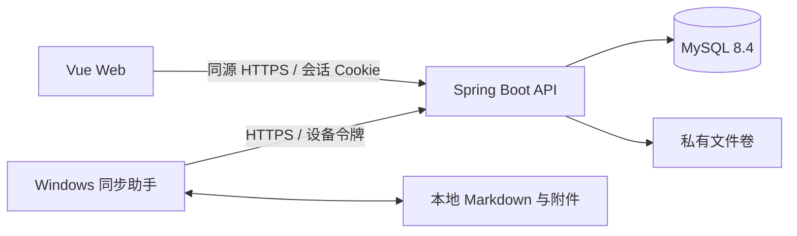

# 私有空间技术架构

版本：v1.0

确认日期：2026-10-27

状态：已确认，用于项目初始化与后续分阶段开发

## 1. 已确认范围

- 单用户、无公开注册，首版管理一个普通笔记库。
- 普通 Markdown 与附件在服务端和 Windows 本地目录均可读，不做端到端加密。
- 密码条目、安全笔记和自定义字段只进入浏览器端加密的保险库；服务端只保存密文和必要元数据。
- Windows 11 通过常驻同步助手实现关闭网页后的双向自动同步；macOS、Linux 和手机目录同步不属于首版。
- 保险库首版为在线 Web 使用并支持加密导入导出，不提供桌面离线保险库。
- 视觉采用浅色工具型界面与墨绿强调色，具体以 PRD 第 5 节为准。

## 2. 架构类型

采用单仓库、前后端分离、模块化单体和单机 Docker Compose 部署。



不引入微服务、Redis、消息队列、Kubernetes 或对象存储集群。后续只有在已有需求无法满足且经过确认时才增加基础设施。

## 3. 技术选型

| 层 | 选型 | 说明 |
| --- | --- | --- |
| Web | Vue 3、TypeScript、Vite | 使用官方 Vite 工程方式；编辑器在 M1 采用 CodeMirror 6 |
| 状态与路由 | Pinia、Vue Router | 按业务模块拆分，保险库解密状态不得泄漏到普通笔记模块 |
| Markdown | 成熟解析器与 DOM 净化库 | 禁用原始 HTML 执行并限制危险协议，具体依赖在 M1 锁定 |
| 服务端 | Java 17、Spring Boot 4.1.x、Maven | 模块化单体；根包名 `com.privatespace` |
| 数据访问 | MyBatis Spring Boot 4.1.x、Flyway | 显式 SQL 和可追踪迁移；不引入 MyBatis-Plus 的额外抽象 |
| 数据库 | MySQL 8.4 LTS | 保存账户、元数据、当前可检索文本、版本关系、密文和同步状态 |
| 文件内容 | 服务器私有文件卷 | 保存不可变文件版本与附件，数据库保存摘要及对象引用 |
| 同步助手 | Python 3.13 原型 | 使用 SQLite 持久化队列和基线；Windows 打包、凭据保护及托盘能力先验证 |
| 部署 | Docker Compose、HTTPS 反向代理 | 只暴露 HTTPS，数据库不直接暴露公网 |

依赖补丁版本通过锁文件或构建文件固定。升级依赖时执行对应测试，不依赖浮动的 `latest` 版本完成生产部署。

## 4. 源码职责

```text
frontend/
  src/
    app/                    应用装配、路由、全局主题
    modules/                note、vault、sync、settings 等业务模块
    shared/                 无业务归属的可复用组件和基础能力
backend/
  src/main/java/com/privatespace/
    modules/                auth、note、file、vault、sync、backup
    common/                 通用异常、常量与基础工具
    config/                 框架与基础设施配置
sync-client/
  privatespace_sync/        Windows 助手实现
database/migrations/        Flyway 迁移的唯一来源
deploy/                     本地 Compose 与后续生产部署配置
```

初始化阶段只创建运行、构建和验证必需的文件，不提前创建空业务分层或占位接口。

## 5. 数据与一致性

### 5.1 普通笔记和附件

- `Note/File` 保存稳定 ID、逻辑相对路径、类型、当前版本和删除状态。
- Markdown 当前文本可在 MySQL 中检索；每次已确认保存产生不可变版本。
- 历史版本和附件先写入私有文件卷并校验摘要，再在数据库事务中发布版本及变更记录。
- 同步内容以相对路径导出，不向 Markdown 强制写入系统专属 ID。

### 5.2 保险库

- 浏览器负责加密、解密和解锁后搜索；API 不接受字段明文。
- 服务端保存整体加密快照、格式版本、KDF 参数、受保护的数据密钥和条件更新版本号。
- 具体 KDF、AEAD、nonce、关联数据和格式迁移必须经过 M0 加密验证和专项设计审查后确定。

### 5.3 条件更新

- 普通内容写入携带对象基线版本、内容摘要和幂等操作 ID。
- 服务端仅在基线版本匹配时发布新版本；不匹配返回冲突，不自动覆盖重试。
- 变更日志使用服务端单调递增游标；删除使用墓碑，不以客户端时钟决定胜负。
- 保险库使用快照版本条件更新，旧版本提交被拒绝并保留本地加密草稿。

## 6. 身份和接口边界

- Web 使用受保护的同源会话 Cookie，启用 CSRF 防护、严格来源校验和接口对象级授权。
- 同步助手使用独立、限权、可撤销设备令牌，只能访问普通笔记同步接口。
- 登录口令、保险库主密码和设备令牌分别管理；登录不等于保险库解锁。
- 接口统一返回错误代码、操作 ID 和可执行提示，不在错误、URL 或日志中记录密钥、密码、令牌及私有正文。

## 7. 备份与恢复

- 数据库、文件卷、保险库密文和备份清单组成一个恢复单元。
- 首版允许短暂暂停写入、等待在途发布结束后制作一致性备份。
- 同机备份不视为灾备；必须由用户选择异机或离线目的地后才能显示整机故障保护已配置。
- 恢复演练需在全新目录或实例核对笔记数量、附件摘要、保险库解锁、历史和设备撤销状态。

## 8. 开发闸口

### M0 三项验证

1. 加密验证：仅用虚构条目验证创建、解锁、篡改拒绝、并发拒绝、改主密码和独立口令导出恢复。
2. 文件兼容验证：中文路径、Frontmatter、相对图片、换行和特殊字符在 Web、Windows 与 Obsidian 间往返。
3. 同步验证：两端并发、离线队列、临时文件替换、删除冲突、崩溃恢复、磁盘满与令牌撤销。

### M1 计划范围

- 单用户初始化与基础登录；正式公网启用前仍须在 M3 完成 TOTP 和安全加固。
- Markdown 笔记、目录、附件、搜索、自动保存状态、历史、回收站、导入和导出。
- 对应接口契约、数据库迁移、前后端测试及文件兼容验证。
- 不在 M1 宣称同步助手或密码保险库已经完成。

## 9. 尚待实施时核实

- Ubuntu 版本、CPU 架构、剩余磁盘、现有服务和可用端口。
- `www.sy.ggh.cool` 的 DNS、证书与反向代理现状。
- 异机或离线备份目的地及可用容量。
- Windows 同步助手原型的凭据保护、通知与打包验证见第 15 节；正式托盘、升级方式、安装签名和资源占用目标仍待 M2 验收。
- 密码协议、安全审查、平台兼容性与性能目标均不得在验证前宣称通过。

## 10. M0 运行与接口约定

### 10.1 当前已接入的运行接口

| 请求 | 成功/失败 | 含义 |
| --- | --- | --- |
| `GET /api/system/health/readiness` | 200 / 503，`{"status":"UP"}` 或不可用状态 | 本次 MySQL 查询、私有文件卷真实读写及可用空间检查 |
| `GET /api/system/health/liveness` | 200 / 503 | 只报告应用进程是否存活，不代替就绪检查 |

健康检查不输出内部路径、连接地址或异常。默认本机监听；前端通过同源 `/api` 代理访问。Flyway 使用 Boot 4 的 `spring-boot-starter-flyway` 自动配置，启动迁移失败时后端不能进入就绪状态。V1 为基线，V2 为账户与笔记业务表；公开接口还包含初始化状态、CSRF、登录及一次性初始化，笔记与附件必须登录。

开发 Compose 项目名固定为 `private-space`，私有卷独立。MySQL 使用 8.4 镜像的固定摘要；升级时显式调整摘要并重跑集成验证。测试项目名为 `private-space-integration`，使用独立数据库 `private_space_it`、随机端口、随机密码和临时存储。

### 10.2 业务接口的统一约定

- 业务 API 前缀 `/api/v1`，JSON 字段采用 lowerCamelCase；成功响应使用对应资源 DTO，不返回持久化 Entity。
- 对象 ID、操作 ID 使用 UUID 字符串；数据库递增版本号和游标在 JSON 中以十进制字符串表示，避免 JavaScript 整数精度丢失。
- 时间使用 UTC ISO 8601 字符串；展示转换为北京时间。时间不参与冲突决胜。
- 写入请求携带 `Idempotency-Key`；更新和删除携带 `baseVersion`。同一身份、方法、目标和操作 ID 的重试返回相同确认结果；相同操作 ID 对应不同请求载荷时拒绝。
- 文件响应包含 `id`、`path`、`type`、`version`、`size`、`sha256`、`deleted`。发布版本、更新当前内容和写入变更日志属于同一数据库事务；对象文件必须先完成写入校验。
- 错误使用 `application/problem+json`，字段为 `type`、`title`、`status`、`code`、`operationId`；不透出堆栈、正文、密码、密文载荷或凭据。
- 分页使用 `cursor` 和有上限的 `limit`；变更游标过期明确返回重新对账信号，不自动推断删除。

| HTTP 状态 | 业务错误代码 |
| --- | --- |
| 400 | `INVALID_REQUEST`、`INVALID_PATH`、`UNSUPPORTED_FORMAT` |
| 401 / 403 | `UNAUTHENTICATED` / `FORBIDDEN` |
| 404 | `NOT_FOUND` |
| 409 | `VERSION_CONFLICT`、`PATH_CONFLICT`、`IDEMPOTENCY_CONFLICT` |
| 410 | `CURSOR_EXPIRED` |
| 413 | `FILE_TOO_LARGE` |
| 429 | `RATE_LIMITED` |
| 503 / 507 | `SERVICE_UNAVAILABLE` / `INSUFFICIENT_STORAGE` |

### 10.3 M1 数据职责

账户保存唯一用户、登录哈希和初始化状态；会话保存令牌摘要、有效期与撤销状态。文件保存稳定 ID、相对路径、类型、当前版本及删除状态；版本保存不可变对象引用、字节数、摘要和来源。当前普通笔记文本单独关联文件与版本供子串查询；保险库不进入该索引。变更日志保存单调游标、文件 ID、版本与墓碑；幂等记录保存操作 ID、请求摘要和确认结果。目录/路径按 Windows 兼容规则校验，大小写冲突不得静默覆盖。

V2 迁移已实现账户、会话、登录失败限制、文件对象、笔记、历史、变更日志和幂等记录；V3 添加设备配对和限权设备身份。真实业务验收状态见下方记录。加密候选范围见第 12 节，M0 Windows 机制、异常同步原型与已完成的 Obsidian 实际编辑往返见第 15 节。

## 11. M0 第一项验收记录（2026-10-28，历史记录）

范围：本地运行基础链路。测试均使用独立测试数据；没有 Mock 服务或内存数据库替代 MySQL。

| 验证方式 | 实际结果与边界 |
| --- | --- |
| Maven 单元测试 | 3 项通过，其中 2 项验证真实临时文件目录读写/不可用和探测文件清理，另 1 项为原有启动注解检查 |
| Maven 集成测试 | 2 项通过；独立 MySQL 8.4、Flyway V1、真实随机端口 HTTP 就绪接口、事务提交/回滚、UTF-8 与 CRLF 字节往返 |
| 前端构建/单元测试 | TypeScript 类型检查及生产构建通过；1 项服务端渲染测试验证收到真实响应前不显示就绪，不证明联调 |
| 浏览器运行链路 | Chrome 实际访问 Vite → 后端 → MySQL/文件卷；1440、1280、375、812px 均通过就绪状态、键盘重试及无横向溢出检查 |
| 实际故障注入 | 停止本项目 MySQL，以上四种尺寸均收到真实 503/DOWN 并显示不可用；恢复数据库后四种尺寸重新通过 200/UP 检查 |
| 容器重建与数据卷 | 修改健康检查后重建开发 MySQL 容器，原 Flyway V1/success 记录仍存在，前端代理返回 200/UP |
| 人工视觉检查 | 已查看 1440px 和 375px 截图，沿用浅色墨绿主题；浏览器检查期间发现并修复重试按钮等待后丢失键盘焦点的问题 |

可复现命令见 README；JUnit 报告在 `backend/target/`，浏览器截图与 JSON 记录在 `frontend/test-results/`，均不提交生成物。后端服务默认只在本机提供健康接口；目前没有账户、笔记、保险库或同步业务接口。本项不代表全部 M0 或任何 M1 功能验收通过。

未验证：真实业务内容经 API 保存及进程重启恢复、Obsidian 往返、保险库密码协议、安全审查、Windows 助手打包与同步异常场景、Ubuntu/HTTPS/备份部署和性能指标。

## 12. M0 加密候选方案与验证边界

本节是可逆验证原型的专项设计，不代表生产密码格式已定稿或安全审查通过。原型位于 `frontend/verification/vault/`，不被产品入口引用；HTTP 控制器和事务存储仅在 `backend/src/test/` 中，包名置于产品扫描范围之外，不打入生产 JAR。测试表只在 `private_space_it` 中创建，没有添加产品数据库迁移。

### 12.1 候选构成

- 使用固定的 `libsodium-wrappers-sumo 0.8.4`，仅作为验证开发依赖；核心算法直接调用该库的高层接口。
- 随机 256 位数据密钥加密载荷；主密码经 Argon2id v1.3 派生独立的 256 位密钥，用于认证加密保护数据密钥。
- 验证参数为 64 MiB、opslimit=3、随机 128 位盐；在 Web Worker 中执行。反序列化时严格限制算法、参数及字段，拒绝任意 CPU/内存消耗；此参数选择仍须在目标手机/浏览器上进一步校准。
- 载荷与数据密钥包装均使用 XChaCha20-Poly1305，每次加密生成新的随机 192 位 nonce；拒绝篡改或认证失败的密文。
- 浏览器主线程/Worker 的口令字符串和解密内容只能短暂保存在内存；可持有的字节缓冲尽力清零，任务完成或失败后终止 Worker。JavaScript 字符串与运行时内部副本不能保证物理擦除。

### 12.2 验证格式

顶层只接受 `format`、`version`、`purpose`、`vaultId`、`keyId`、`kdf`、`wrappedKey`、`payload`，拒绝额外字段。`format=private-space-candidate`、`version=1`，与未来生产格式明确隔离；`purpose` 区分 `vault` 和 `backup`。ID 为 UUID v4 字符串；二进制为规范 URL-safe 无 padding Base64。当前原型明文上限 1 MiB，仅作为验证资源上限，不改变产品容量要求。

`kdf` 保存显式算法、运算次数、内存字节数与盐；`wrappedKey` 保存数据密钥包装的 nonce 与认证密文；`payload` 保存快照 ID、nonce 与认证密文。

包装关联数据使用固定顺序的 JSON 数组，绑定命名空间、格式版本、用途、算法、保险库 ID、数据密钥 ID 与 KDF 参数。载荷关联数据绑定命名空间、版本、用途、算法、保险库 ID、数据密钥 ID 与快照 ID。数据库并发版本不等同于密码快照 ID；CAS 版本控制不能替代认证，也不能保证检测恶意服务端回滚到完整旧快照。

### 12.3 主密码、历史与恢复

- 改主密码先认证原包装及原载荷，生成新盐和新包装，保留数据密钥；候选快照只有经数据库版本检查成功后才能作为当前版本。
- 当前主密码解出的数据密钥可读取同保险库、同 keyId 的历史或加密草稿，不依赖旧主密码。解密历史之前验证用途与绑定 ID。
- 历史/旧草稿或旧备份中原有的包装不会因此失效；已持有旧副本与旧口令的人仍可能读取它们。单纯改主密码不是数据密钥轮换，也不是泄漏后的完整处置。
- 独立备份口令生成全新的盐、包装密钥和数据密钥，不复用在线数据密钥；恢复时解密备份，再为新的保险库 ID 生成新数据密钥。
- `recover.ts` 是本地候选格式恢复验证工具，仅使用本地文件、依赖和标准输入的口令；默认校验输出仅含摘要/字节数。明确指定 `--output` 时才创建明文恢复文件，已有文件禁止覆盖。它尚不是面向用户发布的离线恢复安装包。

### 12.4 验证 HTTP 入口的边界

测试端点使用每轮生成的随机认证令牌，监听本机随机端口；读写均鉴权。真实 HTTP 请求将浏览器生成的加密 JSON 写入独立 MySQL 表；当前快照和不可变历史在同一事务发布，两个旧基线并发提交应恰有一个成功，另一个返回 409。令牌和主密码均不写入报告。

这一 HTTP 层用于验证密码候选方案的真实往返与事务行为，不是产品保险库 API，不包含登录、TOTP、完整幂等契约、生产格式校验、历史清理或产品权限体系。不能据此宣称这些功能已经交付。后端重启验证当前通过关闭并重建完整 Spring 应用上下文、HTTP 服务和连接池实现，尚未覆盖 JVM 进程崩溃和服务器断电。

### 12.5 查证依据

- [libsodium 密码派生与参数指南](https://doc.libsodium.org/password_hashing/default_phf)：显式保存算法/盐/参数，依据可用内存选取参数并测量耗时。
- [libsodium XChaCha20-Poly1305](https://doc.libsodium.org/secret-key_cryptography/aead/chacha20-poly1305/xchacha20-poly1305_construction)：高层认证加密、关联数据及每消息 nonce 的使用约束。
- [libsodium.js 官方仓库](https://github.com/jedisct1/libsodium.js)：浏览器/Node 模块、初始化与包含密码派生接口的 sumo 构建。

公开库文档只支持接口和构造的使用依据，不等同于本项目继承库或其他密码管理器的审计结论。候选组合仍需独立安全审查，之后才能进入正式密码模块和真实秘密迁入流程。

### 12.6 实际验证记录（2026-10-28）

- `npm run type-check:verification`、前端正常类型检查/生产构建及原有单元测试通过。
- `scripts/test-integration.ps1 -IncludeCrypto`：3 项后端单元测试、3 项真实集成测试通过。其中加密集成测试驱动真实 Chrome、Web Worker、认证 HTTP、MySQL 和本地文件恢复，没有 Mock 网络响应或内存数据库替代。
- 500 条虚构条目完成加密保存、读取和解密；API 写入请求与数据库当前/历史记录的扫描未发现测试名称、账号域名、秘密标记和主/备份口令标记。扫描只覆盖本次测试标记，不等于完整数据流审计。
- 错误口令、载荷/nonce/包装/元数据篡改、未知格式、过大 KDF 参数、跨保险库引用均被拒绝；认证失败的输入也无法通过更新操作被悄悄覆盖。
- 同一基线的两个真实并发写入恰有一个成功、一个 409；主密码变更后的旧版本提交被拒绝；故意制造历史表主键冲突后，快照更新事务回滚，原版本保持不变。
- IndexedDB 保存的加密草稿在页面刷新后可用当前主密码恢复；localStorage/sessionStorage 没有写入口令、密钥或条目。当前主密码可读取同 keyId 的历史；旧副本原包装的可解密性限制见 12.3。
- 下载的独立口令备份在新浏览器会话和重建的后端应用中恢复成新保险库；独立 Node 进程用本地文件验证了解密内容摘要一致、错误备份口令拒绝，不调用任何 API。
- 当前 Windows/Chrome 单次创建样本（500 条虚构条目）约 361ms，主线程 20ms 计时器触发 18 次；该数值包含 Worker 启动和加密，不是单独 KDF 基准、P95 性能结论或手机兼容结论。
- 已检查生产 JAR 不含 `verification/privatespace` 类，正常前端 `dist` 不含候选格式、虚构条目或 libsodium 代码。

原始结果位于 `frontend/test-results/vault-<随机ID>/write.json`、`restore.json` 及 `backend/target/failsafe-reports/`，生成物被 Git 忽略；测试容器和网络已移除，开发数据库未被修改。本次没有完成独立安全审查、生产登录/TOTP/CSRF/CSP 接入、主密码强度政策、密钥轮换、完整锁定 UI、手机浏览器校准或 JVM 崩溃恢复，因此仍不得迁入真实秘密；产品保险库功能仍属于后续 M3。

## 13. M1 工作台实施进度（2026-10-28）

本节是开发进度，不代表整个 M0 或 M1 验收通过。PRD 的需求范围没有改变。

- 已接入产品入口：单用户初始化、登录、退出；笔记文件树、CodeMirror 源码与净化预览、中文搜索、收藏、最近访问、大纲、自动保存、普通本机草稿、冲突对比、历史与回收站、单个 Markdown 导入和附件上传/私有下载。
- 前端新增依赖采用已确认的成熟编辑器/Markdown 解析与净化方向：CodeMirror 6、markdown-it、DOMPurify、highlight.js；Lucide 为统一图标，diff 用于普通文本对比。版本由 package-lock 固定，没有接入云服务。
- 初始化凭证由本机启动脚本随机生成并保存在被忽略的 deploy/setup-token.local；账户口令使用 BCrypt，随机会话令牌只保存摘要。Cookie 为 HttpOnly、SameSite=Strict，公网需启用 Secure 和 HTTPS；CSRF 与来源校验均实际执行。
- V2 数据库迁移新增账户、会话、文件、历史和幂等表；私有对象先临时写入并 fsync/原子发布，数据库事务再发布版本、历史和变更。失败可能留下不可访问的孤立对象，自动清理尚未实现，不会为清理而删除历史引用对象。
- NotesIT 驱动真实 Chrome、产品 HTTP、MySQL 和临时真实文件目录；不使用模拟接口。开发中已修复 MySQL 保留字和 CSRF 令牌失效问题。最新 scripts/test-integration.ps1 通过：3 项后端单元测试、3 项集成测试（RuntimeIT 两项，NotesIT 一项）。NotesIT 覆盖初始化/登录、未登录拒绝、CSRF 拒绝、非法路径、新建保存、幂等、旧版本冲突、断网草稿重试、历史恢复、收藏、UTF-8/BOM/CRLF 导入和原字节下载、回收站恢复、附件、危险 Markdown 净化、四种视口宽度无横向溢出、重建后端上下文后重新登录读取及退出失效；上下文重建不是 JVM 崩溃测试。前端类型检查与 1 项单元测试通过，生产构建曾通过，最新细节修改后的构建需重新执行。
- 补充验证：最新 CRLF 编辑规范化修正后，真实笔记集成流程再次通过；已人工查看桌面/手机截图，编辑器换行正常。最新 npm run build 复验也已通过；仍有主包体积超过 Vite 建议阈值的告警，尚未完成加载性能优化与性能验收。
- 保存交互修复：修正“无修改保存”同步结束时残留已完成 Promise、阻塞后续写入的问题；按钮与 Ctrl+S 统一提供显式反馈，只有真实写入确认后显示成功，无修改时单独说明。CodeMirror 已处理的快捷键不再被全局重复触发。NotesIT 已加入无修改保存后再编辑、按钮连续保存、Ctrl+S 成功反馈和断网失败反馈的真实回归，并通过 Chrome/HTTP/MySQL/文件链路验证；故障覆盖使用浏览器真实断网，没有模拟响应。README 同步操作说明，PRD 未改变。
- 分栏和图标提示：按用户新增要求，源码/预览间增加 Pointer Capture 拖动分隔线，宽度比例限制在 20%–80%，支持方向键、Home/End、滑轨点击和双击各半；小于 1024px 时继续显示单栏。图标操作按钮的浏览器原生 title 提示与辅助名称对应。PRD 5.3/5.4 与 README 已同步。真实 NotesIT 回归验证拖动后实际面板尺寸变化、拖动释放、键盘边界、滑轨调整、双击复位、图标名称属性及四种视口；与笔记保存业务一同通过真实 Chrome/HTTP/MySQL 验证，构建通过，无新增依赖。
- 仍未完成：目录批量导入预检、完整 ZIP 导出、历史分页及 30 天保留清理。不能据此宣称完整 M1 已完成。重命名/移动及链接修复的实现见第 14 节。
- 当时尚缺 Obsidian 实际编辑往返；现已由用户实际编辑确认并完成真实接口回传、字节核对，M0 验收关闭记录见第 15 节。

当前接口：GET /api/v1/auth/status、GET /api/v1/auth/csrf、POST /api/v1/auth/initialize、POST /api/v1/auth/login、POST /api/v1/auth/logout；GET/POST /api/v1/notes，GET/PUT/DELETE /api/v1/notes/{id}，GET /api/v1/notes/{id}/history、GET /api/v1/notes/{id}/history/{version}、POST /api/v1/notes/{id}/restore、PUT /api/v1/notes/{id}/favorite；POST /api/v1/files 与 GET /api/v1/files/content。创建/保存请求为 path、type、content、baseVersion；历史恢复传 version 与 baseVersion。收藏为幂等布尔赋值，不发布正文版本；其他正文写入使用 Idempotency-Key，更新/删除检查 baseVersion。列表每页最多 200 条并返回 nextCursor，历史目前最多最近 200 条。

## 14. 文件重命名、移动与链接修复（2026-10-28）

用户明确补充右键菜单和拖拽两种入口，PRD N-01 与 README 已同步。文件树支持笔记、附件和文件夹的右键“重命名 / 移动到…”、Shift+F10 键盘菜单、拖入文件夹、拖回根目录；普通搜索、收藏和最近列表也支持右键操作。目录移动包含仍有效的子目录与文件，稳定 ID 不变；回收站条目保持原路径，并列出恢复前需要原目录的提示。

### 14.1 产品接口与事务

- `POST /api/v1/notes/{id}/move-preview`：登录与 CSRF 保护；请求 `{targetPath, baseVersion}`。只读业务预览，不写入版本；返回 `{fingerprint, fromPath, toPath, changes, warnings}`。changes 项为 `{id, fromPath, toPath, baseVersion, links}`，links 为 `{line, from, to}`，行号从 1 开始。
- `POST /api/v1/notes/{id}/move`：请求在预览字段之外携带 fingerprint，另带 `Idempotency-Key`。统一执行重命名和移动；服务器重新计算预览，拒绝过期版本或过期 fingerprint。`PREVIEW_STALE` 为 HTTP 409，要求重新预览。fingerprint 包含整个路径/版本/删除目录快照，其他笔记或新文件变化也会使其过期；不采用时间先后决定覆盖。
- 两个接口均使用 notebook_lock 获取一致目录快照；提交在一个 MySQL 事务内更新路径、受影响正文、历史、变更日志和幂等确认。附件不改写二进制内容；修复正文先写不可变对象，再发布版本。数据库中途失败时整体回滚，可能遗留不可访问的孤立文件对象，沿用现有清理边界。
- 拒绝非法 Windows 路径、路径超限、目标父目录不存在、大小写重名、回收站重名及文件夹移入自身子树；不会覆盖目标对象。大小写改名保留文件 ID。路径和正文变化均形成新版本；原历史正文与历史路径保留。
- 发起操作前保存当前普通草稿；预览涉及其他本机草稿时阻止确认，要求先打开保存。未知网络失败保留同一操作 ID 供重试；409 不会伪装为成功。移动后刷新目录、搜索结果和当前正文。

### 14.2 Markdown 兼容边界

后端新增固定版本 `org.commonmark:commonmark:0.31.0`，仅用于解析普通 Markdown 的 AST 和源位置，遵循已确认的成熟解析器方向；不替换前端解析/净化库，不引入新服务。使用 [CommonMark 官方源位置 API](https://github.com/commonmark/commonmark-java#source-positions) 定位链接和图片目的地，只替换相应源区间，不将整篇文档重新渲染成 Markdown。

自动处理可准确定位的单行标准行内链接、图片链接及单行引用定义，包括目标改名后的入站链接和源文件移目录后的出站相对路径；保留 URL 查询、片段与标题。路径按 URL 编码保存，预览按可读名称展示。Frontmatter、BOM、CRLF/LF、代码段和代码块保持原样，外部协议地址与锚点保持原样。双链、HTML、无法准确定位的多行/转义/实体写法和无效/缺失目标列出提示并保持原文。预览扫描当前普通笔记，因此也可能提示其他已有的未解析链接。历史不被追溯修复；恢复旧正文后应核查其相对路径。

### 14.3 验证结果与限制

- 5 项后端单元测试通过，其中 2 项解析器测试覆盖 Frontmatter 中 emoji 的 UTF-16 源位置、BOM/CRLF、普通/图片/引用定义、标题、代码保留及出站路径变化；单元测试不替代业务验收。
- 真实集成命令 `scripts/test-integration.ps1` 通过：3 项集成测试，包括真实 Chrome → 产品 HTTP → MySQL/私有文件的 NotesIT。新增场景覆盖搜索结果右键重命名、Shift+F10 菜单、目录选择、拖入目录和拖回根目录、文件夹及子文件 ID、入站和出站链接修复、移动后图片实际解码、旧历史保留、重名与非法路径拒绝、目录快照过期拒绝、相同操作重试幂等，以及重建后端上下文后的路径持久化。
- 故障注入使用真实测试数据库的历史主键冲突，强制多文件事务中途失败；检查原路径、正文和版本全部回滚，清除测试故障后以同一操作重试成功。没有 Mock、内存替代库或伪造网络响应。只在专用 `private_space_it` 与临时目录执行；未对开发库注入故障。
- 前端类型检查和生产构建通过；已查看右键菜单和变更预览截图。依然有既有的主包大小告警，未完成大规模性能验收。M0 的 Obsidian 与 Windows 同步验收已完成，详见第 15 节；其他 M1 剩余项维持第 13 节状态。

## 15. M0 Windows 同步原型与文件兼容验收（2026-10-28）

### 15.1 当前结论与阶段边界

M0 的加密候选验证维持第 12 节结论。Windows 同步原型已经接通真实产品服务、MySQL、SQLite 和本地文件，验证关键风险。2026-10-28 用户在 Obsidian 中实际打开并编辑验收文件，确认显示正常；随后修改文件通过真实接口回传，与 Web 私有下载及第二份 Windows 文件核对字节一致。用户确认 M0 验收关闭。本结论限于 M0 验证范围，不代表完整 M1、M2、M3 产品交付或全面安全审计。

实现位于 `sync-client/privatespace_sync/`；故障与场景编排位于 `sync-client/verification/`，不包含在正常原型入口中。后端使用 `modules/sync/` 调用 NoteService 的真实版本发布事务，不直接跨模块操作 NoteMapper；新增 V3 迁移只创建 sync_pairing/sync_device，不删除既有数据。未替换已确认技术栈。

### 15.2 身份、接口与持久化

| 接口 | 身份与请求 | 实际行为 |
| --- | --- | --- |
| POST /api/v1/sync-devices/pairing-code | Web Cookie + CSRF + Origin；`{name}` | 创建五分钟一次性随机码；只存摘要，响应 `{code,expiresInSeconds}` |
| POST /api/v1/sync/pair | `{code}` | 原子消费有效配对码，签发只允许普通文件同步的设备身份；返回 `{id,name,token}` 一次 |
| GET /api/v1/sync-devices | Web 身份 | 返回设备 DTO，不含令牌/摘要，时间为 UTC ISO 字符串 |
| DELETE /api/v1/sync-devices/{id} | Web Cookie + CSRF + Origin | 持久化撤销；后续设备请求返回 401 DEVICE_UNAUTHORIZED |
| GET /api/v1/sync/snapshot | Bearer 设备令牌 | 在 notebook_lock 下读取一致的普通文件/目录/墓碑元数据及字符串 cursor |
| GET /api/v1/sync/files/{id}?version=… | Bearer 设备令牌 | 条件读取不可变版本字节；无有效版本则拒绝，通用附件下载/CSP sandbox |
| POST /api/v1/sync/files | Bearer + Idempotency-Key | 请求 `{id,path,baseVersion,deleted,sha256,contentBase64}`；新增 id=null/baseVersion="0"，删除需有效基线 |

设备令牌不能使用 Web 笔记、附件或设备管理接口；Web Cookie 不能作为设备通道身份。设备 API 的独立安全链不读取 Cookie，仅对该 Bearer 通道关闭 CSRF；Web 通道继续校验 CSRF 与来源。原型 HTTP 只允许回环地址，其他地址必须 HTTPS，证书验证不被关闭，跨地址重定向不被跟随。

SyncWrite 先校验路径、版本、格式、字节限额及 SHA-256；在一个事务内创建必要父目录并发布不可变对象、当前正文、历史、变更和幂等确认。失败不发布半文件；删除只产生墓碑。原型服务端令牌、配对码都只保存摘要。Windows 令牌使用 [Microsoft DPAPI 用户范围保护](https://learn.microsoft.com/en-us/windows/win32/api/dpapi/nf-dpapi-cryptprotectdata)，无明文降级方案；SQLite 队列包含普通笔记的明文/编码内容，是普通本机数据，不是保险库。

### 15.3 Windows 原型行为

- 使用 [ReadDirectoryChangesW](https://learn.microsoft.com/en-us/windows/win32/api/winbase/nf-winbase-readdirectorychangesw) 唤醒对账，另有定期扫描；读取前后核对文件状态并等待稳定，忽略编辑器临时文件。正常写回可能再唤醒一次检查，但摘要一致不重复发布正文版本。
- SQLite 保存基线、不可变待发送载荷、操作 UUID、冲突和删除观察状态，使用 WAL/FULL 同步。网络失败时先持久化本地编辑；重启后重试相同操作，不把新服务器版本当作无条件覆盖基线。
- 本地文件写入真实临时文件并 fsync，核对当前本地摘要后原子替换；本地再次编辑则拒绝覆盖。根目录身份标记丢失、根/祖先目录出现联接或符号链接、扫描无权访问时暂停，不根据目录失联发送删除。缺失的子目录也会被保守暂停，不能仅凭缺失推断删除。
- 两端并发改动保留远端当前版本及本地冲突副本；如果队列载荷与后续本机编辑不同，均保留。二进制附件按原始字节处理，不强制解码。删除/修改冲突保留修改内容与冲突记录，不自动复活已删除对象。
- 删除使用共同基线和稳定观察；超过 20 个或 10% 时输出具体变化列表及 fingerprint，只有当前列表对应的确认才执行。远端删除前把本地原文件与摘要/路径记录写入状态目录 recycle。不同步 .git/.obsidian、助手状态、缓存、符号链接或目录联接。
- `status`/`once` 只报告本地已知队列、冲突、错误和本轮处理结果，不宣称某台电脑实时在线或全端同步完成；无正式 Web 同步中心。

### 15.4 实际验收记录

完整命令与固定测试镜像见 README。使用 `scripts/test-integration.ps1 -IncludeCrypto -IncludeSync -UsePackagedSync -FullDiskImage …` 执行：

- 后端 5 项单元测试、4 项集成测试通过（RuntimeIT 两项、NotesIT 一项含笔记和 Windows 同步场景、VaultCryptoIT 一项）。Python 本机 4 项单元测试通过，涉及实际文件替换保护、Windows 路径边界与真实 DPAPI 往返/篡改拒绝；单元测试不代替集成结论。
- 两个独立目录、两份 SQLite 和两台设备身份通过真实 HTTP 并发提交同一基线，Markdown 与二进制附件的双方字节均被保留；错误上传摘要被拒绝且没有创建对象。
- 测试中继只转发真实后端响应，不构造成功响应。实际停止其监听以制造 TCP 连接失败，关闭/重启助手再恢复连接后队列可继续提交。另在后端真实提交后阻断确认，并终止真实 EXE 进程；重新启动 EXE 后恢复队列，未发布重复版本。
- 真实文件临时替换保存被 Windows 通知捕获，最终内容在两端一致；真实目录失联、空目录替换、Windows 目录联接不会造成误删除或越界上传。删除/修改冲突保留修改内容；21 文件批量删除先暂停，旧确认因影响列表变化而被拒绝，确认当前列表后完成并留下本地回收副本。
- 通过真实 Docker 内核填满只属于本次测试的 24 MiB tmpfs，收到 ENOSPC。真实文件写入 API 返回 507 INSUFFICIENT_STORAGE，原版本号和字节仍可读取。未填充 Windows 物理卷，也没有在开发库注入故障；客户端物理卷耗尽尚未单独实测。
- 后端应用上下文关闭并重建后，原队列/基线对应文件可读取；设备撤销后旧令牌被拒绝。此处后端上下文重建不等于后端 JVM 断电测试；助手进程终止为实际进程终止测试。
- PyInstaller 固定构建依赖生成 Windows onedir EXE，实际 `--version`、状态读取、DPAPI 解密及断网/崩溃恢复使用打包产物执行。本机目录总量 21,707,076 字节，入口 2,067,235 字节；未完成安装签名、干净 Windows 安装环境及 CPU/内存性能目标验收。
- 中文/特殊路径、BOM、Frontmatter 中 emoji、自定义字段、CRLF、标准相对图片、表格、任务和代码的验收语料已在 Web 私有下载与两份 Windows 文件中核对原始字节一致。早期语料正文 SHA-256 为 `2de75c33fae44d37571985f1caffe67567dbf09c69091c89bd66cbbca0bdded1`；早期 `compatibility.json` 中 obsidianUiVerified=false 仅说明该自动化检查本身不覆盖 Obsidian 人工操作。
- 最终验收在完整命令追加 `-ObsidianVault 'D:\ai_project\Workbench\data\m0-obsidian-vault'`，后端 5 项单元测试和 4 项集成测试再次通过。用户实际添加“Obsidian 手动验证”段落并确认图片显示正常；`obsidian-manual.json` 记录 Frontmatter、自定义字段及相对图片仍在，修改文件经真实上传、第二份 Windows 目录下载与 Web 私有下载核对字节完全一致，SHA-256 为 `0b7a6decfc4d90fe433499e7cece837377600265de2167338470c65e9c1a67d4`。Obsidian 此次保存后的文件是无 BOM 的 UTF-8、LF 换行；同步链路原样保留该输入，不声称 Obsidian 保存仍保留原 BOM/CRLF。

报告在被忽略的 `frontend/test-results/sync-<随机ID>/`，包括 write.json、restore.json、disk-full.json、compatibility.json 和最终人工编辑回传的 obsidian-manual.json；测试不记录原始令牌。测试 MySQL、网络和专用磁盘满容器已清理；本地报告、冲突与回收副本保留用于核对。所有测试只使用独立数据库/普通虚构文件，无 Mock 服务、内存数据库或写死成功结果。

人工素材修正：原来的 1×1 PNG 只适合自动字节校验，不适合人工判断。已新增由确定性 SVG 渲染的 640×320 可视测试 PNG，并在独立 Obsidian 语料中替换其相对图片引用；修改前副本保存在 data/m0-obsidian-before-image-fix.md。验收脚本也使用此可视语料。上述早期正文摘要属于调整图片引用前的记录，最终人工编辑及回传结果以上一条记录为准。素材修正本身未作为 Obsidian 人工验收依据，人工确认和真实回传已另行完成。

### 15.5 M2 待交付边界

当前是有限的全量快照原型（最多 5000 对象），不是增量分页协议。首次配对只接受新空目录，不接管非空库；远端重命名保守要求重新对账，暂不自动迁移本机路径。冲突记录和副本会保留，但没有正式解决界面。正式托盘/小窗、设备管理页面、首次合并预览、增量游标过期策略、冲突解决、目录删除处理、回收站恢复操作、单实例/自动启动、升级、安装签名与负载目标属于 M2 完整产品工作，不能用上述原型验证替代它们。M0 已按上述限定范围完成验收，后续仍需独立完成这些 M2 工作。
