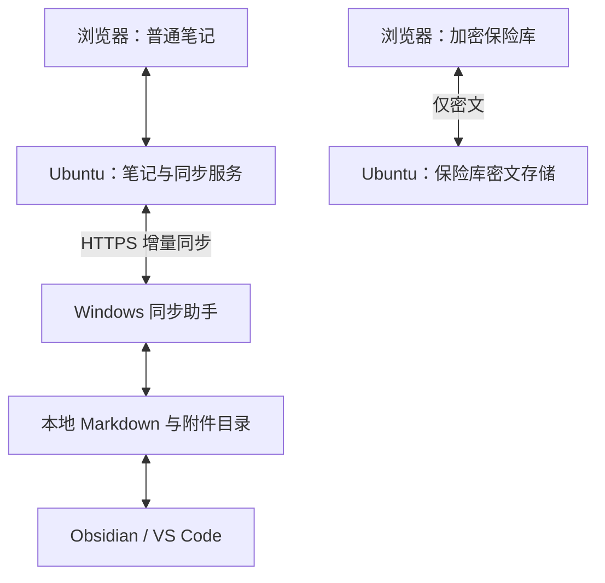

# 个人密码与知识管理系统 PRD

版本：v1.1｜日期：2026-10-27（北京时间）｜状态：AI 开发交付版；视觉方向已确认，实施默认值与待核实环境见第 16 节

> 一句话定位：部署在个人服务器上的私人 Web 工作台，集中管理网站账号密码、编辑 Markdown 笔记，并将普通笔记与附件双向同步到电脑本地目录。
>
> 用户已选定“浅色＋墨绿点缀”的视觉方向。本文可独立交给开发 AI 使用，不要求 AI 能访问此前聊天或原型图片。产品工作名为“私有空间”，名称不影响开发。
>
> 本文是产品需求，不代表系统已经实现、完成安全审计或通过性能测试。未逐项确认的选择标为实施默认值或待核实项；性能数字为验收目标，不应被描述为实测结果。

## 1. 需求来源与默认假设

### 1.1 用户本次明确提出

1. 自己开发一套 Web 系统。
2. 支持密码管理，主要存储网站账号密码等信息。
3. 能像 Obsidian 一样在页面中编辑内容。
4. 文件可以同步到电脑本地。
5. 先整理完善需求，再形成 PRD。
6. 原型比较后，明确采用“浅色＋墨绿点缀”，要求将 PRD 交给 AI 进行开发。

“obsition”按 Obsidian 理解；“像 Obsidian”首先指 Markdown 编辑、文件目录和本地文件可用，不理解为首版复制其全部功能。

### 1.2 沿用此前场景，实施前核实

| 项目 | 已知背景 | 本文处理 |
| --- | --- | --- |
| 用户数量 | 此前表示主要自己使用 | 首版单用户，不开放注册 |
| 服务器 | Ubuntu，4 核 4G | 按单机轻量部署设计，磁盘容量与现有负载待核实 |
| 域名 | 此前提供 `www.sy.ggh.cool` | 作为候选访问域名；DNS、证书和端口是否可用未核实 |
| 本地电脑 | 此前其他项目中使用 Windows 11 | 建议优先支持 Windows 11，不能据此认定所有设备都是 Windows |
| 开发偏好 | Java 优先，Vue 3 + TypeScript 为默认偏好 | 作为技术建议，具体架构先核对再开发 |

### 1.3 为使需求可落地而采用的建议默认值

- 本地同步指“双向自动同步”，而不是仅提供下载按钮。
- Windows 运行一个轻量同步助手；关闭网页后，只要助手仍在运行就能同步。
- 普通笔记保存为标准 UTF-8 `.md`，附件保留原格式；本地可使用 Obsidian、VS Code 或其他编辑器。
- 密码与安全笔记进入独立加密保险库，不作为明文 Markdown 同步。
- 普通笔记首版不做端到端加密，服务器管理者及有权限的本地程序可能读取内容。密码保险库必须在浏览器端加密后上传。
- 首版必须交付“密码、笔记、本地双向同步”完整闭环；可以分阶段开发，但不能把只支持下载的中间版本称为完成全部需求。

以上作为本版实施基线，不等同于用户逐项明确确认。开发 AI 可据此准备设计和可逆的验证工作；涉及改变主技术栈、取消核心功能或调整密码安全边界时先提出具体影响。若调整这些假设，应同步修改范围、流程、验收条件及技术方案，不必为颜色细节、控件选择等常规实现决定反复询问。

## 2. 产品目标与边界

### 2.1 要解决的问题

- 网站账号、密码、安全备注分散存储，查找和复制不方便。
- 普通笔记需要在浏览器中创建、编辑、搜索和归档。
- 不希望文件只能通过某个系统访问，希望电脑上始终有真实文件可离线使用。
- 同一笔记从网页和本地编辑后，需要可靠同步，避免覆盖或丢失。
- 单人维护、服务器资源有限，需要部署、备份和迁移相对简单。

### 2.2 首版成功条件

1. 浏览器登录后，可建立并使用加密保险库。
2. 网页可以编辑 Markdown，附件可上传和引用。
3. 网页修改能同步到本地，本地修改能同步回网页。
4. 本地普通笔记在服务停机或无网络时仍可直接打开。
5. 冲突、误删除、断网、程序重启均有明确处理方式，不静默丢失已确认保存的数据。
6. 笔记可完整导出为 Markdown 与附件；保险库可加密导出并在新实例恢复。

### 2.3 首版明确不做

- 多用户、组织、团队权限、实时协作。
- 公开发布博客、分享链接、评论系统。
- 浏览器扩展、跨站自动填充、自动登录网站。
- 完整克隆 Obsidian 的插件市场、Canvas、Dataview、主题生态及所有语法。
- Word/Excel 在线编辑、Office 格式转换、OCR。
- 移动端原生客户端、手机系统目录后台同步。
- AI 对话、知识库问答、向量数据库、自动读取保险库。
- 通用网盘、大视频同步、服务器远程命令执行。
- 自行设计密码算法或宣称具有成熟密码管理器同等级的安全保障。

## 3. 数据分类：三类内容分别处理

| 类型 | 例子 | 服务端内容形式 | 本地形式 | 检索与使用 |
| --- | --- | --- | --- | --- |
| 普通笔记 | 技术笔记、文章、操作记录 | 普通文本，需权限控制 | `.md` 明文文件 | 服务端可全文检索，本地可直接编辑 |
| 普通附件 | PNG/JPG/PDF/文档资料 | 私有文件对象 | 原格式文件 | 图片预览、下载；不承诺附件全文检索 |
| 保险库内容 | 网站账号密码、API Key、安全笔记 | 客户端加密后的密文 | 首版仅提供加密导出文件，不生成明文账号文件 | 解锁后在浏览器内检索与编辑 |

关键规则：

- 密码条目名称、网址、账号、密码、自定义字段、标签及安全笔记正文都包含在加密载荷中。
- 服务器仍可看到密文大小、版本号、更新时间、访问日志等必要元数据；不得称为隐藏所有元数据。
- 普通笔记不是密码保险库。创建笔记时应提供清楚但不打断日常操作的说明，并提供“新建安全笔记”入口。
- 安全笔记允许 Markdown 编辑，但保存在保险库中，不参与普通文件同步、服务端索引或普通笔记导出。
- 不通过正则判断内容就承诺自动识别所有秘密；用户主动选择存储类型。

## 4. 主要使用场景

| 场景 | 用户操作 | 期望结果 |
| --- | --- | --- |
| 保存网站账号 | 新建登录条目，填写网址、用户名、密码 | 浏览器加密后保存，服务端没有这些字段的明文 |
| 查找并使用密码 | 解锁保险库，搜索条目，复制密码 | 可快速使用，列表默认不显示密码 |
| 记录文章 | 新建 Markdown，编辑并粘贴图片 | 网页保存，图片成为私有附件，本地收到对应文件 |
| 本地编辑 | 用 Obsidian 打开同步目录并修改 `.md` | 助手上传变化，网页刷新或收到更新提示 |
| 断网使用 | 在电脑本地继续编辑 | 文件可正常使用；恢复网络后排队同步 |
| 多端同时修改 | 网页和本地基于旧版本分别编辑 | 保留双方版本，出现待处理冲突，禁止直接按时间覆盖 |
| 误删或服务损坏 | 从回收站、历史或备份恢复 | 恢复流程可执行，能核对文件与密码条目完整性 |

## 5. 页面与交互

### 5.1 主要页面

| 页面 | 主要内容 |
| --- | --- |
| 登录与初始化 | 单用户初始化、登录、二次验证、登录恢复说明 |
| 笔记工作台 | 左侧目录树、中间编辑区、右侧可收起的大纲；搜索、收藏、最近访问 |
| 保险库 | 独立锁定页、条目列表、详情编辑、安全笔记、生成密码、加密导出 |
| 同步中心 | 设备、最后联系时间、待同步数量、失败原因、冲突、暂停与撤销授权 |
| 回收站与历史 | 笔记恢复、版本对比；保险库历史在解锁后单独查看 |
| 设置 | 账户安全、锁定时间、导入导出、容量、备份状态与恢复说明 |

### 5.2 通用交互要求

- 中文界面，桌面优先；手机浏览器可完成笔记基本编辑和保险库基本操作。
- 明确显示“编辑中 / 本机草稿已暂存 / 正在保存 / 服务器已保存 / 保存失败 / 存在冲突”。
- “服务器已保存”与“某台电脑已同步”分开显示。电脑离线时不可显示全端同步完成。
- 敏感操作、不可恢复操作及大批量变更提供具体影响预览。
- 常用快捷键：`Ctrl+S` 保存，`Ctrl+K` 快速查找；不得抢占导致正常输入无法使用。
- 错误提示说明可执行动作，例如重新登录、释放磁盘、解决冲突，不能只显示内部异常堆栈。

### 5.3 已确认视觉规范：浅色＋墨绿点缀

**唯一实施方向：浅色工具型界面，以墨绿强调选中项与主要操作。** 不混入深色 IDE、米色纸张、蓝色企业后台或大面积柔和卡片方案。深色主题不属于首版范围。此前原型图片仅用于方向参考；发生文案、状态或功能差异时，以本 PRD 为准。

| 设计项 | 统一规则 |
| --- | --- |
| 主背景 | `#FAFAF8`，编辑与详情内容区使用 `#FFFFFF` |
| 侧栏背景 | `#F2F3F0` |
| 主色 | 墨绿 `#39765B`，用于主要按钮、选中状态、复选框和焦点提示 |
| 悬停色 | 主按钮建议 `#2E624A`；普通行使用轻微灰绿底色 |
| 选中背景 | 浅绿 `#E7EFE9`，搭配深色文字，不用整屏绿色 |
| 主文字 | `#252A28`；正文对比清楚 |
| 次文字 | `#66706A`；禁用项不得与正常文字混淆 |
| 边框 | `#E1E6E1`，主要通过细分隔线建立层级 |
| 冲突与警告 | 琥珀色，例如 `#B66A13`；危险删除用红色，例如 `#B54747` |
| 圆角 | 输入框与按钮默认 6px，普通面板 6–8px；避免大圆角漂浮面板 |
| 阴影 | 默认不用；菜单、弹窗和托盘可用轻微阴影 |
| 间距 | 按 4/8/12/16/24/32px 统一，不随页面随意变化 |
| 字体 | 使用系统中文无衬线字体；代码使用等宽字体，无需远程下载字体 |
| 字号 | 常规操作与列表 14px；笔记预览正文 16px、行高约 1.7；页面标题 22–26px |
| 图标 | 使用同一套线性图标；常用模块保留文字，不仅靠图标或颜色解释状态 |
| 按钮 | 同一操作区域突出一个主要动作；次要动作使用描边或文字按钮 |

实现中统一使用 CSS 变量或主题 token，禁止在各页面重复写出互相不一致的主题颜色。正常文本对比度目标不低于 4.5:1；支持键盘焦点与标签关联。图标操作按钮在鼠标悬停时显示对应操作名称，并保留供辅助技术识别的名称。无需额外生成设计说明文件，本节即为首版规范。

### 5.4 笔记工作台布局

桌面参考宽度 1440px；可调整宽度为实现建议，不要求机械还原图片像素。

1. 左侧全局导航约 176px：工作名、笔记、密码保险库、同步中心、回收站、设置；底部个人账户。
2. 文件树约 224px：顶部“我的笔记”、搜索、新建笔记和文件夹；选中行浅绿，层级与折叠状态清楚。
3. 中间工作区：文件标签页、路径面包屑、模式切换与历史入口；工具栏固定，正文区域独立滚动。
4. 默认“分栏”：左边 Markdown 源码、右边渲染预览；两区之间的分隔线支持手动拖动调整宽度，并提供键盘调整和滑轨操作。允许切为单独“编辑”或“预览”。源码支持行号、基础高亮、撤销重做和查找。分栏时两边内容属于同一文档版本。
5. 右侧大纲约 160px，可收起；按标题层级跳转到预览并只高亮对应标题，采用浅琥珀色背景与深色文字，与绿色选中状态区分，点击预览正文后取消高亮，不自动引入关系图谱。
6. 收藏和最近访问再次点击时取消当前筛选并返回根目录。
7. 底部状态条分别显示服务器保存、设备同步、Markdown/UTF-8 等信息，不用一个绿色勾代替所有状态。
8. “新建安全笔记”作为次要入口，打开保险库流程；不能把当前普通笔记悄悄改成安全笔记，反之亦然。

优先将可用空间留给内容。窄桌面先收起大纲，再提供可收起文件树；分栏最小宽度不足时切单栏并保留模式提示，不让整个页面产生大范围横向滚动。首版不要求多窗口拖拽布局或多工作区管理。

### 5.5 密码保险库布局及锁定状态

- 解锁后使用“分类 / 条目列表 / 详情”布局，与笔记页共用全局导航和色彩系统。
- 分类包含全部条目、登录账号、安全笔记、收藏；条目列表提供本地搜索和新增入口。
- 详情显示网址、用户名、遮罩密码、复制/显示按钮、标签、备注与修改时间；编辑表单与只读详情明确区分。
- 顶部显示“已解锁”、自动锁定时间及“立即锁定”；加密导出为次要操作。
- 锁定时主区只展示解锁表单与解释，不展示已解密条目名称、标签、搜索结果、详情或先前的安全笔记；全局导航仍可访问普通笔记。
- “显示密码”是临时显示状态，不能与保存密码改动混淆。生成新密码先填入编辑草稿，用户确认保存后才替换原值。
- 新建普通笔记和安全笔记使用不同入口、路径和存储提示，不依靠一个模糊“私密”开关决定是否加密。

### 5.6 同步中心布局及冲突处理

- 顶部标题“同步中心”和“添加设备”，下方包含设备、同步记录、冲突三个视图。
- 设备列表显示名称、本地目录、最后上报时间、在线/离线、暂停状态、待处理数量和撤销授权操作。
- 仅使用少量必要状态摘要，不加入访问量、活跃度等与个人同步无关的统计图。
- 冲突以琥珀色强调，显示文件路径、双方来源和时间、“双方版本已保留”及“对比并处理”。
- Markdown 冲突打开双栏文本对比，提供保留服务器版本、采用本地版本、编辑合并三个明确操作；提交前解释对两端文件的影响。
- 附件冲突展示双方文件名、大小与可用预览/下载入口，允许保留双方或选择其一；不提供虚假的文本合并按钮。
- 已处理的冲突保留结果记录；失败或又出现新版本时继续显示待处理状态。
- 独立备份未配置时显示真实状态，不因同步成功就显示“已备份”。

### 5.7 移动网页与通用状态

- 宽度低于约 1024px 时按空间收起侧栏；低于约 768px 时使用抽屉导航、单栏编辑和详情返回，不强制桌面多栏。
- 手机网页可以看笔记、基本编辑、复制密码和处理简单设置；文件目录后台同步仍由 Windows 助手负责。
- 空目录展示新建/导入入口；空保险库展示新建登录条目与安全笔记；未配对设备展示添加设备步骤。
- 加载、无搜索结果、权限失效、网络中断、容量不足及保存失败分别有状态，不能全部退化成空白页。
- 普通笔记首次在浏览器暂存草稿时说明本机保存范围；退出账户处理本机普通草稿前先提示未提交内容，不把它们误当作加密保险库草稿。
- 删除、恢复、主密码修改、设备撤销、导入覆盖等对话框显示具体对象和影响；取消后不得执行操作。

文件上传显示整批总进度条，依据真实已发送字节更新；传输结束后区分服务器预检/保存阶段，不将上传 100% 当作保存成功。页面内需要确认的操作（删除、恢复、冲突处理、草稿切换、退出及上传/导入/导出）统一使用应用内对话框，不使用浏览器默认 confirm/alert/prompt。关闭或刷新标签页的未保存提醒受浏览器平台控制，保留原生 beforeunload 防丢失保护。导入弹窗点击遮罩不关闭，只能通过显式取消、关闭、完成或 Escape 退出；结果未知时先在应用内提示核对影响。

### 5.8 界面验收依据

浅色与墨绿方向、全局导航、三类核心页面、保存/同步状态和锁定边界为必验项。原型中的虚构日期、字数、设备名、文件数量、图标和占位内容不属于真实数据；实现时全部从真实状态驱动。原型没有展示的空态、错误、锁定和冲突状态同样必须实现。

## 6. 功能需求

优先级：P0 为首个完整可用版本必需，P1 为后续增强，P2 为远期候选。

### 6.1 账户与访问控制

| 编号 | 优先级 | 需求与规则 |
| --- | --- | --- |
| A-01 | P0 | 单用户；通过服务器初始化命令或一次性初始化凭证创建账户。初始化完成后关闭入口，无公开注册。 |
| A-02 | P0 | 登录口令与保险库主密码分别管理；登录成功不等于解锁保险库。界面解释二者区别，不默认复用。 |
| A-03 | P0 | 登录支持 TOTP 二次验证，正式公网使用前完成绑定；提供一次性登录恢复码并要求离线保存。TOTP 种子不能只保存在本系统保险库中。 |
| A-04 | P0 | 登录限速、失败退避、会话过期、退出登录；页面与所有私有接口都需鉴权。 |
| A-05 | P0 | 查看并撤销会话和同步设备；设备令牌仅有普通笔记同步权限，不具有保险库写入或账户管理权限。 |
| A-06 | P0 | 提供服务器侧账户恢复流程，重置登录凭据时撤销会话和设备令牌；不能借此重置保险库主密码或解密密文。 |

### 6.2 密码保险库

| 编号 | 优先级 | 需求与规则 |
| --- | --- | --- |
| V-01 | P0 | 首次创建主密码并二次确认；说明忘记主密码后的后果，完成加密备份验证后才引导迁入真实秘密。 |
| V-02 | P0 | 登录条目包含名称、一个或多个网址、用户名、密码、普通备注、标签、收藏、自定义文本/隐藏字段；均进入加密载荷。 |
| V-03 | P0 | 新增、查看、修改、删除、搜索、收藏；搜索仅在解锁后的浏览器内执行，不将解密字段传给服务端搜索。 |
| V-04 | P0 | 密码生成器使用操作系统/浏览器密码学安全随机源，可设置长度和字符类型；默认建议长度 20，可调整。 |
| V-05 | P0 | 密码默认遮罩；显示后建议 30 秒重新隐藏；复制失败要提示并允许手动复制。 |
| V-06 | P0 | 一键锁定；默认无操作 5 分钟锁定；刷新页面、关闭后重开必须重新解锁；不持久化主密码与解密密钥。 |
| V-07 | P0 | 安全笔记支持 Markdown 文本、预览、搜索；首版不支持安全笔记附件，避免误用普通附件通道泄漏。 |
| V-08 | P0 | 主密码修改须在已解锁且再次确认后完成；新旧版本控制需原子更新，失败不能使现有保险库无法解锁。 |
| V-09 | P0 | 加密导出、加密导入及新实例恢复；导出可使用独立备份口令，备份格式包含版本和解密所需参数。 |
| V-10 | P0 | 并发更新使用保险库版本检查。首版按整体加密快照保存；旧版本提交被拒绝，保留未保存修改供用户重新合并。未提交草稿只允许加密后暂存，重新解锁后可恢复；自动锁定或刷新不能静默丢弃这些修改。 |
| V-11 | P0 | 保留可回退的加密历史与逻辑删除条目，默认 30 天；查看和恢复均需解锁，恢复创建新版本。 |
| V-12 | P1 | 密码重复/弱密码本地检查、浏览器 CSV 导入、独立桌面保险库离线访问。 |
| V-13 | P2 | 浏览器扩展、自动填充、Passkey 管理、第三方站点验证码生成。 |

说明：首版不把保险库同步成可由 Obsidian 编辑的文件。其他浏览器在线访问的是同一份密文保险库；本地离线保险库是后续能力。保险库加密导出是备份与迁移，不应在产品文案中称为密码的实时双向本地同步。

### 6.3 Markdown 笔记与文件

| 编号 | 优先级 | 需求与规则 |
| --- | --- | --- |
| N-01 | P0 | 新建、编辑、重命名、移动、删除笔记；多级目录；同目录重名不直接覆盖。文件操作同时提供右键菜单（重命名、移动到指定目录、删除到回收站）和拖拽移动入口。右键删除复用版本检查和回收站逻辑，需要应用内确认；目录确认后连同当时的子目录和文件一起移入回收站，恢复时还原本次删除前的层级、路径与内容。此前已经单独删除的文件不随本批恢复。 |
| N-02 | P0 | 源码编辑与分栏预览；支持标题、列表、任务列表、链接、图片、引用、表格、代码块和代码高亮。 |
| N-03 | P0 | 自动保存：建议输入停止 1 秒后提交；`Ctrl+S` 可立即触发；以服务端确认作为保存成功依据。 |
| N-04 | P0 | 临时断网时保留当前普通笔记草稿并显示状态；已打开页面可继续编辑。首版不承诺断网后重新打开整个 Web 应用仍可工作。 |
| N-05 | P0 | 搜索普通笔记标题、路径和正文，支持中文基本子串检索；不要求中文分词、语义搜索或 PDF 全文搜索。 |
| N-06 | P0 | 文件树、最近访问、收藏、大纲；中文路径和文件名可正常使用。收藏等系统元数据不要求被 Obsidian 识别。 |
| N-07 | P0 | 文件导入导出不改写原有 YAML Frontmatter；能够保存和再次导出 `[[双链]]` 等文本，即使首版没有完整渲染。 |
| N-08 | P0 | 普通图片粘贴/拖拽上传，使用相对附件路径；失败不插入可被误认为成功的永久链接。 |
| N-09 | P0 | 笔记历史、文本对比、恢复到新版本、删除后回收站恢复。回收站列表将同一批次删除的文件夹显示为单个条目，不平铺其子目录和文件；内部明细仅在恢复选择弹窗中展开。此前单独删除的文件保留独立条目。回收站右键提供“恢复”：文件直接恢复到原位置；文件夹弹窗选择整个文件夹恢复或多选文件恢复。整个文件夹只恢复本次删除批次的剩余项目到原位置，已恢复项目不再次移动。选择文件时展示默认收起的目录树，支持多选，再选择原目录或指定目录；原目录保留原层级，指定目录将文件直接放入目标目录（如 A/子目录/笔记.md → B/笔记.md），不保留内部层级。恢复仅补齐必要父目录，未选文件留在回收站；同名冲突阻止整批，不覆盖。确认前展示路径与链接变化，失败不显示成功。默认历史与回收站保留 30 天，可配置。 |
| N-10 | P0 | 批量导入标准 Markdown 目录及附件；导入支持系统选择目录与应用内拖入目录两个入口；“导入到”使用带文件夹图标、层级与搜索的应用内目录选择器，只能选择根目录或已有文件夹，不能选择文件；拖入后只在本机读取目录信息，点击预检后才上传。导入前以目录树预览重名、非法路径、超限文件，目录默认全部收起，展开后显示子目录和文件；以 . 开头的目录默认排除，不上传并显示排除数量；笔记连同附件可导出 ZIP；默认打开可展开的目录树且不勾选内容，提供复选框选择文档、目录（含子项），通过“全选”按钮选中全部；未选择时禁止导出。单篇文档导出时一并包含其标准 Markdown 相对链接引用的库内附件，保留原目录路径。 |
| N-11 | P1 | `[[双链]]` 导航、反向链接、标签面板、行内即时预览、数学公式和 Mermaid。 |
| N-12 | P2 | 知识关系图、模板、日记、插件体系。 |

新建交互（2026-10-29 用户确认）：新建笔记/文件夹弹窗分开填写名称和创建位置，位置通过已有目录选择器调整，不要求手写完整路径。默认聚焦并选中名称（笔记保留 .md 后缀；未填写时自动补齐），Enter 创建、Escape 取消；中文输入法确认候选词不应触发创建。非法名称和重名在弹窗内就地提示并保留输入。目录箭头只展开/收起，点击名称只选中目录并高亮，作为顶部新建按钮和文件树空白处右键的默认位置；侧栏明确显示当前新建位置。空白处右键提供“新建笔记 / 新建文件夹”，文件夹右键提供“在此新建笔记 / 在此新建文件夹”，根目录右键固定在根目录新建；菜单标明位置。回收站不提供新建入口，编辑器正文保留原有编辑右键。真实创建成功后展开必要目录、定位并高亮新项目，显示服务器确认的成功提示。

文件树选中态互斥：文件、文件夹和根目录共用一个选中状态，按最后一次选择高亮，不同时高亮当前打开的文件和选中的文件夹。点击目录不关闭正文，保存正文不抢回文件树选中态；创建位置仍独立显示，展开箭头不改变选择。

兼容边界：首版兼容标准文件读写，不宣称完全兼容 Obsidian 体验。网页中重命名或移动文件时，预览并更新能够可靠解析的库内标准相对链接；无法解析的链接列出提示。发生于本地的移动或重命名，不承诺自动修复所有链接，交由本地编辑器或用户处理。基础兼容验收使用标准 Markdown 相对图片路径。

### 6.4 附件

- P0：支持普通附件上传、同步、下载；PNG/JPEG/WebP 可预览，PDF 和其他文档至少可下载。
- 首版建议单个 Markdown 最大 1 MiB，单个附件最大 50 MiB；超限明确提示，默认值可配置。
- 笔记中的图片可存储为 `assets/<唯一文件名>`，避免同名覆盖；其他附件保留合理可读名称并处理冲突。
- 附件必须鉴权，不以猜测困难的 URL 代替权限控制；令牌不得放进持久化 Markdown 链接。
- SVG、HTML、可执行文件等不在主应用来源内直接执行或内联展示；通用附件以安全下载方式提供。
- 删除笔记不自动永久删除其附件；引用检查和垃圾清理须考虑历史版本，避免破坏恢复。
- 不上传文件到外部预览、识别或 AI 服务。首版不承诺抗病毒检测，附件不能在服务器上执行。

## 7. 本地双向同步规格

### 7.1 选定的建议路径

采用“Web + 自建服务端 + Windows 同步助手 + 本地真实文件目录”。

服务端是共享版本和变更顺序的协调点；它不在冲突时无条件覆盖本地。普通笔记服务与保险库服务可在同一个后端部署，图中拆开是为了表达数据边界。

依据与限制：浏览器本地目录 API 存在浏览器兼容、HTTPS 和用户授权要求，不能作为跨浏览器、关闭网页后持续运行的通用同步保证 [R1]。因此自动后台同步需要本地常驻进程；不接受安装助手时，可退化为导入导出或受限的页面内同步，但必须修改验收范围。

### 7.2 同步范围

| 对象 | 首版规则 |
| --- | --- |
| `.md` 文件 | 双向同步，保留可读内容与原有 Frontmatter |
| 普通附件 | 双向同步；不符合大小限制时跳过并报告 |
| 文件夹 | 支持创建与层级映射；首版不承诺保留空目录 |
| `.obsidian`、`.git`、编辑器配置、缓存、助手状态文件 | 默认排除，不上传和覆盖；首版不开放任意同步插件配置 |
| 密码条目、安全笔记、解密密钥 | 禁止进入此同步通道 |
| 符号链接、目录联接、授权目录之外内容 | 不跟随、不读取、不写入 |

建议一个账户首版只管理一个普通笔记库，可绑定多个电脑目录。手机浏览器可以编辑服务端内容，但不实现手机目录后台同步。不得将同一目录同时交给另一个双向同步服务管理；如用户坚持叠加，需先完成专门冲突测试。

### 7.3 设备绑定与首次同步

1. 用户在已登录网页创建短期、一次性配对码；助手使用配对码换取可撤销、限定范围的设备令牌。
2. 助手令牌保存到 Windows 凭据保护设施，不写入笔记目录、配置明文或日志；助手不持有保险库主密码或解密密钥。
3. 用户选择本地目录；默认建议新建空目录。
4. 同步前扫描两端，预览新增、同名、排除、超限和非法路径。
5. 空本地目录：下载服务端现有内容；空服务端：上传本地内容。
6. 两端都有内容：默认合并导入；相同路径相同字节视为一致，相同路径不同内容保留双方并进入冲突处理，不按时间决定覆盖。
7. 首次同步绝不因为一端不存在某文件就推断用户删除另一端文件。非空目录初始化必须确认预览后执行。

### 7.4 日常同步

- 助手监听文件变化，并定期重新扫描以弥补监听丢失；建议监听事件稳定 1 秒后处理，定期扫描间隔 5 分钟。
- 本地提交包含文件内容摘要、稳定文件标识或映射、基线版本、设备标识及幂等操作 ID。
- 服务端提供单调递增的变更游标与每个文件的版本号。判断冲突依赖共同基线与内容摘要，不依赖设备时钟。
- 服务端提交必须对同一对象执行版本条件检查；版本不匹配返回冲突，客户端不能自动改成无条件覆盖重试。
- 上传完整校验后才发布新版本；客户端下载到临时文件并校验后原子替换目标。替换前再次确认本地文件未被用户改动。
- 写回本地造成的监听事件必须识别，避免上传下载循环。
- 单个文件失败不阻塞其他文件；建议失败重试为 5、15、30、60 秒，之后最多每 5 分钟重试。鉴权失败、路径非法和磁盘不足等待用户处理。
- 队列、基线、未完成任务持久化，助手崩溃、电脑重启后可恢复；开机启动需用户在助手设置中启用。
- 外部编辑器可能采用临时文件再替换保存；同步需识别稳定后的最终文件，不将瞬时缺失当作永久删除。
- 不保证分块去重或断点续传；首版小文件与限额附件可整文件重试，但不得暴露半文件版本。

### 7.5 冲突与变更规则

| 情况 | 必须行为 |
| --- | --- |
| 仅网页修改 | 下载新版本；仅在本地仍与基线一致时替换 |
| 仅本地修改 | 条件上传，成功后更新本地基线 |
| 两端均修改同一文件 | 保留服务端当前版本与本地冲突副本，显示冲突；首版不自动拼接正文 |
| 附件同名不同内容 | 保留双方副本，不通过最后修改时间覆盖 |
| 一端删除、另一端修改 | 保留修改内容并提示删除冲突，不直接删除修改版本 |
| 多设备并发修改 | 与两端冲突同一规则，适用于多个浏览器标签页和多个助手 |
| 本地重命名无法可靠识别 | 允许按新增与删除处理，保留历史和回收站，不能误删同名新文件 |
| Windows 非法文件名、大小写冲突、路径过长 | 拦截并显示待处理项；不静默改名覆盖；Web 新建路径按目标 Windows 规则校验 |
| 本地目录被拔除、无权限或整体暂时不可达 | 暂停同步并报错，不将所有文件标记删除 |

冲突副本建议命名：`原文件名 (conflict-设备-唯一标识).md`，时间仅用于阅读，不用于决胜。网页冲突中心应记录双方对应版本；用户可保留远端、采用本地或手动合并。解决时仍须检查版本，避免覆盖期间出现的第三份修改。冲突副本在解决前按普通文件保护，不随普通历史过期自动清理。

### 7.6 删除、离线过久与防误操作

- 删除采用墓碑记录，跨端传播前必须确认设备具备有效基线。
- 普通删除可同步到其他设备，但双方保留 30 天回收站；本地恢复副本放在受保护的应用数据目录，不混入用户工作目录。
- 变更日志与墓碑建议保留至少 90 天。超过有效游标范围或基线丢失的客户端进入重新对账，不直接补发旧删除或复活已删除文件。
- 重新对账按首次合并原则预览；对无法确定的删除保留双方，不以“缺失”自动执行破坏性操作。
- 一轮拟删除或重命名超过 20 个文件，或超过已有同步文件数的 10%，触发影响预览并暂停该批破坏性操作，待用户确认；阈值可配置。
- 磁盘不足时暂停写入、保存任务状态、清楚报错，不删除未确认备份来腾空间。

### 7.7 助手与状态可见性

P0 助手至少提供托盘状态或小型状态窗口：选目录、配对、开始/暂停、手动同步、打开目录、查看错误、退出。无需内置笔记编辑器，也无需开放本地 HTTP 控制端口。网页显示“最后一次上报状态”及设备在线/离线判断，不将历史状态伪装成实时在线。

## 8. 密码安全与恢复要求

### 8.1 威胁模型与责任边界

需要保护：服务端磁盘、数据库、普通备份被读取时，不泄露保险库字段明文；网络窃听与未登录访问不能获取私有内容；Markdown 与附件不能执行脚本偷取已解锁数据。

不作以下承诺：恶意浏览器扩展、已中木马的电脑、键盘记录器、被篡改的前端代码、被完整控制的在线服务环境仍能保证秘密安全。Web 客户端加密不能消除恶意页面脚本获取解锁后数据的风险。普通笔记服务器端明文也不属于保险库加密保护范围。

### 8.2 必须遵守的规则

1. 保险库在浏览器内加密和解密；主密码、解密密钥、字段明文不提交到 API，不进入日志、URL、分析、错误上报和服务端搜索。
2. 随机数据密钥与主密码派生密钥分开管理。主密码用于保护数据密钥，数据密钥用于加密载荷；格式须带版本、盐、KDF 参数和认证信息。
3. 使用维护中的成熟密码库和标准带认证加密机制；KDF、参数、随机数/nonce 唯一性、关联数据和格式迁移在专项技术设计中确定并审查。不得由 AI 临时拼装未经验证的加密协议。
4. 解密失败、密文被篡改、版本不支持时停止操作并保留原始密文，不能覆盖成空保险库。
5. 解锁密钥仅存在当前页面运行内存；锁定时移除明文 UI、搜索索引及密钥引用，尽力清理，不宣称 JavaScript 能保证物理内存完全擦除。
   未提交的保险库草稿使用现有数据密钥加密后暂存到本机，锁定后只能再次输入主密码恢复；不为保留草稿而持久化解密密钥。若暂存失败，锁定仍优先执行，并明确报告未保存内容可能丢失，不显示已保存。
6. 普通 Markdown 禁用原始 HTML 执行，解析后仍做成熟净化处理；限制危险 URL、事件属性和脚本，落实 CSP。安全笔记采用同等限制 [R4]。
7. 密码页面不加载第三方分析、广告、远程脚本和第三方插件；基础资源随应用部署，依赖版本锁定并记录升级。
8. 普通 HTML/SVG 等附件不能在主应用同源上下文执行；外部链接限制协议，远程图片默认不自动加载，避免追踪与隐私泄漏。
9. HTTPS、受保护的会话 Cookie、CSRF 防护、严格来源校验和接口授权检查不可省略。同步设备令牌与 Web 会话分别管理。
10. 登录口令使用合适的单向密码哈希；不能用可逆加密代替。登录 TOTP 种子如需服务端解密验证，其保护密钥与数据库备份分离；该种子不等同于保险库数据密钥。
11. 复制密码后可提示用户清理剪贴板；浏览器无法可靠保证自动清除或清除系统剪贴板历史。若尝试定时清理，需能力检测并避免覆盖用户后来复制的新内容，不以此作为安全保证。
12. 浏览器端加密与密文存储原则可参考成熟密码管理器公开设计，但参考不等于本项目继承其审计结论，也不照搬历史参数 [R3]。

### 8.3 主密码、登录恢复与备份口令

| 丢失内容 | 首版处理 |
| --- | --- |
| 登录密码或 TOTP 设备 | 通过离线登录恢复码或服务器管理流程恢复账户访问；撤销旧会话与设备令牌 |
| 保险库主密码 | 服务端不能直接找回；若存在已验证、使用独立口令的加密导出，可恢复该导出时点的数据 |
| 独立备份口令 | 不能解开对应导出；仍能用主密码解锁在线保险库时应重新创建备份 |
| 主密码与所有可用备份凭据均丢失 | 首版无法恢复旧保险库，只能在明确影响后重建 |

修改主密码不撤销别人已拿到的旧备份。若怀疑数据密钥或真实网站密码泄漏，需要专项密钥轮换/凭据更换，不能把单纯改主密码称为已解决。旧历史、旧备份的解锁与迁移策略必须在技术设计中明确。

### 8.4 上线门槛

密码功能先使用虚构测试数据。导入真实秘密前，必须通过安全关键实现审查、密文篡改与错误口令测试、日志/存储明文检查、XSS 验证，以及一次从导出到新实例的恢复演练。有未解决的高风险问题时标记密码模块未达到真实数据使用条件，不能通过隐藏提示视为完成。

## 9. 数据与一致性约束

以下是逻辑模型，不是最终数据库表结构。

| 对象 | 关键数据或职责 |
| --- | --- |
| Account | 单用户标识、登录密码哈希、TOTP 配置、初始化状态 |
| Session / Device | 有效期、撤销状态、设备权限、最后联系时间；令牌摘要存储 |
| Note / File | 稳定 ID、逻辑相对路径、类型、当前版本、删除状态 |
| FileVersion | 不可变内容对象引用、大小、内容摘要、创建设备与版本号 |
| ChangeLog | 单调递增游标、对象变更和删除墓碑 |
| ClientState | 各对象已同步基线、游标、操作 ID、失败与冲突状态 |
| VaultSnapshot | 加密载荷、密码格式版本、受保护的数据密钥及派生参数、条件更新版本号 |
| Conflict | 涉及版本、保留副本、处理状态；保险库冲突不记录解密内容 |
| BackupManifest | 备份时间、版本、对象清单、校验与恢复结果，不包含明文秘密 |

一致性规则：

- 服务端文件内容采用不可变对象，先完成写入与校验，再通过事务发布版本、元数据与变更记录；失败遗留对象可稍后清理，不能发布不存在的文件版本。
- 数据库逻辑目录与内容对象共同组成有效状态；禁止直接在服务器对象目录里人工改文件并期望自动同步。
- 同一请求重复提交不得产生重复新文件或重复删除；服务重启后保证已确认版本可读取。
- 客户端内容摘要用于校验与差异检测，不充当权限凭据。
- 导出普通笔记不强制写入专属 ID 或破坏已有 Frontmatter；本地映射信息保存在同步助手应用数据目录。
- 更新失败保留当前草稿；数据迁移失败需可回滚，不能破坏旧版本格式。

## 10. 非功能要求

### 10.1 建议验收数据集与目标

下列数值用于制定验收计划，不是已测性能承诺。

| 项目 | 首版建议目标 |
| --- | --- |
| 测试环境 | Ubuntu 4 核 4G，SSD，单用户；独立记录已有系统负载 |
| 数据量 | 2,000 篇普通笔记，总正文不超过 100 MiB；500 个保险库条目；1 GiB 普通附件 |
| 使用方式 | 1 个浏览器会话 + 2 台逻辑同步设备，同时正常编辑；不把 2,000 篇笔记全部打开 |
| 网络基线 | 测试环境至少 100 Mbps，往返延迟约 50 ms；记录实际条件 |
| 普通笔记保存 | 100 KiB 以内，保存请求服务端确认 P95 ≤ 2 秒，不计自动保存等待与本地助手延迟 |
| 普通笔记搜索 | 上述数据集简单中文/英文子串检索 P95 ≤ 1 秒 |
| 小文件同步 | 助手在线、队列空、无冲突时，100 KiB 以内的变化 95% 在 10 秒内到达另一在线端 |
| 服务端资源 | 业务服务、数据库、反向代理稳定运行建议合计常驻内存不超过 2.5 GiB，压测无 OOM，给备份与系统留余量 |

密钥派生耗时、首次同步、大附件传输和恢复耗时单独测试，不与上述小文件指标混为一谈。服务器带宽、磁盘容量、实际依赖内存占用均需实施时测量。

### 10.2 可维护性与部署

- 单机 Docker Compose 部署；业务服务为模块化单体，不引入微服务、Kubernetes、消息队列、向量库。
- 数据、配置、密文、日志持久化目录清楚；重建容器不会删除用户文件。
- 外网只暴露必要 HTTPS 服务，数据库、内部接口不直接暴露公网；证书续期与健康检查可观测。
- 设置磁盘容量阈值，建议 80% 提醒、90% 拒绝新增大附件并保留读取能力；具体阈值可配置。
- 依赖与数据结构迁移有版本记录；升级前备份，失败可回滚；不能将运行秘密提交 Git。
- 无错误堆栈、密文载荷或内容明文进入面向用户的通用日志；日志保留必要操作 ID、结果和设备等诊断元数据。

## 11. 备份、恢复与迁移

同步会传播误删，因此不能代替备份。

### 11.1 三条恢复路径

1. 日常误操作：版本历史、冲突副本与回收站。
2. 整机或磁盘损坏：数据库、文件对象、密文、必要配置及完整性清单的一致性备份。
3. 不再使用本系统：普通笔记 ZIP 导出，保险库独立口令加密导出，并提供可离线运行的恢复/解密工具及格式说明。首版不宣称兼容 KeePass、Bitwarden 等导入格式。

### 11.2 默认建议策略

- 每日自动备份，保留最近 7 份日备份与最近 4 份周备份；执行时间由部署配置指定。
- 同机备份仅用于快速恢复；至少配置一个由用户选择的异机/离线目的地，未配置时显示“整机故障保护未配置”，不显示已达成灾备。
- 普通笔记也进入加密备份；外层备份加密密钥与备份副本分开保存，不将保险库主密码存入备份任务。
- 备份必须来自可证明一致的快照：首版允许短暂暂停写入并完成在途写入后备份。不得随意复制运行中的数据库文件再声称一致。
- 至少一次恢复到全新目录或实例：核对笔记数量、附件摘要、保险库解锁、历史与设备状态；恢复实例默认撤销旧会话和令牌并重新配对。
- 建议目标：完整每日异机备份成功时，故障数据损失窗口不超过 24 小时；恢复耗时目标 2 小时内，在上述数据集下验证。异机备份缺失或失败时不得继续宣称达到该目标。
- 加密导出保留所需版本、参数与格式文档；独立备份口令恢复须实际演练，不能仅测试“文件成功下载”。

## 12. 技术实现建议与设计闸口

### 12.1 默认技术建议

| 层 | 建议 | 原因与限制 |
| --- | --- | --- |
| Web | Vue 3 + TypeScript | 沿用用户偏好；编辑器采用成熟组件，不自写完整 Markdown 编辑器 |
| 服务端 | Java + Spring Boot 模块化单体 | 沿用用户主技术栈；具体版本在实施时选择受支持版本 |
| 数据库 | MySQL，持久化元数据与密文 | 与现有经验一致；单用户不引入 Redis。若有明显资源问题，再比较 SQLite/PostgreSQL 并确认 |
| 内容对象 | 服务器私有文件卷 + 数据库对象索引 | 避免小型单人系统额外维护对象存储集群；同时落实一致性备份 |
| 本地助手 | 优先做 Python 可打包原型，最终语言在验证后确认 | 文件监听、Windows 凭据保护、托盘、打包和升级必须实测；不因后端 Java 就强制助手使用同种语言 |
| 通信 | HTTPS API + 游标增量同步 | 首版可用短轮询，不要求引入实时推送基础设施 |
| 部署 | Docker Compose + HTTPS 反向代理 | 对应 Ubuntu 单机；不在 PRD 固定未经核验的镜像版本和部署命令 |

这些是建议，不视为技术选型已获确认。密码格式、编辑器选型、全文检索实现、助手语言和数据库配置都应在设计阶段给出证据与最小验证，再进入对应模块开发。

### 12.2 建议模块划分

后端按业务模块分组：`auth`、`note`、`file`、`vault`、`sync`、`backup`；基础异常、常量及工具进入 `common`，配置进入 `config`。模块内使用 controller / service / service.impl / mapper / entity / dto 等熟悉分层，避免将所有业务混在公共目录。

这是架构讨论起点，不要求为每个操作都生成全套空类或跨模块抽象。前端划分笔记工作台、保险库、同步中心和设置，避免从 Markdown 渲染模块直接访问保险库解密状态。

### 12.3 开发前必须完成的三个验证

1. **加密验证**：用虚构条目实现创建、解锁、篡改拒绝、主密码变更、并发拒绝和独立口令备份恢复；审查浏览器存储、请求与日志。
2. **文件兼容验证**：同一目录在网页、Windows、Obsidian 中往返读写，覆盖中文路径、相对图片、Frontmatter、换行与特殊字符。
3. **同步验证**：两设备修改同一基线、离线编辑、监听漏事件、临时文件保存、删除冲突、崩溃恢复、磁盘满和令牌撤销均按规则运行。

验证结论形成简短技术设计并与 PRD 对齐，不能先生成大批业务代码再补架构。

## 13. 开发阶段与交付物

| 阶段 | 工作内容 | 退出条件 |
| --- | --- | --- |
| M0：需求与技术设计 | 核对默认假设、页面草图、三项关键验证、数据与安全设计 | 用户确认关键方向，风险与未完成项可见 |
| M1：笔记闭环 | 初始化与登录、Markdown、附件、目录、搜索、导入导出、历史 | 网页笔记可用且标准文件往返不丢内容 |
| M2：本地同步闭环 | Windows 助手、配对、增量、双向、冲突、删除与恢复 | 双端及异常测试通过，关闭网页仍可同步 |
| M3：保险库与加固 | 客户端加密、条目、安全笔记、锁定、TOTP、加密导出恢复、审查 | 密码安全上线门槛通过，方可使用真实秘密 |
| M4：部署与验收 | Compose、备份、全新实例恢复、资源与性能测试、使用说明 | 所有 P0 验收通过，形成首个完整版本 |

M1/M2 可以使用虚构密码测试页面，但不能提前作为真实密码存储工具。实际阶段可部分交叉，不以表格顺序代替安全依赖。

每阶段只实现约定模块，提交可运行结果、必要测试、已知问题和文档差异。实现与文档冲突时先说明影响；用户指定方向后，同步修改 PRD 与设计文档，再继续实现。

## 14. 核心验收用例

| 编号 | 操作 | 通过标准 |
| --- | --- | --- |
| T01 | 创建账户后再次访问初始化/注册入口 | 不能重复创建账户或开放注册 |
| T02 | 未登录访问笔记、附件、密文与同步接口 | 均拒绝；无法借对象 ID 绕过授权 |
| T03 | 新建含中文、表格、代码及相对图片的笔记 | 网页与本地内容可读，导出再导入语义与文件字节关系不被无故破坏 |
| T04 | 网页修改已同步笔记 | 达到小文件同步目标，本地内容更新，状态区分服务器保存与设备同步 |
| T05 | Obsidian 本地编辑与其临时文件替换式保存 | 网页得到最终版本，不产生误删除或无限同步循环 |
| T06 | 关闭网页，保持助手运行并在本地新增文件 | 文件仍自动上传；网页重开可见 |
| T07 | 断网本地修改，重启助手后再联网 | 队列恢复，变更不丢；若远端也改则触发冲突 |
| T08 | 两端基于同一版本分别修改 Markdown 或附件 | 两份内容完整保留，显示待处理项，不按时间静默覆盖 |
| T09 | 一端删除、另一端修改；随后手动解决 | 修改内容保留，删除冲突明确；解决受版本检查保护 |
| T10 | 模拟整目录暂不可达及超过阈值批量删除 | 不传播瞬时目录缺失；批量删除等待影响确认 |
| T11 | 助手中途崩溃、内容传输中断、磁盘满 | 不发布半文件；当前已确认版本仍可读取；重试幂等 |
| T12 | 创建特殊路径、大小写重名、超限文件 | 清楚报告，不越目录、不覆盖已有不同内容 |
| T13 | 创建测试保险库后检查请求、数据库、日志、持久化浏览器存储 | 无主密码、解密密钥和测试字段明文；仅必要密文与元数据持久化 |
| T14 | 错误主密码、篡改密文、旧版并发提交 | 拒绝解密或更新，旧密文完整；保留未保存编辑供处理 |
| T15 | 自动锁定、刷新和重新打开页面 | 重新输入主密码才能查看；密码默认遮罩；复制失败可理解 |
| T16 | 普通笔记导出与同步目录全面检查 | 不包含保险库条目、安全笔记或密钥明文 |
| T17 | Markdown、链接、图片与附件中注入恶意脚本 | 不执行脚本、不通过危险协议或同源附件偷取会话及解锁内容 |
| T18 | 修改主密码与执行独立口令加密导出 | 新口令解锁正常；按设计处理历史；导出可在新实例恢复，错误口令拒绝 |
| T19 | 撤销同步设备与恢复登录账户 | 旧令牌失效；重置登录不会解开保险库 |
| T20 | 从完整备份恢复全新实例 | 笔记、附件摘要、保险库及历史可核对；旧会话设备须重新授权 |
| T21 | 使用过期游标或丢失本地基线重新接入 | 进入合并对账，不自动批量删除或复活过期文件 |
| T22 | 跑建议数据集与网络条件下的性能/资源测试 | 给出实际结果；未达到目标时记录原因并修正，不以理论估计代替测试 |
| T23 | 在 1440px、1280px 及手机宽度检查三个核心页面 | 使用浅色墨绿规范；窄屏按规则收起面板；文字、主要按钮和内容不被遮挡 |
| T24 | 锁定保险库后搜索、切页、返回和刷新 | 无条目名称、标签、正文等明文残留 UI；普通笔记可正常访问 |
| T25 | 在密码编辑表单生成新密码后取消 | 原密码保持不变；只有明确保存成功才更新条目 |
| T26 | 无数据、网络失败、会话失效、导入失败与磁盘不足 | 显示各自明确状态，不能以空列表掩盖错误或显示虚假的成功 |
| T27 | 检查正式部署中的交互、统计和保存结果 | 无未说明的模拟接口与写死成功状态；刷新及服务重启后已保存数据真实存在 |
| T28 | 在有未提交内容时切换文件、关闭编辑、锁定或退出 | 按普通/保险库草稿各自规则保存或提示；不静默显示成功并丢弃内容 |

## 15. 风险与取舍

| 风险/取舍 | 本文决策 |
| --- | --- |
| 同时做密码管理、编辑器与同步，工作量容易膨胀 | 三个核心保留；自动填充、图谱、AI、协作全部后置 |
| Markdown 与密码同处应用，XSS 影响较大 | 限制渲染与附件执行、依赖审查；不承诺加密可以抵御被篡改前端 |
| 本地真实文件必须能被编辑器读取 | 普通笔记本地明文；秘密进入独立保险库，本地系统安全由用户维护 |
| 同步不是简单文件复制 | 条件更新、共同基线、冲突副本、删除墓碑与异常恢复为 P0 |
| 自研密码模块缺少成熟产品审计积累 | 密码协议专项设计、虚构数据验证、安全审查与备份演练是上线门槛 |
| 4G 内存与磁盘未知 | 单体部署、不上重型中间件；资源实测，磁盘容量与备份空间另行核实 |
| 浏览器剪贴板、内存擦除能力有限 | 诚实提示能力边界，不把尽力操作当作可靠安全保证 |
| 使用同一同步目录叠加其他同步软件 | 默认避免；若需要叠加，另行增加一致性验证 |

## 16. 实施基线与待核实项

视觉方向已确认：浅色＋墨绿点缀。以下其他选择沿用本稿实施默认值；用户没有逐项确认，开发 AI 不应描述为全部已批准。常规实现可按默认值推进，架构摘要中集中列出重要取舍；仅在确实影响产品范围、安全边界、主技术栈或外部资源时提出具体问题，不逐条重复询问。

| 选择 | 本稿建议默认值 | 如果不同，将影响什么 |
| --- | --- | --- |
| 本地是否安装助手 | 接受，优先 Windows 11 | 拒绝时无法承诺关闭网页后持续自动同步，需改变产品验收 |
| 是否直接用 Obsidian 编辑同步目录 | 支持标准 Markdown 文件，不要求必须安装 Obsidian | 如要求完整双链/插件兼容，需扩大首版范围 |
| 密码是否也要独立桌面离线使用 | 首版 Web 保险库 + 加密导出；桌面离线后续做 | 如首版必须离线，则新增本地加密存储、解锁和密文并发协议 |
| 普通笔记是否必须端到端加密 | 首版不要求，权限控制与加密备份 | 如需要，则浏览器/助手加解密、客户端检索、密钥恢复及附件处理均需重设计 |
| 使用设备 | Windows 11 + 主流浏览器，手机网页基本操作 | macOS/Linux 助手需单独打包、凭据保护与文件系统测试 |
| 技术选型 | Java 后端、Vue 3 + TypeScript；助手语言待验证 | 调整后同步更新设计与开发规范，不默认自行改主栈 |
| 预计数据与磁盘 | 先按建议验收集，磁盘总量待核实 | 影响限额、保留策略、备份目的地和上传方式 |

部署前由实际环境核实 Ubuntu 版本、CPU 架构、可用内存、磁盘剩余空间、占用端口、域名 DNS、证书和异机备份目的地。缺少服务器访问条件时可先完成本地开发与可复现部署配置，不编造服务器验证结果。默认按北京时间显示时间，底层使用带时区或 UTC 时间记录；时钟不参与同步冲突决胜。

## 17. 查证依据与使用说明

检索日期：2026-10-27。以下来源用于核对基础事实，不证明本项目实现已经安全。产品范围、数值默认值、架构与优先级为本文的设计建议。

- **[R1] MDN — Window.showDirectoryPicker()**  
  https://developer.mozilla.org/en-US/docs/Web/API/Window/showDirectoryPicker  
  核对点：本地目录选择 API 的兼容限制、HTTPS 环境、用户交互和授权要求。
- **[R2] Obsidian — How Obsidian stores data**  
  https://help.obsidian.md/Files+and+folders/How+Obsidian+stores+data  
  核对点：笔记以本地文件夹中的 Markdown 纯文本存储，可由其他编辑器管理。本稿借鉴文件可携带性，不声称实现其全部功能。
- **[R3] Bitwarden — Security Whitepaper**  
  https://bitwarden.com/help/bitwarden-security-white-paper/  
  核对点：客户端加密、密文存储与密钥管理的成熟产品设计参考；不沿用旧文档中的历史参数，不继承其安全认证。
- **[R4] OWASP — DOM based XSS Prevention Cheat Sheet**  
  https://cheatsheetseries.owasp.org/cheatsheets/DOM_based_XSS_Prevention_Cheat_Sheet.html  
  核对点：不可信文本进入 DOM 的脚本执行风险及安全渲染要求。
- **[R5] Obsidian — Troubleshoot Obsidian Sync**  
  https://obsidian.md/help/sync/troubleshoot  
  核对点：多端与离线编辑可能造成冲突，产品需明确冲突策略。本稿选择保留副本、人工解决，不复制其默认自动合并策略。

## 18. 交给开发 AI 的执行约束

1. 先阅读项目现有规则及本 PRD。若沿用此前规范库，将本文件放到 `docs/prd/`，规则放到 `docs/rule/`；确认所用工具实际读取了规则入口。
2. 先按第 16 节整理实施基线，提交轻量架构与关键验证计划，按第 19 节进入开发；不要一次生成完整系统，也不要为已经确认的视觉方向重复请求选择。
3. 不以“先做简单版”为由取消双向同步、冲突保护、密码加密和恢复能力；缩减这些内容须明确变更产品范围。
4. 加密协议不能临时编造；无法提供可靠实现与审查时，把密码模块标为未达到真实数据使用条件。
5. 普通笔记同步与保险库密文传输严格分离；不能用 Markdown 明文保存密码作为实现捷径。
6. 技术实现与文档冲突时给出影响及备选；用户指定方向后同步更新本文和设计，保证需求、实现及验收一致。
7. 交付可复现部署、适当测试、备份恢复方法及真实已知限制；不声称未经测试的安全、兼容或性能结论。
8. 首版使用第 5.3–5.8 节的浅色墨绿界面，不以个人审美另换风格；原型与文字冲突时以本文为准。
9. 页面原型、Mock 数据和占位按钮不能算真实功能交付。开发演示如需使用 Mock，须事先取得用户明确同意并醒目标识模拟范围与未实现能力；正式流程必须接通真实接口、后端业务逻辑、持久化、鉴权和失败处理。

## 19. AI 开发执行说明

### 19.1 文档与代码的组织

- 将本文保存为仓库 `docs/prd/PRD.md`，作为此项目的产品依据。已有规则按仓库实际入口读取；若沿用此前规范，读取 `docs/rule/AGENTS.md`、`CODING.md`、`STACK.md`、`INIT.md`。文件不存在时说明现状，不虚构已读取或自动生成一批新规范。
- 新项目建议使用 `frontend/`、`backend/`、`sync-client/`、`deploy/`、`docs/` 和根 `README.md`。这是源码项目的职责分组，不是要求将此前“仅文档规范库”的根目录约定照搬到业务仓库。
- Java 后端按 `com.<自定组织>.<项目>.modules.<业务模块>` 组织，模块内按已有规范分层；不使用真实个人域名臆造已注册组织信息。
- 技术设计优先采用已有项目文档，或以简短架构摘要回复；不为每个决定都新建文件。需要长期记录时集中维护一份轻量设计说明。
- 在现有 Git 仓库中工作时先检查已有代码与未提交改动，不覆盖用户内容。没有 Git 仓库时可建议初始化；远程地址、推送和公开可见性由用户决定，不擅自发布。

### 19.2 第一次开工应交付什么

开发 AI 首次读取本文后，先完成以下可审查结果：

1. 用简短摘要确认产品范围：单用户、笔记/附件、Web 加密保险库、Windows 双向同步、浅色墨绿。
2. 列出建议的技术栈及依赖、主版本和目录职责；选择时核对官方文档和当前兼容性，不凭记忆写死过时版本。
3. 说明普通笔记、密文和文件对象如何存储，API 如何鉴权，版本如何条件更新，如何做一致性备份。
4. 指定三个关键验证的最小范围，以及 M1 的具体实现清单；明确当前尚未验证的安全与平台限制。
5. 集中提出真正需要用户决定的关键架构问题；没有额外问题时明确请求确认这份具体架构，然后按已授权范围继续。不要在尚无具体架构时空泛询问“是否开始”。

用户确认架构后，按阶段实现。已确认的架构与范围无需在每个按钮或每个文件修改前重复确认。发现会实质改变架构、安全或用户数据行为的差异时，提出具体变更并更新文档。

### 19.3 最低接口契约要求

下表为接口能力，不固定 URL 或 JSON 结构；技术设计时一次确定并复用，不能由各页面临时发明不同约定。

| 接口能力 | 至少需要约定 |
| --- | --- |
| 初始化与登录 | 初始化关闭规则、口令/TOTP 验证流程、会话或设备令牌用途、错误与限速行为 |
| 笔记/文件读取 | 稳定 ID、逻辑路径、类型、当前版本、大小、权限与删除状态 |
| 普通内容保存 | 基线版本、幂等操作 ID、内容摘要、确认后的新版本；冲突不等于保存成功 |
| 附件传输 | 上传限额、完成校验和发布、私有读取、失败清理；禁止发布半文件 |
| 历史与回收站 | 分页、保留策略、恢复成新版本、永久删除影响 |
| 设备配对与撤销 | 一次性配对码、有效期、限定权限、令牌撤销及失效反馈 |
| 增量同步 | 变更游标、分页、对象版本、删除墓碑、过期游标和重新对账信号 |
| 冲突处理 | 双方版本标识、保留副本、解决动作、再次出现新版本时的拒绝行为 |
| 保险库密文读写 | 密文格式版本、加密参数、条件更新版本、加密草稿；接口不接受字段明文 |
| 导入导出与备份 | 影响预览、重名规则、完整性结果、备份运行状态与恢复验证 |

业务错误至少区分未登录、无权限、版本冲突、游标过期、非法路径、文件超限、容量不足、服务不可用和不支持的格式。错误消息不包含密码、密钥、令牌或私有正文；技术设计给出统一状态码与错误结构。

### 19.4 每阶段的完成定义

每阶段完成必须同时满足：

- 代码可运行，相关页面与接口接通；已保存数据在刷新和正常服务重启后存在。
- 功能完成与阶段验收必须执行真实接口、真实后端业务逻辑及真实持久化链路。Mock、Stub、写死响应、仅前端状态、内存临时实现或绕过后端的流程不得作为完成依据；开发演示或验收中确需使用时，须先取得用户明确同意。
- 单元测试可隔离外部依赖，异常测试可使用故障注入，密码与安全测试应使用虚构敏感数据；报告必须分别说明模拟范围、真实执行范围、未验证内容及其影响，不得将局部或模拟测试描述为端到端验证。
- 对应 P0 流程有实际验收证据；身份权限、加密、冲突和恢复等关键行为使用必要测试验证。
- 前端按统一主题实现；空态、失败和待处理状态与真实后端状态一致。
- 给出本阶段变更、启动/验证方法、实际测试结果、已知限制和下一步范围；没有执行的检查明确标记未验证。
- 需求或设计发生批准变更时同步文档；代码注释解释安全、同步一致性与恢复的关键意图，不堆砌无意义逐行注释。
- 已接通的核心功能不能只剩 TODO；尚未实现的后续功能可隐藏入口或明确禁用，不能显示假的成功提示。

完整首版仍以所有 P0 和 T01–T28 为验收依据，不以“页面看起来完成”或“编译通过”代替。

### 19.5 可直接复制给开发 AI 的开工指令

> 请先阅读 `docs/prd/PRD.md` 和仓库现有开发规则，按这份 PRD 开发“私有空间”。界面已确定为浅色＋墨绿点缀，不再切换视觉方案。默认使用 Vue 3 + TypeScript、Java + Spring Boot、MySQL；Windows 同步助手先验证可打包方案。普通笔记与附件需要真实双向同步；密码和安全笔记放入浏览器端加密的独立保险库，不能写入明文 Markdown。请先检查仓库并提交轻量架构、目录、关键接口与分阶段计划，集中说明需要确认的关键取舍；架构确认后从最小可运行闭环开始，按阶段实现和验证，不要一次生成全部业务代码。不得以 Mock、下载按钮或虚假的保存状态替代真实持久化、双向同步、安全与恢复要求。实现方向发生经我确认的调整后，同步更新 PRD 和设计说明。

## 20. 本版变更记录

| 版本 | 变化 |
| --- | --- |
| v1.0 | 整理密码管理、Markdown、本地同步、安全、备份和验收的基础需求 |
| v1.1 | 纳入用户确认的浅色墨绿视觉；明确三类页面与异常状态；增加 AI 开发执行说明、接口契约要求和 T23–T28 验收；核心数据安全与同步边界延续原版 |
| v1.2（2026-10-29） | 同步用户确认的交互要求：可调整分栏、文件右键与拖拽、应用内确认、真实上传进度、导入目录拖入与收起的预检树、隐藏目录排除、仅目录目标选择、复选框 ZIP 导出、导航取消与标题高亮；明确整目录回收、按批次归组展示、文件直接恢复、目录整批/多选恢复和指定目录平铺规则。M1 历史分页/对比、保留清理及整体验收仍待完成。 |
